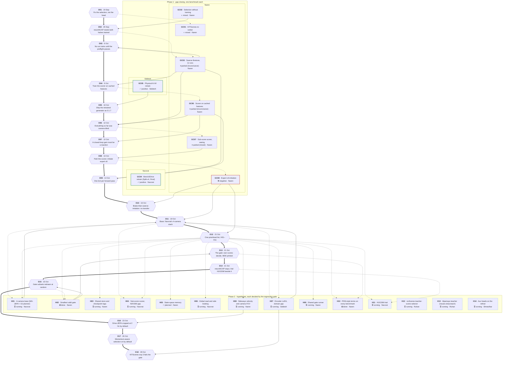

<h1 align="center">
   Gallops
</h1>

<p align="center"><strong>Gallops trains driving policies. <a href="https://github.com/FastCodeAI/Paddock">Paddock</a> scores them. Neither repo imports the other.</strong></p>

<p align="center">
  <a href="pyproject.toml"></a>
  <a href="pyproject.toml"></a>
  <a href="https://github.com/astral-sh/ruff"></a>
  <a href="#quickstart"></a>
  <a href="docs/reviewing.md"></a>
</p>
<p align="center">
<!-- experiments:badges -->
  <a href="#gap-closing-experiments"></a>
  <a href="#hypothesis-experiments"></a>
  <a href="#regression-gate-log"></a>
  <a href="#where-we-are"></a>
<!-- /experiments:badges -->
</p>

Gallops takes a driving model, trains it, and writes a checkpoint that paddock
scores on the same benchmarks, with the same machinery, that scored the vendor
models first. We are building a JEPA-based model of our own, and **this README
is its evidence**: every experiment that shaped it, who ran it, what it trained
on, which checkpoint it wrote, what it measured and how strongly, and what the
team decided next.

None of the tables below is typed by hand. Each experiment keeps its facts in
`experiments/<ID>_<slug>/experiment.toml`; the tables, the decision path and
the gate log are rendered from those files by `gallops experiments render`, and
`make check` fails if this page says anything they do not. The rules are in
[docs/experiments.md](docs/experiments.md).

The work has had two phases:

- **Phase 1, gap closing (GC).** Each of us took some benchmarks and tried to
  close released Drive-JEPA's gap on them — Naren on KITScenes, nuScenes and
  neuroNCAP; Navvrat on Bench2Drive and NAVSIM; Siddesh on AlpaSim and
  KITScenes.
- **Phase 2, hypotheses (H).** It began with the 4-camera approach. On 19 Oct
  the team agreed Navvrat's 4-camera stack as the base, and since 21 Oct we test
  one structural hypothesis at a time, each decided by paddock's regression
  gate.

## Where we are

<!-- experiments:status -->
- **Base model:** the 4-camera stack (`H01.run2`), agreed as the base on 19 Oct and not yet through the gate; gate comparisons are still against released Drive-JEPA — since D11, 19 Oct 2026.
- **Shipped version:** none yet. `gallops-v0.1` is the first checkpoint the gate says SHIP to against the base ([how versions are earned](docs/experiments.md#versions)).
- **Last gate run:** 28 Oct · [H01.run2](experiments/H01_four_camera_base/CARD.md) · ⏸ **HOLD**.
- **Hypotheses in progress:** [H01](experiments/H01_four_camera_base/CARD.md) 4-camera base (WA-JEPA + DJ planner) (Navvrat), [H04](experiments/H04_subscore_scorer_navsim/CARD.md) Sub-score scorer, NAVSIM gap (Navvrat, Siddesh), [H06](experiments/H06_global_read/CARD.md) Global read and side braking (Navvrat), [H07](experiments/H07_encoder_lora/CARD.md) Encoder LoRA, domain gap (Siddesh), [H08](experiments/H08_sideways_velocity_fov/CARD.md) Sideways velocity and camera FOV (Naren), [H14](experiments/H14_aux_heads/CARD.md) Aux heads on the refiner (Shreedhar).
- **Enablers in progress:** [H03](experiments/H03_shared_store_and_tags/CARD.md) Shared store and checkpoint tags (Naren), [H09](experiments/H09_shared_runner/CARD.md) Shared gate runner (Naren), [H11](experiments/H11_hugsim/CARD.md) HUGSIM trial (Navvrat), [H12](experiments/H12_nuscenes_teacher_scenes/CARD.md) nuScenes teacher-scene selector (Ruhan), [H13](experiments/H13_alpamayo_teacher/CARD.md) Alpamayo teacher (reuses draw.teach) (Ruhan).
- **Next, by priority:** [H05](experiments/H05_ssm_memory/CARD.md) State-space memory.
<!-- /experiments:status -->

## The decision path

Decisions run down the middle in date order; each is fed by the experiments
that were its evidence (solid arrows) and leads to the next ones (dotted). Click
an ID in any table below for that experiment's card.

<!-- experiments:flow -->

<!-- /experiments:flow -->

<a id="training-so-far"></a>

## Gap-closing experiments

Every row starts from the released Drive-JEPA checkpoint. The headline is the
one result that best states the outcome. **Click an ID for the experiment's
card**: every run with its data, code and checkpoint sha256, every result, the
gate verdicts and the checks that decided something.

<!-- experiments:gap-closing -->
| ID | Experiment | Owner | Benchmark | Headline result | Strength | Outcome | Checkpoint | Record |
|---|---|---|---|---|---|---|---|---|
| [**GC01**](experiments/GC01_rerank_kitscenes/CARD.md) | KITScenes re-ranker | Naren | KITScenes, nuScenes, neuroNCAP | KITScenes ADE@3s (m) 2.521 → **0.973** (n=223 samples) | ●●●○ strong · adapted, open-loop | ◐ mixed | `2050b799e8e8` | [account](experiments/GC01_rerank_kitscenes/README.md) |
| [**GC02**](experiments/GC02_selection_without_training/CARD.md) | Selection without training | Naren, Siddesh | AlpaSim, neuroNCAP | AlpaSim scene_score 0.4209 → **0.5433** (n=30 scenes) | ●●○○ moderate | ◐ mixed | — | [account](experiments/GC02_selection_without_training/README.md) |
| [**GC03**](experiments/GC03_swerve_finetune/CARD.md) | Swerve finetune, 11 runs | Naren | neuroNCAP, offline | neuroNCAP ncap_score 3.568 → **3.671** (n=20 scenario pairs) | ○○○○ unverified · blind | ⏸ parked (inconclusive) | `78071f68af07` | [account](experiments/GC03_swerve_finetune/README.md) |
| [**GC04**](experiments/GC04_bench2drive/CARD.md) | Bench2Drive retrain (Split-v4, Final) | Navvrat | Bench2Drive | Bench2Drive mean driving score 57.60 → **73.6** (n=50 routes) | ●●○○ moderate · adapted, selected-on-report, no-record | ✅ positive | — | [account](experiments/GC04_bench2drive/README.md) |
| [**GC05**](experiments/GC05_physicalai_retrain/CARD.md) | Physical AI AV retrain | Siddesh | AlpaSim | AlpaSim scene_score 0.5433 → **0.7697** (n=30 scenes) | ●●○○ moderate · adapted | ✅ positive | `29d5f9517c2e` | [account](experiments/GC05_physicalai_retrain/README.md) |
| [**GC06**](experiments/GC06_scorer_cache/CARD.md) | Scorer on cached features | Naren | offline, neuroNCAP | offline held-out collision ranking AUC, worst of 5 folds 0.59 → **0.660** (n=5 scenes) | ●●○○ moderate · blind, open-loop | ⏸ parked (inconclusive) | — | [account](experiments/GC06_scorer_cache/README.md) |
| [**GC07**](experiments/GC07_subscore_scorer/CARD.md) | Sub-score scorer, seeing | Naren | neuroNCAP | neuroNCAP ncap_score, frontal 2.36 → **5.00** (n=3 runs) | ●●○○ moderate · smoke, adapted, no-record | ⏸ parked (mixed) | `b6e0c778e9f0` | [on branch ⎇](https://github.com/FastCodeAI/Gallops/blob/expert/v6-imitation/docs/brake-swerve-expert.md) |
| [**GC08**](experiments/GC08_expert_v6_imitation/CARD.md) | Expert v6 imitation | Naren | neuroNCAP, nuScenes | neuroNCAP ncap_score, mean of 3 shapes 3.01 → **2.31** (n=9 runs) | ●●○○ moderate · smoke, adapted, no-record | ❌ negative | `305892faf6bb` | [on branch ⎇](https://github.com/FastCodeAI/Gallops/blob/expert/v6-imitation/docs/brake-swerve-expert.md) |
<!-- /experiments:gap-closing -->

How to read it:

- **Nothing here is yet a closed-loop safety gain** shown on a split nothing was
  chosen on. The strongest result is the re-ranker's open-loop gain on
  KITScenes, and the same weights do worse on neuroNCAP.
- **Every swerve and scorer-cache run was camera-blind.** Paddock and the
  trainer both placed the cameras relative to nuScenes' LIDAR_TOP, so no image
  reached the model; a black frame gave the same plan. Those numbers are what
  the runs measured, but they say nothing about learning to *see* a hazard. The
  trainer is fixed and its preflight now refuses a model that a blanked camera
  does not move.
- **The swerve runs also trained at batch 8, and scorer cache v1 was built at
  batch 4.** The vendor model mixes ticks within a batch, which did not matter
  while it was blind but would from the first run that sees. Every forward pass
  is now one tick, so any rerun trains differently.
- **Several shipped sidecars are known to be wrong about their own run,** and
  were left as written rather than hand-edited. Each is marked ⚠️ in the
  details.
- **Bench2Drive and AlpaSim runs are one run per route or scene,** so a
  difference of a few points is not a result on its own.

## Hypothesis experiments

One structural change at a time on the agreed base, each with its predictions
written down before it runs and its checkpoint put through the
[regression gate](#regression-gate-log). Priority is the team's order of
21 Oct; IDs never change.

<!-- experiments:hypotheses -->
| ID | Hypothesis | Owner | Priority | Status | Runs | Headline result | Strength | Gate |
|---|---|---|:-:|---|---|---|---|---|
| [**H01**](experiments/H01_four_camera_base/CARD.md) | 4-camera base (WA-JEPA + DJ planner) | Navvrat | 1 | ⏳ running | `run2` | NAVSIM navtest EPDMS, human filter 87.78 → **85.27** (n=12,146 scenes) | ●●○○ moderate · adapted, open-loop | ⏸ **HOLD** 28 Oct |
| [**H04**](experiments/H04_subscore_scorer_navsim/CARD.md) | Sub-score scorer, NAVSIM gap | Navvrat, Siddesh | 4 | ⏳ running | `agent-decoder`, `run3a` | NAVSIM navtest EPDMS, human filter, locked pick 87.78 → **87.30** (n=12,146 scenes) | ●●○○ moderate · adapted, open-loop | — |
| [**H05**](experiments/H05_ssm_memory/CARD.md) | State-space memory | Naren | 5 | 📝 planned | — | — | — | — |
| [**H06**](experiments/H06_global_read/CARD.md) | Global read and side braking | Navvrat | 6 | ⏳ running | `navsim_off`, `b2d_off` | NAVSIM score, global read off 0.870 → **0.852** (n=500 scenes) | ●●○○ moderate · no-record, open-loop | — |
| [**H07**](experiments/H07_encoder_lora/CARD.md) | Encoder LoRA, domain gap | Siddesh | 7 | ⏳ running | `exp1`, `exp2a`, `exp2b`, `exp3` | KITScenes pick ADE (3 s), m 2.372 → **1.879** (n=223 moments) | ●●○○ moderate · adapted, open-loop | ⛔ **FAIL** 28 Oct |
| [**H08**](experiments/H08_sideways_velocity_fov/CARD.md) | Sideways velocity and camera FOV | Naren | 8 | ⏳ running | `crop` | KITScenes ADE (m), cropped 3.222 → **2.521** (n=223 keyframes) | ●●○○ moderate · open-loop | — |
| [**H14**](experiments/H14_aux_heads/CARD.md) | Aux heads on the refiner | Shreedhar | — | ⏳ running | `C`, `T1`, `T2` | nuScenes picked-plan L2 at 3 s, m 3.760 → **2.934** (n=2,996 keyframes) | ●●○○ moderate · adapted, open-loop | — |
<!-- /experiments:hypotheses -->

### Enablers

What the hypotheses need before they can be decided.

<!-- experiments:enablers -->
| ID | Enabler | Owner | Priority | Status | What it gives the team |
|---|---|---|:-:|---|---|
| [**H02**](experiments/H02_smallest_valid_gate/CARD.md) | Smallest valid gate | Naren | 2 | ☑️ done | Smallest drop each subset detects (80% power): neuroNCAP closed tier 0.73 for a small change and 2.85 for a big one, out of 5; its quick tier 2.5 / 6.7, a pipeline check only; NAVSIM about 0.0035; KITScenes 0.51 m for a big change; Bench2Drive only 17–38 points; AlpaSim about 0.23, argued. |
| [**H03**](experiments/H03_shared_store_and_tags/CARD.md) | Shared store and checkpoint tags | Naren | 3 | ⏳ running | So far: the paddock account and a paddock group holding the three of us exist on shakaal; paddock's gate queue (#109, 26 Oct) copies every submitted checkpoint into a shared store named by its sha256. |
| [**H09**](experiments/H09_shared_runner/CARD.md) | Shared gate runner | Naren | 9 | ⏳ running | So far: the queue landed (paddock #109, 26 Oct) and runs as the paddock account, one job at a time, with each submitted checkpoint copied into a shared store by its sha256 and the code pinned to a pushed commit; by 27 Oct it had made Drive-JEPA's quick- and closed-tier baselines and gated a teammate's candidate. |
| [**H10**](experiments/H10_pdm_terms/CARD.md) | PDM-style terms on every benchmark | Naren | 10 | ☑️ done | paddock #102, merged 22 Oct: NAVSIM's five terms print under every gate pair, as far as each benchmark can measure them, and never change a verdict. neuroNCAP has all five by NAVSIM's rules, its collision check agreeing with neuroNCAP's own on 600 of 600 stored runs; NAVSIM has all five; AlpaSim NC, DAC and EP; nuScenes NC, EP and C; Bench2Drive NC and EP; KITScenes and nuPlan EP and C. |
| [**H11**](experiments/H11_hugsim/CARD.md) | HUGSIM trial | Navvrat | 11 | ⏳ running | So far: HUGSIM is a paddock benchmark (#118, merged 27 Oct PDT, 28 Oct IST) on 420 of the release's 436 scenarios (16 fail for every model), with upstream PR #57's controller fix. |
| [**H12**](experiments/H12_nuscenes_teacher_scenes/CARD.md) | nuScenes teacher-scene selector | Ruhan | — | ⏳ running | A selector that scores every eligible nuScenes train scene and picks 12 training scenes by turn / curve / straight quota plus 3 disjoint validation scenes, with paddock's own 3 s, 2.0 m command rule; an annotator draws the 'good actor' boxes on each pick's front video for human review. |
| [**H13**](experiments/H13_alpamayo_teacher/CARD.md) | Alpamayo teacher (reuses draw.teach) | Ruhan | — | ⏳ running | A thin adapter reshapes draw.teach()'s plan to six waypoints at 0.5 s, records labels per tick the way label.py does for Drive-JEPA, and flags a tick-to-tick swerve direction flip rather than forcing commitment. |
<!-- /experiments:enablers -->

## Regression gate log

Every checkpoint we would keep goes through paddock's gate
(`python -m tools.gate`, paddock `docs/gate.md`): candidate minus baseline on
fixed subsets, paired sample by sample, standard errors clustered by scene, pair
or route. Any REGRESSION fails the checkpoint; a closed-loop GAIN with nothing
regressing ships it; anything else holds. Bench2Drive's 7 routes and the quick
tier's 3 neuroNCAP episodes can fail a checkpoint but cannot ship one.

<!-- experiments:gate -->
| Date | Run | Checkpoint | Tier | NAVSIM | KITScenes | nuScenes | neuroNCAP | Bench2Drive | AlpaSim | Verdict |
|---|---|---|---|---|---|---|---|---|---|---|
| 20 Oct 2026 | [H02.timing](experiments/H02_smallest_valid_gate/CARD.md) | `740335c800e2` | all | ⚪ 0.875 → 0.875 | ⚪ 3.222 → 3.222 | ⚪ 2.497 → 2.497 | ⚪ 3.175 → 3.175 | ⚪ | — | ⏸ **HOLD** |
| 21 Oct 2026 | [H01.run2](experiments/H01_four_camera_base/CARD.md) | `f8ce667cdcd7` | quick | ⚪ 0.875 → 0.863 | 🟢 3.222 → 1.969 | 🟢 2.497 → 1.956 | — | ⚪ 58.801 → 62.757 | — | ⏸ **HOLD** |
| 27 Oct 2026 | [H01.run2](experiments/H01_four_camera_base/CARD.md) | `f8ce667cdcd7` | closed | — | — | — | ⚪ 3.679 → 3.28 | — | — | ⏸ **HOLD** |
| 28 Oct 2026 | [H01.run2](experiments/H01_four_camera_base/CARD.md) | `f8ce667cdcd7` | quick | — | 🟢 2.537 → 2.001 | 🟢 2.431 → 2.057 | — | — | — | ⏸ **HOLD** |
| 28 Oct 2026 | [H07.exp3](experiments/H07_encoder_lora/CARD.md) | `91e13bc38aa7` | all | 🔴 0.8572 → 0.7533 | 🟢 2.5375 → 0.9204 | 🟢 2.4314 → 0.9152 | ⚪ 3.6792 → 2.7265 | 🔴 59.0360 → 0.2686 | 🔴 0.4344 → 0.1158 | ⛔ **FAIL** |
<!-- /experiments:gate -->

## Decision log

<!-- experiments:decisions -->
| # | Date | Decision | By | Evidence | Led to |
|---|---|---|---|---|---|
| **D01** | 19 Sep 2026 | First target: Drive-JEPA's choice among its 32 candidates, not its trajectory head. On KITScenes the best candidate is 0.37 m from the human path and the pick 2.36 m; a re-ranker over the frozen model's candidates attacks that gap and proves the train → checkpoint → paddock loop on the way. | Naren | — | [GC01](experiments/GC01_rerank_kitscenes/CARD.md) |
| **D02** | 26 Sep 2026 | Selection alone cannot fix neuroNCAP: no signal in the released model picks a clear plan on the rescue ticks (0 of 322), and the scorer rates injected swerves below the colliding plan. Fine-tune both halves — propose evasive swerves and choose them — on hazards inserted into scenes outside the benchmark. | Naren | [GC02.signals](experiments/GC02_selection_without_training/CARD.md), [GC02.inject](experiments/GC02_selection_without_training/CARD.md) | [GC03](experiments/GC03_swerve_finetune/CARD.md) |
| **D03** | 6 Oct 2026 | Defect 6: swerve runs v1–v4 graded every tick from the first tick's pose. From now on every training run passes the preflight — code committed, grading reproduced, inputs rebuilt faithfully — before its first step, and there is no way to skip it. | Naren | [GC03.v4](experiments/GC03_swerve_finetune/CARD.md) | [GC03.v4fix](experiments/GC03_swerve_finetune/CARD.md) |
| **D04** | 9 Oct 2026 | s1–s3 ended at a random ranking loss. Train the scorer alone on cached features from the frozen encoder and refiner, with sub-score heads, so a run takes minutes and can be checked scene by scene. | Naren | [GC03.s1](experiments/GC03_swerve_finetune/CARD.md), [GC03.s2](experiments/GC03_swerve_finetune/CARD.md), [GC03.s3](experiments/GC03_swerve_finetune/CARD.md) | [GC06](experiments/GC06_scorer_cache/CARD.md) |
| **D05** | 10 Oct 2026 | After its 30-scene trial, the second run's merged checkpoint — released encoder, first-run scorer, second-run generator — drives AlpaSim as driver 0.1.7. | Siddesh | [GC05.run2](experiments/GC05_physicalai_retrain/CARD.md) | — |
| **D06** | 12 Oct 2026 | Paddock and the trainer placed the cameras relative to nuScenes' LIDAR_TOP, so no image reached the model in any swerve or scorer-cache run. Those numbers stand as what they measured, not as evidence about seeing; the caches are to be rebuilt, and the preflight now refuses a model a blanked camera does not move. | Naren | [GC03](experiments/GC03_swerve_finetune/CARD.md), [GC06](experiments/GC06_scorer_cache/CARD.md) | [GC07](experiments/GC07_subscore_scorer/CARD.md) |
| **D07** | 12 Oct 2026 | A closed-loop gain counts only once the switches behind it are shown to differ between scenarios: the scorer-cache model's 0103 gain was a drift that happened to clear the car, not an avoidance. | Naren | [GC06.relative-0103](experiments/GC06_scorer_cache/CARD.md) | — |
| **D08** | 13 Oct 2026 | Park the sub-score scorer: on the seeing model it overrode the pick from 0.5 s in every scenario and flipped side. Teach the manoeuvre through the model's own generator instead, with expert v6 — brake for stationary and side hazards, brake then swerve onto free road for oncoming ones — as the one consistent driver to imitate. | Naren | [GC07.sighted-v1](experiments/GC07_subscore_scorer/CARD.md) | [GC08](experiments/GC08_expert_v6_imitation/CARD.md) |
| **D09** | 14 Oct 2026 | The vendor model mixes ticks within a batch, so every forward pass is now one tick. The batch-8 swerve runs and the batch-4 cache v1 would train differently today; a rerun is a new run. | Naren | [GC03](experiments/GC03_swerve_finetune/CARD.md), [GC06.v1](experiments/GC06_scorer_cache/CARD.md) | — |
| **D10** | 16 Oct 2026 | Concluded negative: the swerve is learned on the five training scenes but lost on unseen streets (round 2 on 0103: 2.31 against 3.01 released), and each new reconstructed scene costs about 7.5 GPU-hours. | Naren | [GC08.v6-r1a-loso0075](experiments/GC08_expert_v6_imitation/CARD.md), [GC08.v6-r1b-all](experiments/GC08_expert_v6_imitation/CARD.md), [GC08.v6-r2-short](experiments/GC08_expert_v6_imitation/CARD.md) | — |
| **D11** | 19 Oct 2026 | The three tracks merge into one base: Navvrat's 4-camera stack — WA-JEPA's encoder over four views, Drive-JEPA's planner with path reads and a global read. All three tracks found the scorer is the weak part. Still open: close its NAVSIM gap before the gate, rebase its adapter onto the camera fix, repeat the LoRA on its encoder. | team | [H01.run2](experiments/H01_four_camera_base/CARD.md), [H07.exp1](experiments/H07_encoder_lora/CARD.md), [GC08](experiments/GC08_expert_v6_imitation/CARD.md) | [H01](experiments/H01_four_camera_base/CARD.md), [H04](experiments/H04_subscore_scorer_navsim/CARD.md), [H07](experiments/H07_encoder_lora/CARD.md) |
| **D12** | 21 Oct 2026 | The hypothesis phase runs as one list in priority order, proposed 21 Oct: enablers first, then the hypotheses that most directly get the base through the gate. Dropped: the scene-count curve (the imitation overfits, and a scene costs about 7.5 GPU-hours) and more cameras for side crashes (the front camera already sees the crossing car). | team | [GC08](experiments/GC08_expert_v6_imitation/CARD.md) | [H01](experiments/H01_four_camera_base/CARD.md), [H02](experiments/H02_smallest_valid_gate/CARD.md), [H03](experiments/H03_shared_store_and_tags/CARD.md), [H04](experiments/H04_subscore_scorer_navsim/CARD.md), [H05](experiments/H05_ssm_memory/CARD.md), [H06](experiments/H06_global_read/CARD.md), [H07](experiments/H07_encoder_lora/CARD.md), [H08](experiments/H08_sideways_velocity_fov/CARD.md), [H09](experiments/H09_shared_runner/CARD.md), [H10](experiments/H10_pdm_terms/CARD.md), [H11](experiments/H11_hugsim/CARD.md) |
| **D13** | 21 Oct 2026 | Each benchmark's own score keeps deciding the gate; the PDM-style terms are shown beside it and may decide later, one benchmark at a time. The subset sizes stay (20 pairs × 1 seed was not adopted), and every verdict prints its minimum detectable effect. | Naren | [H02.mde](experiments/H02_smallest_valid_gate/CARD.md), [H02.timing](experiments/H02_smallest_valid_gate/CARD.md) | [H10](experiments/H10_pdm_terms/CARD.md) |
| **D14** | 21 Oct 2026 | neuroNCAP stays the crash benchmark; HUGSIM is trialled beside it on a slice, checked by reproducing WA-JEPA's published 0.4462, before deciding whether to adopt it. | team | — | [H11](experiments/H11_hugsim/CARD.md) |
| **D15** | 23 Oct 2026 | Every gate subset is drawn at random within groups of turns, speeds and places (seed 20261022), replacing the hand-forced subsets of 21 Oct; neuroNCAP's closed tier becomes 15 pairs × 1 seed. | Naren | [H02.mde](experiments/H02_smallest_valid_gate/CARD.md) | [H02](experiments/H02_smallest_valid_gate/CARD.md) |
| **D16** | 23 Oct 2026 | Drive-JEPA runs with the OpenScene crop and plans twice a second on every benchmark by default, and the queue's baselines are remade under it. | Naren | [H08.crop](experiments/H08_sideways_velocity_fov/CARD.md) | — |
| **D17** | 26 Oct 2026 | Paddock's Drive-JEPA adapter selects with momentum by default, as the published method does; Drive-JEPA baselines from here on include it. | Siddesh | — | — |
| **D18** | 28 Oct 2026 | The encoder + generator + scorer checkpoint trained on KITScenes fails the gate (NAVSIM, Bench2Drive and AlpaSim regress); its checkpoints stay a research record, not for deployment. | Siddesh | [H07.exp3](experiments/H07_encoder_lora/CARD.md) | — |
<!-- /experiments:decisions -->

## How to read these tables

| Mark | Means |
|---|---|
| ●●●● proof · ●●●○ strong · ●●○○ moderate · ●○○○ argued · ○○○○ unverified | how strongly the evidence supports the number: paddock's ladder ([docs/conventions.md](docs/conventions.md)) |
| `adapted` | trained on the benchmark's own domain |
| `blind` | measured before the 12 Oct camera fix: no image reached the model |
| `smoke` | one scene or a few episodes: a pipeline check, not a result |
| `selected-on-report` | the variant was chosen on the split it is reported on |
| `open-loop` | measured against logged driving, not driven |
| `no-record` | the evidence is not yet committed to any repository |
| ✅ positive · ❌ negative · ◐ mixed · ❔ inconclusive · ☑️ done | how a finished experiment came out (☑️ for an enabler) |
| ⏳ running · 📝 planned · ⏸ parked · 🗑 dropped | an experiment that has not finished |
| 🟢 GAIN · ⚪ NEUTRAL · 🔴 REGRESSION · ▫️ no verdict | a regression-gate pair |
| 🚀 SHIP · ⏸ HOLD · ⛔ FAIL | the gate's overall verdict |
| `29d5f9517c2e` | a checkpoint's tag: the first 12 hex digits of its weights' sha256; the details give it in full. "—" means it was never recorded |
| **GC05**, **H07**, … | an experiment's ID: it opens the experiment's card, `experiments/<ID>_<slug>/CARD.md` |
| on branch ⎇ | the record is on a branch not yet merged |

## Recording an experiment

```bash
gallops experiments new H15 my_hypothesis --owner Naren   # folder from experiments/_template
$EDITOR experiments/H15_my_hypothesis/PREDICTIONS.md      # commit it before anything trains
gallops experiments checkpoint <step dir>                  # the [runs.checkpoint] block, by weights sha256
gallops experiments render --write                         # re-render this README and the cards
gallops experiments check                                  # what make check enforces
```

[docs/experiments.md](docs/experiments.md) has the rules: IDs and names,
versions, where code and data go, how to record a gate verdict, and how a branch
moves onto the registry. [experiments/README.md](experiments/README.md) indexes
every folder and maps every module in `src/gallops` to the runs that used it.

## Quickstart

```bash
make setup                                  # .venv + install (no torch)
source .venv/bin/activate

cp gallops.toml.example gallops.toml
$EDITOR gallops.toml                        # point at YOUR weights, runs and data

gallops config                              # what this machine resolved
gallops show <checkpoint dir>               # what a checkpoint claims about itself
gallops train-rerank <dataset.npz> --train-run <name>   # see gallops/train/rerank.py
python -m gallops.data.rerank keyframes|dataset ...     # its training data; see gallops/data/rerank.py
```

Point `[roots.weights]` at **the same directory as paddock's
`[roots.weights]`**. That is the whole mechanism by which paddock finds a model
this repo trained.

The training stack is a separate extra, so a machine with no GPU can still run
the gate:

```bash
uv pip install --python .venv/bin/python -e ".[train]"
```

The two repos meet at a directory on disk:

```
{weights}/<model>/<train_run>/step_<n>/
    checkpoint.json      <- the entire contract
    model.safetensors
```

Gallops writes it. Paddock reads it, scores the model, and puts the result in
the same table as every other model. That separation is the point; see
[why](#why-two-repos).

| Where | What |
|---|---|
| [experiments/](experiments/) | one folder per experiment: `experiment.toml` (the facts), `CARD.md` (rendered from them), the account, the predictions, and the scripts as they ran |
| [src/gallops/train/](src/gallops/train/) | the trainers: the KITScenes re-ranker, the swerve finetune, the scorer on cached features, and the preflight and safety checks they must pass |
| [src/gallops/expert/](src/gallops/expert/) | the expert that draws evasion and braking targets offline, and the grader every plan is judged by |
| [src/gallops/data/](src/gallops/data/) | training-data builders: the re-ranker's dataset, real nuScenes scenes as episodes |
| [src/gallops/drivejepa_b2d/](src/gallops/drivejepa_b2d/), [recipes/](recipes/) | the Bench2Drive training, as a recipe that prints or runs its commands |
| [checkpoint.py](src/gallops/checkpoint.py), [config.py](src/gallops/config.py) | the checkpoint contract, and the only code that knows where anything lives on disk |
| [experiments.py](src/gallops/experiments.py) | the experiment registry: validates every record and renders this README |

The names: a paddock is the enclosure where a horse is paraded and judged
before a race. The gallops is the training ground where it is made fast.

## Why two repos

Four reasons, in increasing order of importance:

1. **Engineering.** Paddock's dependency list is six packages and its `make
   check` runs in a clean environment with no GPU. Putting torch in there makes
   its gate heavy and breaks the invariant that paddock never imports a model.
2. **Data isolation.** The strategy is to attract OEMs who bring their own data.
   That data arrives under terms that do not permit it to sit beside a repo we
   publish results from. The separation has to exist before the first
   conversation, not after.
3. **Our own numbers stay trustworthy to us.** Paddock's claim is that an ADE
   and an NCAP score are "statements about the same model, run the same way".
   The moment our model gets a privilege the vendors' do not have — in-process
   access, a special data path, a shortcut past the HTTP node — we lose the
   ability to tell whether we are actually gaining on them.
4. **Paddock's credibility is the commercial asset.** A leaderboard maintained
   by the party that also trains the winning entry is marketing. A leaderboard
   where our model is one adapter among six, scored by machinery that predates
   it and scored four competitors first, is evidence. **Keeping the scorer
   separate from the trainee is what makes the numbers persuasive to somebody
   who does not work here.**

## Documentation

| Doc | Read it when |
|---|---|
| [docs/STRATEGY.md](docs/STRATEGY.md) | **start here** — why this exists, what the evidence says, what to build |
| [docs/experiments.md](docs/experiments.md) | starting, running or recording an experiment — IDs, versions, where code and data go, the gate |
| [experiments/README.md](experiments/README.md) | finding an experiment's folder, or which runs used a module |
| [docs/architecture.md](docs/architecture.md) | designing or changing the model — what gallops-v0 is, and which choices are measured |
| [docs/checkpoints.md](docs/checkpoints.md) | writing or reading a checkpoint; the paddock contract |
| [docs/conventions.md](docs/conventions.md) | before training anything — frames, splits, what counts as a result |
| [docs/data.md](docs/data.md) | what data exists, what does not, and what must be fetched |
| [docs/reviewing.md](docs/reviewing.md) | reviewing a PR — what gets checked, and the 🔴 / 🟠 / 🟡 scale |
| `experiments/<ID>_<slug>/README.md` | the full account of one experiment — e.g. [GC03](experiments/GC03_swerve_finetune/README.md), the swerve finetune and the defects its measurements exposed; [GC05](experiments/GC05_physicalai_retrain/README.md), the Physical AI AV retrain |

## Licence

Apache-2.0, matching paddock.
