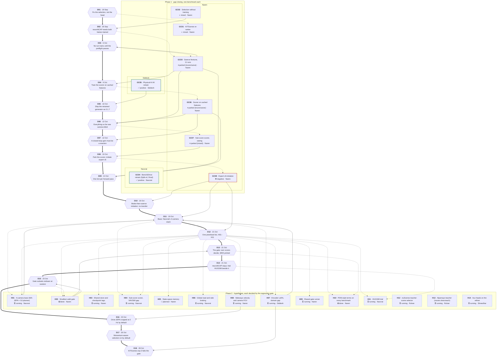

<h1 align="center">
   Gallops
</h1>

<p align="center"><strong>Gallops trains driving policies. <a href="https://github.com/FastCodeAI/Paddock">Paddock</a> scores them. Neither repo imports the other.</strong></p>

<p align="center">
  <a href="pyproject.toml"></a>
  <a href="pyproject.toml"></a>
  <a href="https://github.com/astral-sh/ruff"></a>
  <a href="#quickstart"></a>
  <a href="docs/reviewing.md"></a>
</p>
<p align="center">
<!-- experiments:badges -->
  <a href="#gap-closing-experiments"></a>
  <a href="#hypothesis-experiments"></a>
  <a href="#regression-gate-log"></a>
  <a href="#where-we-are"></a>
<!-- /experiments:badges -->
</p>

Gallops takes a driving model, trains it, and writes a checkpoint that paddock
scores on the same benchmarks, with the same machinery, that scored the vendor
models first. We are building a JEPA-based model of our own, and **this README
is its evidence**: every experiment that shaped it, who ran it, what it trained
on, which checkpoint it wrote, what it measured and how strongly, and what the
team decided next.

None of the tables below is typed by hand. Each experiment keeps its facts in
`experiments/<ID>_<slug>/experiment.toml`; the tables, the decision path and
the gate log are rendered from those files by `gallops experiments render`, and
`make check` fails if this page says anything they do not. The rules are in
[docs/experiments.md](docs/experiments.md).

The work has had two phases:

- **Phase 1, gap closing (GC).** Each of us took some benchmarks and tried to
  close released Drive-JEPA's gap on them — Naren on KITScenes, nuScenes and
  neuroNCAP; Navvrat on Bench2Drive and NAVSIM; Siddesh on AlpaSim and
  KITScenes.
- **Phase 2, hypotheses (H).** It began with the 4-camera approach. On 19 Oct
  the team agreed Navvrat's 4-camera stack as the base, and since 21 Oct we test
  one structural hypothesis at a time, each decided by paddock's regression
  gate.

## Where we are

<!-- experiments:status -->
- **Base model:** the 4-camera stack (`H01.run2`), agreed as the base on 19 Oct and not yet through the gate; gate comparisons are still against released Drive-JEPA — since D11, 19 Oct 2026.
- **Shipped version:** none yet. `gallops-v0.1` is the first checkpoint the gate says SHIP to against the base ([how versions are earned](docs/experiments.md#versions)).
- **Last gate run:** 28 Oct · [H07.exp3](#h07) · ⛔ **FAIL** — regressed on NAVSIM, Bench2Drive, AlpaSim.
- **Hypotheses in progress:** [H01](#h01) 4-camera base (WA-JEPA + DJ planner) (Navvrat), [H04](#h04) Sub-score scorer, NAVSIM gap (Navvrat, Siddesh), [H06](#h06) Global read and side braking (Navvrat), [H07](#h07) Encoder LoRA, domain gap (Siddesh), [H08](#h08) Sideways velocity and camera FOV (Naren), [H14](#h14) Aux heads on the refiner (Shreedhar).
- **Enablers in progress:** [H03](#h03) Shared store and checkpoint tags (Naren), [H09](#h09) Shared gate runner (Naren), [H11](#h11) HUGSIM trial (Navvrat), [H12](#h12) nuScenes teacher-scene selector (Ruhan), [H13](#h13) Alpamayo teacher (reuses draw.teach) (Ruhan).
- **Next, by priority:** [H05](#h05) State-space memory.
<!-- /experiments:status -->

## The decision path

Decisions run down the middle in date order; each is fed by the experiments
that were its evidence (solid arrows) and leads to the next ones (dotted). Click
an ID in any table for the full record.

<!-- experiments:flow -->

<!-- /experiments:flow -->

<a id="training-so-far"></a>

## Gap-closing experiments

Every row starts from the released Drive-JEPA checkpoint. The headline is the
one result that best states the outcome; every other result is in the
experiment's [details](#experiment-details).

<!-- experiments:gap-closing -->
| ID | Experiment | Owner | Benchmark | Headline result | Strength | Outcome | Checkpoint | Record |
|---|---|---|---|---|---|---|---|---|
| [**GC01**](#gc01) | KITScenes re-ranker | Naren | KITScenes, nuScenes, neuroNCAP | KITScenes ADE@3s (m) 2.521 → **0.973** (n=223 samples) | ●●●○ strong · adapted, open-loop | ◐ mixed | `2050b799e8e8` | [record](experiments/GC01_rerank_kitscenes/README.md) |
| [**GC02**](#gc02) | Selection without training | Naren, Siddesh | AlpaSim, neuroNCAP | AlpaSim scene_score 0.4209 → **0.5433** (n=30 scenes) | ●●○○ moderate | ◐ mixed | — | [record](experiments/GC02_selection_without_training/README.md) |
| [**GC03**](#gc03) | Swerve finetune, 11 runs | Naren | neuroNCAP, offline | neuroNCAP ncap_score 3.568 → **3.671** (n=20 scenario pairs) | ○○○○ unverified · blind | ⏸ parked (inconclusive) | `e7cda1681023` | [record](experiments/GC03_swerve_finetune/README.md) |
| [**GC04**](#gc04) | Bench2Drive retrain (Split-v4, Final) | Navvrat | Bench2Drive | Bench2Drive mean driving score 57.60 → **73.6** (n=50 routes) | ●○○○ argued · adapted, selected-on-report, no-record | ✅ positive | — | [record](experiments/GC04_bench2drive/README.md) |
| [**GC05**](#gc05) | Physical AI AV retrain | Siddesh | AlpaSim | AlpaSim scene_score 0.5433 → **0.7697** (n=30 scenes) | ●●○○ moderate · adapted | ✅ positive | `29d5f9517c2e` | [record](experiments/GC05_physicalai_retrain/README.md) |
| [**GC06**](#gc06) | Scorer on cached features | Naren | offline, neuroNCAP | offline held-out collision ranking AUC, worst of 5 folds 0.59 → **0.660** (n=5 scenes) | ●●○○ moderate · blind, open-loop | ⏸ parked (inconclusive) | — | [record](experiments/GC06_scorer_cache/README.md) |
| [**GC07**](#gc07) | Sub-score scorer, seeing | Naren | neuroNCAP | neuroNCAP ncap_score, frontal 2.36 → **5.00** (n=3 runs) | ●○○○ argued · smoke, adapted, no-record | ⏸ parked (mixed) | `1f11144e697e` | [on branch ⎇](https://github.com/FastCodeAI/Gallops/blob/expert/v6-imitation/docs/brake-swerve-expert.md) |
| [**GC08**](#gc08) | Expert v6 imitation | Naren | neuroNCAP, nuScenes | neuroNCAP ncap_score, mean of 3 shapes 3.01 → **2.31** (n=9 runs) | ●○○○ argued · smoke, adapted, no-record | ❌ negative | `916b930a38ea` | [on branch ⎇](https://github.com/FastCodeAI/Gallops/blob/expert/v6-imitation/docs/brake-swerve-expert.md) |
<!-- /experiments:gap-closing -->

How to read it:

- **Nothing here is yet a closed-loop safety gain** shown on a split nothing was
  chosen on. The strongest result is the re-ranker's open-loop gain on
  KITScenes, and the same weights do worse on neuroNCAP.
- **Every swerve and scorer-cache run was camera-blind.** Paddock and the
  trainer both placed the cameras relative to nuScenes' LIDAR_TOP, so no image
  reached the model; a black frame gave the same plan. Those numbers are what
  the runs measured, but they say nothing about learning to *see* a hazard. The
  trainer is fixed and its preflight now refuses a model that a blanked camera
  does not move.
- **The swerve runs also trained at batch 8, and scorer cache v1 was built at
  batch 4.** The vendor model mixes ticks within a batch, which did not matter
  while it was blind but would from the first run that sees. Every forward pass
  is now one tick, so any rerun trains differently.
- **Several shipped sidecars are known to be wrong about their own run,** and
  were left as written rather than hand-edited. Each is marked ⚠️ in the
  details.
- **Bench2Drive and AlpaSim runs are one run per route or scene,** so a
  difference of a few points is not a result on its own.

## Hypothesis experiments

One structural change at a time on the agreed base, each with its predictions
written down before it runs and its checkpoint put through the
[regression gate](#regression-gate-log). Priority is the team's order of
21 Oct; IDs never change.

<!-- experiments:hypotheses -->
| ID | Hypothesis | Owner | Priority | Status | Runs | Headline result | Strength | Gate |
|---|---|---|:-:|---|---|---|---|---|
| [**H01**](#h01) | 4-camera base (WA-JEPA + DJ planner) | Navvrat | 1 | ⏳ running | `run2` | NAVSIM navtest EPDMS, human filter 87.78 → **85.27** (n=12,146 scenes) | ●●○○ moderate · adapted, open-loop | — |
| [**H04**](#h04) | Sub-score scorer, NAVSIM gap | Navvrat, Siddesh | 4 | ⏳ running | `agent-decoder`, `run3a` | NAVSIM navtest EPDMS, human filter, locked pick 87.78 → **87.30** (n=12,146 scenes) | ●●○○ moderate · adapted, open-loop | — |
| [**H05**](#h05) | State-space memory | Naren | 5 | 📝 planned | — | — | — | — |
| [**H06**](#h06) | Global read and side braking | Navvrat | 6 | ⏳ running | `navsim_off`, `b2d_off` | NAVSIM score, global read off 0.870 → **0.852** (n=500 scenes) | ●○○○ argued · no-record, open-loop | — |
| [**H07**](#h07) | Encoder LoRA, domain gap | Siddesh | 7 | ⏳ running | `exp1`, `exp2a`, `exp2b`, `exp3` | KITScenes pick ADE (3 s), m 2.372 → **1.879** (n=223 moments) | ●●○○ moderate · adapted, open-loop | ⛔ **FAIL** 28 Oct |
| [**H08**](#h08) | Sideways velocity and camera FOV | Naren | 8 | ⏳ running | `crop` | KITScenes ADE (m), cropped 3.222 → **2.521** (n=223 keyframes) | ●●○○ moderate · open-loop | — |
| [**H14**](#h14) | Aux heads on the refiner | Shreedhar | — | ⏳ running | `C`, `T1`, `T2` | nuScenes picked-plan L2 at 3 s, m 3.760 → **2.934** (n=2,996 keyframes) | ●●○○ moderate · adapted, open-loop | — |
<!-- /experiments:hypotheses -->

### Enablers

What the hypotheses need before they can be decided.

<!-- experiments:enablers -->
| ID | Enabler | Owner | Priority | Status | What it gives the team |
|---|---|---|:-:|---|---|
| [**H02**](#h02) | Smallest valid gate | Naren | 2 | ☑️ done | Smallest drop each subset detects (80% power): neuroNCAP closed tier 0.73 for a small change and 2.85 for a big one, out of 5; its quick tier 2.5 / 6.7, a pipeline check only; NAVSIM about 0.0035; KITScenes 0.51 m for a big change; Bench2Drive only 17–38 points; AlpaSim about 0.23, argued. |
| [**H03**](#h03) | Shared store and checkpoint tags | Naren | 3 | ⏳ running | So far: the paddock account and a paddock group holding the three of us exist on shakaal; paddock's gate queue (#109, 26 Oct) copies every submitted checkpoint into a shared store named by its sha256. |
| [**H09**](#h09) | Shared gate runner | Naren | 9 | ⏳ running | So far: the queue landed (paddock #109, 26 Oct) and runs as the paddock account, one job at a time, with each submitted checkpoint copied into a shared store by its sha256 and the code pinned to a pushed commit; by 27 Oct it had made Drive-JEPA's quick- and closed-tier baselines and gated a teammate's candidate. |
| [**H10**](#h10) | PDM-style terms on every benchmark | Naren | 10 | ☑️ done | paddock #102, merged 22 Oct: NAVSIM's five terms print under every gate pair, as far as each benchmark can measure them, and never change a verdict. neuroNCAP has all five by NAVSIM's rules, its collision check agreeing with neuroNCAP's own on 600 of 600 stored runs; NAVSIM has all five; AlpaSim NC, DAC and EP; nuScenes NC, EP and C; Bench2Drive NC and EP; KITScenes and nuPlan EP and C. |
| [**H11**](#h11) | HUGSIM trial | Navvrat | 11 | ⏳ running | So far: HUGSIM is a paddock benchmark (#118, merged 27 Oct PDT, 28 Oct IST) on 420 of the release's 436 scenarios (16 fail for every model), with upstream PR #57's controller fix. |
| [**H12**](#h12) | nuScenes teacher-scene selector | Ruhan | — | ⏳ running | A selector that scores every eligible nuScenes train scene and picks 12 training scenes by turn / curve / straight quota plus 3 disjoint validation scenes, with paddock's own 3 s, 2.0 m command rule; an annotator draws the 'good actor' boxes on each pick's front video for human review. |
| [**H13**](#h13) | Alpamayo teacher (reuses draw.teach) | Ruhan | — | ⏳ running | A thin adapter reshapes draw.teach()'s plan to six waypoints at 0.5 s, records labels per tick the way label.py does for Drive-JEPA, and flags a tick-to-tick swerve direction flip rather than forcing commitment. |
<!-- /experiments:enablers -->

## Regression gate log

Every checkpoint we would keep goes through paddock's gate
(`python -m tools.gate`, paddock `docs/gate.md`): candidate minus baseline on
fixed subsets, paired sample by sample, standard errors clustered by scene, pair
or route. Any REGRESSION fails the checkpoint; a closed-loop GAIN with nothing
regressing ships it; anything else holds. Bench2Drive's 7 routes and the quick
tier's 3 neuroNCAP episodes can fail a checkpoint but cannot ship one.

<!-- experiments:gate -->
| Date | Run | Checkpoint | Tier | NAVSIM | KITScenes | nuScenes | neuroNCAP | Bench2Drive | AlpaSim | Verdict |
|---|---|---|---|---|---|---|---|---|---|---|
| 20 Oct 2026 | [H02.timing](#h02) | `740335c800e2` | all | ⚪ 0.875 → 0.875 | ⚪ 3.222 → 3.222 | ⚪ 2.497 → 2.497 | ⚪ 3.175 → 3.175 | ⚪ | — | ⏸ **HOLD** |
| 28 Oct 2026 | [H07.exp3](#h07) | `91e13bc38aa7` | all | 🔴 0.8572 → 0.7533 | 🟢 2.5375 → 0.9204 | 🟢 2.4314 → 0.9152 | ⚪ 3.6792 → 2.7265 | 🔴 59.0360 → 0.2686 | 🔴 0.4344 → 0.1158 | ⛔ **FAIL** |
<!-- /experiments:gate -->

## Decision log

<!-- experiments:decisions -->
| # | Date | Decision | By | Evidence | Led to |
|---|---|---|---|---|---|
| **D01** | 19 Sep 2026 | First target: Drive-JEPA's choice among its 32 candidates, not its trajectory head. On KITScenes the best candidate is 0.37 m from the human path and the pick 2.36 m; a re-ranker over the frozen model's candidates attacks that gap and proves the train → checkpoint → paddock loop on the way. | Naren | — | [GC01](#gc01) |
| **D02** | 26 Sep 2026 | Selection alone cannot fix neuroNCAP: no signal in the released model picks a clear plan on the rescue ticks (0 of 322), and the scorer rates injected swerves below the colliding plan. Fine-tune both halves — propose evasive swerves and choose them — on hazards inserted into scenes outside the benchmark. | Naren | [GC02.signals](#gc02), [GC02.inject](#gc02) | [GC03](#gc03) |
| **D03** | 6 Oct 2026 | Defect 6: swerve runs v1–v4 graded every tick from the first tick's pose. From now on every training run passes the preflight — code committed, grading reproduced, inputs rebuilt faithfully — before its first step, and there is no way to skip it. | Naren | [GC03.v4](#gc03) | [GC03.v4fix](#gc03) |
| **D04** | 9 Oct 2026 | s1–s3 ended at a random ranking loss. Train the scorer alone on cached features from the frozen encoder and refiner, with sub-score heads, so a run takes minutes and can be checked scene by scene. | Naren | [GC03.s1](#gc03), [GC03.s2](#gc03), [GC03.s3](#gc03) | [GC06](#gc06) |
| **D05** | 10 Oct 2026 | After its 30-scene trial, the second run's merged checkpoint — released encoder, first-run scorer, second-run generator — drives AlpaSim as driver 0.1.7. | Siddesh | [GC05.run2](#gc05) | — |
| **D06** | 12 Oct 2026 | Paddock and the trainer placed the cameras relative to nuScenes' LIDAR_TOP, so no image reached the model in any swerve or scorer-cache run. Those numbers stand as what they measured, not as evidence about seeing; the caches are to be rebuilt, and the preflight now refuses a model a blanked camera does not move. | Naren | [GC03](#gc03), [GC06](#gc06) | [GC07](#gc07) |
| **D07** | 12 Oct 2026 | A closed-loop gain counts only once the switches behind it are shown to differ between scenarios: the scorer-cache model's 0103 gain was a drift that happened to clear the car, not an avoidance. | Naren | [GC06.relative-0103](#gc06) | — |
| **D08** | 13 Oct 2026 | Park the sub-score scorer: on the seeing model it overrode the pick from 0.5 s in every scenario and flipped side. Teach the manoeuvre through the model's own generator instead, with expert v6 — brake for stationary and side hazards, brake then swerve onto free road for oncoming ones — as the one consistent driver to imitate. | Naren | [GC07.sighted-v1](#gc07) | [GC08](#gc08) |
| **D09** | 14 Oct 2026 | The vendor model mixes ticks within a batch, so every forward pass is now one tick. The batch-8 swerve runs and the batch-4 cache v1 would train differently today; a rerun is a new run. | Naren | [GC03](#gc03), [GC06.v1](#gc06) | — |
| **D10** | 16 Oct 2026 | Concluded negative: the swerve is learned on the five training scenes but lost on unseen streets (round 2 on 0103: 2.31 against 3.01 released), and each new reconstructed scene costs about 7.5 GPU-hours. | Naren | [GC08.v6-r1a-loso0075](#gc08), [GC08.v6-r1b-all](#gc08), [GC08.v6-r2-short](#gc08) | — |
| **D11** | 19 Oct 2026 | The three tracks merge into one base: Navvrat's 4-camera stack — WA-JEPA's encoder over four views, Drive-JEPA's planner with path reads and a global read. All three tracks found the scorer is the weak part. Still open: close its NAVSIM gap before the gate, rebase its adapter onto the camera fix, repeat the LoRA on its encoder. | team | [H01.run2](#h01), [H07.exp1](#h07), [GC08](#gc08) | [H01](#h01), [H04](#h04), [H07](#h07) |
| **D12** | 21 Oct 2026 | The hypothesis phase runs as one list in priority order, proposed 21 Oct: enablers first, then the hypotheses that most directly get the base through the gate. Dropped: the scene-count curve (the imitation overfits, and a scene costs about 7.5 GPU-hours) and more cameras for side crashes (the front camera already sees the crossing car). | team | [GC08](#gc08) | [H01](#h01), [H02](#h02), [H03](#h03), [H04](#h04), [H05](#h05), [H06](#h06), [H07](#h07), [H08](#h08), [H09](#h09), [H10](#h10), [H11](#h11) |
| **D13** | 21 Oct 2026 | Each benchmark's own score keeps deciding the gate; the PDM-style terms are shown beside it and may decide later, one benchmark at a time. The subset sizes stay (20 pairs × 1 seed was not adopted), and every verdict prints its minimum detectable effect. | Naren | [H02.mde](#h02), [H02.timing](#h02) | [H10](#h10) |
| **D14** | 21 Oct 2026 | neuroNCAP stays the crash benchmark; HUGSIM is trialled beside it on a slice, checked by reproducing WA-JEPA's published 0.4462, before deciding whether to adopt it. | team | — | [H11](#h11) |
| **D15** | 23 Oct 2026 | Every gate subset is drawn at random within groups of turns, speeds and places (seed 20261022), replacing the hand-forced subsets of 21 Oct; neuroNCAP's closed tier becomes 15 pairs × 1 seed. | Naren | [H02.mde](#h02) | [H02](#h02) |
| **D16** | 23 Oct 2026 | Drive-JEPA runs with the OpenScene crop and plans twice a second on every benchmark by default, and the queue's baselines are remade under it. | Naren | [H08.crop](#h08) | — |
| **D17** | 26 Oct 2026 | Paddock's Drive-JEPA adapter selects with momentum by default, as the published method does; Drive-JEPA baselines from here on include it. | Siddesh | — | — |
| **D18** | 28 Oct 2026 | The encoder + generator + scorer checkpoint trained on KITScenes fails the gate (NAVSIM, Bench2Drive and AlpaSim regress); its checkpoints stay a research record, not for deployment. | Siddesh | [H07.exp3](#h07) | — |
<!-- /experiments:decisions -->

## Experiment details

<!-- experiments:details -->
<a id="gc01"></a>
<details>
<summary><b>GC01 · A re-ranker over Drive-JEPA's 32 candidates, trained on KITScenes train</b> — Naren · KITScenes, nuScenes, neuroNCAP · ◐ mixed</summary>

**When:** 16 Sep – 12 Oct 2026 · **Track:** gap-closing

**Question.** Released Drive-JEPA is last on KITScenes (ADE@3s 2.364) and first on NAVSIM. Its 32 candidates include one within 0.37 m of the human on average, but its NAVSIM-trained scorer picks one 2.36 m away, about 15th of 32. Does replacing only the choice -- the model frozen, a small selector trained on KITScenes train -- close that gap, and what does it do elsewhere?

**What we learned.** Replacing only the choice closes most of the KITScenes gap: ADE@3s 2.521 → 0.973 m against the model's own pick on the same path (paired t −8.0; adapted, open loop), and 0.587 cumulative L2 on nuScenes zero-shot. It learned closeness to the human path and nothing about collisions: on neuroNCAP 0103 with the seeing model it scored 1.85 against 3.01 (9 episodes), and it never picks a stop.

| Run | Started from | Trained | Data | Code | Checkpoint |
|---|---|---|---|---|---|
| **GC01.kitscenes-train-h128-t1**<br>the selector: 128 hidden units, label temperature 1.0, epoch 325 of 400 | released | selector (new one-hidden-layer MLP over 18 features per candidate) (0.002561 M); frozen: all of Drive-JEPA: encoder, generator and scorer | kitscenes `train` 4,858 keyframes (train) — 318 of the list's 373 scenes (the first 373 of 533 to download, revision 213352cf); 5,711 keyframes in all. The sha256 is the train.npz export's (checkpoint.json notes.dataset_sha256)<br>kitscenes `train, 55 held-out scenes (seed 0)` 853 keyframes (selection) — chose the epoch by the pick's ADE; the 55 scene ids are in checkpoint.json notes.holdout_scenes<br>kitscenes `val + overlap_train_val` 223 samples (eval) — 140 scenes, none among the 373 (checked by scene id)<br>nuscenes `val` 5,119 samples (eval) — 150 scenes; no nuScenes data went into the selector<br>neuroncap `scene 0103, three scenario pairs, seeds 0-2` 9 episodes (eval) | `gallops.train.rerank`<br>commit `dfa7459` | `{weights}/drivejepa_rerank/kitscenes-train-h128-t1/step_000000325/`<br>sha256 `2050b799e8e88d4fdd46d95233bacf71a97eabf7db975fbf1de17052d66b91fa`<br>shipped as paddock model drivejepa_rerank (its model.yaml pins this directory) |

- **GC01.kitscenes-train-h128-t1:** Listwise cross-entropy against softmax(−ADE) over the 32, full batch, Adam, numpy. Hidden size and temperature won a sweep over {16, 32, 64, 128} × {0.3, 0.5, 1.0} ranked on held-out train scenes only; the sweep also computed the benchmark score of every configuration and the held-out winner was the benchmark's best too, so the paddock page says the benchmark 'was not unseen'. Candidates were dumped through paddock's own KITScenes harness (tools/models/drivejepa/paddock_candidates.py, DRIVEJEPA_IMAGE_GEOMETRY=openscene); that step is paddock's, the data and training steps are gallops'.

| Run | Result | Baseline | Strength | Source |
|---|---|---|---|---|
| GC01.kitscenes-train-h128-t1 ★ | KITScenes ADE@3s (m) 2.521 → **0.973** (n=223 samples)<br>all 223 benchmark samples; SE 0.174; t -8.0; paired −1.548 m with scene-clustered SE over 140 scenes; best of the 32 (any selector's ceiling) 0.409; the recorded drivejepa row (devkit loader) 2.364; FDE@3s 2.082; better than the model's pick on 155 samples, worse on 46 | Drive-JEPA's own pick, same path and inputs | ●●●○ strong · adapted, open-loop | paddock docs/models/drivejepa_rerank.md, run 20260921T210621-d7ed08 |
| GC01.kitscenes-train-h128-t1 | KITScenes ADE@3s (m) 1.159 → 0.973 (n=223 samples)<br>all 223 benchmark samples; SE 0.050; t -4.9; paired −0.186 m: it is not just picking 'keep your speed' | the candidate closest to constant velocity | ●●○○ moderate · adapted, open-loop | paddock docs/models/drivejepa_rerank.md, run 20260921T210621-d7ed08 |
| GC01.kitscenes-train-h128-t1 | KITScenes pick ADE@3s on the held-out train scenes (m) 2.515 → 1.050 (n=853 keyframes)<br>55 held-out train scenes, the epoch-selection split; best of the 32 here 0.502; this is the split the epoch was chosen on | Drive-JEPA's own pick | ●●○○ moderate · adapted, open-loop, selected-on-report | paddock docs/models/drivejepa_rerank.md; checkpoint.json notes.holdout_pick_ade |
| GC01.kitscenes-train-h128-t1 | nuScenes cumulative L2 (m) 0.641 → 0.587 (n=5,119 samples)<br>val, all 5,119 samples over 150 scenes, camera-frame fix; t -2.8; zero-shot; paired −0.054 m with SEs over the 150 scenes; ADE@3s 0.949 against 1.069 (t −3.4); point collisions 1.21% against 1.66%, not separated (t −1.5) | constant velocity | ●●○○ moderate · open-loop | paddock docs/models/drivejepa_rerank.md, run 20261012T220930-6194bd |
| GC01.kitscenes-train-h128-t1 | nuScenes cumulative L2 (m) 1.360 → 0.587 (n=5,119 samples)<br>val, all 5,119 samples over 150 scenes, camera-frame fix; t -16; paired −0.772 m, but it mixes two changes: this model runs on the OpenScene crop, drivejepa on native cameras. The selector's own effect at the same pixels is unmeasured on nuScenes | drivejepa with the fix, native cameras (run 20261012T215049-798a0d, not tracked) | ●●○○ moderate · open-loop | paddock docs/models/drivejepa_rerank.md; gallops branch docs/rerank-nuscenes-result |
| GC01.kitscenes-train-h128-t1 | neuroNCAP ncap_score 3.01 → 1.85 (n=9 episodes)<br>scene 0103, three scenario pairs, seeds 0-2, seeing model (camera-frame fix); hit in 6 of 9 against 5; a subset, not a neuroNCAP score. The re-ranker's run 20261012T231620-01570a is not tracked | drivejepa on the same nine episodes (20261012T205915-7153f0) | ●○○○ argued · smoke, no-record | paddock docs/models/drivejepa_rerank.md (Limits); paddock docs/ROADMAP.md |

**Checks that decided something**

- **Input-side explanations before the selector** (19 Sep): none moved the pick beyond noise: acceleration zeroed or smoothed ≤ 0.07 m (t ≤ 1.75), route command ≤ 0.07 m (t ≤ 1.75), ego origin at the rear axle −0.09 to +0.02 m (t ≤ 0.7), OpenScene lens distortion −0.14 m (t −1.27); best of 32 stayed 0.35–0.39 m and the pick's mean rank 14.6–15.3 → the deficit is the scorer's choice, so the first target became a re-ranker, not a speed head
- **Rebuild from gallops' data steps**: `gallops.data.rerank keyframes` lists the same 5,711 keyframes the checkpoint trained on; `dataset` on the original dump gives every array of the original train.npz unchanged (its sha256 is checkpoint.json's dataset_sha256); a 5-sample smoke matched the paddock run to the dump's 4-decimal rounding → the data steps moved from paddock into gallops (gallops.data.rerank)
- **The re-ranker as the picker on neuroNCAP candidate dumps (camera-blind)** (23 Sep): picked a clear plan on 0 of the 322 ticks where the driven plan hits although one of the 32 was clear; it never picks a stop → not quoted on the model page, because the dumps were camera-blind; the model stays open-loop only until a full neuroNCAP run pairs it with drivejepa

**Evidence outside this repo**

- paddock docs/models/drivejepa_rerank.md: the model page with every number, the rebuild steps and the limits; adapter src/paddock/adapters/models/drivejepa_rerank/ (paddock #54, nuScenes #66).
- paddock results/kitscenes/drivejepa_rerank/20260921T210621-d7ed08 and results/nuscenes/drivejepa_rerank/20261012T220930-6194bd: the tracked runs.
- The neuroNCAP 0103 run neuroncap/drivejepa_rerank/20261012T231620-01570a is not tracked in paddock; only its numbers are, in docs/models/drivejepa_rerank.md.
- The input-side checks (acceleration, route command, ego origin, lens distortion) are on paddock branch drivejepa/selection-diagnostics, not merged.
- The nuScenes headline is added to this repo's README on the unmerged branch docs/rerank-nuscenes-result.

**Record:** [record](experiments/GC01_rerank_kitscenes/README.md)

</details>

<a id="gc02"></a>
<details>
<summary><b>GC02 · Selection changes with no training: momentum, the model's own signals, injected swerves</b> — Naren, Siddesh · AlpaSim, neuroNCAP · ◐ mixed</summary>

**When:** 23 Sep – 13 Oct 2026 · **Track:** gap-closing

**Question.** Drive-JEPA proposes 32 trajectories and a NAVSIM-trained scorer drives one. Before training anything: can a better choice among what it already proposes -- the paper's own momentum-aware selection, the model's other heads and logits, or extra swerves handed to its scorer -- close its gap on AlpaSim and neuroNCAP?

**What we learned.** Momentum-aware selection lifted AlpaSim from 0.4209 to 0.5433 on 30 scenes, one drive each, and became driver 0.1.4b; on the camera-blind neuroNCAP set it changed 2.4% of picks for +0.050 (t 0.99, no measurable effect). No signal the blind model computes picked a clear plan on any of 322 rescue ticks, and its scorer refused injected swerves on all 434 frontal ticks, so the neuroNCAP gap was judged to need training.

| Run | Started from | Trained | Data | Code | Checkpoint |
|---|---|---|---|---|---|
| **GC02.momentum-alpasim**<br>momentum-aware selection in the native AlpaSim driver: 0.1.4 → 0.1.4b | released | — | alpasim `30 scenes: the benchmark's first 10 (public_2601) plus 20 more` 30 scenes (eval) — one rollout per scene; scene ids in models_compare.json (pilot, ext) | — | — |
| **GC02.momentum-ncap**<br>momentum-aware selection on the full neuroNCAP set, separate adapter copy drivejepa_momentum | released | — | neuroncap `full official set: 20 scenario pairs × 10 seeds` 200 episodes (eval) | — | — |
| **GC02.signals**<br>the model's own signals as the picker: TTC logit, training-only collision head, a linear probe, the KITScenes re-ranker | released | — | — | — | — |
| **GC02.inject**<br>six synthetic swerves injected into the candidate set at the last refinement (±1.5, 2.5, 3.5 m) | released | — | — | — | — |

- **GC02.momentum-alpasim:** No training. The driver hands the model its previous plan; upstream's calibrate_score simulates each proposal and the previous plan forward and adds a flat bonus for two-frame comfort, (14·S + 2·S_c)/16. Driver work by Siddesh; the date of the 0.1.4b drives is not recorded in the sources. The AlpaSim driver is not camera-blind (no lidar in its chain; paddock docs/models/drivejepa.md).
- **GC02.momentum-ncap:** Run 20261002T065426-a87115 at site fastcode-shakaal, paired seed for seed with drivejepa 20260905T220225-f11ac0. Verified first: bit-identical scores to the vendor's calibrate_score on 1,242 replayed ticks. Both runs camera-blind (paddock #62). Paddock's own node got the stage in #59 (merged 13 Oct, off by default), which quotes this measurement, and declared it on in #95 (26 Oct).
- **GC02.signals:** Offline, over 32-candidate dumps of 7 pairs × 3 seeds from the camera-blind model, each run first reproducing the September sweep's plans and scores exactly. 'Clear' is an open-loop verdict: one candidate followed 4 s with no replanning. The rescue set is the 322 ticks where the driven plan hits although one of the 32 was clear. Every signal is dominated by plan length (the probe's risk correlates 0.97 with it).
- **GC02.inject:** Three frontal episodes. The plan comes from a clean first pass, so the episodes reproduce their recorded scores (2.171, 1.865, 1.747) and untouched slots score bit-identically (0.00e+00 drift over 509 ticks). The injected swerves enter before Bev_refiner, so the scorer reads real sampled features for them.

| Run | Result | Baseline | Strength | Source |
|---|---|---|---|---|
| GC02.momentum-alpasim ★ | AlpaSim scene_score 0.4209 → **0.5433** (n=30 scenes)<br>30 scenes, one drive each; at-fault collisions 7 → 4, any collision 12 → 10; no paired SE recorded. Constant velocity scores 0.4876 on the same 30 (one simulator setting differs) | released, driver 0.1.4 | ●●○○ moderate | experiments/GC05_physicalai_retrain/07_closed_loop_test/runs_017/tables/models_compare.json; paddock docs/models/drivejepa.md |
| GC02.momentum-ncap | neuroNCAP ncap_score 3.568 → 3.618 (n=20 scenario pairs)<br>full set, 20 pairs × 10 seeds, paired seed for seed; SE 0.050; t 0.99; read by its author as no measurable effect: the whole +0.050 is side-0108 seeds 1 and 8. Pick changed on 324 of 13,977 ticks (2.4%); collision rate 45.5% → 44.5% | drivejepa, run 20260905T220225-f11ac0 | ○○○○ unverified · blind | paddock branch record/drivejepa-camera-blind: docs/models/drivejepa_momentum.md, results/neuroncap/drivejepa_momentum/20261002T065426-a87115 |
| GC02.signals | neuroNCAP rescue ticks on which the collision head's safest pick is clear 0 (n=322 ticks)<br>7 pairs × 3 seeds, offline over candidate dumps; also 0 of 322 for the linear probe on proposal_feature and for the KITScenes re-ranker. The head does rank hitting candidates as riskier: 85–94% (stationary), 77–91% (frontal), blind on side | — | ●●○○ moderate · blind, open-loop | paddock branch analysis/drivejepa-ncap-candidates, docs/models/drivejepa-neuroncap.md (d737456, 66dddac) |
| GC02.signals | neuroNCAP rescue ticks with the TTC logit as the picker 17 (n=322 ticks)<br>7 pairs × 3 seeds, offline over candidate dumps; only by braking everywhere: it costs KITScenes ADE 0.97 → 3.96 | — | ●●○○ moderate · blind, open-loop | paddock branch analysis/drivejepa-ncap-candidates, docs/models/drivejepa-neuroncap.md (d737456) |
| GC02.inject | neuroNCAP frontal ticks on which an injected swerve is preferred over the driven plan 0 (n=434 ticks)<br>3 frontal pairs, one episode each; on the 248 of 314 hitting ticks where a swerve was clear, the best clear swerve scored 0.151 against 0.808 for the plan that hits. The swerves are far outside the scorer's training, so a low score may be unfamiliarity | — | ●○○○ argued · blind, smoke | paddock branch analysis/drivejepa-ncap-candidates, docs/models/drivejepa-neuroncap.md (66dddac) |

**Checks that decided something**

- **Momentum adapter against the vendor's own code**: 1,242 recorded neuroNCAP ticks replayed through the adapter and through calibrate_score: scores bit-identical (max |diff| 0), picks matched; on 20 real nuScenes keyframes only the pick changed (1 tick) → the n=200 run measures the vendor's stage, not a re-implementation
- **What the 32 candidates hold before a crash (camera-blind)** (23 Sep): frontal: no swerve anywhere (widest 0.8–1.2 m sideways); stationary: a safe stop on 97–98% of ticks, ranked about 9th; side: a safe option on 79–98% of ticks, ranked 4th–8th → frontal cannot be fixed by choosing better; stationary and side could in principle

**Evidence outside this repo**

- No gallops code: momentum is upstream's calibrate_score, run by paddock's AlpaSim driver (tools/models/drivejepa/alpasim_driver/, tracked at 0.1.7) and by the drivejepa node (paddock #59, on by default since #95).
- neuroNCAP momentum run 20261002T065426-a87115 and its separate adapter (drivejepa_momentum): paddock branch record/drivejepa-camera-blind, kept, not for merging.
- Signal and injection analyses: paddock branch analysis/drivejepa-ncap-candidates (no PR); the dump and injection adapters stay outside paddock; dumps under {runs}.
- AlpaSim 0.1.4b drives: {runs}/alpasim_bulk/baseline_014b/ (experiments/GC05_physicalai_retrain/POINTERS.md).

**Record:** [record](experiments/GC02_selection_without_training/README.md)

</details>

<a id="gc03"></a>
<details>
<summary><b>GC03 · The swerve finetune: teaching Drive-JEPA to evade on reconstructed scenes with inserted hazards</b> — Naren · neuroNCAP, offline · ⏸ parked (inconclusive)</summary>

**When:** 26 Sep – 12 Oct 2026 · **Track:** gap-closing · **Builds on:** [GC02](#gc02)

**Question.** Paddock's neuroNCAP sweep put Drive-JEPA's frontal split at 2.42 against 4.23 on stationary: it drives into oncoming traffic. Across all 32 proposals the widest reaches 0.70 m sideways on a frontal tick, and navtrain's 20 hours hold 1.5 s of emergency braking and no evasions. Can expert-labelled episodes on reconstructed nuScenes train scenes, with hazards inserted on collision courses, teach it to evade?

**What we learned.** Eleven camera-blind finetunes taught no evasion. The one run taken to the full neuroNCAP set, s1 (scorer only), scored 3.671 against 3.568 (+0.103, pair SE 0.079: not resolved), and v4's 4.53 against 4.05 on 0103 was chosen on those six episodes and is one episode. Retraining the refiner made the car faster and lost its braking; with no image reaching the model, the runs say nothing about learning to see a hazard.

| Run | Started from | Trained | Data | Code | Checkpoint |
|---|---|---|---|---|---|
| **GC03.stageA**<br>Stage A: the refiner alone on round 0 | released | refiner; frozen: encoder, scorer | neuroncap-actor-insertion `round 0: the released model drove` (train) — 150 episodes, 9,495 ticks: 5 reconstructed nuScenes train scenes × 3 hazard types × 10 seeds; the label set it read is not recorded<br>neuroncap-actor-insertion `round 0, scene 0058` (selection) — the sidecar's selection_split | `gallops.train.swerve`<br>commit `6ef2660` | `{weights}/drivejepa_swerve/swerve-stageA-round0-seen/step_000000928/`<br>sha256 `1ab1c66126ab4cfb7bee344129ed9384fe4b2ae9730f59e081d381a52788196f` |
| **GC03.v1**<br>joint v1: refiner and scorer | released | refiner, scorer; frozen: encoder | neuroncap-actor-insertion `round 0: the released model drove` (train) — the label set it read is not recorded<br>neuroncap-actor-insertion `round 0, scene 0053` (selection) | `gallops.train.swerve` | `{weights}/drivejepa_swerve/swerve-joint-round0/step_000000917/`<br>sha256 `b1c4bf00256fb59be5d73ab97a53674ea831b37e53ad2bd1720696f790371b27`<br>⚠️ sidecar: notes.stage says 'A -- refiner only, scorer and encoder frozen', a stale note: v1 trained its scorer (its scorer weights differ from Stage A's frozen ones by up to 0.032) |
| **GC03.v2**<br>joint v2: brake-first expert | released | refiner, scorer; frozen: encoder | neuroncap-actor-insertion `round 0: the released model drove` (train) — the label set it read is not recorded<br>neuroncap-actor-insertion `round 0, scene 0053` (selection) | `gallops.train.swerve`<br>commit `ae32ff4` | `{weights}/drivejepa_swerve/swerve-joint-round0-v2/step_000000922/`<br>sha256 `593279d1467c9faffeb8d3675669dbe24c03ed5cd2fcbcbf1b1a9c403dae23d6`<br>⚠️ sidecar: notes.stage says 'A -- refiner only, scorer and encoder frozen', but v2 trained its scorer (the doc: all four scorers, v1 to v4, carry defect 6) |
| **GC03.v3**<br>joint v3: the scorer's progress term capped at the expert's distance | released | refiner, scorer; frozen: encoder | neuroncap-actor-insertion `round 0: the released model drove` (train) — the label set it read is not recorded<br>neuroncap-actor-insertion `round 0, scene 0053` (selection) | `gallops.train.swerve`<br>commit `35037f2` | `{weights}/drivejepa_swerve/swerve-joint-round0-v3/step_000000922/`<br>sha256 `b9279f00c588c13911b30881852ba3ea878cd439581d4bb3356dbd9687c82b38`<br>⚠️ sidecar: notes.stage says 'A -- refiner only, scorer and encoder frozen', but v3 trained its scorer (the doc: all four scorers, v1 to v4, carry defect 6) |
| **GC03.v4**<br>joint v4: the progress term peaks at the expert's distance | released | refiner, scorer; frozen: encoder | neuroncap-actor-insertion `round 0: the released model drove (labelled_round0_v2)` (train)<br>neuroncap-actor-insertion `round 0, scene 0053` (selection) — the sidecar's selection_split; 0103 is what chose among v1 to v4 | `gallops.train.swerve`<br>commit `a0c20bf` | `{weights}/drivejepa_swerve/swerve-joint-round0-v4/step_000000922/`<br>sha256 `a1a835259988f268a915228803536ec01f7f1c2dcb60eb912aa71cdcc8eabfbc`<br>⚠️ sidecar: notes.stage says 'A -- refiner only' for a joint run; it records no label set (labelled_round0_v2); selection_split says scene 0053, but 0103 is what chose among v1 to v4 |
| **GC03.v4fix**<br>v4fix: v4's recipe on correctly graded targets (defect 6 fixed) | released | refiner, scorer; frozen: encoder | neuroncap-actor-insertion `round 0: the released model drove` (train) — the label set it read is not recorded<br>neuroncap-actor-insertion `round 0, scene 0053` (selection) | `gallops.train.swerve`<br>commit `c18f488` | `{weights}/drivejepa_swerve/swerve-joint-round0-v4fix/step_000000922/`<br>sha256 `370f97e0a34e34e747fb27ffc2b00778cab077b218d272381b13c51dc2c49920`<br>⚠️ sidecar: train_git_sha says 85e1f9c, but c18f488 trained it (its chain log; 85e1f9c was committed mid-run); notes.stage says 'A -- refiner only' for a joint run |
| **GC03.l4fix**<br>l4fix: + an expert that holds speed, then brakes firmly to a stop; ticks with no recorded past skipped | released | refiner, scorer; frozen: encoder | neuroncap-actor-insertion `round 0: the released model drove (labelled_round0_v4)` 7,376 ticks (train) — 120 episodes; continue 4,119, brake 1,423 as claimed (about 1,154 trained), swerve 932, least-impact 902<br>neuroncap-actor-insertion `round 0, scene 0053` (selection) | `gallops.train.swerve`<br>commit `38690b9` | `{weights}/drivejepa_swerve/swerve-joint-round0-l4fix/step_000000922/`<br>sha256 `361a600431a78aa072e0cdddcbeee43bdb4091ab03dee7d1150aa4f65b0b68cb`<br>⚠️ sidecar: claims 1,423 brake ticks where about 1,154 trained: ticks with no recorded past were then skipped silently, after counting; validation losses before and after 38690b9 are over different held-out sets |
| **GC03.l5**<br>l5: + an expert that follows the lane centre, and every plan drivable | released | refiner, scorer; frozen: encoder | neuroncap-actor-insertion `round 0: the released model drove (labelled_round0_v5)` 5,583 ticks (train) — 90 episodes; scene 0064 excluded<br>neuroncap-actor-insertion `round 0, scene 0053` (selection) | `gallops.train.swerve`<br>commit `cdfdb64` | `{weights}/drivejepa_swerve/swerve-joint-round0-l5/step_000000698/`<br>sha256 `7473767c3a655a70102cc362398cf34f4f21955fada93d4a485647061e1fb992`<br>⚠️ sidecar: train_git_sha says a9ef8ba, but cdfdb64 trained it: a9ef8ba was committed 80 minutes into the epoch, and the sidecar lacks the fields a9ef8ba writes |
| **GC03.s1**<br>s1: the scorer alone, + a ranking loss, + 150 GT drives | released | scorer; frozen: encoder, ego encoder, queries, refiner | neuroncap-actor-insertion `round 0: the released model drove (labelled_round0_v5)` 7,352 ticks (train) — of the round's 9,495<br>neuroncap-actor-insertion `GT: the human's logged path driven, the released model's plans saved (labelled_gt)` 3,147 ticks (train) — of the set's 5,426; 230 episodes in all across both sources<br>neuroncap-actor-insertion `scene 0053` (selection)<br>neuroncap `full official set: 20 scenario pairs × 10 seeds` 200 episodes (eval) | `gallops.train.swerve`<br>commit `fbc0ce7` | `{weights}/drivejepa_swerve/swerve-scorer-r0gt-s1/step_000002626/`<br>sha256 `e7cda16810230d2cddd339c9b2b2de72a0bcdc36a8eeb503800c21e61314f7fd`<br>⚠️ sidecar: trained_on names only 'round0, 5 non-benchmark nuScenes train scenes', though notes.sources lists labelled_gt as well (read from the sidecar; the doc does not list this) |
| **GC03.s2**<br>s2: the refiner alone (swerve ticks ×4), then the scorer on its candidates | released | refiner, scorer; frozen: encoder | neuroncap-actor-insertion `round 0: the released model drove (labelled_round0_v5)` 6,850 ticks (train) — frontal-0064 excluded<br>neuroncap-actor-insertion `GT: the human's logged path driven, the released model's plans saved (labelled_gt)` 2,767 ticks (train) — frontal-0064 excluded; 210 episodes in all across both sources<br>neuroncap-actor-insertion `scene 0053` (selection) | `gallops.train.swerve`<br>commit `735f478` | `{weights}/drivejepa_swerve/swerve-scorer-r0gt-s2b/step_000002406/`<br>sha256 `1897b595c6eeaf688bb7104711f6565d461c8d0d34897af2b1bd9183a38875a9`<br>⚠️ sidecar: trained_on names only 'round0, 5 non-benchmark nuScenes train scenes', though notes.sources lists labelled_gt as well (read from the sidecar; the doc does not list this) |
| **GC03.s3**<br>s3: DAgger round 1 -- s2 drove 150 episodes, the expert labelled them, both stages retrained from s2 on all three data sets | GC03.s2 | refiner, scorer; frozen: encoder | neuroncap-actor-insertion `round 0: the released model drove (labelled_round0_v5)` 6,850 ticks (train) — frontal-0064 excluded<br>neuroncap-actor-insertion `GT: the human's logged path driven, the released model's plans saved (labelled_gt)` 2,767 ticks (train) — frontal-0064 excluded<br>neuroncap-actor-insertion `DAgger round 1: s2 drove (labelled_round1_s2)` 3,617 ticks (train) — of the round's 9,263; 313 episodes in all across the three sources<br>neuroncap-actor-insertion `scene 0053` (selection) | `gallops.train.swerve`<br>commit `735f478` | `{weights}/drivejepa_swerve/swerve-scorer-r0gtr1-s3b/step_000001655/`<br>sha256 `4420e7384b3f64405b0029d489da8833f8510b9ab895d3e2445678aa28e5571c`<br>⚠️ sidecar: trained_on names only 'round0, 5 non-benchmark nuScenes train scenes', though notes.sources lists labelled_gt and labelled_round1_s2 as well (read from the sidecar; the doc does not list this) |

- **GC03.stageA:** Loss: min over the 32 proposals of L1 to the expert trajectory; off-camera targets dropped. Six epochs written (steps 928 to 5568); the 0103 smoke (paddock run 20260930T081242-bb52e8) drove step 928. Held out scene 0058, replaced by 0053 from v1 on: 0058 has 54 swerve ticks of 1,673, one of them frontal.
- **GC03.v1:** Three epochs written (steps 917, 1834, 2751); the 0103 smoke (20260930T212532-af6551) drove step 917. Its step sidecars name two commits, 2957918 at step 917 and fa47c4b at steps 1834 and 2751, because train_git_sha was read at each save; so no training commit is recorded here. Its scorer targets carry defect 6. The doc's table once gave its 0103 mean as 2.56; corrected to 2.50.
- **GC03.v2:** The expert brakes for what is not closing on the ego and swerves for what is (defect 4). It moved 1,200 targets and, through the scorer's progress term, changed behaviour not at all (defect 5). Scorer targets carry defect 6. 0103 smoke: 20261002T010108-5f6f80.
- **GC03.v3:** Never run on 0103: no override run's digest matches it, and no export of it exists. Measured offline, its capped target tied braking with full speed, and the model sped up 26% where the expert braked 38%; v4 replaced it the same day. Scorer targets carry defect 6.
- **GC03.v4:** Trained on labelled_round0_v2, not on the label set later named v4: training ended 2026-10-02 13:35 IST, and the v3 and v4 labels were written at 23:04 that day and on 2026-10-06. Slowing on brake ticks rose to +47% (the expert asks 38%, the released model does 50%). It drives like the released model with harder braking: 0.11–0.21 m of lateral motion; on held-out swerve ticks it moves 0.07 m where the expert asks 4.59. On 46 held-out stationary creep ticks it picks a crashing plan on all 46. Scorer targets carry defect 6. 18 round-1 episodes were collected under v4 and stopped, because v4 does not swerve. 0103 smoke: 20261002T080920-070cd5.
- **GC03.v4fix:** Ran without the preflight and without the history skip (it trained at c18f488, before both). On 0103 it behaves like v4: slows to about 2 m/s, no swerve. 0103 smoke: 20261005T225911-49344e.
- **GC03.l4fix:** The first run through the preflight: grading reproduced 48 of 48 sampled ticks, fidelity agreed on 47 of 47. Loss: the vendor's trajectory_loss_anchors plus scorer BCE against score_target. On 0103 like v4, ending at 2–3.4 m/s. 0103 smoke: 20261005T231510-5dcf05.
- **GC03.l5:** The expert had copied the human's path; it now follows the centre of the lane the car is in. On 0103 it never drops below about 3 m/s and hits all 6. 0103 smoke: 20261007T202011-99499f.
- **GC03.s1:** Why: l5 had safe candidates and picked wrong, and joint training damaged the candidates. Loss: scorer BCE against score_target + 1.0 × a ranking loss over the 32. Kept frontal-0064 (it predates --exclude-episodes): 882 of its 10,499 ticks (8.4%) were graded against a car that never renders; its sidecar records no exclusion, which is true. Two epochs written; step 2626 drove both the 0103 smoke (20261008T020429-00e049) and the full sweep (20261008T021909-55974f). On 0103 it drives like the released model, slowing to about 1.7 m/s.
- **GC03.s2:** Two stages, each a run of its own. s2a, refiner only, scorer frozen, swerve and swerve+brake ticks oversampled ×4, from the released weights: {weights}/drivejepa_swerve/swerve-refiner-r0gt-s2a/step_000003280/, model.pt sha256 7bb0a3f694c1cdb343015e5329c770c6f11e76a77e5907e55fc2ee386dd437a2. s2b, scorer only, from s2a: the checkpoint below. Why: frontal needs swerves the released candidates never contain. On 0103 it holds about 5.8 m/s and swerves 2–3 m; passes the parked car once, otherwise hits. 0103 smoke: 20261008T103801-ec9faa.
- **GC03.s3:** Why: s2 never came back after a swerve. Two stages: s3a, refiner only, from s2b, swerve ticks ×4: {weights}/drivejepa_swerve/swerve-refiner-r0gtr1-s3a/step_000002343/, model.pt sha256 c137805196ab7bb8a83b5d1889914cd9e0724584c5e2b0ba97f93871f04d7cbc; s3b, scorer only, from s3a: the checkpoint below. After s3a a safe candidate exists on 87% of frontal 0075 approach ticks, 68% before. On 0103 it stays on its route at about 6.4 m/s, neither swerves nor brakes, and hits all 6. 0103 smoke: 20261008T205424-aee62f.

| Run | Result | Baseline | Strength | Source |
|---|---|---|---|---|
| GC03.stageA | neuroNCAP ncap_score 4.05 → 1.22 (n=6 episodes)<br>scene 0103, seeds 0 / 1, two runs per scenario; frontal 1.90 / 1.90, stationary 1.30 / 0.89, side 0.81 / 0.56; recorded valid: false | released (n=10) | ●○○○ argued · blind, smoke | experiments/GC03_swerve_finetune/README.md; paddock run 20260930T081242-bb52e8 |
| GC03.v1 | neuroNCAP ncap_score 4.05 → 2.50 (n=6 episodes)<br>scene 0103, seeds 0 / 1, two runs per scenario; frontal 5.00 / 5.00, stationary 0.00 / 0.00, side 0.00 / 5.00 | released (n=10) | ●○○○ argued · blind, smoke | experiments/GC03_swerve_finetune/README.md; paddock run 20260930T212532-af6551 |
| GC03.v2 | neuroNCAP ncap_score 4.05 → 3.05 (n=6 episodes)<br>scene 0103, seeds 0 / 1, two runs per scenario; frontal 1.60 / 1.60, stationary 5.00 / 5.00, side 5.00 / 0.07 | released (n=10) | ●○○○ argued · blind, smoke | experiments/GC03_swerve_finetune/README.md; paddock run 20261002T010108-5f6f80 |
| GC03.v4 | neuroNCAP ncap_score 4.05 → 4.53 (n=6 episodes)<br>scene 0103, seeds 0 / 1, two runs per scenario; frontal 2.15 / 5.00, stationary and side 5.00 ×4. Best of four checkpoints chosen on these six episodes; its whole +0.47 is frontal run_1 (5.0 where the released model averages 2.16). Lower impact speed, not an evasion | released (n=10) | ●○○○ argued · blind, smoke, selected-on-report | experiments/GC03_swerve_finetune/README.md; paddock run 20261002T080920-070cd5 |
| GC03.v4fix | neuroNCAP ncap_score 4.05 → 4.51 (n=6 episodes)<br>scene 0103, seeds 0 / 1, two runs per scenario; frontal 2.07 / 5.00, stationary and side 5.00 ×4 | released (n=10) | ●○○○ argued · blind, smoke | experiments/GC03_swerve_finetune/README.md; paddock run 20261005T225911-49344e |
| GC03.v4fix | offline safe picks on held-out 0053 approach ticks (stationary, expert brakes) 89% → 88%<br>from the ops copy of what is now gallops.train.safety_check; read as a diagnostic, not a ranking | released | ●○○○ argued · blind, open-loop, smoke | experiments/GC03_swerve_finetune/README.md ('After the fix') |
| GC03.l4fix | neuroNCAP ncap_score 4.05 → 4.40 (n=6 episodes)<br>scene 0103, seeds 0 / 1, two runs per scenario; frontal 1.41 / 5.00, stationary and side 5.00 ×4 | released (n=10) | ●○○○ argued · blind, smoke | experiments/GC03_swerve_finetune/README.md; paddock run 20261005T231510-5dcf05 |
| GC03.l4fix | offline safe picks on held-out 0053 approach ticks (stationary, expert brakes) 89% → 55%<br>from the ops copy of what is now gallops.train.safety_check; read as a diagnostic, not a ranking | released | ●○○○ argued · blind, open-loop, smoke | experiments/GC03_swerve_finetune/README.md ('After the fix') |
| GC03.l5 | neuroNCAP ncap_score 4.05 → 2.65 (n=6 episodes)<br>scene 0103, seeds 0 / 1, two runs per scenario; frontal 3.05 / 3.05, stationary 2.51 / 2.44, side 2.40 / 2.45 | released (n=10) | ●○○○ argued · blind, smoke | experiments/GC03_swerve_finetune/README.md; paddock run 20261007T202011-99499f |
| GC03.l5 | offline safe picks on held-out 0053 approach ticks (stationary, expert brakes) 89% → 32%<br>from the ops copy of what is now gallops.train.safety_check; read as a diagnostic, not a ranking | released | ●○○○ argued · blind, open-loop, smoke | experiments/GC03_swerve_finetune/README.md ('After the fix') |
| GC03.s1 ★ | neuroNCAP ncap_score 3.568 → **3.671** (n=20 scenario pairs)<br>full set, 20 pairs × 10 seeds, paired seed for seed; SE 0.079; +0.103 with a pair-level SE of 0.079: not a proven win. 83 collisions against 91 (10 avoided, 2 new); per pair stationary +0.16, side +0.17, frontal −0.08. Most of the side gain is side-0108 seeds 1 and 8. The released sweep ran on older harness code and was not re-run | released, sweep of 5 Sep (20260905T220225-f11ac0) | ○○○○ unverified · blind | experiments/GC03_swerve_finetune/README.md; paddock run 20261008T021909-55974f |
| GC03.s1 | neuroNCAP ncap_score 4.05 → 4.04 (n=6 episodes)<br>scene 0103, seeds 0 / 1, two runs per scenario; frontal 2.02 / 2.23, stationary and side 5.00 ×4 | released (n=10) | ●○○○ argued · blind, smoke | experiments/GC03_swerve_finetune/README.md; paddock run 20261008T020429-00e049 |
| GC03.s1 | offline safe picks on held-out 0053 approach ticks (stationary, expert brakes) 89% → 8%<br>disagrees with closed loop (5.0 on both stationary 0103 runs, +0.16 per pair on stationary over the full set), unexplained; read as a diagnostic, not a ranking | released | ●○○○ argued · blind, open-loop, smoke | experiments/GC03_swerve_finetune/README.md ('After the fix') |
| GC03.s1 | offline held-out top-choice accuracy 23%<br>scene 0053, on the released candidates | — | ●○○○ argued · blind, open-loop, smoke | experiments/GC03_swerve_finetune/README.md ('After the fix') |
| GC03.s2 | neuroNCAP ncap_score 4.05 → 2.11 (n=6 episodes)<br>scene 0103, seeds 0 / 1, two runs per scenario; frontal 2.19 / 2.19, stationary 5.00 / 1.15, side 1.07 / 1.04 | released (n=10) | ●○○○ argued · blind, smoke | experiments/GC03_swerve_finetune/README.md; paddock run 20261008T103801-ec9faa |
| GC03.s2 | offline safe picks on held-out 0053 approach ticks (stationary, expert brakes) 89% → 40%<br>from the ops copy of what is now gallops.train.safety_check; read as a diagnostic, not a ranking | released | ●○○○ argued · blind, open-loop, smoke | experiments/GC03_swerve_finetune/README.md ('After the fix') |
| GC03.s2 | offline held-out top-choice accuracy 7%<br>scene 0053, s2b on its own refiner's candidates | — | ●○○○ argued · blind, open-loop, smoke | experiments/GC03_swerve_finetune/README.md ('After the fix') |
| GC03.s3 | neuroNCAP ncap_score 4.05 → 0.80 (n=6 episodes)<br>scene 0103, seeds 0 / 1, two runs per scenario; frontal 0.56 / 0.80, stationary 1.04 / 0.83, side 0.73 / 0.86 | released (n=10) | ●○○○ argued · blind, smoke | experiments/GC03_swerve_finetune/README.md; paddock run 20261008T205424-aee62f |
| GC03.s3 | offline safe picks on held-out 0053 approach ticks (stationary, expert brakes) 89% → 29%<br>from the ops copy of what is now gallops.train.safety_check; read as a diagnostic, not a ranking | released | ●○○○ argued · blind, open-loop, smoke | experiments/GC03_swerve_finetune/README.md ('After the fix') |
| GC03.s3 | offline held-out top-choice accuracy 5.8% → 4%<br>scene 0053, s3b on its own refiner's candidates | keeping s2's scorer | ●○○○ argued · blind, open-loop, smoke | experiments/GC03_swerve_finetune/README.md ('After the fix') |

**Checks that decided something**

- **The grader against paddock's verdicts**: reproduces paddock's check.json exactly: 38,080 of 38,080 candidate verdicts → every drawn target and every proposal goes through the same grader
- **Defect 1: reactions taught to an off-camera hazard (found by plotting the training set)**: the crossing actor sits a median 43.5° off axis against a 32.6° half-FOV; 400 of 9,495 ticks taught an evasion of something outside the frame → every tick records the hazard's bearing; reactive targets that cannot see their hazard are dropped
- **Defect 2: a swerve from t = 0 held to the horizon (found by watching the closed-loop video)**: at 10 Hz the target re-commanded full displacement at once on every tick; the model threw the wheel over at first sight → the drawn plan holds its lane, then moves, then recovers
- **Defect 3: an undrivable recovery (found by probing a state round 0 never visits)**: a plan for a car 3 m off the logged path began with a 3 m jump: 24.5 m/s², six times the module's own comfort limit, taught after every evasion → rejoin() eases the correction: 1.7 m/s², back in lane by 4 s
- **Defect 4: swerving where braking was available (found by measurement)**: braking alone was clear on 197 of 197 sampled stationary swerve ticks and 10 of 10 side ones, every one taught as a swerve → brake for what is not closing on the ego, swerve for what is (closing-speed split near −3.0 m/s): the v2 expert
- **Defect 5: the scorer taught to want the opposite of the expert**: score_target scored a clear swerve 1.00 and a clear brake 0.75 on every tick; swerve-first to brake-first moved 1,200 targets and changed behaviour not at all; a cap at the expert's distance tied brake with full speed (v3) → the progress term peaks at the expert's distance and falls on both sides (v4): slowing on brake ticks −26% → +47%
- **Defect 6: every scorer target graded from the wrong pose (found by a creep check that could not be true)** (6 Oct): Referee cached the ego pose once per episode, 14–16 m off; re-grading round 0 that way flipped 19.5% of 3,776 stationary, 36.6% of 3,008 frontal and 1.6% of 3,808 side hit/clear verdicts. In every run that trained the scorer: v1 to v4 → episode_context returns the tick's own pose; no run trains until the preflight shows the trainer's grading reproduces the labels exactly; v4's recipe retrained under the fix (v4fix)
- **Preflight fidelity: the rebuilt past (506 round-0 ticks)**: the first real run was refused by an absolute 5 cm limit; measuring why found that an episode's first half second needs a priming frame the logger never saved: rebuilt pick a median 0.4–0.5 m (p90 2.4 m) from the driven one, against 0.10 m once the real frame exists; about 7% of every round's ticks → unrebuildable ticks are dropped before counting and recorded by kind (notes.unrebuildable); a set with more than 10% is refused; fidelity gates the median at 1% of travel (measured 0.29%) and the p90 at 10%
- **Camera-blind: did any image reach the model?** (12 Oct): no: the trainer's inputs (swerve_data.py) and paddock's adapter placed the cameras relative to nuScenes' LIDAR_TOP, yawed −90°; a black frame gave the identical plan, in every run and every collection here → fixed in camera_extrinsics (paddock half: #62); the preflight refuses a model a blanked camera does not move; these runs say nothing about learning to see a hazard
- **Ticks mixed within a batch** (14 Oct): every run here trained at --batch 8; the vendor's spatial cross-attention picks each camera's queries from batch element 0's mask for the whole batch → every forward pass is one tick (TICKS_PER_PASS in swerve_data.py); --batch refuses anything else

**Evidence outside this repo**

- neuroNCAP 0103 smokes and the s1 full sweep (20261008T021909-55974f): paddock branch record/drivejepa-camera-blind, kept, not for merging. The s1 sweep is recorded valid: true there only through a runner gap the branch describes.
- Collections, candidate dumps and label sets (collect_dumps*, labelled_round0*, labelled_gt, labelled_round1_s2, rounds.json): under {runs} at the training site, not in git.
- The grader's reference, paddock's check.json, comes from candidate_check.py on paddock branch analysis/drivejepa-ncap-candidates (no PR).
- The runs were launched by site-local wrappers, as were the side-by-side videos and camera plots that found three of the six defects; the reproducible commands are in experiments/GC03_swerve_finetune/README.md 'Reproducing'.

**Record:** [record](experiments/GC03_swerve_finetune/README.md)

</details>

<a id="gc04"></a>
<details>
<summary><b>GC04 · Drive-JEPA retrained on the Bench2Drive base set: Split-v4 and the Final</b> — Navvrat · Bench2Drive · ✅ positive</summary>

**When:** 29 Sep – 13 Oct 2026 · **Track:** gap-closing

**Question.** Released Drive-JEPA (NAVSIM-v2, ViT-L) drives paddock's 50 Bench2Drive routes to a mean driving score of 57.60 at its native 2 Hz. Does retraining parts of it on the Bench2Drive base set, with the backbone never trained, raise that: first only the scorer head, split into yes/no safety heads (Split-v4), then also the proposal generator with MTD-H teacher paths and an area head (the Final)?

**What we learned.** Split-v4 reached a mean DS of 68.1 and the Final 73.6 on 50 routes, against 57.60 for the released model, but each is one run per route on routes that also chose the variant, with no run record committed and same-spot twins of 26 eval routes in the training set. Split-v4's head stages reproduce bitwise from this repo; the Final's three training stages have not been rerun.

| Run | Started from | Trained | Data | Code | Checkpoint |
|---|---|---|---|---|---|
| **GC04.split-v4**<br>Split-v4: the scorer head retrained as yes/no heads (collision, lane, TTC, red light); three head stages, split-v4aug kept | released Drive-JEPA (NAVSIM-v2, ViT-L) | scorer head (scorer.pred_score) (1.32 M); frozen: encoder, generator | bench2drive `base less the 150 held-out clips, + route-start frames` 19,950 frames (train) — base 20,449 + route-start 3,000 rows less the 150 held-out clips; labels iPad v2, col/lane/ttc v3, red v4 (Bench2Drive's stop-line rule); split-v4aug adds 8,316 speed-randomised copies of training light frames. manifest: recipes/drivejepa_b2d/data_split_v4.json<br>bench2drive `base, 150 held-out clips` 3,499 frames (selection) — chose every kept epoch; list recovered 29 Sep from the feature cache, confirmed by the bitwise rerun<br>bench2drive `50 eval routes` 50 routes (eval) — the same routes chose which head and which selection rule to keep: selection on the test set | [drivejepa_b2d.toml#split-v4aug](recipes/drivejepa_b2d.toml) | `drivejepa_scorer_b2d/split-v4/step 8840`<br>sha256 not recorded |
| **GC04.final**<br>the Final: generator fine-tuned with MTD-H teachers (batch-fixed), split head on its candidates (m05b labels), area head, progress guard | GC04.split-v4 | generator (init_feature, hist_encoding, shared refiner), split head, area head (scorer.pred_area); frozen: encoder | bench2drive `base less the 150 held-out clips, + route-start frames` (train) — as Split-v4, plus the backbone-feature cache, the MTD-H teacher set (Bench2Drive frames only) and the new generator's relabelled candidates. manifest: recipes/drivejepa_b2d/data_final.json (the split head also reads data_split_v4.json)<br>bench2drive `base, 150 held-out clips` 3,499 frames (selection) — chose the kept epoch of all three stages<br>bench2drive `50 eval routes` 50 routes (eval) — the same routes chose which head and which selection rule to keep: selection on the test set | [drivejepa_b2d.toml#final-generator](recipes/drivejepa_b2d.toml) | `drivejepa_scorer_b2d/final`<br>sha256 not recorded |

- **GC04.split-v4:** Stages ipad-base-start (kept epoch 17) → split-full (epoch 32, mean AUC 0.940) → split-v4aug (epoch 20, mean AUC 0.940), each initialised from the one before. The 32 proposals are unchanged; only the pick changes. Driven with DRIVEJEPA_PICK=split, DRIVEJEPA_SPLIT_MODE=exponent, DRIVEJEPA_SPLIT_K=4, which are part of the model. The deployed file (release + split-v4aug head, checked tensor by tensor) was written by paddock-ops' writer; this repo's write_checkpoint has never been run on the release.
- **GC04.final:** Generator from the release with its own multimodal loss (expert winner-takes-all + 0.5 × MTD-H pseudo-teachers, up to 4 per frame): Adam 2e-5, batch 32, 10 epochs, seed 0, kept epoch 10 by held-out objective, with the batch fix; holds ~26 GB of feature cache in RAM. Split head from split-v4aug on the new generator's candidates and m05b labels (0.5 m margin on moving actors, expert-masked), kept epoch 25. Area head from the release on v6 step labels, kept epoch 40, shipped beside the weights as area_head.pt. Progress guard (DRIVEJEPA_SPLIT_GUARD=1). Policy env from tags/final-73.6. Deployed file = release + generator + m05b split head, checked tensor by tensor 13 Oct; none of the three stages rerun from this repo.

| Run | Result | Baseline | Strength | Source |
|---|---|---|---|---|
| GC04.split-v4 | Bench2Drive mean driving score 68.1 (n=50 routes)<br>50 routes, one run each, 30 Sep 2026; inference rate not recorded for these runs; released Drive-JEPA on paddock's 50 routes is 57.60 at 2 Hz and 31.71 at 20 Hz | — | ●○○○ argued · adapted, selected-on-report, no-record | experiments/GC04_bench2drive/README.md |
| GC04.split-v4 | offline split-v4aug mean AUC, 150 held-out clips 0.940<br>kept epoch 20, chosen on the same clips; split-full also 0.940 | — | ●●○○ moderate · selected-on-report | experiments/GC04_bench2drive/README.md |
| GC04.final ★ | Bench2Drive mean driving score 57.60 → **73.6** (n=50 routes)<br>50 routes, one run each, 6 Oct 2026; the Final is driven at PADDOCK_INFER_HZ=2, as the baseline was; no significance test; the base set holds same-scenario, same-location twins of 26 eval routes | released Drive-JEPA at 2 Hz (paddock native50-2hz-40c29d24c37d542a-447e23) | ●○○○ argued · adapted, selected-on-report, no-record | experiments/GC04_bench2drive/README.md |
| GC04.final | Bench2Drive mean driving score 68.1 → 73.6 (n=50 routes)<br>50 routes, one run each; Bench2Drive runs are not repeatable here (rain and foliage render differently), so a single-run difference of a few points is not a result | Split-v4 | ○○○○ unverified · adapted, selected-on-report, no-record | experiments/GC04_bench2drive/README.md |

**Checks that decided something**

- **Batch fix: the refiner mixes batch elements** (5 Oct): a dump at batch 64 was a median 1.49 m off the same frames at batch 1; upstream mixes elements in three places (batch_fix.py). Deployment runs batch 1, so closed-loop numbers are unaffected → every generator run behind the Final trains with the fix
- **Split-v4's head stages rerun from this repo** (13 Oct): ipad-base-start, split-full and split-v4aug rerun on the recorded data, each from the previous rerun's output: every head_best.pt bitwise identical (same GPU and torch build); so the held-out list is the original → the recipe stands for Split-v4's training (verified); the dump holds its files (strong: copied ~30 min after the rerun read the same paths)
- **Deployed checkpoints against the release** (13 Oct): Split-v4: its 10 head tensors equal split-v4aug's head_best.pt and its other 495 equal the release. Final: its 10 head tensors equal the m05b head, the generator's 45 tensors its 171, nothing else differs → the recipe's writer replaces the same tensors (argued: never run on the release)

**Evidence outside this repo**

- Bench2Drive runs behind 68.1 (30 Sep) and 73.6 (6 Oct): no run record in any repository. paddock's drivejepa_scorer_b2d adapter that drove them existed on 13 Oct only as uncommitted files in one local paddock worktree (rerank-native), on no paddock branch.
- Baseline: paddock results/bench2drive/drivejepa/native50-2hz-40c29d24c37d542a-447e23 (released Drive-JEPA, 2 Hz, DS 57.60; 31.71 at 20 Hz), paddock docs/benchmarks/bench2drive-native-rate.md.
- Training data: the frozen dump drivejepa_b2d-v1 ([datasets.drivejepa_b2d]), made 13 Oct by copying the files the stages read; every file's bytes and sha256 in recipes/drivejepa_b2d/data_split_v4.json and data_final.json. The tooling that built the rows, features, labels and teachers is paddock-side and not in this repo.
- Deployed checkpoints: written by paddock-ops' writers (scorer-retrain/write_scorer_checkpoint.py, generator-ft/step4_write_ckpt.py) with a hand-written sidecar; not under this machine's weights root.
- What still fails on the Final (left turns 0/7, right turns 0/3, ambulance 0/5, road works and two-way accidents 0/5, a stall after a first stop): the team's status page, citing Navvrat's Bench2Drive write-up; in no repository.

**Record:** [record](experiments/GC04_bench2drive/README.md)

</details>

<a id="gc05"></a>
<details>
<summary><b>GC05 · Drive-JEPA retrained on NVIDIA Physical AI AV</b> — Siddesh · AlpaSim · ✅ positive</summary>

**When:** 1 Oct – 12 Oct 2026 · **Track:** gap-closing

**Question.** Released Drive-JEPA scores 0.421 on AlpaSim's 30 scenes, below constant velocity (0.4876), and its 8,192-path vocabulary tops out near 15 m/s. Does retraining it on in-domain NVIDIA Physical AI AV driving, with a vocabulary that reaches highway speed, close that gap?

**Predictions.** [PREDICTIONS_phase1.md](experiments/GC05_physicalai_retrain/12_second_training_run/PREDICTIONS_phase1.md), written before the run.

**What we learned.** In-domain data closes most of the AlpaSim gap: 0.5433 → 0.7697 on 30 scenes, one drive each (moderate, adapted). The gain is the generator's; the retrained scorer failed its own pick-the-best check (37.9% against a 50% bar), so the shipped checkpoint keeps the first run's scorer and retrains only the generator. Two of its three at-fault collisions are new, and two scenes never move under any driver.

| Run | Started from | Trained | Data | Code | Checkpoint |
|---|---|---|---|---|---|
| **GC05.run1**<br>first training run: generator and scorer together, 10 passes; pass 9 kept | released (740335c800e2) | generator, scorer (7.08 M); frozen: encoder | physicalai_av `train` 126,981 samples (train) — from 4,015 clips; AlpaSim's 913 public scenes (which hold the 30 test scenes) excluded<br>physicalai_av `val_full` 24,657 examples (selection) — 801 clips; chose which pass to keep | [scripts in 06_first_training_run/](experiments/GC05_physicalai_retrain/06_first_training_run/)<br>Drive-JEPA @ `e21f474` + patches | `{weights}/drivejepa_physicalai/first-run/step_000000009/`<br>sha256 `8a71c3c0d84a9758de46c7b46eaf18556a62ac4837feea7271040e7a0caacdd2` |
| **GC05.run2**<br>second training run: generator only, scorer frozen; 1 pilot pass + 2 passes (final_P0) | GC05.run1 | generator (2.38 M); frozen: encoder, scorer | physicalai_av `train` (train) — run 1's training set minus 145 held-out training clips<br>physicalai_av `train (145 held-out clips)` 4,400 examples (selection) — chose the arm and the pass by a rule written beforehand (PREDICTIONS_phase1.md)<br>physicalai_av `val` (eval) — the after-the-fact evaluation on clips neither run trained on (unseen_clip_evaluation.md) | [scripts in 12_second_training_run/](experiments/GC05_physicalai_retrain/12_second_training_run/)<br>commit `3e8901a`<br>Drive-JEPA @ `e21f474` + patches | `{weights}/drivejepa_physicalai/second-run-generator/step_000000002/`<br>sha256 `29d5f9517c2ea8789f35c51f0934493e0727bde2d40b573ecc3eb33f5922d916`<br>shipped as AlpaSim driver 0.1.7<br>⚠️ sidecar: train_git_sha was set after the fact; `val` is missing from trained_on |

- **GC05.run1:** Driven in AlpaSim as driver 0.1.6; never shipped.
- **GC05.run2:** Spacing weight lam = 0 (a tie-break, pilot_choice.json). Merged file = released encoder + run-1 scorer + run-2 generator, bit for bit (gen_ckpt.json).

| Run | Result | Baseline | Strength | Source |
|---|---|---|---|---|
| GC05.run1 | AlpaSim scene_score 0.5433 → 0.7032 (n=30 scenes)<br>30 scenes, one drive each; at-fault collisions 4 → 2; highway and pull-outs not fixed (07_closed_loop_test/REPORT.md: MIXED) | released, driver 0.1.4b (momentum-aware selection) | ●○○○ argued · adapted | experiments/GC05_physicalai_retrain/07_closed_loop_test/runs_017/tables/totals.json |
| GC05.run1 | offline scorer picks the best of 32 (val) 34.2% → 37.9%<br>the run's own bar was ≥ 50%: failed, so the scorer was frozen for run 2 | released scorer | ●●○○ moderate | experiments/GC05_physicalai_retrain/06_first_training_run/REPORT.md |
| GC05.run2 ★ | AlpaSim scene_score 0.5433 → **0.7697** (n=30 scenes)<br>30 scenes, one drive each; SE 0.069; +0.226 paired; at-fault 4 → 3, two of them new; constant velocity 0.4876 (different simulator setting) | released, driver 0.1.4b (momentum-aware selection) | ●●○○ moderate · adapted | experiments/GC05_physicalai_retrain/07_closed_loop_test/runs_017/tables/totals.json |
| GC05.run2 | AlpaSim scene_score 0.7032 → 0.7697 (n=30 scenes)<br>30 scenes, one drive each; SE 0.068; +0.066 paired: not a resolved difference | run 1, driver 0.1.6 | ○○○○ unverified · adapted | experiments/GC05_physicalai_retrain/07_closed_loop_test/runs_017/tables/totals.json |
| GC05.run2 | offline scorer picks the best of 32 (val, batch 1) 38.3% → 54.6%<br>95% interval 52.1–56.9; same scorer weights, better candidates | run 1's checkpoint | ●●○○ moderate | experiments/GC05_physicalai_retrain/12_second_training_run/unseen_clip_evaluation.md |

**Checks that decided something**

- **Small overfit check (05)** (7 Oct): 30 epochs on 1% of the set: BROKEN by its own rule (41% against ≤ 25%), under-trained by the author's reading → go-ahead for the full run (Sid's call)
- **Why the scorer did not improve (08–11)** (9 Oct): the menu caps the pick; a replacement head on frozen features fails on unseen clips (regret 0.110): features are the ceiling → freeze the scorer; run 2 retrains the generator only
- **Why 0.1.6 swerves and stays stopped (14)** (9 Oct): swerves: scorer, generator and controller together; one stuck scene is the scorer, the other both → a fix was tested offline only; no closed-loop check was run
- **Best possible pick (13), pre-registered** (12 Oct): with the best candidate always driven, the car still does not pull out on d2715023 or b44a4a44 → no training started for pull-outs

**Evidence outside this repo**

- AlpaSim runs: paddock PR #68, results/alpasim/*/legacy-*_30scenes (paddock's own record of what was driven).
- Weights, training set and large tables: off-repo at the training site, each with bytes and sha256 in experiments/GC05_physicalai_retrain/POINTERS.md.

**Record:** [record](experiments/GC05_physicalai_retrain/README.md)

</details>

<a id="gc06"></a>
<details>
<summary><b>GC06 · Drive-JEPA's scorer trained on cached features, held out scene by scene</b> — Naren · offline, neuroNCAP · ⏸ parked (inconclusive)</summary>

**When:** 9 Oct – 12 Oct 2026 · **Track:** gap-closing · **Builds on:** [GC03](#gc03)

**Question.** s1–s3 retrained the scorer on four rendered scenes, and its held-out ranking loss ended where a random ranking lands (3.45–3.58, against log 32 = 3.47): it memorised the scenes it saw, and each step reran the 300 M-parameter encoder. With everything upstream of the scorer frozen and cached, can Drive-JEPA's scorer learn to pick a safe plan on a scene it has never seen?

**What we learned.** On camera-blind cached features, a scorer trained leave-one-scene-out ranked a held-out scene's collisions better than chance for the first time (AUC 0.66–0.83 against 0.50–0.59 released; open loop), but it learned plan geometry and ego motion, not the car. Real nuScenes data broke it either way, and its one closed-loop gain on 0103 was a 2 m drift set off by the scene, not an avoidance.

| Run | Started from | Trained | Data | Code | Checkpoint |
|---|---|---|---|---|---|
| **GC06.v1**<br>cache v1: built at --batch 4, one run of scorer_folds (fixed seed) | released | scorer heads on cached features: a control (s1's target and ranking loss) and sub-score heads; frozen: encoder, queries, refiner | neuroncap-actor-insertion `round 0 (labelled_round0_v5) + GT (labelled_gt) + DAgger round 1 (labelled_round1_s2)` 21,934 ticks (train) — 450 rendered episodes × 64 plans over scenes 0053, 0058, 0064, 0070, 0075; leave-one-scene-out, each scene held out in turn | `gallops.train.scorer_cache` | — |
| **GC06.v2**<br>cache v2: rebuilt at --batch 1, measured by code on branch train/sighted-scorer | released | scorer variants on cached features (attention, plan geometry, probe paths), five seeds; frozen: encoder, queries, refiner | neuroncap-actor-insertion `round 0 (labelled_round0_v5) + GT (labelled_gt) + DAgger round 1 (labelled_round1_s2)` (train) — the same sources as v1; leave-one-scene-out | `gallops.train.scorer_cache` | — |
| **GC06.v3_nusc**<br>cache v3_nusc: real nuScenes train scenes as episodes, graded against where their vehicles really went | released | scorer variants with real scenes in training, masked from the collision label, or at 0.2 weight; frozen: encoder, queries, refiner | nuscenes `train minus every neuroNCAP scene, scene-0061 and the 5 reconstructed scenes` (train) — labelled_nusc; no inserted hazard, every annotated vehicle is graded<br>nuscenes `train, 66 held-out scenes` (held-out) — labelled_nusc_holdout | `gallops.data.nuscenes_real` | — |
| **GC06.relative-0103**<br>closed loop on 0103: the five-seed sub-score scorer may override the released pick (relative rule, margin 0.2) | released | sub-score scorer: MLP over each plan's own tokens, attention over 256 probe tokens, plan geometry; six channels (2.01165 M); frozen: all of Drive-JEPA | neuroncap `scene 0103, seeds 0-2, three runs per scenario` 9 episodes (eval) | commit `cb52979` | `{weights}/drivejepa_subscore/realmask-attngeo-v1/step_000000020/`<br>sha256 not recorded<br>⚠️ sidecar: the sidecar is not in gallops.checkpoint's format (no train_run, no weights_sha256, `unit` where a step unit goes), so `gallops experiments checkpoint` refuses it; nothing records the pick rule a run used: scorer.json gives the absolute rule, and this run drove the relative one |

- **GC06.v1:** Built by scorer_cache at gallops b3caf13; its ticks are mixed within each batch of four. 64 plans a tick: 32 native, 32 from a vocabulary rerun through the refiner's last stage. Gated pick (keep the released plan unless the collision head is under 0.5): kept safe 90–100% per held-out scene, frontal rescued 2–29%, stationary 4–48%; the two Singapore scenes (0053, 0058) are weakest. Result file dj_cache/v1/folds.json, copied to the branch record's results/v1/.
- **GC06.v2:** Rescues rise from 2–26% to 17–36% with four training scenes and have not levelled off. Frontal is limited by what the plans see: more than 2 s before contact the car is 35–45 m away, the released pick reaches 8–13 m and straight swerves 15–25 m. Result files dj_cache/v2/probe_*_s{0..4}.json and learning_curve_*.json, copied to the branch record's results/v2/.
- **GC06.v3_nusc:** With real scenes in training, the rendered frontal lesson disappears (real logs teach 'car ahead, short braking plan, safe'). With real scenes masked from the collision label, the rendered scorer works but fires on 55% of real held-out ticks and keeps only 68% of them safe. At 0.2 weight no middle ground was found. Result files probe_attngeo_real*, probe_attngeo_realmask*, probe_attngeo_realw* sit under the branch record's results/v2/. The real-nuScenes conversion itself is unaffected by the camera bug.
- **GC06.relative-0103:** Run by paddock's drivejepa_subscore adapter, neuroNCAP run 20261012T131011-c43ac5. Its run_config.json records neither the scorer directory nor the rule; these weights are identified as the ones the adapter loaded by the branch record (scripts/final_train.py, results/subscore_weights_sidecar/, byte-identical to this directory's sidecar). Trained 20 epochs on the rendered scenes (round0_v5, gt, round1_s2) and on real nuScenes train for on_road, in_lane and progress only. Five seed files, sha256 seed_0 5f113faf20fb…, seed_1 2a90cd232ae5…, seed_2 81a1813270a3…, seed_3 df4903d8cdce…, seed_4 7debbf4db701…. The absolute rule (run 20261011T160321-c43ac5) scored frontal 2.20 / 2.26 / 2.21, all hit.

| Run | Result | Baseline | Strength | Source |
|---|---|---|---|---|
| GC06.v1 ★ | offline held-out collision ranking AUC, worst of 5 folds 0.59 → **0.660** (n=5 scenes)<br>each rendered scene held out in turn; 0.660 / 0.706 / 0.695 / 0.828 / 0.751 for 0053 / 0058 / 0064 / 0070 / 0075, against 0.50–0.59 for the released final score; one seed | released final score, best of the same 5 folds | ●●○○ moderate · blind, open-loop | experiments/GC06_scorer_cache/README.md; dj_cache/v1/folds.json |
| GC06.v2 | offline held-out collision ranking AUC, trained on a single scene 0.8<br>'about 0.8'; from code not on main (train/sighted-scorer) | — | ○○○○ unverified · blind, open-loop | experiments/GC06_scorer_cache/README.md; dj_cache/v2/learning_curve_*.json |
| GC06.v3_nusc | offline override rate on real nuScenes held-out ticks (real scenes masked from the collision label) 55%<br>66 held-out real nuScenes train scenes; and keeps only 68% of them safe; from code not on main (train/sighted-scorer) | — | ○○○○ unverified · blind, open-loop | experiments/GC06_scorer_cache/README.md; dj_cache/v2/probe_attngeo_realmask* |
| GC06.relative-0103 | neuroNCAP ncap_score, frontal 4.044839 (n=3 episodes)<br>scene 0103, frontal, seeds 0-2; 2.13 / 5.0 / 5.0. Not an avoidance: every switch happens in the first 3 s, identically in the frontal, stationary and side runs, and drifts the ego about 2 m left; the oncoming car misses an ego already displaced | released (blind): 2.07 / 2.26 / 2.08 | ●○○○ argued · blind, smoke | experiments/GC06_scorer_cache/README.md; paddock branch record/drivejepa-camera-blind, results/neuroncap/drivejepa_subscore/20261012T131011-c43ac5/metrics.json |

**Checks that decided something**

- **The released scorer on cached features (v1)**: reproduces its own picks on 99.62% of ticks, max logit drift 0.0017 → cached features stand in for the live forward pass
- **Does the scorer's answer change when only the hazard car changes?** (12 Oct): no: on GT drives, where 30 runs of a scene share every pose, the cached tokens were bit-identical across runs whose images differ by up to 23% of pixels; the cameras were placed relative to LIDAR_TOP, so no image reached the refiner → caches v1, v2 and v3_nusc must be rebuilt; a cache records its key (camera frame, code sha, --batch, vocabulary sha256, checkpoint, calibration source), and scorer_labels and scorer_folds refuse a cache without camera_frame: ego
- **Ticks mixed within a batch**: at batch 1 the rebuilt plans match the driven ones to 5e-5 m, at batch 4 by up to 1.0 m: the vendor's spatial cross-attention takes every element's camera queries from element 0's mask → every pass is one tick (TICKS_PER_PASS); scorer_cache, the trainer, reach and the preflight refuse --batch above 1
- **Is the 0103 closed-loop gain an avoidance?** (12 Oct): no: the relative rule's switches happen in the first 3 s with the same times, offsets and scores in frontal, stationary and side runs → any closed-loop gain must be checked for switches that differ between scenarios before it is credited

**Evidence outside this repo**

- The raw record -- scripts and ops chains as run, small result JSONs, the scorer's sidecars: gallops branch record/blind-scorer-experiments, experiments/2026-10-blind-scorer/ (kept for the record, not the current state of anything).
- The v2 measurements were made by code not on main (attention and plan-geometry scorer, probe paths, real / real-mask / 0.2-weight variants, learning curves, five seeds), on gallops branch train/sighted-scorer.
- The feature caches v1, v2 and v3_nusc (25 GB), fold logits and the scorer .pt files stay off the repository at the training site.
- The closed-loop adapter drivejepa_subscore is on paddock branch model/drivejepa-subscore (no PR); its two 0103 runs are on paddock branch record/drivejepa-camera-blind.

**Record:** [record](experiments/GC06_scorer_cache/README.md)

</details>

<a id="gc07"></a>
<details>
<summary><b>GC07 · Sub-score scorer over inserted swerve paths, on the seeing model</b> — Naren · neuroNCAP · ⏸ parked (mixed)</summary>

**When:** 13 Oct 2026 · **Track:** gap-closing · **Builds on:** [GC06](#gc06)

**Question.** After the camera fix, none of the seeing model's 32 candidates swerves round the oncoming car on neuroNCAP 0103 frontal; the only clear plans are hard braking, and braking alone still gets hit. Can a scorer with six sub-score heads, choosing among 32 inserted swerve paths passed through the model's own refiner, avoid the car?

**What we learned.** On 0103 it cleared frontal (5.00, 0/3 hit, against 2.36 released), but on 3 runs a shape and by overriding the model from 0.5 s in every scenario, stationary and side included, flipping side 0–16 times an episode. Parked: labels graded each plan as if followed for 4 s, progress is 5/12 of the formula and the choice has no memory, so fast early swerves win; what carried forward is that the manoeuvre must come from the model's own generator, taught by one consistent driver (GC08).

| Run | Started from | Trained | Data | Code | Checkpoint |
|---|---|---|---|---|---|
| **GC07.sighted-v1**<br>sub-score scorer, 5 seeds × 20 epochs, on features that include the camera | released Drive-JEPA scorer MLP for the own-token columns; probe and geometry columns at zero | sub-score scorer (no collision, on road, TTC, lane keeping, progress, final) (2.012 M); frozen: encoder, generator, refiner | neuroncap-actor-insertion `5 non-benchmark nuScenes train scenes (0053 0058 0064 0070 0075), rendered with an inserted car` 23,777 ticks (train) — usable ticks: the seeing round-0 collection plus cache v4<br>neuroncap `scene 0103, frontal / stationary / side` 9 runs (eval) — 3 runs per shape | `gallops.train.scorer_train`<br>commit `dbcc105` | `{weights}/drivejepa_subscore/sighted-v1/step_000000020/`<br>sha256 `1f11144e697efed38dfe50390141ee94b8f3f8dfe056d7008921daf1cbe9429c` |

- **GC07.sighted-v1:** Each tick, 32 hand-built paths (the pick or straight ahead shifted 1–4 m either side, plus 4 braking nudges) and 32 straight probe paths go through the refiner's last stage: 64 plans with the model's own features. A fixed formula combines the heads and an override rule (relative or absolute) decides when to leave the model's pick. Preflight passed (fidelity 99.3% after the switch to lossless frames). The checkpoint is a 5-seed ensemble (seed_0.pt … seed_4.pt, averaged); weights_sha256 pins seed_4.pt only. params_trained_m is the sidecar's params_m (per seed).

| Run | Result | Baseline | Strength | Source |
|---|---|---|---|---|
| GC07.sighted-v1 ★ | neuroNCAP ncap_score, frontal 2.36 → **5.00** (n=3 runs)<br>scene 0103, 3 runs, relative rule; 0/3 hit against 3/3; it moved early in every scenario, so the clear frontal runs are not shown to be a reaction to the car | released Drive-JEPA, seeing | ●○○○ argued · smoke, adapted, no-record | docs/brake-swerve-expert.md §1 (branch); paddock run neuroncap/drivejepa_subscore/20261013T202318-c43ac5 |
| GC07.sighted-v1 | neuroNCAP ncap_score, mean of 3 shapes 3.01 → 4.44 (n=9 runs)<br>scene 0103, 3 runs per shape, relative rule; frontal 5.00 vs 2.36, stationary 5.00 vs 5.00, side 3.33 (1/3 hit) vs 1.67 (2/3 hit). The doc gives the shapes, not the mean; 4.44 is the team page's | released Drive-JEPA, seeing | ●○○○ argued · smoke, adapted, no-record | paddock run neuroncap/drivejepa_subscore/20261013T202318-c43ac5; baseline docs/brake-swerve-expert.md §5 (branch) |

**Checks that decided something**

- **Why the sub-score scorer was parked**: it overrode the model from 0.5 s in every scenario and flipped side 0–16 times an episode: plans were labelled as if followed for the full 4 s (so the released braking plan graded as a crash), progress is 5/12 of the formula, each tick chose with no memory, and after the first swerve the car was in states no training data covered → parked; code and caches kept as diagnostics; the manoeuvre must come from the model's own plan generator, taught by one consistent driver (expert v6, GC08)

**Evidence outside this repo**

- neuroNCAP runs on 0103 (3 per shape): paddock run dirs neuroncap/drivejepa_subscore/20261013T202318-c43ac5 (relative rule, the doc's table) and 20261013T205827-fff68a (DRIVEJEPA_SUBSCORE_RULE=absolute, the same nine scores); under the site's paddock runs root, committed to no repository.
- Training inputs: the seeing round-0 collection and scorer cache v4, under the site's runs and cache roots; listed in the sidecar's notes.

**Record:** [on branch ⎇](https://github.com/FastCodeAI/Gallops/blob/expert/v6-imitation/docs/brake-swerve-expert.md) · branch `expert/v6-imitation`, not merged yet

</details>

<a id="gc08"></a>
<details>
<summary><b>GC08 · Expert v6 (brake, then swerve for oncoming cars) and its imitation rounds 1A, 1B and 2</b> — Naren · neuroNCAP, nuScenes · ❌ negative</summary>

**When:** 13 Oct – 16 Oct 2026 · **Track:** gap-closing · **Builds on:** [GC07](#gc07)

**Question.** On neuroNCAP the seeing model should brake for a parked and a crossing car, and for an oncoming car brake first, then steer round it. Can it learn that by imitating one consistent expert (v6), proven in an offline copy of the simulator, from the 5 reconstructed training scenes, and does what it learns transfer to a street it has not seen?

**What we learned.** Imitating v6 teaches brake-then-swerve on the scenes it trained on (round 1B on new seeds: frontal clear in 10 of 20 runs, against 4 of 50 released), but it did not transfer: round 1A on held-out 0075 learned to brake for the side car and not to swerve, and on 0103 round 2 scored 2.31 against 3.01, all on 3-10 runs a shape. The likely cause, argued and not tested, is too few scenes (5, from 2 cities; NeuRAD measured 7.5 h per new scene on this machine).

| Run | Started from | Trained | Data | Code | Checkpoint |
|---|---|---|---|---|---|
| **GC08.v6-r1a-loso0075**<br>round 1A: refiner and scorer imitate v6 on 4 scenes, 0075 held out | released Drive-JEPA (seeing) | refiner, scorer; frozen: encoder | neuroncap-actor-insertion `round 0, 4 of the 5 rendered training scenes (0075 held out)` (train) — driven by the released seeing model, relabelled by v6; the doc gives 8,402 ticks over 150 episodes for round 0, of which 0075's are held out<br>nuscenes `train, real driving (human source)` (train) — 33% kept each epoch; the target is the human's path<br>neuroncap-actor-insertion `scene 0075` (held-out) — training curves, and 10 closed-loop runs per shape<br>neuroncap `scene 0103, frontal / stationary / side` 9 runs (eval) | `gallops.train.swerve`<br>commit `21067a5` | `{weights}/drivejepa_swerve/v6-r1a-loso0075/step_000015684/`<br>sha256 `49bf193783003cb8487eb6cc29856556fa07b4b80c7c6d182cc022b22e51b838`<br>⚠️ sidecar: train_git_sha records 048d49c, the commit at save time; 1A ran 21067a5. trained_on names only the rendered round-0 collection (it also read real nuScenes; notes.sources lists it). --accumulate and --subsample-source are not recorded |
| **GC08.v6-r1b-all**<br>round 1B: as 1A on all 5 scenes, plus the expert-driven collection; epoch-2 checkpoint | released Drive-JEPA (seeing) | refiner, scorer; frozen: encoder | neuroncap-actor-insertion `round 0, 5 rendered training scenes (0053 0058 0064 0070 0075)` 8,402 ticks (train) — driven by the released seeing model, relabelled by v6, 150 episodes<br>neuroncap-actor-insertion `expert-driven collection, the same 5 scenes` 9,234 ticks (train) — 150 episodes driven by v6 through neuroNCAP with the renderer (paddock DRIVEJEPA_DRIVE=expert)<br>nuscenes `train, real driving (human source)` (train) — 33% kept each epoch<br>neuroncap `scene 0103, frontal / stationary / side` 9 runs (eval)<br>nuscenes `open loop, 150 scenes (val, per the team page)` 5,119 samples (eval) | `gallops.train.swerve`<br>commit `048d49c` | `{weights}/drivejepa_swerve/v6-r1b-all/step_000069186/`<br>sha256 `2195fc27212d57a22ca35067d9f2642894343e0fbd60e6cfc6863c96213487eb`<br>⚠️ sidecar: trained_on names only the rendered round-0 collection (it also read real nuScenes and the expert-driven collection; notes.sources lists them). --accumulate and --subsample-source are not recorded |
| **GC08.v6-r2-short**<br>round 2: one epoch of DAgger from 1B on its own 40 episodes, relabelled by v6 | GC08.v6-r1b-all | refiner, scorer; frozen: encoder | neuroncap-actor-insertion `round 2: 1B epoch 2 driving the 5 training scenes, frontal and stationary, seeds 10-13 (40 episodes)` 2,466 ticks (train) — v6 labels: 1,135 brake, 507 brake then swerve, 288 least-impact; plus a quarter of round 0 and of the expert-driven set, a tenth of real nuScenes<br>neuroncap `scene 0103, frontal / stationary / side` 9 runs (eval) | `gallops.train.swerve`<br>commit `b4f3930` | `{weights}/drivejepa_swerve/v6-r2-short/step_000011377/`<br>sha256 `916b930a38ead276c601c3e6ccdbe0b5fbd20835f252c7cc879887cf8a5bdff9`<br>⚠️ sidecar: trained_on names only the rendered round-0 collection; notes.sources lists all four sources (round 0, real nuScenes, expert-driven, round 2). Read from the sidecar; the doc's list covers 1A and 1B only |

- **GC08.v6-r1a-loso0075:** Winner-takes-all L1 to the v6 plan plus scorer BCE and ranking; batch 1 × 8 accumulated, lr 1e-4, brake ticks 2×, brake-then-swerve 4×, 3 epochs. Training curves: nearest-candidate distance to the v6 plan 1.18 → 0.48 m (train), 0.83 → ~0.59 m (held-out 0075); scorer picks the best of 32 on 27–31% of training ticks, 9–22% on 0075, where its loss does not fall. Pinned checkpoint is epoch 1 (the one driven on 0103); epochs 2 and 3 are step_000031485 (ed263d39acfb) and step_000047338 (b1c829eb3dec). The sidecar's step counts one-tick forward passes, not optimizer steps (train/swerve.py increments it per micro-batch).
- **GC08.v6-r1b-all:** Recipe as 1A. Stopped at 93% of epoch 3 on OSError [Errno 5] reading one frame-cache file from the NAS; the epoch-2 checkpoint is the one evaluated. Training curves: nearest-candidate distance to the v6 plan 1.03 → 0.40 m. On 0103 frontal one run braked to 2.6 m/s and moved 3.3 m left (the intended manoeuvre), one swerved 3 m right without braking, one was hit; one stationary run veered 3.1 m left with no need. Every tick stayed on the drivable area. Step counts one-tick forward passes, not optimizer steps.
- **GC08.v6-r2-short:** Continues 1B for one epoch on the round-2 ticks plus a quarter of round 0 and of the expert-driven set and a tenth of the real driving, with brake-then-swerve at 2× (1B: 4×). Three things changed at once from 1B (the weighting, the share of old data, one epoch), so it does not say which one cost the swerve. Step counts one-tick forward passes, not optimizer steps.

| Run | Result | Baseline | Strength | Source |
|---|---|---|---|---|
| GC08.v6-r1a-loso0075 | neuroNCAP ncap_score, side 0.00 → 5.00 (n=10 runs)<br>scene 0075 (held out of 1A), 10 runs; 10/10 clear against 0/10; it brakes for the side car. Checkpoint epoch not recorded | released Drive-JEPA, seeing | ●○○○ argued · smoke, adapted, no-record | docs/brake-swerve-expert.md §4 (branch) |
| GC08.v6-r1a-loso0075 | neuroNCAP ncap_score, frontal 1.84 → 1.69 (n=10 runs)<br>scene 0075 (held out of 1A), 10 runs; 0/10 clear either way: no swerve learned on the unseen street; stationary 5.00 for both | released Drive-JEPA, seeing | ●○○○ argued · smoke, adapted, no-record | docs/brake-swerve-expert.md §4 (branch) |
| GC08.v6-r1a-loso0075 | neuroNCAP ncap_score, frontal 2.36 → 2.01 (n=3 runs)<br>scene 0103, 3 runs, epoch 1; 3/3 hit either way; side 0.00 (3/3 hit) against 1.67 (2/3 hit); stationary 5.00 for both | released Drive-JEPA, seeing | ●○○○ argued · smoke, adapted, no-record | docs/brake-swerve-expert.md §4 (branch); paddock run neuroncap/drivejepa/20261014T153543-0d6a7b |
| GC08.v6-r1b-all | neuroNCAP ncap_score, mean of 3 shapes 3.01 → 3.07 (n=9 runs)<br>scene 0103, 3 runs per shape, epoch 2; SE 1.01; +0.06 over 9 paired runs: frontal 4.21 (1/3 hit) vs 2.36 (3/3), side 0.00 (3/3 hit) vs 1.67 (2/3); the frontal gain and the side loss cancel | released Drive-JEPA, seeing | ●○○○ argued · smoke, adapted, no-record | docs/brake-swerve-expert.md §4-5 (branch); paddock run neuroncap/drivejepa/20261015T055256-49c277 |
| GC08.v6-r1b-all | neuroNCAP frontal runs with no contact 4 → 10 (n=20 runs)<br>the 5 training scenes, new seeds 10-13; scenes it trained on; different seeds and run counts (10 of 20 against 4 of 50). Mean 2.85; stationary 16 of 20 (4.16) against 46 of 50 | released Drive-JEPA, seeing: 4 of 50 runs, seeds 0-9 | ●○○○ argued · adapted, no-record | docs/brake-swerve-expert.md §5 (branch) |
| GC08.v6-r1b-all | nuScenes L2 (m) 2.380 → 1.186 (n=5,119 samples)<br>open loop, 5,119 samples; 1B trained on real nuScenes train driving; collisions 1.2% against 1.4%, not significant | released Drive-JEPA, seeing | ●●○○ moderate · open-loop, adapted, no-record | docs/brake-swerve-expert.md §4 (branch); paddock run nuscenes/drivejepa/20261015T074632-198187 |
| GC08.v6-r2-short ★ | neuroNCAP ncap_score, mean of 3 shapes 3.01 → **2.31** (n=9 runs)<br>scene 0103, 3 runs per shape; frontal 1.79 (3/3 hit), side 0.13 (3/3 hit), stationary 5.00. Lost 1B's swerve: widest frontal move 1.1 m against ~3 m; the needless stationary veer is gone (0.6 m against 3.1 m) | released Drive-JEPA, seeing | ●○○○ argued · smoke, adapted, no-record | docs/brake-swerve-expert.md §5 (branch); paddock run neuroncap/drivejepa/20261016T180740-bf1796 |

**Checks that decided something**

- **Expert v6, Gate A: replay**: each round-0 episode's driven plans, replayed through neuro-ncap's own Engine.step, vehicle model, evaluator and collision checker without the renderer (expert/rollout.py), reproduce its ego_poses.json and metrics.json: 150/150 episodes, worst 0.07 mm, metrics exact
- **Expert v6, Gate B: v6 drives all 150 training episodes (trigger T = 3.5 s)**: no contact frontal 42/50, stationary 50/50, side 23/50, against 4/50, 46/50, 25/50 for the released seeing model; 0 off-road ticks, 0 side flips; with memory cleared the same decision on 98.3% / 100% / 97.3% of ticks. Frontal failures are all 0058 (road too narrow to pass; v6 brakes, 1.56); most side failures are a crossing car at a 36–45° bearing, outside the front camera's 32.6° → side is left as it is; v6 approved as the teacher (13 Oct, per the team's status page)
- **Expert v6 in the real engine**: expert-driven collection (paddock's analysis adapter, DRIVEJEPA_DRIVE=expert) replays v6 through neuroNCAP with the renderer and asserts the pose stays within 2 cm of the offline rollout; the first smoke differed by 0.000 mm over 70 ticks and scored the same
- **Probe: does the frozen encoder see what v6 decides?**: linear probe on pooled tokens, v6's decision on a held-out scene, balanced accuracy with the image / ego state alone: 0053 0.29/0.26, 0058 0.45/0.38, 0064 0.67/0.55, 0070 0.53/0.61, 0075 0.93/0.58. Strong on the Boston scenes, weak on Singapore
- **Round 2's init preflight**: a DAgger round driven by the --init weights is fidelity-checked against them once they load: 1B's weights held to what 1B drove on 45/45 ticks, 0.0 m apart

**Evidence outside this repo**

- neuroNCAP runs on 0103 (3 per shape), paddock run dirs under the site's paddock runs root, committed to no repository: neuroncap/drivejepa/20261014T153543-0d6a7b (1A epoch 1), 20261015T055256-49c277 (1B epoch 2), 20261016T180740-bf1796 (round 2); and 20261012T205915-7153f0, the released seeing model on seeds 0-2, whose scores match the doc's baseline (the doc names no run).
- nuScenes open loop of 1B epoch 2: paddock run dir nuscenes/drivejepa/20261015T074632-198187, committed to no repository.
- Round 1A on 0075 (10 runs per shape): the gallops collection collect_r1a_eval under {runs}; which 1A epoch drove it is not recorded.
- Labelled data (labelled_r0cam_v6, labelled_expert_v6, labelled_r2_v6, labelled_nusc) and candidate dumps: under {runs}, listed per run in each sidecar's notes.sources.

**Record:** [on branch ⎇](https://github.com/FastCodeAI/Gallops/blob/expert/v6-imitation/docs/brake-swerve-expert.md) · branch `expert/v6-imitation`, not merged yet

</details>

<a id="h01"></a>
<details>
<summary><b>H01 · The 4-camera stack as the base: WA-JEPA's frozen encoder under Drive-JEPA's planner</b> — Navvrat · NAVSIM, Bench2Drive · ⏳ running</summary>

**When:** 16 Oct 2026 · **Track:** hypothesis · **Priority:** 1

**Question.** Released Drive-JEPA reads only its front camera. Navvrat's 4-camera stack puts Drive-JEPA's planner (path reads plus a global read over all four cameras) on WA-JEPA's frozen encoder over front-left, front, front-right and back. The team agreed it as the base on 19 Oct; the 21 Oct list put gating it first, because every later result needs that baseline. Is it at least as good as released Drive-JEPA where the gate measures?

**Hypothesis.** Replacing Drive-JEPA's front-camera ViT-L with WA-JEPA's frozen encoder over four cameras, under Drive-JEPA's planner with path reads and a global read, gives a base at least as good as released Drive-JEPA. Refuted if paddock's regression gate, base against released Drive-JEPA, reports a REGRESSION; the list's first step is the quick tier (NAVSIM, KITScenes, nuScenes, neuroNCAP 0103).

**Predictions.** ⚠️ not pre-registered — Run 2 trained 16-17 Oct, before the 21 Oct hypothesis list; its spec (the user's of 15-16 Oct) is not committed and the branch has no PREDICTIONS.md

**What we learned.** So far, Run 2 trails released Drive-JEPA on navtest (EPDMS 85.27 against 87.78, human filter), the benchmark that trained it, and on Bench2Drive's 50 routes zero-shot (DS 51.70 and 51.95 against 57.60, one run per route). Its extra inputs are used on NAVSIM (page, no-record). The gate has not run on it: paddock has no wajepa_dj adapter on any branch through 3 Nov.

| Run | Started from | Trained | Data | Code | Checkpoint |
|---|---|---|---|---|---|
| **H01.run2**<br>Run 2: Drive-JEPA's planner from scratch on frozen WA-JEPA tokens (b0 f0 l0 r0), footprint + global look; epoch 19 of 20 kept | scratch: no released weights loaded (checkpoint_path ''); WA-JEPA encoder frozen | planner (refiner and scorer), token projector Linear(1024, 256) + camera embedding, global look (7.8 M); frozen: WA-JEPA encoder (V-JEPA 2.1 ViT-L/16, tokens cached) | navsim `navtrain train_logs (Drive-JEPA's own split)` 85,109 scenes (train)<br>navsim `navtrain val_logs (Drive-JEPA's own split)` 18,179 scenes (train) — only logged val/score_epoch; the last epoch was kept, so the recipe declares both as training data<br>navsim `navtest` 12,146 scenes (eval) | [drivejepa_wajepa.toml#run2-train](https://github.com/FastCodeAI/Gallops/blob/drivejepa-wajepa/run3a/recipes/drivejepa_wajepa.toml)<br>Drive-JEPA (linhanwang/Drive-JEPA) @ `548bb82` | `{runs}/drivejepa_wajepa/run2/epoch_ckpts/`<br>sha256 not recorded |

- **H01.run2:** Trained 16 Oct 17:48 to 17 Oct 05:33 (experiment wajepa_dj_v2): batch 64, Adam 1e-4, 16-mixed, seed 0, 1.65 s a step. Token dump 16 Oct: navtrain's 103,288 scenes, 0 errors, 5.43 h. The last epoch is kept, not the best (val/score_epoch 0.880 at epoch 19, 0.882 at 17). WA-JEPA code: AFARI-Research/WA-JEPA at bec2966. Whether run2-checkpoint has published it into {weights}/wajepa_dj/run2/, and the weights' sha256, are not recorded on the branch.

| Run | Result | Baseline | Strength | Source |
|---|---|---|---|---|
| H01.run2 ★ | NAVSIM navtest EPDMS, human filter 87.78 → **85.27** (n=12,146 scenes)<br>full navtest, no momentum-aware selection; CSV score 81.98 against 84.49. Same run_pdm_score.py and metric cache, released run on a clean upstream tree. Sub-scores Run 2 / released: EC .401 / .478, DAC .972 / .986, EP .879 / .891. The 17 Oct evaluation is labelled 'encoder possibly selected on navtest' | released Drive-JEPA, same evaluation | ●●○○ moderate · adapted, open-loop | docs/drivejepa_wajepa.md (navtest-score from the evaluations' CSVs, verified 27 Oct) |
| H01.run2 | NAVSIM navtest EPDMS, Navvrat's eval 0.845 → 0.820<br>higher on 3,317 scenes, lower on 4,119, the same on 4,710; biggest gaps extended comfort -0.077, drivable area -0.014. Agrees to three digits with the doc's CSV-score column (81.98 / 84.49); that it is the same evaluation is inferred | released Drive-JEPA, same eval | ○○○○ unverified · adapted, open-loop, no-record | team gap-review page (22 Oct): Navvrat's dashboard, checkpoint wajepa_dj_v2 epoch 19 |
| H01.run2 | Bench2Drive mean driving score 57.60 → 51.70 (n=50 routes)<br>50 routes, 2 Hz, the command fix, one run per route; zero-shot (a NAVSIM-trained planner in CARLA). A second command-fix run gave 51.95 (the two dated 23-24 Oct in the doc's version on branch drivejepa-wajepa/run2); 50.07 on 18 Oct before the fix. The two command-fix runs differ by a mean of 9.1 DS per route | released Drive-JEPA, 2 Hz | ●○○○ argued | docs/drivejepa_wajepa.md |

**Checks that decided something**

- **Are the extra inputs used? (open loop, passing navtest scenes)**: global read off -0.038, back camera zeroed -0.025, ego-speed noise -0.027 (no-record: Navvrat's numbers, not re-run by the page's authors) → the back camera stays in the agreed base (19 Oct)
- **Global read off, NAVSIM and Bench2Drive**: NAVSIM 500 scenes 0.870 -> 0.852 (-0.018, 95% CI -0.038 to -0.000), mostly lane keeping (0.978 -> 0.946); Bench2Drive, all 25 routes, 51.1 -> 50.4 (-0.7, CI -12.6 to +11.0), no detectable effect (no-record) → the side-crash question (global read on vs off on neuroNCAP 0103, 0110) became priority 6
- **Why the base fails on navtest (failure report)** (19 Oct): 72% of the stack's failing navtest scenes are a wrong pick with a good plan available; in every largest-difference scene both models had a perfect plan among their 32 (no-record) → the scorer is the weak part: priority 4, train the scorer on the sub-scores (H04)
- **Regression gate, quick tier on the base (the list's item 1)**: not run as of the page (22 Oct). Paddock's git log, all refs through 3 Nov, holds no wajepa_dj adapter and no gate run of it; the page adds that its adapter predates the camera fix (#62), so it would be blind on neuroNCAP until rebased

**Evidence outside this repo**

- Navvrat's navtest dashboard and 19 Oct failure report (checkpoint wajepa_dj_v2 epoch 19), quoted on the team's gap-review page (updated 22 Oct); not committed to any repository.
- Paddock's wajepa_dj adapter: on 27 Oct only uncommitted files in one local paddock worktree (rerank-native), per docs/drivejepa_wajepa.md; no paddock ref carries it through 3 Nov.
- The token cache (about 420 GB, {data.wajepa_tokens}) and the epoch checkpoints ({runs}/drivejepa_wajepa/run2/epoch_ckpts) are off-repo at the training site; no sha256 of either is recorded on the branch.

**Record:** [on branch ⎇](https://github.com/FastCodeAI/Gallops/blob/drivejepa-wajepa/run3a/docs/drivejepa_wajepa.md) · branch `drivejepa-wajepa/run3a`, not merged yet

</details>

<a id="h02"></a>
<details>
<summary><b>H02 · Smallest valid gate: subset size per benchmark from the spread of past paired runs</b> — Naren · NAVSIM, KITScenes, nuScenes, neuroNCAP, Bench2Drive, AlpaSim · ☑️ done</summary>

**When:** 20 Oct – 21 Oct 2026 · **Track:** enabler · **Priority:** 2

**Question.** How small can each benchmark's gate subset be and still catch a change worth catching? Measured as the smallest drop each subset detects at 80% power, from the spread of past paired runs (CPU and existing results only), so that every checkpoint can go through the gate.

**What we learned.** Smallest drop each subset detects (80% power): neuroNCAP closed tier 0.73 for a small change and 2.85 for a big one, out of 5; its quick tier 2.5 / 6.7, a pipeline check only; NAVSIM about 0.0035; KITScenes 0.51 m for a big change; Bench2Drive only 17–38 points; AlpaSim about 0.23, argued. Decided 21 Oct: the subset sizes stay, every verdict prints its MDE, and each benchmark's own score decides. The first timed run (20 Oct, released against itself) took 2 h 40 min, the quick tier 19 min, and matched its baselines to the last digit: HOLD.

| Run | Started from | Trained | Data | Code | Checkpoint |
|---|---|---|---|---|---|
| **H02.mde**<br>smallest detectable drop (MDE, 80% power, two-sided 5%) per gate subset, from the spread of existing paired runs | — | — | — | — | — |
| **H02.timing**<br>first timed gate run: released Drive-JEPA against itself, --tier all, three lanes for the quick tier | — | — | — | — | `{data.navsim.exp}/Drive-JEPA-cache/`<br>sha256 `740335c800e248598949c2f3c70700da79fe52f5fdc282b887d08fe112d30d05` |

- **H02.mde:** Cost: CPU, existing results. A small change is a finetune of the same model; a big change is one that changes what the model sees (page). Bench2Drive's 17–38 points and the not-adopted neuroNCAP alternative are under checks: a range is not one number.
- **H02.timing:** 18:49–21:30 PDT on a quiet evening (box CPU 14%, NAS 65 MB/s, GPU shared with one other job); the 16 Oct first smoke (one lane, before tiers) took 7.7 h. Each run.json records paddock 340b7fa, clean, and the adapter as it then was: image_geometry native (uncropped), momentum off -- before #106 and #95 changed both defaults.

| Run | Result | Baseline | Strength | Source |
|---|---|---|---|---|
| H02.mde ★ | neuroNCAP MDE, small change (closed tier, 6 pairs × 3 seeds) **0.73** (n=6 scenario pairs)<br>out of 5; measured from past paired runs per the page, not in either repo | — | ●○○○ argued · no-record | Renesas Progress and Plan, 22 Oct 2026 (Next steps item 2; Regression gate subset table) |
| H02.mde | neuroNCAP MDE, big change (closed tier, 6 pairs × 3 seeds) 2.85 (n=6 scenario pairs)<br>out of 5 | — | ●○○○ argued · no-record | Renesas Progress and Plan, 22 Oct 2026 (Next steps item 2; Regression gate subset table) |
| H02.mde | neuroNCAP MDE, small change (quick tier, 0103 × 3 shapes, 1 seed) 2.5 (n=3 scenario pairs)<br>out of 5; a pipeline check only | — | ●○○○ argued · no-record | Renesas Progress and Plan, 22 Oct 2026 (Next steps item 2; Regression gate subset table) |
| H02.mde | neuroNCAP MDE, big change (quick tier, 0103 × 3 shapes, 1 seed) 6.7 (n=3 scenario pairs)<br>out of 5; a pipeline check only | — | ●○○○ argued · no-record | Renesas Progress and Plan, 22 Oct 2026 (Next steps item 2; Regression gate subset table) |
| H02.mde | NAVSIM MDE in EPDMS, small change (1,000 of 12,146 navtest scenarios) 0.0035 (n=136 logs)<br>'about 0.0035' | — | ●○○○ argued · no-record | Renesas Progress and Plan, 22 Oct 2026 (Next steps item 2; Regression gate subset table) |
| H02.mde | KITScenes MDE in ADE (m), big change (all 223 keyframes) 0.51 (n=140 scenes) | — | ●○○○ argued · no-record | Renesas Progress and Plan, 22 Oct 2026 (Next steps item 2; Regression gate subset table) |
| H02.mde | AlpaSim MDE (10 clips, public_2601_first10) 0.23 (n=10 clips)<br>'about 0.23, argued from PR #93's swings, not measured' | — | ●○○○ argued · no-record | Renesas Progress and Plan, 22 Oct 2026 (Next steps item 2; Regression gate subset table) |

**Regression gate, H02.timing** — 20 Oct 2026, all tier, against the released model's own earlier runs (15–16 Oct smokes; 12 Oct full nuScenes and neuroNCAP runs): ⏸ **HOLD**

| Benchmark | Metric | Baseline | Candidate | t | MDE | Units | Verdict |
|---|---|---|---|---|---|---|---|
| KITScenes | ADE (m) | 3.222 | 3.222 |  |  | 140 | ⚪ NEUTRAL |
| nuScenes | L2 | 2.497 | 2.497 |  |  | 30 | ⚪ NEUTRAL |
| NAVSIM | EPDMS | 0.875 | 0.875 |  |  | 136 | ⚪ NEUTRAL |
| neuroNCAP | NCAP score (quick: 0103 × 3 shapes, 1 seed) | 4.000 | 4.000 |  |  | 3 | ⚪ NEUTRAL |
| neuroNCAP | NCAP score (closed: 6 pairs × 3 seeds) | 3.175 | 3.175 |  |  | 6 | ⚪ NEUTRAL |
| Bench2Drive | driving score (+7.0; cannot ship) |  |  | 0.82 | 28.7 | 7 | ⚪ NEUTRAL |
| AlpaSim |  |  |  |  |  |  | — NOT RUN |

Total 2 h 40 min: quick tier 19 min, closed tier 2 h 21 min. HOLD overall, as expected for the model against itself. The page and paddock docs/gate.md record the open-loop and neuroNCAP pairs as identical to the last digit; NEUTRAL is the gate's word for a zero difference (tools/gate.py), not a word copied from the run. The first neuroNCAP row is the quick tier (0103 × 3 shapes, 1 seed), the second the closed tier (6 pairs × 3 seeds). AlpaSim was not run: Drive-JEPA had no AlpaSim baseline yet, and its model.yaml did not declare AlpaSim.

**Checks that decided something**

- **Smallest drop each subset detects (80% power)** (21 Oct): neuroNCAP closed 0.73 small / 2.85 big (of 5); quick 2.5 / 6.7, a pipeline check only; NAVSIM about 0.0035; KITScenes 0.51 m big; Bench2Drive only 17–38 points (paired route differences of 13.6–30.4 sd); AlpaSim about 0.23, argued → the subset sizes stay, and every verdict prints its MDE (Naren); shipped in paddock #100, merged 22 Oct
- **neuroNCAP: the same ~20 episodes as 20 pairs × 1 seed** (21 Oct): would detect 0.55 small / 1.49 big, because scene-to-scene noise is larger than seed noise → not adopted: Naren kept the subset sizes
- **Bench2Drive's 7 routes and the quick tier's 3 neuroNCAP episodes** (22 Oct): Bench2Drive's 7 routes detect only a 17–38 point drop; 3 episodes are too few to ship on → both can fail a checkpoint but never ship one (can_ship = false), paddock #100, merged 22 Oct
- **Every subset redrawn within groups (paddock #105)** (22 Oct): groups by maneuver, speed, city, crash type, scenario family; every group the same share, random within it (seed 20261022). NAVSIM 1,018 tokens from 126 logs; nuScenes 1,000 keyframes from 143 scenes (was the first 30 scenes); neuroNCAP closed 15 pairs × 1 run (was 6 × 3), quick 1 pair per crash type (was always 0103); Bench2Drive 7 of all 220 routes; KITScenes decides on its 186 val keyframes → agreed 22 Oct (commit message; who is not stated), merged 23 Oct
- **AlpaSim's 10 gate scenes** (27 Oct): the 22 Oct draw of 10 of all 913 never ran (none on disk); #110 drew 10 from the 50 downloaded; 2 were not on the drivers' scene list (#116) and on 2 more every model left the road at once (#120) → swap only those 4 for seeded picks from the same group, keep the other 8 so the baseline keeps its finished scenes; the quick tier's crash-check scene redrawn as 1acf2f5d

**Evidence outside this repo**

- The MDE table exists only on the team page (Renesas Progress and Plan, 22 Oct 2026); paddock records Bench2Drive's 17-38 points in tools/gate_smoke/bench2drive.toml and docs/gate.md.
- The 20 Oct run: paddock docs/gate.md ('The tiered smoke, timed'), state dir {runs}/gate/smoke/drivejepa-released-timing-20261021/ under paddock's runs root.
- Later gate changes: paddock PRs #100, #105, #110, #111, #113, #114, #115, #116, #120 (docs/gate.md on main).

**Record:** [record](experiments/H02_smallest_valid_gate/README.md)

</details>

<a id="h03"></a>
<details>
<summary><b>H03 · One shared folder and group; every checkpoint tagged by weights sha256 with full metadata</b> — Naren ·  · ⏳ running</summary>

**When:** 21 Oct 2026 · **Track:** enabler · **Priority:** 3

**Question.** We could not run each other's models twice in the week of 19 Oct. One shared folder and group for the three of us, and a tag on every checkpoint (its weights sha256) with full metadata, so that anyone can run anyone's checkpoint and every result traces to one. Gallops' checkpoint file already records step, commit and training data; the group needs the machine admin's OK.

**What we learned.** So far: the paddock account and a paddock group holding the three of us exist on shakaal; paddock's gate queue (#109, 26 Oct) copies every submitted checkpoint into a shared store named by its sha256. This registry pins every checkpoint by weights_sha256 with model, run, step, data and code, and `gallops experiments checkpoint` prints that block from a checkpoint directory. Not every past checkpoint has its digest recorded: those without one say so, and a gated checkpoint without one fails make check.

**Checks that decided something**

- **The shared group**: the paddock account and group exist on shakaal; the group's members are naren, navrant and siddesh
- **A shared checkpoint store, by content (paddock #109)** (26 Oct): `gate_queue submit` copies a checkpoint file or directory into the shared store under a name made from its sha256, with the small files beside it (gallops' checkpoint.json), so a job measures what was submitted even if the original is overwritten → merged 26 Oct; anyone in the paddock group can submit
- **Checkpoint tags in this registry** (3 Nov): a [runs.checkpoint] carries weights_sha256 where it is known (64 hex digits, each claimed by one run only; required once a checkpoint is gated), model, train_run, step, file and location as a template; `gallops experiments checkpoint <dir>` prints the block from a sidecar and hashes the weights when the sidecar has no digest (with --hash it hashes anyway and reports a sidecar that disagrees) → the tagging half of H03; the shared group is the other half

**Evidence outside this repo**

- The shared checkpoint store is paddock's gate-queue store ([queue] store in the site paddock.toml); paddock docs/queue.md says how it is set up.

**Record:** [record](experiments/H03_shared_store_and_tags/README.md)

</details>

<a id="h04"></a>
<details>
<summary><b>H04 · Training the scorer on the sub-scores closes the base's NAVSIM gap</b> — Navvrat, Siddesh · NAVSIM, Bench2Drive, HUGSIM · ⏳ running</summary>

**When:** 22 Oct 2026 · **Track:** hypothesis · **Priority:** 4 · **Builds on:** [H01](#h01)

**Question.** The 4-camera base trails released Drive-JEPA on navtest (0.820 against 0.845 on Navvrat's eval), which fails the gate's NAVSIM bar (0.007). 72% of its failing scenes are a wrong pick with a good plan available, and drivable area is about 1.4 points of the gap. The released recipe trains the scorer on the final score alone. Does training it on the sub-scores close the gap?

**Hypothesis.** Retraining the base's scorer with NAVSIM's sub-scores switched on, targeting drivable area, closes the base's NAVSIM gap to released Drive-JEPA. Refuted if the retrained base still fails the gate's NAVSIM pair against released Drive-JEPA: the item decides whether the base passes the gate on NAVSIM.

**Predictions.** ⚠️ not pre-registered — Run 3A followed a spec (the user's of 23 Oct, revision 2) that is not committed, the branch has no PREDICTIONS.md, and its mapping to this item is an inference

**What we learned.** So far, Run 3A narrowed the base's navtest gap (EPDMS 85.27 -> 87.30, paired +2.03 [+1.65, +2.44]) but stays behind released Drive-JEPA (87.78; paired -0.49 [-0.84, -0.11]); drivable area rose .972 -> .984 (released .986). It also added an agent decoder and an agent look in place of the global look, so the gain is not the sub-score heads' alone; no scorer-only arm is recorded, and the gate has not run.

| Run | Started from | Trained | Data | Code | Checkpoint |
|---|---|---|---|---|---|
| **H04.agent-decoder**<br>the agent decoder Run 3A loads: a sweep of slots x layers; D = 300 slots x 3 layers, epoch 11 of 12 kept | scratch, on H01.run2's frozen WA-JEPA token cache | agent decoder (DETR3D-style slots on the token rays) (4.25 M); frozen: WA-JEPA encoder (tokens cached) | navsim `navtrain minus the 51 held-out logs` (train)<br>navsim `navtrain, 51 held-out logs (sha1(log) % 20 == 0)` 4,457 samples (selection) — chose the slot count and depth, and reports the metrics below | [drivejepa_wajepa.toml#agent-decoder](https://github.com/FastCodeAI/Gallops/blob/drivejepa-wajepa/run3a/recipes/drivejepa_wajepa.toml)<br>Drive-JEPA (linhanwang/Drive-JEPA) @ `548bb82` | — |
| **H04.run3a**<br>Run 3A: agent decoder D, agent look (global look removed), 12 scorer heads on the sub-scores, tuned pick; epoch 13 of 20 | H04.agent-decoder | planner from scratch (refiner, agent look, 12 scorer heads, map auxiliary targets), agent decoder D (detection loss, weight 1) (13.22 M); frozen: WA-JEPA encoder (tokens cached) | navsim `navtrain minus the 51 held-out logs (1,141 logs)` 98,831 samples (train)<br>navsim `navtrain, 51 held-out logs` (selection) — chose the epoch, then the pick weights<br>navsim `navtest` 12,146 scenes (eval) — never used to choose anything<br>bench2drive `50 routes` 50 routes (eval)<br>hugsim `419 scenarios` 419 scenarios (eval) | [drivejepa_wajepa.toml#run3a-train](https://github.com/FastCodeAI/Gallops/blob/drivejepa-wajepa/run3a/recipes/drivejepa_wajepa.toml)<br>Drive-JEPA (linhanwang/Drive-JEPA) @ `548bb82` | `{runs}/drivejepa_wajepa/run3a/epoch_ckpts/`<br>sha256 not recorded |

- **H04.agent-decoder:** † Mapped to H04 by inference: it exists to feed Run 3A's agent look. Sweep on the 51 held-out logs (22-23 Oct): 64 x 3, 128 x 3, 64 x 6, 128 x 6, 300 x 3. AdamW 2e-4, weight decay 0.01, batch 64, fp16, cosine over 12 epochs, gradient clip 35. Targets: every vehicle, pedestrian and cyclist within 32 m at time t, nearest 64 kept; navtest never read. D trained 23 Oct 15:56-17:11; its two files are the ones it trained with (verified by timestamps and the code-agent-decoder tree's diff). Checkpoint {runs}/drivejepa_wajepa/agent_decoder/ckpts_D_q300_l3/epoch_11.pt, no sha256 recorded.
- **H04.run3a:** † Mapped to H04 by inference: the branch never names the hypothesis, and Run 3A changes more than the scorer (agent decoder and agent look in place of the global look), so it is not a clean test of the sub-score claim. Spec: the user's of 23 Oct (revision 2), not committed. Trained 24 Oct 17:34 to 25 Oct 10:21; 1,544 steps an epoch at about 2.0 s a step. Epoch 13 chosen by val/score_epoch on the 51 held-out logs (0.9173; epoch 19: 0.9102) under the default pick (gates 1, route 2, no blend); a grid on epoch 13 then locked gates (0.5, 0.5, 1, 0.5, 0.5), route 2, blend 0.5 on 25 Oct (0.9204 against 0.9174; best of 32: 0.9611). drive_jepa_config.py as at launch was not kept (as_run_sha256 null). Closed-loop runs drive with WAJEPA_DJ_FOLLOW=straight. Run 3A's checks 1-3 pass from this repo (27 Oct).

| Run | Result | Baseline | Strength | Source |
|---|---|---|---|---|
| H04.agent-decoder | offline agent detection recall at 2 m (held-out logs) 0.497 (n=4,457 samples)<br>precision 0.748 at 2 m; recall of moving vehicles within 20 m 0.849; epoch 11 of D | — | ●●○○ moderate · selected-on-report, adapted | docs/drivejepa_wajepa.md, 'The agent decoder' |
| H04.run3a ★ | NAVSIM navtest EPDMS, human filter, locked pick 87.78 → **87.30** (n=12,146 scenes)<br>full navtest, no momentum-aware selection; paired per scene -0.49 [-0.84, -0.11]; CSV score 84.09 against 84.49. The pick was tuned on navtrain's 51 held-out logs, not on navtest | released Drive-JEPA, same evaluation | ●●○○ moderate · adapted, open-loop | docs/drivejepa_wajepa.md (navtest-score, verified 27 Oct) |
| H04.run3a | NAVSIM navtest EPDMS, human filter, locked pick 85.27 → 87.30 (n=12,146 scenes)<br>paired per scene +2.03 [+1.65, +2.44] | H01.run2 | ●●○○ moderate · adapted, open-loop | docs/drivejepa_wajepa.md |
| H04.run3a | NAVSIM navtest EPDMS, human filter, default pick 87.78 → 87.00 (n=12,146 scenes)<br>the pick training and checkpoint selection used (gates 1, route 2, no blend); CSV score 83.89; no paired interval reported | released Drive-JEPA, same evaluation | ●○○○ argued · adapted, open-loop | docs/drivejepa_wajepa.md |
| H04.run3a | NAVSIM navtest drivable area (DAC), locked pick .972 → .984 (n=12,146 scenes)<br>the hypothesis' target sub-score; released .986. Run 3A / Run 2: NC .986 / .980, EP .900 / .879, TTC .981 / .973, LK .977 / .967, EC .406 / .401; no per-sub-score test reported | H01.run2 | ●○○○ argued · adapted, open-loop | docs/drivejepa_wajepa.md |
| H04.run3a | Bench2Drive mean driving score 57.60 → 63.29 (n=50 routes)<br>50 routes, 2 Hz, the command fix, one run per route (26 Oct); zero-shot; RC 79.02, 30 routes completed; Run 2 in the same setup 51.70 / 51.95 (two runs); runs are not repeatable (Run 2's two differ by a mean of 9.1 DS per route) | released Drive-JEPA, 2 Hz | ●○○○ argued | docs/drivejepa_wajepa.md |
| H04.run3a | HUGSIM HD-Score 33.8 → 40.4 (n=419 scenarios)<br>419 scenarios, command only, one run per scenario; paired +6.6 [+3.6, +9.7]; KITTI-360 and Waymo have no rear camera, so Run 3A drove those with a black rear image | released Drive-JEPA | ●●○○ moderate | docs/drivejepa_wajepa.md |

**Checks that decided something**

- **Is the Run 3A overlay the code that trained?** (27 Oct): verified file by file: no file of the package, its configs or the Lightning module changed between the launch (24 Oct 17:34) and the overlay, except drive_jepa_config.py (25 Oct: the locked pick), whose launch version was not kept
- **Run 3A spec checks 1-3, synthetic inputs** (27 Oct): pass from this repo with the 24 Oct numbers: transform error 1.8e-15 m, 768 / 768 waypoints, attention on nothing 1.0000; checks 4-7 ran on 24 Oct but their scripts are not in the repo
- **Regression gate on Run 3A**: not run: paddock has no wajepa_dj_run3a adapter on any ref through 3 Nov

**Evidence outside this repo**

- Paddock's wajepa_dj_run3a adapter: on 27 Oct only uncommitted files in one local paddock worktree (rerank-native), per docs/drivejepa_wajepa.md; no paddock ref carries it through 3 Nov, so no gate run exists.
- The agent decoder's and Run 3A's epoch checkpoints, the lane centrelines and the rear-safe teacher list are off-repo at the training site ({runs}/drivejepa_wajepa/, beside the metric cache); no sha256 is recorded on the branch.

**Record:** [on branch ⎇](https://github.com/FastCodeAI/Gallops/blob/drivejepa-wajepa/run3a/docs/drivejepa_wajepa.md) · branch `drivejepa-wajepa/run3a`, not merged yet

</details>

<a id="h05"></a>
<details>
<summary><b>H05 · A state-space memory layer makes plans steadier and reactions earlier</b> — Naren · NAVSIM, neuroNCAP, Bench2Drive, AlpaSim · 📝 planned</summary>

**When:** 21 Oct 2026 · **Track:** hypothesis · **Priority:** 5

**Question.** Does a planner that carries a running state across ticks drive better than one that sees only the last 0.5 s? Extended comfort is the base's biggest NAVSIM gap (−0.077); neuroNCAP's side crashes are runs that never brake although the car was in view for 2 s or more; Bench2Drive stalls after a first stop.

**Hypothesis.** Drive-JEPA sees two frames 0.5 s apart and the current ego status; nothing survives from one tick to the next. A state-space layer (Mamba-style: a learned recurrence with a fixed-size state, linear in sequence length) between the frozen encoder and the planner can carry the scene forward: how the crossing car has been moving, a brake already begun, an actor that has left the view. Expected: earlier, steadier reactions in closed loop and better NAVSIM extended comfort, with no open-loop loss (no size is given). Refuted at step 0 if a probe on the last k ticks stops improving at k = 2 (little for memory to add: the layer is not built); at step 2 unless the arm with state carried across ticks beats the same layer reset every tick (else the gain is capacity, not memory); at step 3 unless it beats that control in closed loop, nothing regresses, and reactions come no later.

**Record:** [record](experiments/H05_ssm_memory/README.md)

</details>

<a id="h06"></a>
<details>
<summary><b>H06 · The global read is what makes a model brake for the crossing car</b> — Navvrat · neuroNCAP, NAVSIM, Bench2Drive · ⏳ running</summary>

**When:** 19 Oct 2026 · **Track:** hypothesis · **Priority:** 6

**Question.** neuroNCAP's side crashes on 0103 and 0110 are runs where Drive-JEPA never brakes, though the front camera already sees the crossing car. Navvrat's 4-camera stack adds a global read (scene-level tokens over all four cameras that every plan slot reads, beside its path reads). Is that read what makes a model brake for the crossing car? Cost about 5 h GPU: on vs off, 10 seeds, 2 pairs. It decides whether to keep the global read or move side crashes to the scorer work.

**Hypothesis.** Drive-JEPA's plan slots read the image only along their own paths, and the crossing car starts about 10 m off every candidate path; WA-JEPA, which reads more of the scene, brakes on side 0103 where Drive-JEPA does not (argued: the two also differ in encoder, planner and data). Claim: in Navvrat's 4-camera stack, the global read is what makes it brake for the crossing car. Expected: with the global read on it brakes on neuroNCAP side 0103 and 0110, and with it off it does not (no size is given). Refuted if on and off brake alike over 10 seeds on the two pairs: then side crashes move to the scorer work.

**Predictions.** ⚠️ not pre-registered — the two ablations below predate the item (Navvrat's dashboard and 19 Oct failure report) and no prediction was written for the neuroNCAP test, which has not run

**What we learned.** So far, open loop and one closed-loop benchmark: turning the global read off costs NAVSIM 0.018 on 500 scenes (0.870 → 0.852, 95% CI −0.038 to −0.000), mostly lane keeping, and has no detectable effect on Bench2Drive's 25 routes (51.1 → 50.4, CI −12.6 to +11.0). The side-crash question itself is untested.

| Run | Started from | Trained | Data | Code | Checkpoint |
|---|---|---|---|---|---|
| **H06.navsim_off**<br>global read off, NAVSIM 500 scenes, Navvrat's 4-camera stack | — | — | — | — | — |
| **H06.b2d_off**<br>global read off, Bench2Drive all 25 routes, Navvrat's 4-camera stack | — | — | — | — | — |

- **H06.navsim_off:** Run date not given on the page. Separately, on passing navtest scenes turning the global read off moves the plan most of any input (−0.038).
- **H06.b2d_off:** Run date not given on the page.

| Run | Result | Baseline | Strength | Source |
|---|---|---|---|---|
| H06.navsim_off ★ | NAVSIM score, global read off 0.870 → **0.852** (n=500 scenes)<br>−0.018, 95% CI −0.038 to −0.000; mostly lane keeping (0.978 → 0.946). The page does not name the metric for this pair. | global read on | ●○○○ argued · no-record, open-loop | Renesas Progress and Plan, 22 Oct 2026 (design decision 5), from Navvrat's dashboard |
| H06.b2d_off | Bench2Drive driving score, global read off 51.1 → 50.4 (n=25 routes)<br>−0.7, 95% CI −12.6 to +11.0: no detectable effect; the same model re-run moves a route 15.8 points on average | global read on | ●○○○ argued · no-record | Renesas Progress and Plan, 22 Oct 2026 (design decision 5), from Navvrat's dashboard |

**Checks that decided something**

- **Side crashes are a braking failure, not a camera one** (19 Oct): only 0103 (7 of 10 runs hit) and 0110 (3 of 10) of the five side pairs fail; in all 26 side episodes checked the crossing car is in the front camera from the first tick, 21–35 m away; 9 of Drive-JEPA's 10 side crashes never brake. WA-JEPA (4 cameras, 3 runs) hits 3 of 3 on side 0103 but all braked → more cameras dropped as the side fix; next: global read on vs off on these two pairs (this item)

**Evidence outside this repo**

- Both ablations: Navvrat's dashboard and his 19 Oct failure report, as copied onto Renesas Progress and Plan (22 Oct 2026); no run record in gallops or paddock.

**Record:** [record](experiments/H06_global_read/README.md)

</details>

<a id="h07"></a>
<details>
<summary><b>H07 · A LoRA on the encoder closes the domain gap: the KITScenes gain holds in closed loop and on the base's encoder</b> — Siddesh · KITScenes, AlpaSim · ⏳ running</summary>

**When:** 16 Oct 2026 · **Track:** hypothesis · **Priority:** 7

**Question.** Released Drive-JEPA, trained on NAVSIM, picks poorly on KITScenes: pick ADE (3 s) 2.372 m on 223 held-out moments while its closest candidate is 0.374 m away. A rank-16 LoRA on its encoder, trained by V-JEPA 2's hide-and-guess task on KITScenes frames with no human paths, moved the pick. Does that gain hold in closed loop (AlpaSim) and on the base's WA-JEPA encoder, i.e. does adapting the encoder transfer?

**Hypothesis.** A LoRA on the encoder, trained self-supervised on the target domain's frames, closes the domain gap: the KITScenes gain (2.37 -> 1.88 m, open loop) holds in closed loop (AlpaSim, 30 scenes) and when repeated on the base's WA-JEPA encoder. Refuted if the merged-LoRA encoder gives no closed-loop gain over the released model on AlpaSim, or a LoRA on WA-JEPA's encoder does not reproduce the KITScenes gain.

**Predictions.** ⚠️ not pre-registered — the encoder LoRA (exp1) trained 16 Oct, before the 21 Oct hypothesis list; the branch has no PREDICTIONS.md

**What we learned.** So far, open loop on 223 held-out KITScenes moments, the LoRA alone moved the pick (ADE 2.372 -> 1.879 m) with the menu unchanged (closest candidate 0.374 -> 0.378 m); training the generator and then the scorer took the pick to 0.596 m. The only closed-loop test is of exp3, which also retrained the generator and scorer: the gate FAILs it (AlpaSim 0.4344 -> 0.1158, Bench2Drive 59.0360 -> 0.2686, NAVSIM 0.8572 -> 0.7533). The hypothesis' own tests, the LoRA alone in AlpaSim and a LoRA on WA-JEPA, have not run.

| Run | Started from | Trained | Data | Code | Checkpoint |
|---|---|---|---|---|---|
| **H07.exp1**<br>exp1, encoder only, tuned on KIT: rank-16 encoder LoRA by hide-and-guess; pass 3 of 6 kept | released (740335c800e2) | encoder LoRA (rank 16, every attention and MLP layer), guesser (training only) (6.3 M); frozen: encoder base weights, projector, generator, scorer | kitscenes `train, 482 scenes (default_geo_split_v1_0)` 18,757 frame pairs (train)<br>kitscenes `train, 50 picking scenes held out from training` 103 moments (selection)<br>kitscenes `val 117 + overlap_train_val 23 scenes` 223 moments (held-out) — read once, after the checkpoint was fixed; 221 of 223 below 15 m/s | [scripts in src/](https://github.com/FastCodeAI/Gallops/blob/train/drivejepa-kitscenes/experiments/drivejepa_kitscenes/03_encoder_training/src/)<br>Drive-JEPA (vendored tree with local changes, see POINTERS.md) @ `e21f474` | `{weights}/drivejepa_kitscenes/encoder-only/step_000001761/`<br>sha256 `2568101fb234cc25f4e6781834c72659283cb8c5df5569cc9e42f248b9e2aaf0` |
| **H07.exp2a**<br>exp2a, generator only, trained on KIT: gentle rate (Adam 3e-5), no stay term; 9.5 passes kept | H07.exp1 | generator; frozen: encoder (exp1's LoRA merged), projector, scorer | kitscenes `train, 482 scenes` 13,937 moments (train)<br>kitscenes `train, 50 picking scenes` 1,763 moments (selection)<br>kitscenes `val 117 + overlap_train_val 23 scenes` 223 moments (held-out) | [scripts in src/](https://github.com/FastCodeAI/Gallops/blob/train/drivejepa-kitscenes/experiments/drivejepa_kitscenes/07_generator_only_gentle_rate/src/)<br>Drive-JEPA (vendored tree with local changes, see POINTERS.md) @ `e21f474` | `{weights}/drivejepa_kitscenes/generator-only/step_000004133/`<br>sha256 `e66e505e1a166c019bd80a4f8c5e02581323a36e4a0ec80b1239d1c21fe019c5` |
| **H07.exp2b**<br>exp2b, generator and encoder LoRA trained together; 1 pass kept | H07.exp2a | generator, encoder LoRA (exp1's, unmerged), guesser (training only); frozen: projector, scorer | kitscenes `train, 482 scenes` 13,937 moments (train)<br>kitscenes `train, 50 picking scenes` 1,763 moments (selection)<br>kitscenes `val 117 + overlap_train_val 23 scenes` 223 moments (held-out) | [scripts in src/](https://github.com/FastCodeAI/Gallops/blob/train/drivejepa-kitscenes/experiments/drivejepa_kitscenes/08_generator_and_encoder_together/src/)<br>Drive-JEPA (vendored tree with local changes, see POINTERS.md) @ `e21f474` | `{weights}/drivejepa_kitscenes/generator-and-encoder/step_000000435/`<br>sha256 `c27aae6e392d98e849463445391490dab94ef9414e920cb874b251183adca915` |
| **H07.exp3**<br>exp3, encoder LoRA, generator and scorer trained together; 4.5 passes kept; the one checkpoint gated | H07.exp1 | encoder LoRA, generator, scorer's pred_score head, guesser (training only); frozen: projector, the rest of the scorer | kitscenes `train, 482 scenes` 13,937 moments (train)<br>kitscenes `train, 50 picking scenes` 1,763 moments (selection)<br>kitscenes `val 117 + overlap_train_val 23 scenes` 223 moments (held-out) | [scripts in src/](https://github.com/FastCodeAI/Gallops/blob/train/drivejepa-kitscenes/experiments/drivejepa_kitscenes/10_encoder_generator_scorer/src/)<br>Drive-JEPA (vendored tree with local changes, see POINTERS.md) @ `e21f474` | `{weights}/drivejepa_kitscenes/encoder-generator-scorer/step_000001958/`<br>sha256 `91e13bc38aa76ee386b903a27f582b5459b1ae0d362a0cb090c01db118ebdb98` |

- **H07.exp1:** Guesser-only warm-up, then passes of 587 steps at batch 32 (LoRA AdamW 2e-4, guesser AdamW 1e-4); stopped after 6 passes (3 without gain); pass 3 chosen on the 103 picking moments (pick ADE 2.392 -> 1.873). Training finished 16 Oct 23:45; controls 17 Oct. 03_encoder_training/REPORT.md counts 95 better / 55 worse by more than 10 cm, the page 96 / 55. Merged encoder alone: sha256 31db4e8dbf846a34d42d0042416ddd51ec11c8a36036054d88ffe3de6ee5d854.
- **H07.exp2a:** † An adjacent run, mapped to H07 by inference: it trains the generator, not the encoder. Loss: upstream's winner-takes-all to the human path only (KITScenes has no vocabulary grades). The fast-rate run (Adam 1e-4) was dropped after 1 pass when variety fell 28% (limit 10%); stay-term runs (0.3, 1.0) dropped. Chosen on the 1,763 picking moments (slow closest FDE 0.572 -> 0.346 m); held-out read 20 Oct.
- **H07.exp2b:** † An adjacent run, mapped to H07 by inference. Generator Adam 3e-5, LoRA AdamW 1e-4, plus hide-and-guess; stopped at 3 passes after two turn checks failed in a row; best qualifying check 0.355 m at 1 pass on the picking moments. Its control, generator only trained longer, reached 0.340 m at 0.5 more passes and was dropped.
- **H07.exp3:** † An adjacent run, mapped to H07 by inference. Generator and scorer start from the release, not from exp2. Scorer target: softmax(-d_k / 0.5 m) over the 32 by mean distance to the human path, replacing upstream's safety-and-progress grades. One backward pass of three equal-weight losses; the scorer loss sends zero gradient to all 41 generator tensors (checked before training). Stopped by rule after 7.5 passes; the 4.5-pass check (slow pick ADE 0.602 m on the picking moments) was fixed before the held-out read. Training-format checkpoint p04.5.pt: sha256 dc6c99d5b0298d32bf26f77f14f228969a7efb53822fcdd5feecac32b096eb45. The record pins the merged export the gate loaded, driven by paddock's drivejepa node with DRIVEJEPA_CHECKPOINT; {nas} is the branch's placeholder for the network store.

| Run | Result | Baseline | Strength | Source |
|---|---|---|---|---|
| H07.exp1 ★ | KITScenes pick ADE (3 s), m 2.372 → **1.879** (n=223 moments)<br>paired -0.493 [-0.687, -0.313] (bootstrap over whole scenes); closest-candidate ADE 0.374 -> 0.378 (+0.004 [-0.009, +0.018]): the menu did not move, the pick did | released model, same software | ●●○○ moderate · adapted, open-loop | docs/drivejepa-kitscenes.md, held-out tables (recomputed by the author from the per-moment files) |
| H07.exp2a | KITScenes pick ADE (3 s), m 1.879 → 1.146 (n=223 moments)<br>paired -0.733 [-0.930, -0.545] | H07.exp1 | ●●○○ moderate · adapted, open-loop | docs/drivejepa-kitscenes.md |
| H07.exp2a | KITScenes closest-candidate ADE (3 s), m 0.378 → 0.194 (n=223 moments)<br>paired -0.185 [-0.231, -0.146]; variety fell 2.82 -> 1.63 m | H07.exp1 | ●●○○ moderate · adapted, open-loop | docs/drivejepa-kitscenes.md |
| H07.exp2b | KITScenes pick ADE (3 s), m 1.146 → 1.101 (n=223 moments)<br>paired -0.045 [-0.114, +0.026]: not resolved | H07.exp2a | ○○○○ unverified · adapted, open-loop | docs/drivejepa-kitscenes.md |
| H07.exp3 | KITScenes pick ADE (3 s), m 1.101 → 0.596 (n=223 moments)<br>paired -0.505 [-0.631, -0.383]; against exp2a -0.550 [-0.664, -0.439]; released model 2.372. Slow turns (37): 1.764 -> 0.819. The scorer now ranks by closeness to the human path, not by safety | H07.exp2b | ●●○○ moderate · adapted, open-loop | docs/drivejepa-kitscenes.md |

**Regression gate, H07.exp3** — 28 Oct 2026, all tier, against released Drive-JEPA (the queue's stored runs): ⛔ **FAIL**

| Benchmark | Metric | Baseline | Candidate | t | MDE | Units | Verdict |
|---|---|---|---|---|---|---|---|
| KITScenes | ADE (3 s), m | 2.5375 | 0.9204 | 8.91 | 0.513 | 117 | 🟢 GAIN |
| nuScenes | L2 averaged over 1, 2 and 3 s, m | 2.4314 | 0.9152 | 14.58 | 0.293 | 143 | 🟢 GAIN |
| NAVSIM | EPDMS | 0.8572 | 0.7533 | -9.31 | 0.032 | 126 | 🔴 REGRESSION |
| neuroNCAP | NCAP score, quick check (3 pairs) | 3.1794 | 2.2194 | -0.44 | 11.792 | 3 | ⚪ NEUTRAL |
| Bench2Drive | driving score, crash check (route 3717) | 37.6700 | 18.4700 |  |  | 1 | ▫️ TOO FEW UNITS |
| AlpaSim | scene score, crash check (clip 1acf2f5d) | 0.9295 | 0.0000 |  |  | 1 | ▫️ TOO FEW UNITS |
| neuroNCAP | NCAP score, closed loop (15 pairs) | 3.6792 | 2.7265 | -1.26 | 2.276 | 15 | ⚪ NEUTRAL |
| Bench2Drive | driving score, closed loop (7 routes) | 59.0360 | 0.2686 | -5.15 | 38.246 | 7 | 🔴 REGRESSION |
| AlpaSim | scene score, closed loop (10 scenes) | 0.4344 | 0.1158 | -2.51 | 0.399 | 10 | 🔴 REGRESSION |

Job 20261027T215457-siddesh-94f0, keep-going; all 9 subsets finished. Every candidate run is marked invalid (site env override DRIVEJEPA_CHECKPOINT), and the baselines ran older paddock code (KITScenes, nuScenes and NAVSIM before Drive-JEPA's momentum default). KITScenes covers the 186 val moments; the 37 overlap_train_val moments are left out. The gate feeds KITScenes a straight command, zero acceleration and sideways speed and a fixed 2.2 m camera height, unlike training: 0.920 m against 0.596 m on the same moments. Bench2Drive: the car moved 0.0 m on 6 of 7 routes. Quick-tier crash checks are listed before the closed-loop pairs of the same benchmark.

**Checks that decided something**

- **Random-LoRA control (04)** (17 Oct): five random LoRAs of the same size all pick worse: ADE (3 s) 2.41-2.53 m on the picking moments, against 1.873 for the trained one → the training itself matters
- **Same-software re-run of the released model (04)** (17 Oct): reproduces the earlier evaluation of it to within one changed pick
- **Gate KITScenes against the held-out evaluation (11, Part E)** (28 Oct): same 223 moments and human paths: 0.920 m through the gate against 0.596 m, from the gate's straight command, zero acceleration and sideways speed and fixed 2.2 m camera height; on the 184 truly-straight moments the gap is still 0.27 m. Whether these inputs contribute to the closed-loop failures is not verified
- **Bench2Drive near zero: real or broken? (11, Part B)** (28 Oct): real: simulator and model server healthy on every route, yet the car moved 0.0 m on 6 of 7; that its plans asked for no motion is argued from the controller code, as the plans were not recorded
- **The hypothesis' own tests (page, priority 7)**: not run: the merged LoRA encoder alone in AlpaSim (30 scenes), and a LoRA on WA-JEPA's encoder. No record on the branch (last commit 30 Oct) or in paddock's git log through 3 Nov

**Evidence outside this repo**

- Weights, frame caches and per-moment results: off-repo at the training site, each with bytes and sha256 in experiments/drivejepa_kitscenes/POINTERS.md. None has a checkpoint.json sidecar or sits in {weights}.
- Gate job 20261027T215457-siddesh-94f0 in paddock's queue site folder (verdict.json, gate.log, baseline.toml, smoke/manifest.toml); candidate runs under paddock's runs root, <bench>/drivejepa/<run>.
- The vendored Drive-JEPA tree (upstream e21f474) every experiment imports has local changes in no git history: two modified attention files and three untracked files, the KITScenes adapter among them; sha256 in POINTERS.md.
- Siddesh's page 'Drive-JEPA Encoder LoRA on KIT', quoted on the team's 22 Oct page: 96 moments better, 55 worse, 72 within 10 cm; 1.4 GPU-hours (no-record).

**Record:** [on branch ⎇](https://github.com/FastCodeAI/Gallops/blob/train/drivejepa-kitscenes/docs/drivejepa-kitscenes.md) · branch `train/drivejepa-kitscenes`, not merged yet

</details>

<a id="h08"></a>
<details>
<summary><b>H08 · Real sideways velocity and a matched camera field of view are free gains</b> — Naren · KITScenes, NAVSIM, nuScenes, neuroNCAP, Bench2Drive, AlpaSim · ⏳ running</summary>

**When:** 21 Oct 2026 · **Track:** hypothesis · **Priority:** 8

**Question.** Drive-JEPA trained with inputs paddock does not give it: the car's sideways velocity, and the camera field of view it was trained on. The switches are already built. Is each a free gain, about 1 h per arm through the gate? It decides whether to keep the inputs.

**Hypothesis.** Claim: giving Drive-JEPA the real sideways velocity, and cameras matched to the field of view it trained on, improves it at no cost. Expected: each arm, through the regression gate, gains or holds on every benchmark (the page gives no size). Refuted for an input whose arm regresses on any benchmark: it is not free, and it is not kept.

**Predictions.** ⚠️ not pre-registered — the camera arm was adopted in paddock PR #106 on a KITScenes comparison, and no prediction was written before it

**What we learned.** So far, the camera half only: cropping every camera onto the OpenScene camera the checkpoint was trained on took KITScenes ADE from 3.222 m to 2.521 m (t −4.0, 223 keyframes), and paddock made the crop Drive-JEPA's default on every benchmark (#106, 23 Oct). No gate verdict for it is recorded. The sideways-velocity arm has not run: paddock still sends Drive-JEPA a sideways speed of 0.

| Run | Started from | Trained | Data | Code | Checkpoint |
|---|---|---|---|---|---|
| **H08.crop**<br>matched field of view: every camera cropped onto the OpenScene camera (64 degrees) Drive-JEPA trained on; paddock #106, merged 23 Oct | — | — | — | — | — |

- **H08.crop:** Paddock-side input change on the released weights; no training. Now the model's own setting, so every benchmark and every gate run gets it; a site that sets 'native' is the override and its runs are not valid.

| Run | Result | Baseline | Strength | Source |
|---|---|---|---|---|
| H08.crop ★ | KITScenes ADE (m), cropped 3.222 → **2.521** (n=223 keyframes)<br>t -4.0; uncropped, KITScenes' 87-degree camera reached the model squeezed: objects 0.65x as wide and 0.55x as tall as in training | released, uncropped (native geometry) | ●●○○ moderate · open-loop | paddock PR #106 (f737ae5); src/paddock/adapters/models/drivejepa/model.yaml (DRIVEJEPA_IMAGE_GEOMETRY) |

**Evidence outside this repo**

- Camera arm: paddock PR #106 (f737ae5) and the DRIVEJEPA_IMAGE_GEOMETRY comment in src/paddock/adapters/models/drivejepa/model.yaml on main.
- A gate smoke of #106's branch (crop and 2 Hz replanning together) left a state dir {runs}/gate/smoke/drivejepa-pr106-crop-rate-20261022/ under paddock's runs root with no verdict written down; its Bench2Drive lane exited 1.

**Record:** [record](experiments/H08_sideways_velocity_fov/README.md)

</details>

<a id="h09"></a>
<details>
<summary><b>H09 · A shared runner: one queue, one job at a time, with warm neuroNCAP renderers and a persistent CARLA</b> — Naren · NAVSIM, KITScenes, nuScenes, neuroNCAP, Bench2Drive, AlpaSim · ⏳ running</summary>

**When:** 21 Oct 2026 · **Track:** enabler · **Priority:** 9

**Question.** Can runs from all three of us share the GPU and simulators safely? Nothing coordinated between users: GPU waits reserved nothing until #100's GPU lock (merged 22 Oct), a crashing CARLA killed its user's other CARLAs, AlpaSim used fixed ports, and Navvrat was not in the docker group. The plan: one queue that runs one job at a time, each job naming a checkpoint in a shared store, with warm neuroNCAP renderers and a persistent CARLA owned by the queue. It waited on the machine admin for a paddock service account and a group for the three of us.

**What we learned.** So far: the queue landed (paddock #109, 26 Oct) and runs as the paddock account, one job at a time, with each submitted checkpoint copied into a shared store by its sha256 and the code pinned to a pushed commit; by 27 Oct it had made Drive-JEPA's quick- and closed-tier baselines and gated a teammate's candidate. Not built: warm simulators. Every benchmark run still starts its simulator cold.

**Checks that decided something**

- **Safe beside other jobs (paddock #100)** (22 Oct): a crashed Bench2Drive route kills only its own CARLA; one launch at a time per GPU across all users (a lock over the last free-memory check and the model load); AlpaSim runs started together use separate host ports → merged 22 Oct (ee62a6b)
- **The gate queue (paddock #109)** (26 Oct): one queue for the site; one worker, running as the paddock account, runs jobs one at a time with tools.gate smoke; submit checks each --env key against model.yaml at the job's commit, copies the checkpoint into a shared store named by its sha256, and pins the code to a commit on GitHub; the queue keeps its own baselines, remade when a model's settings change on main → merged 26 Oct (ef3f004)
- **The queue in use, 23–27 Oct** (27 Oct): 8 jobs (7 by naren, 1 by siddesh): Drive-JEPA baseline jobs done on 23 Oct (quick), 26 Oct (quick, at main with momentum on) and 26–27 Oct (closed: neuroNCAP 15 pairs, Bench2Drive 7 routes, AlpaSim 10 scenes); two released-as-candidate tests ended HOLD; two jobs cancelled; Siddesh's KITScenes candidate (encoder LoRA + generator + scorer pick head, --tier all) ended FAIL on 27 Oct
- **Simulators side by side (paddock #111, #115)** (26 Oct): neuroNCAP, Bench2Drive and AlpaSim run at once when the card holds them, each counted against GPU memory until its lane ends; AlpaSim's Docker containers are pinned to the lane's cores → merged 26 Oct (31e3714, 058a88d); the worker re-reads [queue] (lanes, ports) before each job
- **Warm simulators**: not built: simulators start cold for every benchmark run; keeping neuroNCAP renderers and CARLA up between jobs is the next step, and changes how runs are made, so it comes with its own check that no score moves

**Evidence outside this repo**

- Queue jobs: job.json and result.json under the queue root's jobs/ ([queue] root in the site paddock.toml), on shakaal.

**Record:** [record](experiments/H09_shared_runner/README.md)

</details>

<a id="h10"></a>
<details>
<summary><b>H10 · One set of PDM-style terms on every benchmark, combined by NAVSIM's formula (paddock #102)</b> — Naren · NAVSIM, KITScenes, nuScenes, neuroNCAP, Bench2Drive, AlpaSim, nuPlan · ☑️ done</summary>

**When:** 21 Oct – 22 Oct 2026 · **Track:** enabler · **Priority:** 10

**Question.** One vocabulary for which term moved: collision (NC), drivable area (DAC), time to collision (TTC), progress (EP) and comfort (C) on every benchmark, combined by NAVSIM's formula NC × DAC × (5 EP + 5 TTC + 2 C) / 12, reported beside each benchmark's own score. The same formula is not the same scale: 0.85 on nuScenes and 0.85 on NAVSIM are different claims.

**What we learned.** paddock #102, merged 22 Oct: NAVSIM's five terms print under every gate pair, as far as each benchmark can measure them, and never change a verdict. neuroNCAP has all five by NAVSIM's rules, its collision check agreeing with neuroNCAP's own on 600 of 600 stored runs; NAVSIM has all five; AlpaSim NC, DAC and EP; nuScenes NC, EP and C; Bench2Drive NC and EP; KITScenes and nuPlan EP and C. Each benchmark's own score keeps deciding (21 Oct). Re-scored, the camera fix is NEUTRAL on neuroNCAP's score and composite but worse on comfort beyond t crit.

**Checks that decided something**

- **neuroNCAP's collision check against the engine's own** (21 Oct): 600 of 600 runs agree (three Drive-JEPA sweeps of 200; 223 collided); the plan's frame and the drivable raster were also checked against logged motion → the NAVSIM-rule scorer fills all five terms on neuroNCAP
- **Which score decides the gate** (21 Oct): the same formula is not the same scale across benchmarks; the terms are shown, never deciding → each benchmark's own score keeps deciding the gate; the PDM-style terms are reported beside it and may decide later, one benchmark at a time, only after they agree with the official score and catch changes at least as small (Naren)
- **PDM rows are not part of the verdict**: each row is its own 5% test: if independent, an unchanged model would show a wrong-way row beyond t crit about 35% of the time over the quick tier's 17 rows and about 51% over --tier all's 28; a row worse beyond t crit is named under the overall line as a pointer
- **The camera fix, re-scored with the terms** (22 Oct): Drive-JEPA blind against camera-fixed, 20 pairs × 10, every plan driven by NAVSIM's simulator: NCAP score NEUTRAL (+0.56, MDE 1.30), composite NEUTRAL (0.621 → 0.661, MDE 0.21), comfort worse beyond t crit (0.998 → 0.935, t −6.7)

**Evidence outside this repo**

- paddock PR #102 (7d4c41c); docs/gate.md 'PDM terms beside the score'; docs/benchmarks/neuroncap.md; tools/benchmarks/neuroncap/check_pdm_geometry.py and pdm_rescore.py.

**Record:** [record](experiments/H10_pdm_terms/README.md)

</details>

<a id="h11"></a>
<details>
<summary><b>H11 · HUGSIM trial beside neuroNCAP, checked by reproducing WA-JEPA's published 0.4462</b> — Navvrat · HUGSIM · ⏳ running</summary>

**When:** 21 Oct 2026 · **Track:** enabler · **Priority:** 11

**Question.** Should HUGSIM be adopted beside neuroNCAP? It has 436 scenarios from 4 datasets, with attacking cars, and its score is already PDM-style. Against it: no scene data on the machine, a CUDA rebuild for the Blackwell GPU, runs that do not repeat (its controller is timed by the wall clock), about 19 min a scenario. Decided after a trial on a nuScenes + PandaSet slice, checked by reproducing WA-JEPA's published 0.4462.

**What we learned.** So far: HUGSIM is a paddock benchmark (#118, merged 27 Oct PDT, 28 Oct IST) on 420 of the release's 436 scenarios (16 fail for every model), with upstream PR #57's controller fix. A 22 Oct campaign scored the released Drive-JEPA at HD-Score 0.338 on 419 of 420 (stored partial: HUGSIM crashed on one scenario) and AutoE2E at 0.057 on 420, one run per scenario, on adapters older than main's. WA-JEPA's 0.4462 has not been reproduced and no re-run noise is measured; no episode has yet been driven through the merged harness.

| Run | Started from | Trained | Data | Code | Checkpoint |
|---|---|---|---|---|---|
| **H11.drivejepa**<br>released Drive-JEPA (NAVSIM v2 ViT-L checkpoint) on HUGSIM, 2 Hz, command only; 22 Oct campaign ingested by paddock #118 | — | — | — | — | — |
| **H11.autoe2e**<br>AutoE2E v1.0 (KITScenes epoch 5) on HUGSIM, every step (4 Hz), no command; 22 Oct campaign ingested by paddock #118 | — | — | — | — | — |

- **H11.drivejepa:** Served by paddock's drivejepa adapter as of ac7788f plus a per-call record of the 32 candidates: cameras uncropped, plain-score pick (main now crops, #106, and selects with momentum, #95). Front camera rendered only. Two lanes sharing one scenario queue. The weights are named in run.json's notes, not hashed there.
- **H11.autoe2e:** From paddock b507811 unmodified; its adapter has changed since (#92, #97, #98, #107, #108). All six cameras rendered; upstream's no-route input.

| Run | Result | Baseline | Strength | Source |
|---|---|---|---|---|
| H11.drivejepa ★ | HUGSIM HD-Score **0.338133** (n=419 scenarios)<br>×100 in paddock's docs: 33.8; PDMS 71.7, route completion 39.8, NC 80.8, DAC 95.2, TTC 75.5, comfort 93.6. Stored partial / valid: false: HUGSIM crashed on nuscenes scene-0166-medium-01. One run per scenario. WA-JEPA's published 0.4462 is a different model over 436 scenarios. | — | ●●○○ moderate | paddock results/hugsim/drivejepa/campaign-87d4f5097a85db3c-ce3603/metrics.json |
| H11.autoe2e | HUGSIM HD-Score 0.056697 (n=420 scenarios)<br>×100 in paddock's docs: 5.7; PDMS 35.7, route completion 14.1. Valid, complete. Half its episodes end within 18 steps (4.5 s), mostly against scenery. | — | ●●○○ moderate | paddock results/hugsim/autoe2e/campaign-f7d8f9d4b9736ddd-d03155/metrics.json |

**Checks that decided something**

- **HUGSIM or neuroNCAP** (21 Oct): for: 436 scenarios from 4 datasets with attacking cars, a PDM-style score, WA-JEPA's 0.4462 to check against; against: no scene data, a CUDA rebuild, runs that do not repeat, an upstream steering bug, half the scenes without a back camera, about 19 min a scenario against about 2.5 min for a neuroNCAP episode, and crash-avoidance work defined on neuroNCAP → neuroNCAP stays, and HUGSIM is trialled beside it (who is not stated)
- **The scenario set** (27 Oct): 16 of the 436 released scenarios fail before their first step for every model (15 PandaSet *-medium-02 pass an argument the released ConstantPlanner does not take; one Waymo scenario has start_velo '1R'); the benchmark is 420 → listed in harness.EXCLUDED and in every run.json
- **What #118 verified** (27 Oct): verified: the stored means reproduce the campaign's from each eval.json; bridge.py's outputs equal the campaign's bridge to 1e-12; patch 0001 (upstream PR #57) gives bit-identical controls on 200 plans; both patches apply at 62c690d. Argued: patch 0002 renders what the campaign rendered; the node drove as main's adapter did on 22 Oct (5 of 7 scenarios identical, the two longest diverged). Unverified: launcher.py running a scenario end to end

**Evidence outside this repo**

- paddock PR #118 (9c4e293); results/hugsim/drivejepa/campaign-87d4f5097a85db3c-ce3603/ and results/hugsim/autoe2e/campaign-f7d8f9d4b9736ddd-d03155/ (metrics.json, run.json); docs/benchmarks/hugsim.md.

**Record:** [record](experiments/H11_hugsim/README.md)

</details>

<a id="h12"></a>
<details>
<summary><b>H12 · nuScenes teacher-scene selection for the privileged teacher's data collection</b> — Ruhan · neuroNCAP · ⏳ running</summary>

**When:** 14 Oct 2026 · **Track:** enabler

**Question.** Which nuScenes train scenes should be reconstructed with NeuRAD for the privileged closed-loop teacher's training data, without touching paddock's 14-scene neuroNCAP eval set or the scenes already reconstructed for the swerve finetune?

**What we learned.** A selector that scores every eligible nuScenes train scene and picks 12 training scenes by turn / curve / straight quota plus 3 disjoint validation scenes, with paddock's own 3 s, 2.0 m command rule; an annotator draws the 'good actor' boxes on each pick's front video for human review. Ported from paddock PR #75 with its horizon-truncation bug fixed; no selection is recorded on the branch yet.

| Run | Started from | Trained | Data | Code | Checkpoint |
|---|---|---|---|---|---|
| **H12.r1**<br>the selector and annotator as ported into gallops (19 Oct); tests only, no selection recorded | paddock ruhan/alpamayo-teacher-scenes 9a3a2d4 (select_scenes.py, annotate_actors.py) | — | nuscenes `v1.0-trainval, train scenes not in neuroNCAP's set or already reconstructed` (train) — the pool the selector scores; what it picked is not recorded on the branch | — | — |

- **H12.r1:** Not a training run: it records the code the branch adds. Exclusions come from gallops.data.nuscenes_real (neuroncap_scenes(), which imports paddock's OFFICIAL_SET, and RECONSTRUCTED), not a restated list. Quotas: train turn_left 2, turn_right 2, curved_road 4, straight 4; val turn_left 1, curved_road 1, straight 1. Runs in an env with nuscenes-devkit, outside make setup.

**Checks that decided something**

- **Horizon-truncation fix and its regression test** (19 Oct): the original shrank the 3 s lookahead for every scene's last ~6 samples, biasing them toward 'straight'; tail samples are now excluded from every category, as paddock's nuScenes harness drops them. tests/test_teacher_scenes.py guards it; make check passed (232 passed, 4 skipped), per the commit message

**Evidence outside this repo**

- The original selector and annotator: paddock branch ruhan/alpamayo-teacher-scenes (9a3a2d4, 14 Oct; paddock PR #75), not on paddock main.

**Record:** [on branch ⎇](https://github.com/FastCodeAI/Gallops/blob/ruhan/nuscenes-teacher-scenes/docs/data.md) · branch `ruhan/nuscenes-teacher-scenes`, not merged yet

</details>

<a id="h13"></a>
<details>
<summary><b>H13 · Alpamayo privileged teacher on neuroNCAP, reusing the tested expert solver</b> — Ruhan · neuroNCAP · ⏳ running</summary>

**When:** 14 Oct 2026 · **Track:** enabler

**Question.** Can Alpamayo get privileged teacher labels on neuroNCAP (stop, swerve, brake, least impact) from the expert gallops already tests, draw.teach(), reshaped to Alpamayo's six-waypoint contract, rather than from a second, untested expert ported from the research repo?

**What we learned.** A thin adapter reshapes draw.teach()'s plan to six waypoints at 0.5 s, records labels per tick the way label.py does for Drive-JEPA, and flags a tick-to-tick swerve direction flip rather than forcing commitment. No live neuroNCAP episode has driven it yet: that is paddock's half of the wiring.

| Run | Started from | Trained | Data | Code | Checkpoint |
|---|---|---|---|---|---|
| **H13.r1**<br>the adapter as committed (19 Oct); unit tests only, no live neuroNCAP episode | paddock alpamayo15_teacher (14 Oct), moved to gallops on 19 Oct (paddock 6cd1975) | — | — | — | — |

- **H13.r1:** Not a training run: it records the code the branch adds. ALPAMAYO_WAYPOINT_DT = 0.5 is assumed from draw.WAYPOINT_DT and still to be checked against the live alpamayo15_teacher adapter's model.yaml (module docstring). The research repo's Frenet-frame candidate generation and the paddock adapter's go-around commitment state machine are deliberately not ported.

**Checks that decided something**

- **Unit tests (tests/test_alpamayo_teacher.py)** (19 Oct): cover truncating 8 poses to 6, refusing a smaller draw.POSES, clear road and stationary obstacle, direction-flip flagging, and the per-tick JSONL record by camera; no end-to-end run against a live neuroNCAP episode

**Evidence outside this repo**

- Paddock's half: the privileged ground-truth channel (Observation.actors / scene_name) is on paddock branch ruhan/privileged-channel and the earlier alpamayo15_teacher adapter on ruhan/alpamayo-teacher-planner (14 Oct); neither is on paddock main through 3 Nov.

**Record:** [on branch ⎇](https://github.com/FastCodeAI/Gallops/blob/ruhan/neuroncap-privileged-expert/src/gallops/expert/alpamayo_teacher.py) · branch `ruhan/neuroncap-privileged-expert`, not merged yet

</details>

<a id="h14"></a>
<details>
<summary><b>H14 · Auxiliary prediction heads on Drive-JEPA's refiner, fine-tuned on nuScenes train</b> — Shreedhar · nuScenes · ⏳ running</summary>

**When:** 20 Oct 2026 · **Track:** hypothesis

**Question.** Does training Drive-JEPA's refiner with auxiliary heads (BEV map, objects, lead vehicle, lane change; dropped at inference) give better plans than the identical fine-tune without them, and does it cost the released model anything it already does well?

**Hypothesis.** H-gain: fine-tuning the planner with auxiliary losses (T) gives better plans than the identical fine-tune without them (C). Supported only if the heads learn, T beats C on held-out planning by more than C's range across its three seeds and by more than twice the scene-clustered SE of the difference, the sight check passes, and (if run) shuffled labels S do not match T. H-safe: T does not regress against the released model (R) on any benchmark where R is measured; supported only if the gate's T-vs-R check shows no REGRESSION.

**Predictions.** ⚠️ not pre-registered — the doc cites experiments/drivejepa_aux/PREDICTIONS.md, which was never written; the decision rules the runs are read against are docs/drivejepa-aux-heads.md step 4, committed at 1ec1823 before any run, unchanged

**What we learned.** So far, open loop and in domain (2,996 keyframes of 102 held-out nuScenes train scenes, epoch 10): the heads move the plan the frozen scorer picks, not the proposals. T2's picked L2 at 3 s is 2.934 m against C's 3.760 and the release's 3.788, beyond C's seed range and two paired SE on every seed; best of 32 is the same in every arm. The lane-change and lane-divider heads learned nothing. Inputs not checked against paddock's, no shuffled-label arm, no gate: nothing here speaks to NAVSIM, closed loop or H-safe.

| Run | Started from | Trained | Data | Code | Checkpoint |
|---|---|---|---|---|---|
| **H14.C**<br>arm C: refiner fine-tune on nuScenes train, no heads (control); seeds 0, 1, 2 | released | refiner path (2.39 M); frozen: encoder, projector, scorer | nuscenes `train, 577 scenes` 16,952 keyframes (train)<br>nuscenes `train, 102 held-out scenes (15%, seed 0)` 2,996 keyframes (selection) — chose each run's kept epoch; the numbers quoted are at epoch 10, which nothing chose | [drivejepa_aux.toml#c-s0](https://github.com/FastCodeAI/Gallops/blob/train/drivejepa-auxilliary/recipes/drivejepa_aux.toml)<br>commit `b48f731` | `{weights}/drivejepa_aux/aux-c-s0/`<br>sha256 not recorded |
| **H14.T1**<br>arm T1: as C, plus upstream's BEV map and object heads; seeds 0, 1, 2 | released | refiner path, BEV map head, object head; frozen: encoder, projector, scorer | nuscenes `train, 577 scenes` 16,952 keyframes (train)<br>nuscenes `train, 102 held-out scenes (15%, seed 0)` 2,996 keyframes (selection) | [drivejepa_aux.toml#t1-s0](https://github.com/FastCodeAI/Gallops/blob/train/drivejepa-auxilliary/recipes/drivejepa_aux.toml)<br>commit `b48f731` | `{weights}/drivejepa_aux/aux-t1-s0/`<br>sha256 not recorded |
| **H14.T2**<br>arm T2: T1 plus lead-vehicle and lane-change heads; seeds 0, 1, 2 | released | refiner path, BEV map head, object head, lead-vehicle head, lane-change head; frozen: encoder, projector, scorer | nuscenes `train, 577 scenes` 16,952 keyframes (train)<br>nuscenes `train, 102 held-out scenes (15%, seed 0)` 2,996 keyframes (selection) | [drivejepa_aux.toml#t2-s0](https://github.com/FastCodeAI/Gallops/blob/train/drivejepa-auxilliary/recipes/drivejepa_aux.toml)<br>commit `b48f731` | `{weights}/drivejepa_aux/aux-t2-s0/`<br>sha256 not recorded |

- **H14.C:** Three seeds (recipe stages c-s0, c-s1, c-s2; train runs aux-c-s0..2), 10 epochs of 529 steps at batch 32; planning loss = the Bench2Drive generator stage's mtd_loss with the release's top-2 plans as teachers; Adam 2e-5 on the refiner path. All nine runs passed the preflight identically and trained from b48f731 in a clean worktree. Numbers at the fixed epoch 10; a run's kept epoch was chosen on the held-out scenes it reports on.
- **H14.T1:** Stages t1-s0..2 (train runs aux-t1-s0..2). Heads at upstream's weights (class 1.0, box 0.1, BEV 1.0), Adam 1e-4; dropped at inference. T1 - C, L2 at 3 s, per seed: -0.46 +/- 0.12, -0.32 +/- 0.12, -0.48 +/- 0.11 (C's seed range 0.009). T1 - C collision: +0.37 +/- 0.40, +0.57 +/- 0.51, +0.20 +/- 0.39 points.
- **H14.T2:** Stages t2-s0..2 (train runs aux-t2-s0..2); new heads at weight 0.5. T2 - C per seed: L2 at 3 s -0.89 +/- 0.11, -0.78 +/- 0.11, -0.81 +/- 0.10; L2 at 1 s -0.22 +/- 0.04, -0.16 +/- 0.04, -0.18 +/- 0.03 (C's range 0.017); collision -1.14 +/- 0.45, -0.67 +/- 0.44, -0.70 +/- 0.42 points (C's range 0.23), not resolved since seed 1 lies inside two SE. Lead gap error 3.5-4.1 m against 15.2 m for the train mean; lane-change F1 0 / 0. Seed 0 is the planned gate candidate.

| Run | Result | Baseline | Strength | Source |
|---|---|---|---|---|
| H14.C | nuScenes picked-plan L2 at 3 s, m 3.788 → 3.760 (n=2,996 keyframes)<br>102 held-out train scenes, every run at epoch 10; mean of three seeds (3.755-3.765); no C-vs-R test reported. Best of 32 ADE 0.197 against R's 0.268, yet C picks the proposal nearest the human on 2.4-2.8% of keyframes against R's 4.7% | R, the released model | ●○○○ argued · adapted, open-loop | docs/drivejepa-aux-heads.md, Results (2026-10-21) |
| H14.T1 | nuScenes picked-plan L2 at 3 s, m 3.760 → 3.340 (n=2,996 keyframes)<br>102 held-out train scenes, every run at epoch 10; mean of three seeds (3.283-3.444); paired T1 - C beyond C's seed range and two SE on every seed (in the run notes). Best of 32: 0.199 against C's 0.197 | H14.C | ●●○○ moderate · adapted, open-loop | docs/drivejepa-aux-heads.md, Results (2026-10-21) |
| H14.T2 ★ | nuScenes picked-plan L2 at 3 s, m 3.760 → **2.934** (n=2,996 keyframes)<br>102 held-out train scenes, every run at epoch 10; mean of three seeds (2.863-2.989); paired T2 - C -0.89 / -0.78 / -0.81 m by seed, beyond C's seed range (0.009) and two SE on every seed. Released model 3.788. Best of 32 unchanged (0.198 against C's 0.197): the change is in the pick | H14.C | ●●○○ moderate · adapted, open-loop | docs/drivejepa-aux-heads.md, Results (2026-10-21) |
| H14.T2 | nuScenes collision within 3 s, % 3.53 → 2.69 (n=2,996 keyframes)<br>102 held-out train scenes, every run at epoch 10; mean of three seeds (2.47-2.94); not resolved: seed 1's paired difference lies inside two SE. Released model 4.04 | H14.C | ○○○○ unverified · adapted, open-loop | docs/drivejepa-aux-heads.md, Results (2026-10-21) |

**Checks that decided something**

- **Preflight, all nine runs** (21 Oct): passed identically: code at b48f731 (251 tests under 3.9), train / held-out disjoint (577 / 102 scenes), live rebuild against the cache 0.0 on 60 of 60, trainer 4.6e-5 m with picks 60 of 60, loss parity identical, sight 11.8 m max. Not checked: the inputs against paddock's (deferred by decision) → the runs trained; no checkpoint is a ship candidate until the paddock-inputs check exists
- **Do the heads learn? (rule 1)** (21 Oct): partly: the BEV map (road, vehicles), boxes and lead vehicle beat their no-camera baselines; lane dividers (IoU 0.000) and lane changes (F1 0, the head always says 'keep') learned nothing → class weights for the rare classes, or drop those heads (proposed in drivejepa-aux-next.md)
- **Which epoch to read** (21 Oct): the held-out planning loss moves 0.01-0.03 between epochs, as much as the gaps between arms, and ranked C first while C's picks were the worst; the kept epoch flatters every arm → quote every run at the fixed epoch 10, which nothing chose (evaluate.py)
- **Regression gate (H-safe)**: not run; the shuffled-label arm S was not run either

**Evidence outside this repo**

- Served checkpoints at {weights}/drivejepa_aux/aux-<arm>-s<seed>/step_<n>/ with sidecars, and reports at {runs}/drivejepa_aux/ (report.md, report-epoch10.md, picks-epoch10.md), at the training site (one H200); no sha256 is recorded on the branch.
- The next round is proposed, not run: docs/drivejepa-aux-next.md (PREDICTIONS.md first, then the inputs check against paddock, then the gate on T2 seed 0).

**Record:** [on branch ⎇](https://github.com/FastCodeAI/Gallops/blob/train/drivejepa-auxilliary/docs/drivejepa-aux-heads.md) · branch `train/drivejepa-auxilliary`, not merged yet

</details>
<!-- /experiments:details -->

## How to read these tables

| Mark | Means |
|---|---|
| ●●●● proof · ●●●○ strong · ●●○○ moderate · ●○○○ argued · ○○○○ unverified | how strongly the evidence supports the number: paddock's ladder ([docs/conventions.md](docs/conventions.md)) |
| `adapted` | trained on the benchmark's own domain |
| `blind` | measured before the 12 Oct camera fix: no image reached the model |
| `smoke` | one scene or a few episodes: a pipeline check, not a result |
| `selected-on-report` | the variant was chosen on the split it is reported on |
| `open-loop` | measured against logged driving, not driven |
| `no-record` | the evidence is not yet committed to any repository |
| ✅ positive · ❌ negative · ◐ mixed · ❔ inconclusive · ☑️ done | how a finished experiment came out (☑️ for an enabler) |
| ⏳ running · 📝 planned · ⏸ parked · 🗑 dropped | an experiment that has not finished |
| 🟢 GAIN · ⚪ NEUTRAL · 🔴 REGRESSION · ▫️ no verdict | a regression-gate pair |
| 🚀 SHIP · ⏸ HOLD · ⛔ FAIL | the gate's overall verdict |
| `29d5f9517c2e` | a checkpoint's tag: the first 12 hex digits of its weights' sha256; the details give it in full. "—" means it was never recorded |
| on branch ⎇ | the record is on a branch not yet merged |

## Recording an experiment

```bash
gallops experiments new H15 my_hypothesis --owner Naren   # folder from experiments/_template
$EDITOR experiments/H15_my_hypothesis/PREDICTIONS.md      # commit it before anything trains
gallops experiments checkpoint <step dir>                  # the [runs.checkpoint] block, by weights sha256
gallops experiments render --write                         # re-render this README
gallops experiments check                                  # what make check enforces
```

[docs/experiments.md](docs/experiments.md) has the rules: IDs and names,
versions, where code and data go, how to record a gate verdict, and how a branch
moves onto the registry. [experiments/README.md](experiments/README.md) indexes
every folder and maps every module in `src/gallops` to the runs that used it.

## Quickstart

```bash
make setup                                  # .venv + install (no torch)
source .venv/bin/activate

cp gallops.toml.example gallops.toml
$EDITOR gallops.toml                        # point at YOUR weights, runs and data

gallops config                              # what this machine resolved
gallops show <checkpoint dir>               # what a checkpoint claims about itself
gallops train-rerank <dataset.npz> --train-run <name>   # see gallops/train/rerank.py
python -m gallops.data.rerank keyframes|dataset ...     # its training data; see gallops/data/rerank.py
```

Point `[roots.weights]` at **the same directory as paddock's
`[roots.weights]`**. That is the whole mechanism by which paddock finds a model
this repo trained.

The training stack is a separate extra, so a machine with no GPU can still run
the gate:

```bash
uv pip install --python .venv/bin/python -e ".[train]"
```

The two repos meet at a directory on disk:

```
{weights}/<model>/<train_run>/step_<n>/
    checkpoint.json      <- the entire contract
    model.safetensors
```

Gallops writes it. Paddock reads it, scores the model, and puts the result in
the same table as every other model. That separation is the point; see
[why](#why-two-repos).

| Where | What |
|---|---|
| [experiments/](experiments/) | one folder per experiment: `experiment.toml` (the facts this README renders), the account, the predictions, and the scripts as they ran |
| [src/gallops/train/](src/gallops/train/) | the trainers: the KITScenes re-ranker, the swerve finetune, the scorer on cached features, and the preflight and safety checks they must pass |
| [src/gallops/expert/](src/gallops/expert/) | the expert that draws evasion and braking targets offline, and the grader every plan is judged by |
| [src/gallops/data/](src/gallops/data/) | training-data builders: the re-ranker's dataset, real nuScenes scenes as episodes |
| [src/gallops/drivejepa_b2d/](src/gallops/drivejepa_b2d/), [recipes/](recipes/) | the Bench2Drive training, as a recipe that prints or runs its commands |
| [checkpoint.py](src/gallops/checkpoint.py), [config.py](src/gallops/config.py) | the checkpoint contract, and the only code that knows where anything lives on disk |
| [experiments.py](src/gallops/experiments.py) | the experiment registry: validates every record and renders this README |

The names: a paddock is the enclosure where a horse is paraded and judged
before a race. The gallops is the training ground where it is made fast.

## Why two repos

Four reasons, in increasing order of importance:

1. **Engineering.** Paddock's dependency list is six packages and its `make
   check` runs in a clean environment with no GPU. Putting torch in there makes
   its gate heavy and breaks the invariant that paddock never imports a model.
2. **Data isolation.** The strategy is to attract OEMs who bring their own data.
   That data arrives under terms that do not permit it to sit beside a repo we
   publish results from. The separation has to exist before the first
   conversation, not after.
3. **Our own numbers stay trustworthy to us.** Paddock's claim is that an ADE
   and an NCAP score are "statements about the same model, run the same way".
   The moment our model gets a privilege the vendors' do not have — in-process
   access, a special data path, a shortcut past the HTTP node — we lose the
   ability to tell whether we are actually gaining on them.
4. **Paddock's credibility is the commercial asset.** A leaderboard maintained
   by the party that also trains the winning entry is marketing. A leaderboard
   where our model is one adapter among six, scored by machinery that predates
   it and scored four competitors first, is evidence. **Keeping the scorer
   separate from the trainee is what makes the numbers persuasive to somebody
   who does not work here.**

## Documentation

| Doc | Read it when |
|---|---|
| [docs/STRATEGY.md](docs/STRATEGY.md) | **start here** — why this exists, what the evidence says, what to build |
| [docs/experiments.md](docs/experiments.md) | starting, running or recording an experiment — IDs, versions, where code and data go, the gate |
| [experiments/README.md](experiments/README.md) | finding an experiment's folder, or which runs used a module |
| [docs/architecture.md](docs/architecture.md) | designing or changing the model — what gallops-v0 is, and which choices are measured |
| [docs/checkpoints.md](docs/checkpoints.md) | writing or reading a checkpoint; the paddock contract |
| [docs/conventions.md](docs/conventions.md) | before training anything — frames, splits, what counts as a result |
| [docs/data.md](docs/data.md) | what data exists, what does not, and what must be fetched |
| [docs/reviewing.md](docs/reviewing.md) | reviewing a PR — what gets checked, and the 🔴 / 🟠 / 🟡 scale |
| `experiments/<ID>_<slug>/README.md` | the full account of one experiment — e.g. [GC03](experiments/GC03_swerve_finetune/README.md), the swerve finetune and the defects its measurements exposed; [GC05](experiments/GC05_physicalai_retrain/README.md), the Physical AI AV retrain |

## Licence

Apache-2.0, matching paddock.
