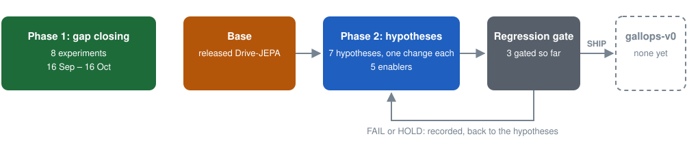

<h1 align="center">
   Gallops
</h1>

<p align="center"><strong>Gallops trains driving policies. <a href="https://github.com/FastCodeAI/Paddock">Paddock</a> scores them. Neither repo imports the other.</strong></p>

<p align="center">
  <a href="pyproject.toml"></a>
  <a href="pyproject.toml"></a>
  <a href=".github/workflows/check.yml"></a>
<!-- experiments:badges -->
  <a href="#gap-closing-experiments"></a>
  <a href="#hypothesis-experiments"></a>
  <a href="experiments/README.md#regression-gate-log"></a>
  <a href="#where-we-are"></a>
<!-- /experiments:badges -->
</p>

We are building a JEPA-based driving model, and this repo is its evidence: every
experiment, who ran it, and what it showed. Click an ID for that experiment's card,
with its data, code, checkpoint sha256, results and gate verdicts.



## Where we are

<!-- experiments:status -->
- **Base model:** released Drive-JEPA; the 4-camera stack (`H01.four-camera-planner`) went through the gate by hand on 21, 27 and 28 Oct (overall HOLD, no pair regressed) with a paddock adapter not yet committed.
- **Shipped version:** none yet. A version is earned by a gate SHIP ([how](docs/experiments.md#versions)).
- **Last gate run:** 20 Nov · [H01.four-camera-planner](experiments/H01_four_camera_base/CARD.md) · ⏸ **HOLD**.
- **In progress:** 6 hypotheses, 3 enablers. Next by priority: [H05](experiments/H05_ssm_memory/CARD.md) State-space memory.
<!-- /experiments:status -->

<a id="training-so-far"></a>

## Gap-closing experiments

Each of us took some benchmarks and tried to close released Drive-JEPA's gap on them.

<!-- experiments:gap-closing -->
| ID | Experiment | Owner | Headline result | Strength | Outcome |
|---|---|---|---|---|---|
| [**GC01**](experiments/GC01_rerank_kitscenes/CARD.md) | KITScenes re-ranker | Naren | KITScenes ADE@3s (m) 2.521 → **0.973** (n=223 samples) | ●●●○ strong · adapted, open-loop | ◐ mixed |
| [**GC02**](experiments/GC02_selection_without_training/CARD.md) | Selection without training | Naren, Siddesh | AlpaSim scene_score 0.4209 → **0.5433** (n=30 scenes) | ●●○○ moderate | ◐ mixed |
| [**GC03**](experiments/GC03_swerve_finetune/CARD.md) | Swerve finetune, 11 runs | Naren | neuroNCAP ncap_score 3.568 → **3.671** (n=20 scenario pairs) | ○○○○ unverified · blind | ⏸ parked (inconclusive) |
| [**GC04**](experiments/GC04_bench2drive/CARD.md) | Bench2Drive retrain (Split-v4, Final) | Navvrat | Bench2Drive mean driving score 57.60 → **73.6** (n=50 routes) | ●●○○ moderate · adapted, selected-on-report, no-record | ✅ positive |
| [**GC05**](experiments/GC05_physicalai_retrain/CARD.md) | Physical AI AV retrain | Siddesh | AlpaSim scene_score 0.5433 → **0.7697** (n=30 scenes) | ●●○○ moderate · adapted | ✅ positive |
| [**GC06**](experiments/GC06_scorer_cache/CARD.md) | Scorer on cached features | Naren | offline held-out collision ranking AUC, worst of 5 folds 0.59 → **0.660** (n=5 scenes) | ●●○○ moderate · blind, open-loop | ⏸ parked (inconclusive) |
| [**GC07**](experiments/GC07_subscore_scorer/CARD.md) | Sub-score scorer, seeing | Naren | neuroNCAP ncap_score, frontal 2.36 → **5.00** (n=3 runs) | ●●○○ moderate · smoke, adapted, no-record | ⏸ parked (mixed) |
| [**GC08**](experiments/GC08_expert_v6_imitation/CARD.md) | Expert v6 imitation | Naren | neuroNCAP ncap_score, mean of 3 shapes 3.01 → **2.31** (n=9 runs) | ●●○○ moderate · smoke, adapted, no-record | ❌ negative |
<!-- /experiments:gap-closing -->

## Hypothesis experiments

One structural change each, judged against the base by paddock's regression gate.

<!-- experiments:hypotheses -->
| ID | Hypothesis | Owner | Status | Headline result | Strength | Gate |
|---|---|---|---|---|---|---|
| [**H01**](experiments/H01_four_camera_base/CARD.md) | 4-camera stack (WA-JEPA + DJ planner) | Navvrat | ⏳ running | NAVSIM navtest EPDMS, human filter 87.78 → **85.27** (n=12,146 scenes) | ●●○○ moderate · adapted, open-loop | ⏸ **HOLD** 20 Nov |
| [**H04**](experiments/H04_subscore_scorer_navsim/CARD.md) | Sub-score scorer, NAVSIM gap | Navvrat, Siddesh | ⏳ running | NAVSIM navtest EPDMS, human filter, locked pick 87.78 → **87.30** (n=12,146 scenes) | ●●○○ moderate · adapted, open-loop | ⏸ **HOLD** 20 Nov |
| [**H05**](experiments/H05_ssm_memory/CARD.md) | State-space memory | Naren | 📝 planned | — | — | — |
| [**H06**](experiments/H06_global_read/CARD.md) | Global read and side braking | Navvrat | ⏳ running | NAVSIM score, global read off 0.870 → **0.852** (n=500 scenes) | ●●○○ moderate · no-record, open-loop | — |
| [**H07**](experiments/H07_encoder_lora/CARD.md) | Encoder LoRA, domain gap | Siddesh | ⏳ running | KITScenes pick ADE (3 s), m 2.372 → **1.879** (n=223 moments) | ●●○○ moderate · adapted, open-loop | ⛔ **FAIL** 28 Oct |
| [**H08**](experiments/H08_sideways_velocity_fov/CARD.md) | Sideways velocity and camera FOV | Naren | ⏳ running | KITScenes ADE (m), cropped 3.222 → **2.521** (n=223 keyframes) | ●●○○ moderate · open-loop | — |
| [**H14**](experiments/H14_aux_heads/CARD.md) | Aux heads on the refiner | Shreedhar | ⏳ running | nuScenes picked-plan L2 at 3 s, m 3.760 → **2.934** (n=2,996 keyframes) | ●●○○ moderate · adapted, open-loop | — |
<!-- /experiments:hypotheses -->

**Strength:** ●●●● proof · ●●●○ strong · ●●○○ moderate · ●○○○ argued · ○○○○ unverified.
**Nothing here is yet a closed-loop safety gain on a split nothing was chosen on,**
and `blind` results predate the 12 Oct camera fix.
[How to read these results](experiments/README.md#how-to-read-the-results).

Enablers, the gate log and the decision log are in
[experiments/README.md](experiments/README.md). These tables are generated from each
experiment's `experiment.toml`, and `make check` fails if they drift.

## Quickstart

```bash
make setup && source .venv/bin/activate     # .venv + install (no torch)
cp gallops.toml.example gallops.toml        # then point it at YOUR weights, runs and data
gallops config                              # what this machine resolved
gallops show <checkpoint dir>               # what a checkpoint claims about itself
```

Point `[roots.weights]` at the same directory as paddock's. Add the training stack with
`uv pip install --python .venv/bin/python -e ".[train]"`.

## Find your way

| Looking for | Go to |
|---|---|
| Every experiment, gate verdict and decision | [experiments/README.md](experiments/README.md) |
| How to run and record an experiment | [docs/experiments.md](docs/experiments.md) |
| Why this exists, what to build, how the repo is laid out | [docs/STRATEGY.md](docs/STRATEGY.md) |
| What gallops-v0 is | [docs/architecture.md](docs/architecture.md) |
| Writing or reading a checkpoint | [docs/checkpoints.md](docs/checkpoints.md) |
| Frames, splits, what counts as a result | [docs/conventions.md](docs/conventions.md) |
| What data exists | [docs/data.md](docs/data.md) |
| Reviewing a PR | [docs/reviewing.md](docs/reviewing.md) |

Apache-2.0, matching paddock.
