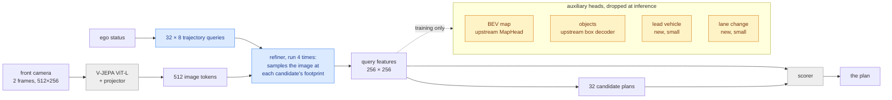
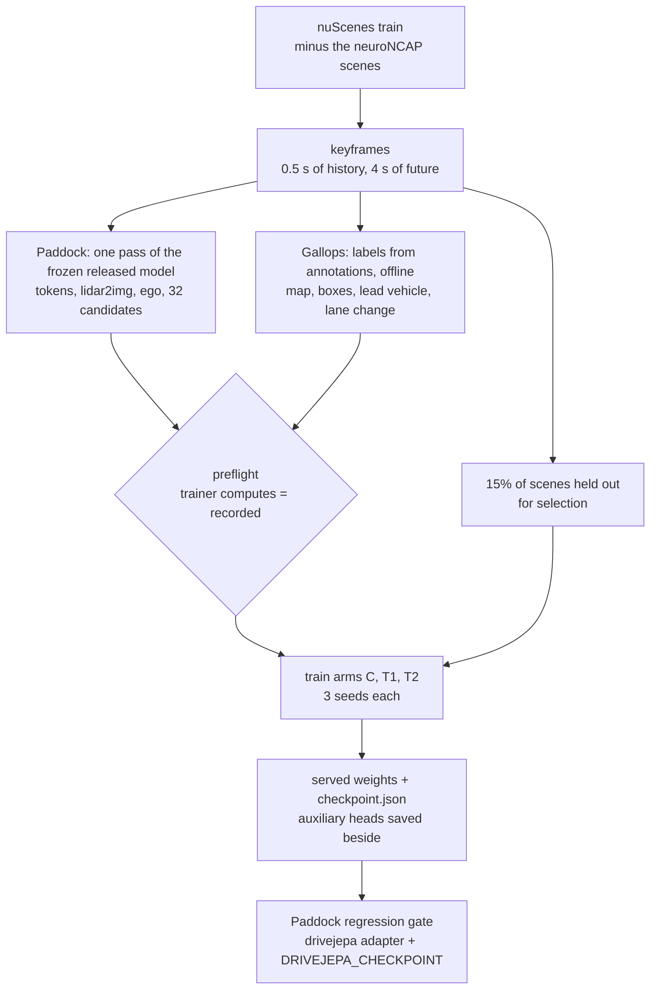
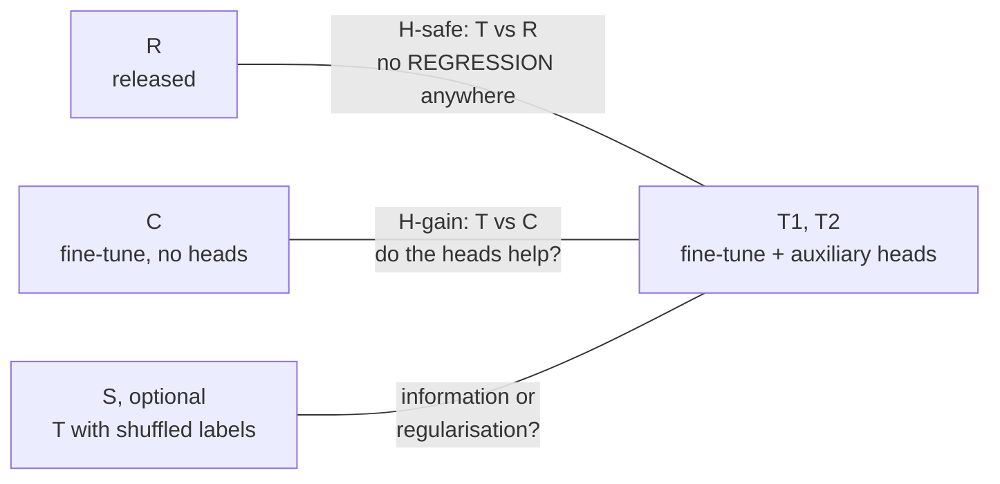
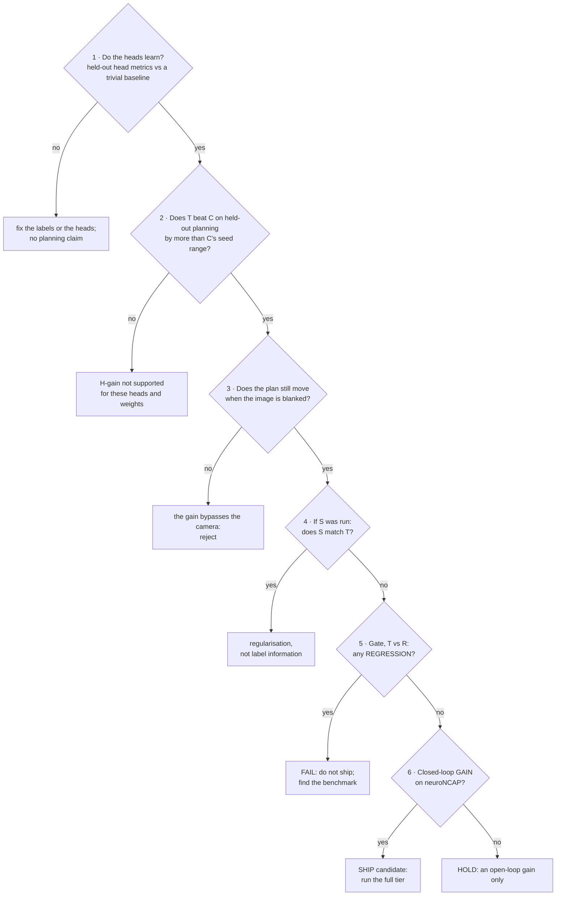
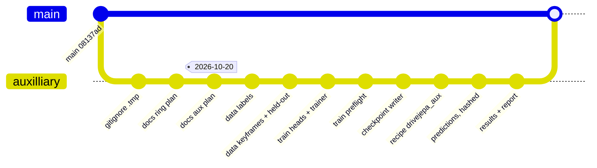

# Auxiliary prediction heads for Drive-JEPA: plan

**Status: a plan. Nothing in it has been built or run (2026-10-20).** Statements marked
*verified* were checked in the code or on disk on that date. Everything else is an argument or
an estimate, and is labelled as one.

The idea is to train Drive-JEPA with extra outputs — lane lines, objects, the lead vehicle and
lane changes. Their only job is to shape the features the planner reads, and they are dropped
at inference. This plan tests two things:

- whether these heads make the planner better;
- whether they cost the released model anything it already does well.

## The four questions, in one line each

| # | Question | Answer |
|---|---|---|
| 1 | What is the smallest architecture change that does it? | **Nothing changes at inference.** Switch on the two auxiliary heads upstream already ships, and add two small heads. All four read the refiner's query features and run only in training. The served weights keep upstream's format, so Paddock's existing `drivejepa` adapter runs them. |
| 2 | Do we need a dataset built with the model in the loop? | **No.** The labels are properties of the logged scene. What we need is one pass of the frozen released model over the training keyframes, made by Paddock. We do not need closed-loop collection. |
| 3 | Can the labels come from data we already hold? | **On nuScenes train, yes, all of them**, from human annotations. On KITScenes, lane lines and lane change can come from the map. KITScenes has no source for the lead vehicle or for objects. Start with nuScenes. |
| 4 | How do we test whether the heads help? | Run the same fine-tune with and without the auxiliary losses, three seeds each, and select on held-out train scenes. Then run Paddock's regression gate twice: with vs without heads (do they help?), and with heads vs the released model (does anything regress?). |

## The hypothesis

- **H-gain.** Fine-tuning the planner with auxiliary losses (T) gives better plans than the
  identical fine-tune without them (C). Data, steps, seeds and selection rule are the same;
  the only difference is the heads and their losses.
- **H-safe.** T does not regress against the released model (R) on any benchmark where R is
  already measured.

H-gain is a claim about the heads; H-safe is a claim about shipping. Each needs its own
comparison, and both are fixed in writing before the first run (step 4).

## Step 1: the minimal architecture change



*Grey: frozen. Blue: trained. Amber: training only.*

**How Drive-JEPA works today (verified).**
1. One front camera, two frames, goes through a V-JEPA ViT-L and a projector to give 512 image
   tokens.
2. 32 × 8 trajectory queries go through one refiner, run four times. The refiner samples the
   image at each candidate's footprint. The queries are a learned embedding plus the ego state.
3. The refiner's output is 256 query features of 256 dimensions each. They are decoded into 32
   candidate plans.
4. The scorer reads the same features and picks one plan.

**The change:**

1. **Attach the heads to the refiner's query features.** This is where the planner and the
   scorer read, and these features are trained. A loss attached here therefore changes the
   planner. Upstream put its own auxiliary heads in the same place.
2. **Switch on what upstream already has (verified).** Two heads exist:
   - `bev_map` (`MapHead`): a BEV semantic map of the front half, 128 × 256 cells at 0.25 m.
     Its class count comes from `num_bev_classes`.
   - `bev_agent`: 30 box queries, each (x, y, heading, length, width) plus a class, trained
     with a Hungarian loss.

   Both are config switches (`drive_jepa_config.py:23-24`) and run only in training mode
   (`scorer.py:46`). `forward()` already returns their outputs. The loss already includes them
   (`drive_jepa_agent.py:302-322`) with weights 1.0 (class), 0.1 (box) and 1.0 (BEV).

   Their targets are not built. The release has no weights for them (none of its 495 tensors),
   so they start from random initialisation.
3. **Add two small heads for what upstream has no slot for.**
   - Lead vehicle: is one present, the gap to it, and the closing speed.
   - Lane change: keep, left or right, over the next 4 s.

   Each pools the query features into an MLP, roughly 0.1 M parameters (an estimate).
4. **Train the refiner path and freeze the rest.**
   - Trained: the refiner, the query embedding and the ego encoder, 171 tensors in all. This is
     the same set the Bench2Drive generator stage trains.
   - Frozen: the encoder with its projector (294 tensors) and the scorer (30).

**What stays the same:**
- **The inference graph.** The upstream heads do not run in eval mode, and the new heads exist
  only in the trainer.
  - The checkpoint writer leaves the heads out of the served file. It saves them beside it as
    `aux_heads.pt`, for analysis.
  - The served file is the release with its 171 generator tensors replaced. The shared refiner
    is written into all four of its copies, exactly as `drivejepa_b2d/write_checkpoint.py`
    already does.
  - So `--model drivejepa` with `DRIVEJEPA_CHECKPOINT` serves it. No new adapter is needed.
- **No Drive-JEPA source edits.** The trainer switches the upstream heads on through config, and
  the two new heads live in the trainer. The planned Drive-JEPA copy is for changes that must
  reach inference, such as the six-camera work. It is not needed for this step.

**Why not put a head on the image tokens?** The projector is frozen, and the cached tokens come
after it. A loss there would train only the head itself: it would be a probe, and the planner
would not change. Making the projector trainable is the fallback, used only if step 4 shows the
query-feature heads move nothing (arm P).

## Step 2: do we need data built with the model in the loop?

**No.** Every label below is a property of the logged scene: where the lanes and cars are, and
what the human driver did next. Each label is computed once, offline, from annotations. None of
them depends on what the model proposes.

What we do need is **one pass of the frozen released model** over the training keyframes. The
trainer works from cached encoder tokens. The encoder is frozen in every arm, so a cached token
is exactly what the encoder would produce live.

Paddock makes this dump through its own input path, as it already did for the KITScenes
re-ranker and the Bench2Drive generator. The training inputs are therefore exactly what the
model sees when Paddock drives it. For each keyframe the dump records:
- the 512 × 256 tokens;
- `lidar2img` and `img_shape`;
- the ego vector;
- the released model's 32 candidates and their scores, which become the pseudo-teachers in
  step 4.

Model-in-the-loop data only becomes necessary for different questions:

| If we later want | Then we need |
|---|---|
| Heads that grade the model's own candidates, e.g. "does candidate *k* cross a lane line?" | The candidates at training time, labelled online by a referee that has a preflight check, as the swerve trainer does. |
| To fix closed-loop failures such as drift or compounding error | DAgger rounds: drive, label the states visited, then aggregate (`expert/rounds.py`). |

Keeping both out of this experiment means any result can be attributed to the heads.

## Step 3: labels



**Available labels.** Verified on disk on 2026-10-20 unless marked otherwise.

| Label | nuScenes train | KITScenes train | How it is derived |
|---|---|---|---|
| Lane lines (BEV) | ✅ map expansion: lane and road dividers | ✅ Lanelet2 `map.osm`, in all 533 scenes: markings, curbs, road borders | Rasterised around the ego pose onto `MapHead`'s grid, as an 8th class |
| Road, walkway, centreline, static objects, vehicles, pedestrians (BEV) | ✅ map expansion + 3D boxes | map classes only (Lanelet2) | Upstream's seven TransFuser classes |
| Lane change in the next 4 s | ✅ ego poses + map lanes | ✅ poses + Lanelet2 lanelets | Compare the lane the ego occupies now with the lane it occupies 4 s later |
| Lead vehicle: present, gap, closing speed | ✅ 3D boxes with track ids (`sample_annotation`) | ❌ no boxes | The nearest vehicle ahead inside the ego's lane corridor, within 50 m. Speed comes from its track, 0.5 s apart |
| Objects (BEV boxes) | ✅ 3D boxes: vehicles, pedestrians, cones, barriers | ❌ no boxes; lidar was deleted at download | Boxes in the front camera's view, within 32 m, in upstream's agent format |
| Ego speed and acceleration | ✅ CAN bus | ✅ poses at 10 Hz | From the log. This is also what the planner itself is trained to predict |
| Image semantic segmentation | ❌ | partial: machine-made Seamseg "thing" masks for the front and rear cameras | — |
| Traffic-light state | ❌ (positions only) | ❌ (positions only) | — |

**Start on nuScenes train.** It is the only corpus here with human labels for all four labels
asked about, and Gallops already converts it. `data/nuscenes_real.py` writes its train scenes
with three things:
- every annotated vehicle;
- the CAN-bus speed;
- the human's next 4 s.

It keeps a keyframe only if 0.5 s of history and 4 s of future exist. It excludes the scenes
behind neuroNCAP: 0061 and the five reconstructed ones. nuScenes `val` is never used, because
both the gate's nuScenes rows and neuroNCAP's scenes come from it.

**Two rules for every label**

1. **Label only what the camera can see.** The model sees one front camera of about 65°.
   Cells and boxes outside that view are masked out of the loss, not labelled "empty". The
   sketch below shows this on the front-half BEV grid. It is geometry, not to scale.
2. **Mask, don't fake.** A sample that lacks a label adds no loss to that head. Examples are a
   keyframe with no lead vehicle, or a scene with no map.

```
             +y (left)                                  -y (right)
   x = 32 m  ┌──────────────────────────────────────────┐
             │░░░░░░░░\                        /░░░░░░░░│
             │░░░░░░░░░░\                    /░░░░░░░░░░│
             │░ masked ░░░\    labelled    /░░░ masked ░│
             │░░░░░░░░░░░░░░\            /░░░░░░░░░░░░░░│
             │░░░░░░░░░░░░░░░░\        /░░░░░░░░░░░░░░░░│
   x = 0     └──────────────────\    /──────────────────┘
                                  ego
```

**When a label is missing** (on KITScenes, or on later datasets):

| Missing | What we can do, best first |
|---|---|
| Lead vehicle | Train on a dataset with boxes (nuScenes). On KITScenes: the front radar, which has one parquet file per frame but has *not been read or validated*; or Seamseg 2D boxes on the front camera plus flat-ground range; or re-download the lidar and run a lidar detector. |
| Objects | The same options, plus pseudo-labels from an off-the-shelf detector. Check the detector's licence, because the checkpoint is meant for commercial use. |
| Image segmentation | Pseudo-labels from an off-the-shelf segmenter. This needs a head on the image tokens with the projector trained, which is not a minimal change, so it is deferred. |
| Traffic-light state | A classifier or VLM pass. Out of scope here. |
| Anything | Mask the head on that dataset, or drop the head if no source is good enough. |

**Lane change and ego speed add no new information.** Both are functions of the human's future
path, which the planning loss already supervises. They do add structure: a lane change is a rare
class that the trajectory loss underweights. That makes T2's two new heads partly an internal
control. If they help as much as the map and box heads, the gain is more likely regularisation
than information.

## Step 4: fine-tune and test

**The recipe.** It is the same in every arm; the only switch is which heads are on.

- **Initialisation:** the released checkpoint.
- **Data:** nuScenes train keyframes from the dump. 15% of the train scenes are held out for
  selection, chosen with seed 0 and committed as a list.
- **Planning loss:** the Bench2Drive generator stage's (`drivejepa_b2d/train_generator.py`),
  that is, expert winner-takes-all plus 0.5 × the pseudo-teacher term.
  - The pseudo-teachers are the released model's own top-2 candidates.
  - This self-distillation keeps the candidates diverse and anchors them to what the release
    already does well.
- **Auxiliary losses:**
  - upstream's weights for its own heads (class 1.0, box 0.1, BEV 1.0);
  - 0.5 for the two new heads;
  - none of these is tuned in this experiment.
- **Optimiser:** Adam at 2e-5, batch 32 with the batch fix, 10 epochs. These are the Bench2Drive
  defaults.
- **Selection:** the epoch kept is the one with the lowest held-out **planning** loss. The
  auxiliary loss plays no part in selection, so C and T are chosen by the same rule.
- **Scorer:** frozen in every arm. A pick can change only through the features the scorer reads.

**The arms**

| Arm | Heads on | Seeds | Purpose |
|---|---|---|---|
| R | — (the released model) | — | The existing performance |
| C | none | 3 | Control: what fine-tuning on nuScenes does on its own |
| T1 | BEV map + objects (upstream's heads) | 3 | The minimal change |
| T2 | T1 + lead vehicle + lane change | 3 | The new heads |
| S *(optional)* | the better T, with labels shuffled across keyframes | 1–3 | Is the gain information, or regularisation? |
| P *(optional)* | the better T, with the projector trained too | 3 | Only if T moves nothing |



**What is measured**

1. **Do the heads learn?** On the held-out scenes, each head is compared with a trivial
   baseline such as the class prior or the mean gap:
   - BEV IoU per class;
   - object matching F1 and box error;
   - lead-gap error;
   - lane-change F1.

   If the heads do not learn, nothing else can be interpreted.
2. **Does planning improve in-domain?** On the held-out scenes, about 100 of them, with standard
   errors clustered by scene:
   - for the picked plan: L2 at 1, 2 and 3 s; collisions against the logged boxes (Gallops'
     grader); and leaving the road, against the map;
   - for the generator: best-of-32 ADE.
3. **Does it still use the camera?** Blank the image: the plan must still move by more than
   0.05 m, the preflight's sight rule. This must hold for R, C and T alike. A model that
   improved by ignoring the camera would be the camera-blind failure again.
4. **The gate.** Paddock's `tools/gate.py`, smoke tier:
   - nuScenes: 30 val scenes;
   - KITScenes: 223 keyframes;
   - NAVSIM: 1,000 tokens;
   - neuroNCAP: 6 pairs × 3 runs.

   Smoke R once to make the baselines. Then, for seed 0 of C and of each T, run:
   - `check` T vs C, for attribution: GAIN, NEUTRAL or REGRESSION per benchmark;
   - `check` T vs R, to catch any regression: FAIL, HOLD or SHIP.



**Decision rules**, written into `experiments/drivejepa_aux/PREDICTIONS.md` and hashed before the
first run:

- **H-gain is supported only if all of these hold:**
  - the heads learn (measurement 1);
  - T beats C on held-out planning (measurement 2), by more than C's range across its three
    seeds and by more than twice the scene-clustered standard error of the difference;
  - the sight check passes (measurement 3);
  - if S was run, S does not match T.
- **H-safe is supported only if** the gate's T-vs-R check shows no REGRESSION on any benchmark.
  The final candidate must then also pass the full tier on NAVSIM (12,146 scenes) and neuroNCAP
  (200 runs), because the smoke tier cannot see small regressions.
- **NEUTRAL means "not resolved at this n", never "no effect".**
  - KITScenes and nuScenes are open-loop (ADE and L2). They are tripwires, not targets
    ([STRATEGY.md](STRATEGY.md) §2).
  - SHIP needs a closed-loop GAIN, so HOLD is the likely outcome.
- **Before a T-vs-C GAIN or REGRESSION from the gate is quoted,** it is re-checked with seeds 1
  and 2.

**Contamination**
- Train only on nuScenes `train`.
- Declare `trained_on` as `nuscenes/train` (with its fraction) and `navsim/navtrain`, which is
  inherited from the release.
- `selection_split` is the held-out nuScenes train scenes.
- neuroNCAP's scenes are excluded by name, as `nuscenes_real.py` already does.

**Cost** (all estimates):
- **The dump:** one encoder pass per keyframe, about 22k keyframes. That is nuScenes' 28,130
  train samples, less about 9 per scene that lack enough history or future. The cache is about
  11 GB in fp32.
- **Training:** minutes per run on cached tokens, so the 9–12 runs are cheap.
- **The gate:** this is where the time goes. Each smoke takes a few hours per checkpoint, and
  the neuroNCAP part waits for a free GPU.

## Preflight

[CLAUDE.md](../CLAUDE.md) requires that no run trains until these checks pass. They run before
the first step of every run, and there is no flag to skip them.

- **code:** `src/` and `tests/` are committed, and the tests pass in the training interpreter
  (`train/preflight.code_checks`).
- **inputs:**
  - On the cached tokens, the released weights reproduce the dump's 32 candidates and its pick,
    in fp32 at batch 1.
  - Batch 32 with the batch fix gives the same result as batch 1.
- **labels:**
  - The human's logged path lies on the rasterised road for at least 99% of the waypoints in
    view. This catches a flipped axis or a wrong frame.
  - Boxes in the ego frame equal the nuScenes devkit's own transform.
  - Every box kept projects inside the front image when projected with the dump's `lidar2img`.
- **sight:** blanking the image moves the released model's plan.
- **loss parity:**
  - On the first batch, the planning loss equals the agent's own `trajectory_loss_anchors`.
  - Upstream's box and BEV losses are called directly, never re-implemented.

## Git history

- All Gallops commits go on `train/drivejepa-auxilliary`.
- Paddock needs one PR, for the dump.
- Drive-JEPA needs no commits.



| # | Commit | Contents | Checked by |
|---|---|---|---|
| 1 | `gitignore: .tmp, for local scratch` | `.gitignore` | done |
| 2 | `docs: a plan for surround views, foveated crops and aux heads on KITScenes` | `docs/drivejepa-ring-plan.md` | done |
| 3 | `docs: a plan for auxiliary prediction heads on Drive-JEPA` | this file | done |
| 4 | `data: auxiliary labels from nuScenes annotations` | `src/gallops/drivejepa_aux/labels.py` (runs in the env with the nuScenes devkit, as `nuscenes_real.py` does) | tests on synthetic maps and boxes, including x forward / y left |
| 5 | `data: keyframes and the held-out scenes` | `recipes/drivejepa_aux/heldout_scenes.json`, exclusion asserts | split tests from committed lists |
| 6 | `train: auxiliary heads and their trainer` | `drivejepa_aux/heads.py` and `train.py`, built from `train_generator.py`; `--aux none` is arm C | loss parity on the first batch |
| 7 | `train: preflight for the dump and the labels` | `drivejepa_aux/preflight.py` | tests with fake torch, as `test_preflight.py` does |
| 8 | `checkpoint: served weights and sidecar` | `drivejepa_aux/write_checkpoint.py`, reusing b2d's tensor swap and `sidecar.publish` | test on a synthetic checkpoint; reload probe |
| 9 | `recipe: drivejepa_aux` | `recipes/drivejepa_aux.toml`; `test_recipe.py` parametrised over it; Python 3.9 modules added to `PY39` | `make check` |
| 10 | `experiment: predictions, written before any run` | `experiments/drivejepa_aux/PREDICTIONS.md` and its sha256 | the hash is recorded before the first run |
| 11 | `results: held-out metrics and gate verdicts` | `REPORT.md`, gate manifests, verdict JSON, and an update to this file | a verified / argued table |

**Paddock** gets one branch off `tools/regression-gate`, with the commit `drivejepa: dump the
refiner's inputs for nuScenes train keyframes`. In it, `paddock_candidates.py` gains nuScenes
train rows and a token output.

**Ordering**
- The runs happen between commits 10 and 11, each from a clean tree. The code check refuses
  anything else, and every sidecar records the commit its run trained from (`train_git_sha`).
- **Merge with a merge commit, not a squash.** A squash makes those recorded commits
  unreachable.

## Risks

1. **NAVSIM forgetting.** NAVSIM is the release's home benchmark, and every fine-tuned arm risks
   it. Self-distillation and the low learning rate are the mitigation; the gate's NAVSIM pair is
   the detector.
2. **The query features only see what lies along candidate paths.** Objects off every path may
   be unpredictable from them, so the heads could learn little. Measurement 1 shows whether they
   do, and arm P is the fallback.
3. **Map labels need the ego pose and the map to agree.** Misalignment teaches noise. The
   logged-path-on-road check catches only gross errors.
4. **Seed noise may be larger than the effect.** That is why C runs three seeds before anything
   is claimed.
5. **Domain confound.** Training on nuScenes moves C and T alike toward the nuScenes-like scenes
   neuroNCAP renders. Only T vs C speaks to the heads.
