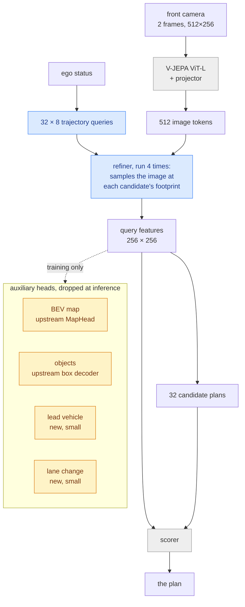
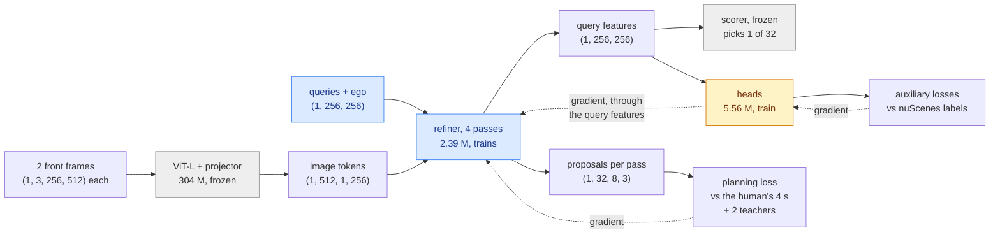
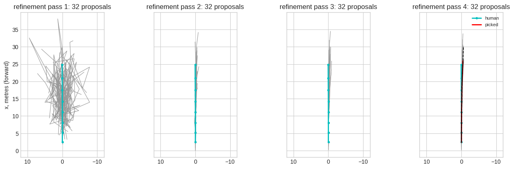
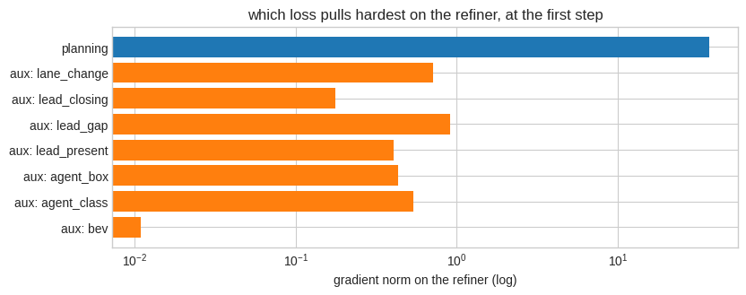
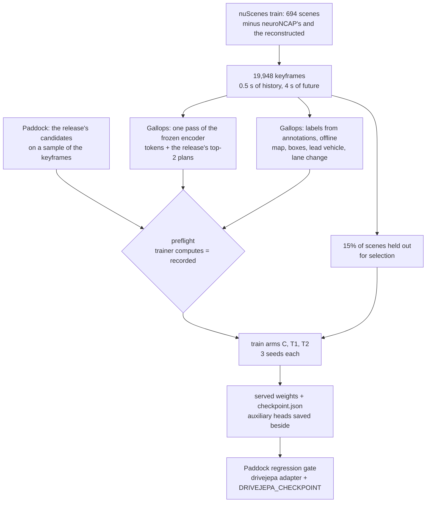
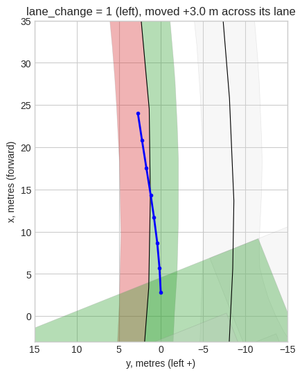
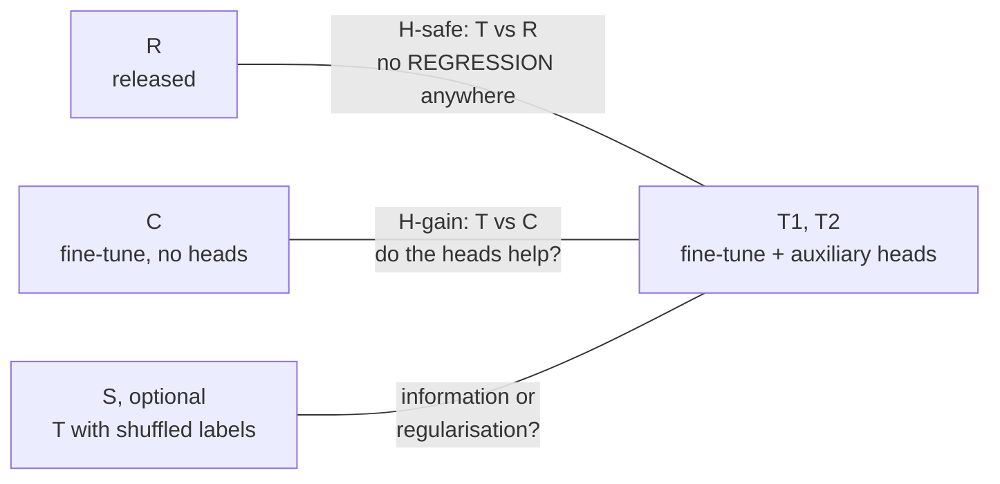
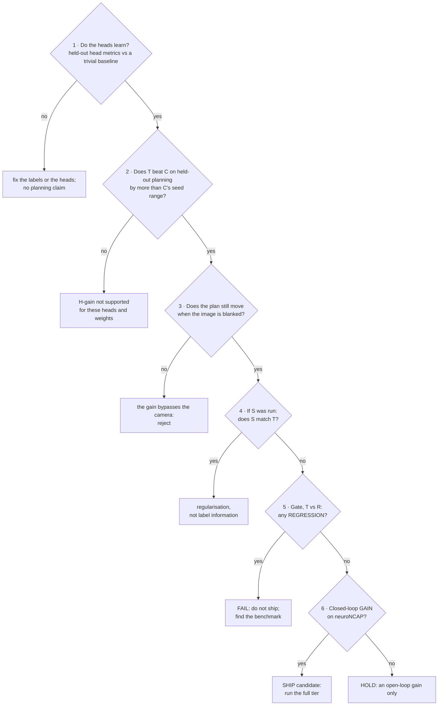
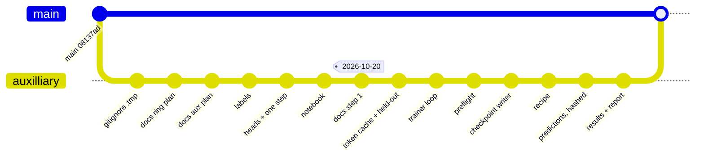

# Auxiliary prediction heads for Drive-JEPA: plan

**Status (2026-10-20): partly built.**
- **Built and run on real data:** the labels, the heads and one training step. On one nuScenes keyframe
  the step runs end to end, and
  [notebooks/drivejepa_aux_train_step.ipynb](../notebooks/drivejepa_aux_train_step.ipynb) shows every
  tensor it touches.
- **Not built yet:** the training loop, the preflight, the checkpoint writer and the gate runs. No
  checkpoint has been trained.

Statements marked *verified* were checked in the code or on disk on that date; *measured* ones come
from the notebook's executed outputs. Everything else is an argument or an estimate, and says so.

The idea is to train Drive-JEPA with extra outputs: lane lines, objects, the lead vehicle and lane
changes. Their only job is to shape the features the planner reads, and they are dropped at
inference. The plan tests two things:
- whether these heads make the planner better;
- whether they cost the released model anything it already does well.

## The questions, in one line each

| # | Question | Answer |
|---|---|---|
| 1 | What is the smallest architecture change that does it? | **Nothing changes at inference.** We switch on the two auxiliary heads upstream already ships and add two small ones. All four read the refiner's query features and run only in training. The served file keeps upstream's format. *Measured:* gradients reach the refiner path and the heads and nothing else. |
| 2 | Do we need a dataset built with the model in the loop? | **No.** The labels are properties of the logged scene. The only model pass needed is the frozen encoder over each keyframe, once, to cache its tokens. |
| 3 | Can the labels come from data we already hold? | **Yes, on nuScenes train (decided), for all four**, from human annotations and the map. 694 scenes give 19,948 trainable keyframes. KITScenes has lanes but no boxes. |
| 4 | How do we test whether the heads help? | Run the same fine-tune with and without the heads, three seeds each, and select on held-out train scenes. Then run Paddock's regression gate twice: with heads vs without (do they help?), and with heads vs the release (does anything regress?). |
| 5 | Why not LoRA? | **The parts this step trains are small** (2.39 M parameters), so LoRA would save nothing. LoRA is the right tool for the next step, adapting the 304 M-parameter encoder (arm P). See [below](#why-not-lora). |

## The hypothesis

- **H-gain.** Fine-tuning the planner with auxiliary losses (T) gives better plans than the
  identical fine-tune without them (C). Data, steps, seeds and the selection rule are the same; the
  only difference is the heads and their losses.
- **H-safe.** T does not regress against the released model (R) on any benchmark where R is already
  measured.

H-gain is a claim about the heads; H-safe is a claim about shipping. Each needs its own comparison,
and both are fixed in writing before the first run (step 4).

## Step 1: the minimal architecture change



*Grey: frozen. Blue: trained. Amber: training only.*

**The change (verified, and now built in `src/gallops/drivejepa_aux/`):**

1. **Attach the heads to the refiner's query features**, the tensor the scorer reads after the
   fourth pass. The refiner makes it and the refiner trains, so a loss attached here changes the
   planner. Upstream put its own auxiliary heads in the same place.
2. **Switch on what upstream already has.** These are two config flags, `bev_map` and
   `bev_agent` (`drive_jepa_config.py:23-24`), set by `heads.configure`:
   - `MapHead`: a BEV semantic map of the front half, 128 × 256 cells at 0.25 m. Its class
     count comes from `num_bev_classes`, which we set to 8: upstream's 7 classes plus lane
     dividers.
   - The box decoder: 30 box queries, each (x, y, heading, length, width) plus a class, trained
     with upstream's Hungarian loss (`_agent_loss`, called rather than restated).

   Both are built inside the scorer, and the release has no weights for them (none of its 495
   tensors). `step.build_model` therefore loads the release with `strict=False`, and refuses unless
   the two heads' keys are the only ones missing.
3. **Add two small heads**, `heads.SceneHeads` (0.40 M parameters, *measured*). Each is one
   learned query that attends over the 256 query features, followed by an MLP:
   - the lead vehicle: present (a logit), the gap / 10 m, the closing speed / 5 m/s;
   - the lane change: keep, left or right.
4. **Train the refiner path; freeze everything else.**
   - Trained: the refiner, the query embedding and the ego encoder. This is
     `swerve.TRAINABLE_REFINER`, the same set the Bench2Drive generator stage trains.
   - Frozen: the encoder and its projector, and the scorer.

### How the refiner is fine-tuned, on one real keyframe

The notebook runs one training step on **nuScenes scene-0004, keyframe 4** (Singapore one-north,
4.82 m/s, command STRAIGHT). Every number below is a *measured* output of it.

The refiner gets gradient from two places:
- **its proposals**, through the planning loss, as in every Drive-JEPA fine-tune so far;
- **its query features**, through the heads.

A head turns a label error into a gradient on those features. That gradient flows back into the
refiner that made them, then into the 32 proposals and into what the frozen scorer reads.



**The inputs.** These are built by `swerve_data.TickDataset`, the swerve trainer's builder,
which copies Paddock's Drive-JEPA adapter. `inputs.TablesTickDataset` feeds it from the
nuScenes tables.

| Name | Shape | dtype | Size | What it is |
|---|---|---|---|---|
| `camera_feature_1` | (1, 3, 256, 512) | float32 | 1,536 KiB | front frame now: rows 28..872 of the 1600 × 900 image, resized |
| `camera_feature_2` | (1, 3, 256, 512) | float32 | 1,536 KiB | front frame 0.5 s ago |
| `lidar2img` | (1, 4, 4, 4) | float32 | 256 B | 4 camera slots; the model keeps slot 1, the front camera |
| `img_shape` | (1, 4, 3) | float32 | 48 B | the padded image size each `lidar2img` is divided by |
| `ego_status` | (1, 4, 11) | float32 | 176 B | 4 frames × [pose 3, velocity 2, acceleration 2, command one-hot 4]; the model reads only the last frame |
| target | (1, 8, 3) | float32 | 96 B | the human's next 4 s: (x, y, heading) at 0.5 s intervals |

**The labels.** `nusc.keyframe_labels` builds them from nuScenes' map expansion, its 3D boxes and
the logged poses. Rule 1 in step 3 means 72% of the grid is ignored.

| Name | Shape | dtype | This keyframe |
|---|---|---|---|
| `bev` | (128, 256) | uint8 | all 8 classes present; 72% of cells = 255 (ignored) |
| `agent_states`, `agent_valid` | (30, 5), (30,) | float32, bool | 5 valid boxes |
| `lead_present`, `lead_gap`, `lead_closing` | scalars | int, float | 1; 16.2 m; +0.24 m/s |
| `lane_change` | scalar | int | 0 (keep) |


*Left: the model's own 512 × 256 input, with the labelled vehicles' footprints (yellow), the lead
vehicle (red) and the human's next 4 s (cyan). Right: the BEV target, forward up and left on the
left, with ignored cells white. Image: nuScenes (Motional), CC BY-NC-SA 4.0.*

**The model.** 7.95 M of 316.8 M parameters train (2.5%):

| Part | Tensors | Parameters | Trains | Weights from |
|---|---:|---:|---|---|
| refiner | 42 | 2,321,219 | yes | release (one module, stored 4 times in the file: 168 tensors) |
| `init_feature` | 1 | 65,536 | yes | release: 32 × 8 learned queries |
| `hist_encoding` | 2 | 3,072 | yes | release: ego status 11 → 256 |
| encoder (ViT-L + projector) | 294 | 304,147,712 | **no** | release |
| scorer | 30 | 4,704,992 | **no** | release |
| map head | 51 | 2,776,584 | yes | upstream code, random initialisation |
| box head | 41 | 2,383,878 | yes | upstream code, random initialisation |
| lead + lane-change heads | 13 | 396,806 | yes | new, random initialisation |

**The forward pass.** `step.forward` runs the vendor's own forward unchanged, in eval mode, and
uses hooks to capture tensors on the way.

| Tensor | Shape |
|---|---|
| image tokens | (1, 512, 1, 256): (cameras, tokens, batch, channels) |
| query features, after each of the 4 passes | (1, 256, 256): 32 proposals × 8 poses, 256 channels |
| proposals, per pass | (1, 32, 8, 3) |
| scorer logits | (1, 32, 6); column 5 picks (here, proposal 17) |
| heads: `bev` / `agent_states`, `agent_labels` / `lead` / `lane_change` | (1, 8, 128, 256) / (1, 30, 5), (1, 30) / (1, 3) / (1, 3) |

Upstream's heads, run this way, match their own `Scorer.forward` in training mode exactly: the
largest difference is 0.0 (`step.check_heads`).



**The losses at the first step.** The heads are random, so the classification terms start at
chance: ln 8, ln 2 and ln 3.

| Term | Value | Weight | Weighted | Share |
|---|---:|---:|---:|---:|
| planning (winner-takes-all + 0.5 × 2 teachers, every pass) | 0.368 | 1.0 | 0.368 | 4.5% |
| bev (cross-entropy, ignored cells excluded) | 2.056 | 1.0 | 2.056 | 24.9% |
| agent class (Hungarian, binary cross-entropy) | 0.592 | 1.0 | 0.592 | 7.2% |
| agent box (Hungarian, L1) | 36.762 | 0.1 | 3.676 | 44.5% |
| lead present / gap / closing | 0.671 / 1.301 / 0.019 | 0.5 each | 0.996 | 12.1% |
| lane change | 1.133 | 0.5 | 0.567 | 6.9% |

**Where each loss's gradient lands** (`step.gradient_split`, gradient norms, no step taken):

| Loss | Refiner | Query embedding | Ego encoder | Heads |
|---|---:|---:|---:|---|
| planning | **37.11** | 0.268 | 4.304 | 0 |
| all auxiliary terms | **1.44** | 0.007 | 0.145 | map 0.58, box 3.88, new 3.20 |
| encoder, scorer | none: no `requires_grad` | | | |

So the auxiliary value of the loss and its pull on the refiner are very different things:
- **By value, the auxiliary terms are 95% of the total loss.**
- **By gradient, they reach the refiner at under 4% of the planning gradient.** The randomly
  initialised heads absorb almost all of it.
- **The two gradients are nearly orthogonal** (cosine **+0.035**). At the first step the
  auxiliary pull is noise, but small noise.
- **Map head vs scene heads.** The map head pulls least (0.011); the lead-gap and lane-change
  terms pull most (0.90 and 0.71).



**One optimizer step** (`step.train_step`) takes 70 ms; peak GPU memory is 1.58 GiB at batch 1.
Adam runs at two rates: 2e-5 on the 2,389,827 refiner-path parameters (the Bench2Drive stage's
rate), and 1e-4 on the 5,557,268 head parameters (the rate the release itself trained at, because
they start from random weights).

| Part | Update norm |
|---|---|
| refiner / `init_feature` / `hist_encoding` | 0.0301 / 0.0051 / 0.0006 |
| map / box / new heads | 0.162 / 0.154 / 0.058 |
| encoder, scorer | 0: their checksums do not change |

The proposals moved 20.3 cm on average (57.3 cm at most). The total loss on this keyframe went from
8.254 to 7.998, and the planning term from 0.368 to 0.327.

**The schedule this implies:**
- **Joint training from the start is safe on this evidence:** the auxiliary pull at the first step
  is small.
- **A warm-up stays as a cheap precaution.** `forward(..., detach_heads=True)` feeds the heads a
  detached copy of the features, so for the first few hundred steps the heads learn while the
  refiner sees the planning gradient alone. The notebook checks the switch: with it on, the
  refiner's gradient equals the planning gradient exactly (37.11).
- **Two pulls to measure over a real run,** not one keyframe: the auxiliary-to-planning ratio and
  the cosine. A cosine that stays near 0 would say the labels carry nothing the planner uses. A
  negative one would say they fight it.

**What stays the same:**
- **The inference graph.**
  - In eval mode the upstream heads do not run, and the new heads exist only in the trainer.
  - The checkpoint writer (not built yet) leaves the heads out of the served file and saves them
    beside it as `aux_heads.pt`.
  - The served file is the release with its refiner-path tensors replaced. The shared refiner is
    written into all four of its copies, as `drivejepa_b2d/write_checkpoint.py` already does.
  - So Paddock's `drivejepa` adapter serves it through `DRIVEJEPA_CHECKPOINT`, with no new
    adapter.
- **No change to Drive-JEPA's model code.** On this site Drive-JEPA does need Paddock's three
  patches applied, for a different reason; see [Environment](#environment).

**Why not put a head on the image tokens?** The projector is frozen, so a loss there would train
only the head. It would be a probe, and the planner would not change. Shaping the image features
is what arm P is for.

### Why not LoRA?

LoRA trains a low-rank update `B·A` beside a frozen weight `W`, and merges it as `W + B·A` at
export. It buys three things:
- fewer trainable parameters and a smaller optimizer state on large layers;
- an update confined to a small subspace, which regularises toward the original weights;
- weights that keep their shape, so serving is unchanged.

**On the refiner, which this step trains, it would buy nothing.**
- The refiner path is 2.39 M parameters. Full Adam state (weights, gradient, two moments) is about
  38 MB.
- The measured peak of 1.58 GiB is the frozen encoder's weights and the activations, not
  optimizer state.
- LoRA's only remaining lever there is regularisation. Self-distillation from the release's own
  plans and a 2e-5 learning rate already pull the same way.
- Full fine-tuning of this set is also what both shipped retrains used (Physical AI generator,
  Bench2Drive Final).
- If NAVSIM regresses, LoRA on the refiner is an optional arm (L) to test whether a constrained
  update forgets less.

**On the encoder, LoRA is the right tool, for the next step, not this one.** The heads can only
shape the image features if something upstream of the query features can move. Adapting 304 M
parameters is exactly where LoRA's savings are real. That is arm P: LoRA, rank 16–64, on the
ViT's last blocks. It is held back for three reasons:
- **It ends the token cache.** The ViT runs forward and backward every step instead of once per
  keyframe: about 0.34 TFLOP per 2-frame clip forward, and roughly three times that with the
  backward pass. *Estimate.*
- **It changes the image features everything else reads.** That is a larger regression surface
  for H-safe.
- **It would confound the test.** Run first, it would mix two changes in one hypothesis test.

The Drive-JEPA-Next design draft (2026-10-19) recommends the same order: freeze the encoder while
the new parts warm up, then LoRA or the last N blocks with a feature anchor.

## Step 2: do we need data built with the model in the loop?

**No.** Every label is a property of the logged scene: where the lanes and cars are, and what the
human driver did next. Each is computed once, offline (`nusc.keyframe_labels`, 51 ms per keyframe,
*measured*). None depends on what the model proposes.

What we do need is **one pass of the frozen encoder** over the training keyframes, so the trainer
can work from cached tokens. The encoder is frozen in every arm, so a cached token is exactly what
it would produce live.
- **Who builds the inputs.** Gallops builds them with the swerve trainer's input builder, the one
  used in the notebook.
- **How they are checked against Paddock.** Paddock dumps the released model's candidates on a
  sample of the same keyframes, and the preflight compares the two.
- **What the pass records:** the released model's own top-2 plans, which become the teachers.

Model-in-the-loop data only becomes necessary for different questions:

| If we later want | Then we need |
|---|---|
| Heads that grade the model's own candidates, e.g. "does candidate *k* cross a lane line?" | The candidates at training time, labelled online by a referee with a preflight check, as the swerve trainer does |
| To fix closed-loop failures such as drift or compounding error | DAgger rounds: drive, label the states visited, then aggregate (`expert/rounds.py`) |

Keeping both out of this experiment means any result can be attributed to the heads.

## Step 3: labels

**The data is nuScenes train (decided).** `nusc extract` read the tables once:
- 694 train scenes, with 19,948 trainable keyframes;
- 15 of those scenes have no CAN-bus poses and give none;
- 233 MB, written under `{runs}/drivejepa_aux/extract-v1`.



**Available labels.** Verified on disk on 2026-10-20.

| Label | nuScenes train | KITScenes train | How it is derived |
|---|---|---|---|
| Lane lines (BEV) | ✅ map expansion: lane and road dividers | ✅ Lanelet2 `map.osm`, in all 533 scenes | Rasterised around the ego pose onto `MapHead`'s grid, as an 8th class |
| Road, walkway, centreline, static objects, vehicles, pedestrians (BEV) | ✅ map expansion + 3D boxes | map classes only | Upstream's seven TransFuser classes |
| Lane change in the next 4 s | ✅ ego poses + the map's lane graph | ✅ poses + Lanelet2 lanelets | See the rule below |
| Lead vehicle: present, gap, closing speed | ✅ 3D boxes with track ids | ❌ no boxes | The nearest vehicle ahead whose footprint overlaps the band the ego sweeps along its logged path, within 50 m. Not oncoming. Speed from its track |
| Objects (BEV boxes) | ✅ 3D boxes: vehicles, pedestrians, cones, barriers | ❌ no boxes; lidar deleted at download | Boxes in the front camera's view, within 32 m, in upstream's agent format |
| Ego speed and acceleration | ✅ CAN bus | ✅ poses at 10 Hz | From the log; also what the planner predicts |
| Image semantic segmentation | ❌ | partial: Seamseg "thing" masks, front and rear cameras | — |
| Traffic-light state | ❌ (positions only) | ❌ (positions only) | — |

**How often each label exists** (*measured* over 1,645 keyframes from the first 60 scenes). A rare
label means few gradients for its head:

| Label | Frequency |
|---|---|
| lead vehicle present | 20.9% (closing speed known for all of them) |
| lane change | keep 1,550 · left 42 · right 23 · unknown 30, so 4.0% are changes |
| boxes in view per keyframe | 1.02 on average, 8 at most; **46% of keyframes have none** |
| BEV classes, share of visible cells | road 41.2, background 36.9, walkway 10.3, centreline 7.1, lane divider 2.2, vehicle 2.0, static object 0.22, pedestrian 0.09 (%) |

**Two rules for every label**

1. **Label only what the camera can see.** The model sees one front camera of about 65°. Cells and
   boxes outside its view are masked out of the loss, not labelled "empty". That is 72% of the
   grid. The sketch is geometry, not to scale.
2. **Mask, don't fake.** A sample that lacks a label adds no loss to that head: a keyframe with no
   lead vehicle, or one off every mapped lane.

```
             +y (left)                                  -y (right)
   x = 32 m  ┌──────────────────────────────────────────┐
             │░░░░░░░░\                        /░░░░░░░░│
             │░░░░░░░░░░\                    /░░░░░░░░░░│
             │░ masked ░░░\    labelled    /░░░ masked ░│
             │░░░░░░░░░░░░░░\            /░░░░░░░░░░░░░░│
             │░░░░░░░░░░░░░░░░\        /░░░░░░░░░░░░░░░░│
   x = 0     └──────────────────\    /──────────────────┘
                                  ego
```

**The lane-change rule, and the case that shaped it.**
- **The first version** said a change is ending, 4 s later, in a lane the lane graph does not lead
  to.
- **It failed on scene-0001,** where the ego drives along a divider past parked trucks. The polygon
  holding it flipped keyframe to keyframe, giving a run of false "right" labels.
- **The rule now** also requires moving at least 2 m across the starting lane's centreline. That
  removed 45 false changes in the 60 scenes and kept the real ones, for example scene-0005 below.



**When a label is missing** (on KITScenes, or on later datasets):

| Missing | What we can do, best first |
|---|---|
| Lead vehicle | Train on a dataset with boxes (nuScenes). On KITScenes: the front radar (one parquet file per frame, *not read or validated*), Seamseg 2D boxes plus flat-ground range, or re-downloading the lidar and running a detector |
| Objects | The same, plus pseudo-labels from an off-the-shelf detector (check its licence: the checkpoint is meant for commercial use) |
| Image segmentation | Pseudo-labels from a segmenter, plus a head on the image tokens with the encoder adapted (arm P). Deferred |
| Traffic-light state | A classifier or VLM pass. Out of scope |
| Anything | Mask the head on that dataset, or drop the head if no source is good enough |

**Lane change and ego speed add no new information.** Both are functions of the human's future
path, which the planning loss already supervises. They add structure (a lane change is a rare class
the trajectory loss underweights), not information. So T2's new heads are partly an internal
control: if they help as much as the map and box heads, regularisation is the likelier cause.

## Step 4: fine-tune and test

**The recipe.** It is the same in every arm; the only switch is which heads are on.
- **Initialisation:** the released checkpoint.
- **Data:** nuScenes train keyframes. 15% of the scenes are held out for selection, chosen with
  seed 0 and committed as a list.
- **Planning loss:** the Bench2Drive generator stage's, `train_generator.mtd_loss`, imported.
  - Expert winner-takes-all plus 0.5 × the pseudo-teacher term, on every pass.
  - The teachers are the release's own top-2 plans (`step.release_teachers`). This keeps the
    candidates diverse and anchored to what the release already does well.
- **Auxiliary losses:** upstream's weights for its heads (class 1.0, box 0.1, BEV 1.0), and 0.5
  for the new heads. None is tuned in this experiment.
- **Optimiser:** Adam, at 2e-5 on the refiner path and 1e-4 on the heads; batch 32 with the batch
  fix; 10 epochs. An optional warm-up uses `detach_heads`.
- **Selection:** the epoch kept is the one with the lowest held-out **planning** loss. The
  auxiliary loss plays no part, so C and T are chosen by the same rule.
- **Scorer:** frozen in every arm.

**The arms**

| Arm | Heads on | Seeds | Purpose |
|---|---|---|---|
| R | — (the released model) | — | The existing performance |
| C | none | 3 | Control: what fine-tuning on nuScenes does on its own |
| T1 | BEV map + objects (upstream's heads) | 3 | The minimal change |
| T2 | T1 + lead vehicle + lane change | 3 | The new heads |
| S *(optional)* | the better T, with labels shuffled across keyframes | 1–3 | Is the gain information, or regularisation? |
| P *(optional)* | the better T, with LoRA (rank 16–64) on the ViT's last blocks | 3 | Can the heads shape the image features? Only if T moves nothing |
| L *(optional)* | the better T, with LoRA on the refiner instead of full updates | 3 | Does a constrained update forget less? Only if NAVSIM regresses |



**What is measured**

1. **Do the heads learn?** On the held-out scenes, each head against a trivial baseline:
   - BEV IoU per class;
   - object matching F1 and box error;
   - lead-gap error;
   - lane-change F1.

   If they do not learn, nothing else can be interpreted.
2. **How hard do the heads pull, and which way?** Over the run, the ratio of the auxiliary to the
   planning gradient on the refiner, and their cosine (`step.gradient_split`). At the first step
   these are 4% and +0.035.
3. **Does planning improve in-domain?** On about 100 held-out scenes, with standard errors
   clustered by scene:
   - for the picked plan: L2 at 1, 2 and 3 s, collisions against the logged boxes (Gallops'
     grader), and leaving the road;
   - for the generator: best-of-32 ADE.
4. **Does it still use the camera?** Blanking the image must move the plan by more than 0.05 m, for
   R, C and T alike.
5. **The gate.** Paddock's `tools/gate.py`, smoke tier:
   - nuScenes: 30 val scenes;
   - KITScenes: 223 keyframes;
   - NAVSIM: 1,000 tokens;
   - neuroNCAP: 6 pairs × 3 runs.

   Smoke R once to make the baselines. Then, for seed 0 of C and of each T, run `check` T vs C
   (attribution) and T vs R (regression).



**Decision rules**, written into `experiments/drivejepa_aux/PREDICTIONS.md` and hashed before the
first run:
- **H-gain is supported only if** all of these hold:
  - the heads learn;
  - T beats C on held-out planning by more than C's range across its three seeds, and by more
    than twice the scene-clustered standard error of the difference;
  - the sight check passes;
  - if S was run, S does not match T.
- **H-safe is supported only if** the gate's T-vs-R check shows no REGRESSION on any benchmark. The
  final candidate must also pass the full tier on NAVSIM (12,146 scenes) and neuroNCAP (200 runs).
- **NEUTRAL means "not resolved at this n", never "no effect".**
  - KITScenes and nuScenes are open-loop tripwires ([STRATEGY.md](STRATEGY.md) §2).
  - SHIP needs a closed-loop GAIN, so HOLD is the likely outcome.
- **Before a T-vs-C GAIN or REGRESSION is quoted,** it is re-checked with seeds 1 and 2.

**Contamination**
- Train only on nuScenes `train`, from the devkit's official split. The code asserts it shares no
  scene with `val`.
- Declare `trained_on` as `nuscenes/train` (with its fraction) and `navsim/navtrain`, which is
  inherited from the release. `selection_split` is the held-out train scenes.
- neuroNCAP's scenes and the five reconstructed ones are excluded by name.

**Cost** (*estimates* unless marked):
- **The encoder pass:** about 20k keyframes, at about 0.2 s each through the full model
  (*measured* in the notebook: 182 ms per forward). That is about an hour, and the cache is about
  10 GB in fp32.
- **Training:** minutes per run on cached tokens.
- **The gate:** a few hours per checkpoint per smoke.

## Preflight

[CLAUDE.md](../CLAUDE.md) requires that no run trains until these checks pass, with no flag to
skip them.

- **code:** `src/` and `tests/` are committed, and the tests pass in the training interpreter.
- **inputs:**
  - On a sample of keyframes, the released weights on Gallops' inputs reproduce the 32
    candidates and the pick Paddock's adapter dumps for the same keyframes.
  - Cached tokens equal live ones.
  - Batch 32 with the batch fix equals batch 1.
- **labels:**
  - The human's logged path lies on the rasterised road for at least 99% of the waypoints in view.
  - Boxes in the ego frame equal the devkit's own transform.
  - Every box kept projects inside the front image.
- **heads:** upstream's heads as the trainer runs them equal `Scorer.forward` in training mode.
  `step.check_heads` exists; it measured 0.0.
- **sight:** blanking the image moves the released plan.
- **loss parity:** on the first batch, the planning loss equals the agent's own
  `trajectory_loss_anchors`.

## Environment

What this site needed, recorded in the gitignored `gallops.toml`:

- **`{python.drivejepa}`:** a venv layered on the existing `drive-jepa` venv, which has torch
  2.1/cu121. It adds `mmcv_full` 1.7.2 (the prebuilt cu121/torch2.1 wheel), `mmdet` 2.28.2 and
  `nuscenes-devkit` 1.1.11, all installed with `--no-deps`. The `drive-jepa` venv itself is left
  untouched: `drivejepa_free` uses it and was built without mmcv on purpose.
- **`{code.drivejepa}`:** `Drive-JEPA-ext`, a git copy of upstream `e21f474` with Paddock's
  patches 0001–0003 as three commits on branch `paddock-patches`, and no model edits.
  - **Patch 0001 is required here.** On these H200 cards (sm_90), mmcv's compiled
    deformable-attention kernel does not raise. It prints "no kernel image is available" and
    returns garbage: 0.83 off the PyTorch path in a direct test.
  - The unpatched checkout Paddock's `repos` root points at would do the same if run here.
    *Argued:* it uses the same kernel; not run.
- **`{code.paddock}`:** its `src/` supplies `Command` and the command rule, which are imported.
  Under Python 3.9 the neuroNCAP scene list is read from Paddock's source with `ast`, because
  importing the harness needs Python 3.11 (`tomllib`).
- **The nuScenes devkit's map module fails to import** with matplotlib ≥ 3.6 (a renamed style).
  `nusc.devkit_map` registers the old name first.
- **To open the notebook in Jupyter or VS Code,** register the interpreter once:
  `{python.drivejepa} -m ipykernel install --user --name drive-jepa-mmcv-py39 --display-name "Python 3.9 (Drive-JEPA + mmcv)"`.

## Git history

- All Gallops commits go on `train/drivejepa-auxilliary`.
- Paddock needs one PR, for the candidate dump on train keyframes.
- `Drive-JEPA-ext` carries Paddock's three patches (local branch `paddock-patches`; it has no
  remote yet) and no model edits.



| # | Commit | Contents | Status |
|---|---|---|---|
| 1 | `gitignore: .tmp, for local scratch` | `.gitignore` | done |
| 2 | `docs: a plan for surround views, foveated crops and aux heads on KITScenes` | `docs/drivejepa-ring-plan.md` | done |
| 3 | `docs: a plan for auxiliary prediction heads on Drive-JEPA` | this file, first version | done |
| 4 | `drivejepa_aux: labels from nuScenes annotations and map` | `bev.py`, `targets.py`, `nusc.py`; tests on hand-built scenes, including the grid's orientation against upstream's | done |
| 5 | `drivejepa_aux: the heads, the model's inputs and one training step` | `heads.py`, `inputs.py`, `step.py`; 19 modules added to `PY39` | done |
| 6 | `notebooks: one training step of the refiner on a real nuScenes keyframe` | the executed notebook; a `[code] paddock` key in `gallops.toml.example` | done |
| 7 | `docs: step 1 with a real keyframe, why not LoRA, nuScenes decided` | this file, and its figures | done |
| 8 | `drivejepa_aux: the held-out scenes and the token cache` | `heldout_scenes.json`; the encoder pass, with a parity check against live tokens | next |
| 9 | `drivejepa_aux: the training loop` | `train.py`: epochs, selection on held-out planning loss; `--heads none` is arm C | |
| 10 | `drivejepa_aux: preflight` | the checks above; tests with fake torch | |
| 11 | `drivejepa_aux: served weights and sidecar` | built from b2d's writer and `sidecar.publish` | |
| 12 | `recipe: drivejepa_aux` | the stages; `test_recipe.py` parametrised over it | |
| 13 | `experiment: predictions, written before any run` | `PREDICTIONS.md` and its sha256 | |
| 14 | `results: held-out metrics and gate verdicts` | `REPORT.md`, manifests, verdicts; a verified / argued table here | |

**Ordering**
- The runs happen between commits 13 and 14, each from a clean tree. Every sidecar records the
  commit its run trained from (`train_git_sha`).
- **Merge with a merge commit, not a squash.** A squash makes those recorded commits unreachable.

## Risks

1. **NAVSIM forgetting.** NAVSIM is the release's home benchmark, and every fine-tuned arm risks
   it. Self-distillation and the low learning rate are the mitigation; the gate's NAVSIM pair is
   the detector; arm L is the fallback.
2. **The query features only see what lies along candidate paths.** Objects off every path may be
   unpredictable from them. Measurements 1 and 2 show it, and arm P is the fallback.
3. **The box head is sparsely supervised.** 46% of keyframes have no box in the camera's view.
   Rare map classes (pedestrians 0.09% of cells) barely register under upstream's unweighted
   cross-entropy.
4. **Map labels need the ego pose and the map to agree.** The logged-path-on-road check catches
   only gross errors; the lane-change rule already needed one fix (step 3).
5. **Seed noise may be larger than the effect,** hence three seeds of C before any claim.
6. **Domain confound.** Training on nuScenes moves C and T alike toward the nuScenes-like scenes
   neuroNCAP renders. Only T vs C speaks to the heads.
7. **Licensing.** nuScenes is CC BY-NC-SA. The figures here and the notebook show only the model's
   512 × 256 frames, in a private repository.
