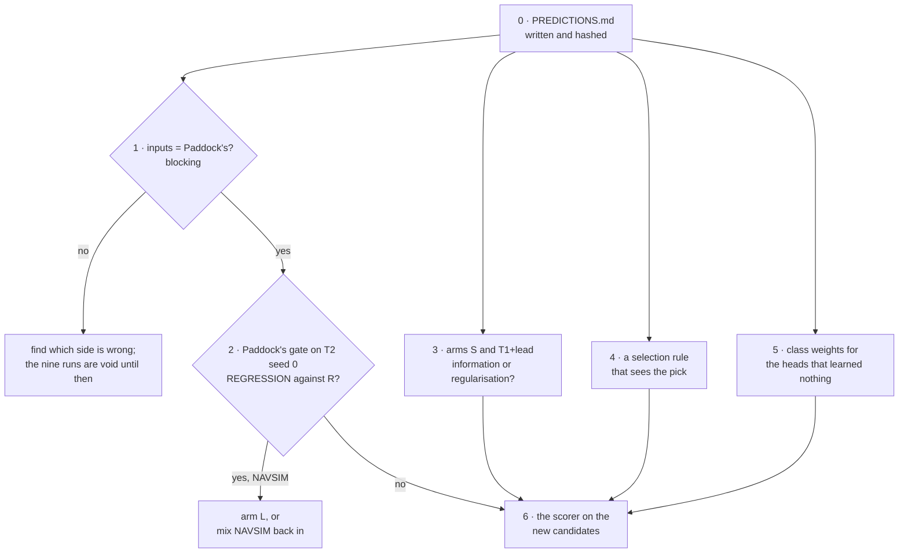

# Drive-JEPA auxiliary heads: what to do next

**Status (2026-10-21): proposed. Nothing below has run.**

Every cost here is an *estimate* unless it cites a measurement. The decision rules are meant to be
copied into `experiments/drivejepa_aux/PREDICTIONS.md` and hashed before the run they decide
(step 0). This round skipped that, and should not have.

## Where the first round left us

From [drivejepa-aux-heads.md](drivejepa-aux-heads.md#results-2026-10-21), *measured* on 2,996
keyframes of 102 held-out nuScenes train scenes, open loop:

- **The heads move the plan the frozen scorer picks, not the proposals.**
  - Against C, the picked plan's L2 at 3 s is −0.78 to −0.89 m for T2 and −0.32 to −0.48 m for T1,
    on every seed.
  - Best-of-32 is the same in every arm.
- **Selection is the bottleneck.** The best of 32 is 0.20 m from the human over 3 s. The pick's
  regret over it is 1.67 m for the release and 1.23–1.32 m for T2.
- **What is open:**
  - whether the inputs equal Paddock's;
  - whether the gain survives a split nothing touched, and NAVSIM;
  - whether it is label information or regularisation;
  - how to select checkpoints that show it;
  - why two of the four heads learned nothing.

## The order

Steps 3–5 need no Paddock change and run on GPU-minutes; they can go while step 1's Paddock PR is in
review. Step 2 is the expensive one and the one that decides shipping. Step 6 waits for all of them.

## Step 0: predictions, before anything runs

Write `experiments/drivejepa_aux/PREDICTIONS.md` with the decision rules of steps 1–5, and a
numeric prediction for each measured quantity. Put its sha256 in the commit message. A rule changed
after a run is a new prediction, recorded as one.

## Step 1: the inputs against Paddock's (blocking)

**The question.** Do Gallops' inputs equal what Paddock's adapter feeds the model? This round held
the nuScenes-table feed to Gallops' own builder only, which is self-referential (docs/reviewing.md
§4). It is the check that would have caught the camera-blind swerve runs.

**How.**
1. Paddock PR: `tools/models/drivejepa/paddock_candidates.py --rows` for nuScenes, as it already
   works for KITScenes. Build the index of the named train scenes with the harness's own
   `build_index`, and draw the samples with its `_sample`. That method writes the split as `"val"`
   today; it should write the split it read.
2. Dump the release's candidates through Paddock for the preflight's 60 sample keyframes. The aux
   preflight's `sample_rows` picks them deterministically, so the list can be written for Paddock
   and checked against it.
3. Add the comparison to `drivejepa_aux/preflight.py`, with no way to skip it. It applies swerve's
   fidelity gates to Paddock's 32 candidates and pick against the cache's.

**Decision.**
- **Passes when:** picks agree on ≥ 95% of keyframes; the median gap is under 1% of four seconds'
  travel; the p90 gap is under 10%.
- **If it passes,** the nine runs stand.
- **If it fails,** find which side is wrong before anything else. Every number of this round
  waits on that.

**Cost.** About 30 lines in Paddock plus a test; a 5-minute dump; about 50 lines and tests here.

## Step 2: Paddock's gate on T2 seed 0

**The question.** Does the gain survive a split nothing touched (nuScenes val), and does T2
regress anything the release does well (H-safe)? NAVSIM is the risk:
- the scorer was trained there;
- T2's picks are slower (mean speed rank 13.1–13.5 of 31, against the release's 16.1);
- NAVSIM's ego-progress term rewards the speed T2 gave up.

**How.** Paddock's `tools/gate.py`, smoke tier: nuScenes 30 val scenes, KITScenes 223 keyframes,
NAVSIM 1,000 tokens, neuroNCAP 6 pairs × 3 runs.
- Run the release once, for the baselines; then C seed 0 and T2 seed 0.
- `check` T2 against R (regression) and T2 against C (attribution).
- Both are served by Paddock's `drivejepa` adapter, with `DRIVEJEPA_CHECKPOINT` pointing at the
  sidecar's `weights_file`.
- Seed 0 is the original plan's choice ("seed 0 of C and of each T"), fixed before these results
  existed. It is not the best run.

**Predictions to write in step 0.**
- nuScenes val: T2 against C is a GAIN in L2 at 3 s.
- NAVSIM: T2 against R is NEUTRAL or a REGRESSION in PDMS, through ego progress.
- neuroNCAP: no prediction. Slower plans can avoid a collision or be hit from behind.

**Decision.**
- Any REGRESSION against R means FAIL: do not ship, and find the benchmark.
- A NAVSIM regression alone points to arm L (LoRA on the refiner) or to mixing NAVSIM back in.
  `navtrain` is not on this machine (data.md).
- No regression plus a closed-loop GAIN makes a ship candidate: run the full tier.

**Cost.** A few hours of GPU per checkpoint per smoke (the plan's estimate), for three checkpoints:
most of a GPU day on a shared machine. Ask before starting it.

## Step 3: information or regularisation

**The question.** Do the heads help because of what their labels say, or because any extra loss on
the query features anchors them? And does T2's extra gain over T1 come from the lead head? The
lane-change head learned nothing.

**How.** Two arms, three seeds each, from the same recipe:
- **S:** T2 with each keyframe's labels taken from another keyframe, a fixed permutation recorded
  in the sidecar. It needs a `--shuffle-labels SEED` switch.
- **T1+lead:** upstream's heads and the lead head, no lane-change head. It needs a `--heads`
  value.

**Decision**, on the picked plan's L2 at 3 s at the fixed epoch 10. Let G = T2 − C, −0.83 m on
average this round.
- **S − C, as a share of G:**
  - ≥ 50%: the gain is mostly regularisation;
  - ≤ 20%: it is label information;
  - in between: not resolved at this n.
- **T1+lead recovers ≥ 80% of T2 − T1:** the lead head carries T2's extra gain.

**Cost.** Six runs. *Measured:* nine took 83 min together on one H200, so about an hour.

## Step 4: a selection rule that sees the pick

**The question.** The held-out planning loss never sees the scorer, and ranked C first while C's
picks were the worst of the three arms. What should choose the epoch?

**How.** No retraining: every epoch's weights are saved.
1. Split the 102 held-out scenes in two, by a rule fixed now (`split.draw` over the held-out list,
   seed 1, half).
2. On the first half, choose each run's epoch by the picked plan's L2 at 3 s.
3. Report on the second half.
4. Compare with the fixed-epoch numbers (`evaluate.py`, `report --epoch`).

**Decision.** Adopt it for the next runs if it moves any run's kept epoch, and its report-half
numbers are no worse than the fixed epoch's. The planning loss stays logged as a curve.

**Cost.** Minutes of GPU.

## Step 5: the heads that learned nothing

**The question.** Two heads learned nothing:
- **lane change** (4% of keyframes): F1 0, it always says "keep";
- **lane dividers** (2% of labelled cells): IoU 0.000.

Can either learn, and does it change the pick if it does?

**How.**
- Class weights in `heads.losses`: inverse frequency over the train split for the lane-change
  cross-entropy, and for the BEV cross-entropy's divider class. Gallops calls
  `F.cross_entropy` itself there, so upstream's code is untouched.
- Three seeds of T2 with the weights.

**Decision.**
- Keep a head only if it beats its no-camera baseline on the held-out scenes: lane-change F1 above
  0.2 for both left and right; lane-divider IoU above 0.05.
- Otherwise drop it from T2. A head that learns nothing is a regulariser with a misleading name.

**Cost.** Three runs, about 40 min.

## Step 6: the scorer on the new candidates

**The question.** Selection is the bottleneck: the pick's regret over the best of 32 is 1.2–1.7 m,
against a best of 0.20 m. The heads closed about a quarter of it. A scorer trained on nuScenes would
go after the rest. Do the heads still add anything once it is?

**How.**
- Retrain the scorer head on T2's candidates, as the Bench2Drive Final's split-head stage did on
  its generator's (`drivejepa_b2d.train_split_head`), and on C's.
- The labels come from Gallops' grader on the logged boxes and the human's progress.
- Compare T2 + scorer against C + scorer, and both against T2.

**Decision.** If C + scorer matches T2 + scorer, the heads were a way around a frozen scorer, and the
scorer is the cheaper fix. If T2 + scorer is better, the heads stay.

**Cost.** The largest step. It needs candidate dumps and grader labels on nuScenes train, so a
plan of its own once steps 1–4 have run.

## Not yet

- **Arm P (LoRA on the encoder).** The plan held it back until T moved nothing. T moved the pick,
  so P waits until step 6 says the error left is perception, not selection.
- **Arm L (LoRA on the refiner)** is only for a NAVSIM regression in step 2.
- **Longer training.** All three C runs kept their last epoch. Train longer only together with
  step 4's rule, both arms alike.
- **Sweeping on closed loop.** Closed loop gates two or three checkpoints; it is not a training
  signal ([CLAUDE.md](../CLAUDE.md)).

| Step | Question | Cost (*estimate*) | Blocks |
|---|---|---|---|
| 0 | the predictions, before the runs | an hour | 1–5 |
| 1 | inputs = Paddock's? | Paddock PR + 5 GPU-min | 2, any ship claim |
| 2 | clean open-loop gain; NAVSIM regression? | most of a GPU day | shipping |
| 3 | information or regularisation? | about 1 GPU-hour | the claim about the heads |
| 4 | a selection rule that sees the pick | GPU-minutes | the next runs' selection |
| 5 | can the dead heads learn? | about 40 GPU-min | T2's final head set |
| 6 | the scorer on the new candidates | a plan of its own | the next model |
