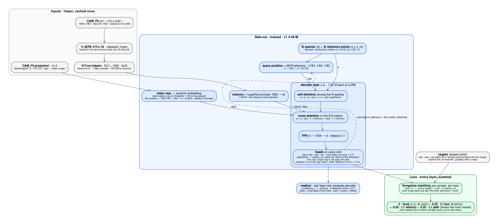

# H15, Part A, revised: the perception side-car alone, one reviewed step at a time

**Status (2026-11-04): steps 1–3 written for review; step 3's pipeline check is in §9. Nothing past
step 3 has run.**

**Why a revision.** The first pass ([its plan](drivejepa-perception-sidecar.md), [its
record](../experiments/H15_perception_sidecar/README.md)) ran the side-car and every phase-B question
in a day and a half. It produced too much to review, so the owner judged its results inconclusive.
This plan covers **Part A only**, training the side-car and measuring it. It breaks Part A into eight
steps. The owner reviews each block before the next one starts.

**What to review, in order:**

| Step | Artifact |
|---|---|
| 1 · the data | `notebooks/01_dataset.ipynb` (written next), §3 |
| 2 · the model and its loss | `notebooks/02_loss.ipynb` (written next), §4–5 |
| 3 · the training recipe and the pipeline check | `notebooks/03_training.ipynb` (written next), §6 and §9 |
| the plan for steps 4–8 | `notebooks/04_evaluation.ipynb` (written next), §7–8 and §11 |

- **Labels on numbers:**
  - *counted*: on disk at this site;
  - *measured*: from a run;
  - *read*: in code;
  - *estimate* and *argued*: as named.
- **First-pass numbers** are quoted as reference only. Part A re-measures what it claims.

## 1. The question

**H-A.** A side-car of a few million parameters reads Drive-JEPA's frozen ViT output. Can it find the
agents in front of the car, in 3D, and say where each one will be in the next second? It must do
better than baselines that do not look at the image.

- **Agents** are vehicles, pedestrians and cyclists.
- **Each agent's output:**
  - class;
  - box (x, y, z, length, width, height, yaw);
  - velocity;
  - position at t + 0.5 s and t + 1.0 s.

**Out of scope until Part A closes:** anything about planning.
- B1 (scorer), B2 (refiner), B3 (ViT LoRA) and C (adapter and gate) wait.
- The side-car changes nothing in the planner, so Part A cannot regress it.

## 2. What changed from the first pass

| | First pass | This plan |
|---|---|---|
| Scope | A, B1, B2, B3, nuScenes for every B model | A only |
| Pace | all steps back to back | 8 steps; the owner reviews after steps 3, 5 and 7 |
| Report logs | read at the end of every run | read once, at step 6, after the choices on select are frozen (`--no-report` until then) |
| What a run records | mean train loss per epoch, select readout | every 50 steps: each loss term per layer, learning rate, gradient norm, AMP scale, fit of the matched slots, data wait. Per epoch: the full select readout (§6.7) |
| Live check of the inputs | post-projector tokens only | also the ViT output, which is what the side-car reads (§6.8) |
| Architecture | one size (+ 128 queries on one seed) | three variants, chosen on select (§6.4) |
| Epochs | 12, untested | 12 against 24, chosen on select (§6.3) |
| Success criteria | written for A and B together | Part A's own, committed at step 4 before any reported run (§7) |
| nuScenes | part of the B readouts | its own step, with a side-car-only readout (§8.2) |
| Metrics | recall and precision at one threshold, centre and velocity error, paths | the same, plus proposals for box size and yaw errors, AP, motion apart from position, per city (§8.1) |

## 3. The data (step 1)

Everything here is reviewed in notebook 01, which draws real samples and every distribution.

### 3.1 One sample

- **A sample** is a navtrain token, the current frame *t* of a 14-frame window:
  - 4 frames of history, ending at *t*, then 10 of future;
  - every frame 0.5 s apart (2 Hz). *Counted*: 0.5 s between frames in the logs.
- **Its source** is an OpenScene log pickle (nuPlan's data, re-packaged).
  - Each frame holds the 8 cameras' file paths and calibration, the ego pose and dynamics, and the
    annotations.
- **Cities**, by navtrain logs (*counted*): Las Vegas 63%, Boston 19%, Pittsburgh 10%, Singapore
  one-north 8%.

### 3.2 What the side-car reads

| Input | Shape | What it is | Where it comes from |
|---|---|---|---|
| ViT-out tokens | 512 × 1024, fp16 | The released V-JEPA ViT-L/16's output, before the projector. It sees CAM_F0 at t − 0.5 s and at t, each cropped to rows 28–1052 and resized to 512×256. Tubelet 2 fuses the two frames, so the 512 tokens are one 16 × 32 grid of 16 × 16-pixel patches | `tokens-vit-v1`, cached once (*measured*: equal to the full forward's tap on 32 rows, largest difference 0.0) |
| CAM_F0 projection | 4 × 4 | The vendor's `lidar2img` for CAM_F0 (slot 1), composed with `TO_512`: ego coordinates → pixels of the 512×256 token image | `tokens-v1/lidar2img.npy` and `targets.front_projection` |

- **Why the ViT's own output.** The first pass's A0 probe chose it over the post-projector tokens and
  over block 12: select recall within 30 m 0.343 against 0.249 and 0.269. It is reused, not
  re-tested.
- **Not an input: the ego's own motion.** The velocity labels are each agent's ground velocity, not
  its velocity relative to the ego.
  - A parked car has velocity zero while the ego drives past it.
  - So the side-car must infer the ego's motion from the two frames. Ego speed is cached
    (`ego_status`, 4 × 11 per sample), so adding it is cheap.
  - Whether it should be added is an open question (§11, Q4). Notebook 01 shows how far labelled
    velocity and image motion differ.

### 3.3 The labels (`labels-v1`, built by `navsim_data` from `6efd8e6`)

- **Every annotated agent within 60 m at *t*,** in *t*'s ego frame (x forward, y left, metres). Each
  has:
  - class: vehicle, pedestrian, bicycle, or static;
  - box: x, y, z, length, width, height, yaw;
  - velocity: vx, vy;
  - **its centre at t + 0.5 s and t + 1.0 s:** frames t+1 and t+2, joined on `track_token` and moved
    from each frame's ego coordinates through global into *t*'s. A step whose track ended is masked,
    never extrapolated.
- **Checked against NAVSIM's and nuPlan's own code** at build time (`navsim_data check`, 60 windows,
  *measured*):
  - the ego future is 1.9e-6 off;
  - path points are 3.7e-6 m off;
  - re-runs equal the stored labels;
  - 0.33% of joins change box size by more than 0.5 m.
- **Counted:** 7,104,100 agents within 60 m, 47% of them in the three side-car classes.

### 3.4 The targets (`targets.build`)

**Which agents are targets.** All of these must hold:
1. a vehicle, pedestrian or cyclist;
2. within 50 m;
3. its **centre** projects inside the 512×256 image, in front of the camera (H04's "seen" rule);
4. among the nearest 64.

Everything else is neither a positive nor a negative. Paths become offsets from the agent's own
centre.

**Per split** (*counted*; "≤ 30 m" is the readout's headline range):

| | train | select | report |
|---|---|---|---|
| samples | 94,195 | 4,457 | 4,636 |
| targets | 660,723 | 32,375 | 24,216 |
| targets per sample: mean, median, 99th percentile, max | 7.01, 5, 42, 64 | 7.26, 5, 39, 64 | 5.22, 4, 29, 56 |
| samples with no target | 14.5% | 15.9% | 18.2% |
| samples with more than 64 seen agents (truncated) | 166 | 7 | 0 |
| vehicles, pedestrians, cyclists | 56.4%, 43.0%, 0.5% | 55.3%, 44.0%, 0.7% | 64.7%, 34.6%, 0.7% |
| range 0–20, 20–30, 30–50 m | 18.2%, 26.7%, 55.2% | 17.7%, 27.4%, 54.9% | 16.7%, 24.3%, 59.0% |
| moving (> 1 m/s) | 43.8% | 44.1% | 43.6% |
| path known at +0.5 s, +1.0 s | 98.7%, 97.5% | 98.7%, 97.6% | 98.6%, 97.2% |
| 1 s displacement: median, 90th percentile | 0.71, 6.05 m | 0.77, 6.01 m | 0.47, 7.13 m |

**What the table changes in the plan:**
- **More than half of all targets are beyond 30 m.** The headline (within 30 m) reads 41–45% of
  them; the 30–50 m bin is reported beside it.
- **The report logs are easier than the select logs:**
  - fewer targets per sample (5.2 against 7.3);
  - fewer pedestrians (35% against 44%), and pedestrians are the harder class;
  - so all-class recall on report sits above select from the class mix alone (*argued*).
  - Per-class numbers are reported beside every all-class one, and nothing compares select and
    report all-class numbers directly.
- **Cyclists are 0.5% of targets** (about 170 on report): their numbers carry wide intervals and
  decide nothing.
- **The 64-target cap almost never binds** (166 of 94,195 train samples), so 64 queries are not
  short of targets.

### 3.5 The splits

| Split | Role | Logs | Samples | Cities (logs: Las Vegas, Boston, Pittsburgh, Singapore) |
|---|---|---|---|---|
| train | training | 1,071 | 94,195 | 674, 206, 105, 86 |
| **select** | validation: every choice (epoch, variant, schedule) | 51 (H04's held-out navtrain logs) | 4,457 | 33, 9, 7, 2 |
| **report** | test: read once, at step 6 | 70 (seeded draw) | 4,636 | 40, 14, 8, 8 |

- **Committed** in `recipes/drivejepa_perception/splits.json`.
  - Every run re-draws the lists from their rule and refuses an edited file.
  - The split is by log, so no scene is in two splits. Samples of one log are 0.5 s apart and
    nearly identical.
- **In-sample for the encoder.** The released model trained on all of navtrain, the select and
  report logs included.
  - The side-car never sees their labels.
  - The ViT has seen their images, through the planner's training.
  - Report numbers may be slightly optimistic for an encoder on new scenes (*argued*). nuScenes
    (§8.2) and, if the owner allows it, navtest (§8.3) are the clean checks.
- **Read before.** The first pass already read the report logs for its A1 runs. The variants below
  were designed knowing that 128 queries scored higher there. §7 and §8.3 say how that is handled.

### 3.6 Caches reused, unchanged (`{runs}/drivejepa_perception/`)

| Cache | Size | Built by (commit) | Held to, at build time |
|---|---|---|---|
| `labels-v1` | 0.5 GB | `navsim_data labels` (`6efd8e6`) | NAVSIM's and nuPlan's code (§3.3) |
| `tokens-v1` | 56 GB | `tokens` (`a2c5255`) | batch 16 equal to batch 1 on 32 rows; the fast inputs equal the vendor's on 12 rows |
| `tokens-vit-v1` | 108 GB | `tokens --vit-out-all` (`30b9fdb`) | the full forward's ViT tap, on 32 rows, exactly |

No new data pass is needed for steps 1–6.

### 3.7 What the labels cannot tell

- **Occlusion.** OpenScene's annotations have no visibility flag and no lidar-point count (*read*:
  their keys are boxes, names, velocities and two token lists).
  - An agent fully hidden behind a truck is still a target. Recall cannot reach 1 for a camera,
    least of all at range.
  - nuScenes keeps only boxes some lidar point hit (§8.2), so the two datasets' recalls are not
    measured against the same kind of target.
- **"Seen" is decided by the centre alone.** A truck half in view with its centre outside the image
  is not a target. A detection of it counts against precision.
- **Box height (z).** Vehicle z varies by log: medians 0.23–0.95 m on four logs, for heights near
  1.8 m (*counted*). Notebook 01 projects the boxes onto the image to show whether z is the box's
  centre, as `views.box_corners` assumes.
- **Auto-labels.** NAVSIM's boxes are machine-made. Box size drifts along a track (0.33% of joins by
  more than 0.5 m), and yaw is noisy for pedestrians.

## 4. The model (step 2)

| Part | What it does | Parameters (v1) |
|---|---|---|
| input projection | LayerNorm(Linear 1024 → d) on every token: the cross-attention's values, and its keys' content | 0.26 M |
| token rays | For each token, the camera centre plus 16 points along the ray through its pixel centre, 1–60 m log-spaced, scaled by (1/64, 1/64, 1/8) → MLP 48 → 256 → d. Added to the keys only (PETR-style) | 0.08 M |
| queries | N learned vectors (d) and N learned reference points (x, y, z in metres) | 0.02 M |
| query position | MLP 3 → 256 → d of the reference point, added to queries and keys in self-attention and to queries in cross-attention | 0.07 M |
| decoder layer × L | pre-norm self-attention among queries → cross-attention to the 512 tokens → FFN (d → 1024 → d, ReLU, dropout 0.1). Every layer has its own heads | 1.32 M each |
| heads, per layer | class (4 logits: vehicle, pedestrian, cyclist, none); Δcentre (3); box (log l, log w, log h, sin yaw, cos yaw); velocity (vx, vy); path (2 steps × 2 offsets) | in the layer |

**How a layer's output becomes the next layer's input.**
- The predicted centre is reference + Δcentre. It becomes the next layer's reference point,
  detached, as in Deformable DETR's box refinement.
- Δcentre's last layer starts at zero, so each slot's first centre is its reference point.

**Initial state** (*read* in `sidecar.py`):
- The "none" logit's bias is 2.0, so every slot starts at p(none) ≈ 0.71: few false alarms at the
  start.
- The reference points start uniform over x 2–50 m, |y| < 30 m, z 0.
  - About half of that rectangle is outside the camera's view (*estimate*: the view is ±32° wide
    and starts about 6 m ahead on the ground). Notebook 02 counts it for the seeded start.
  - With AdamW at 2e-4 a reference point moves at most about 2 m over training (*argued*). A slot
    is still not stuck: its first layer's Δcentre can move its centre anywhere.
  - Kept as is in v1 for comparability with the first pass. A better start inside the view is a
    possible later change, not part of this plan.

**What the outputs mean.**
- All positions are in the ego frame at *t*, metres.
- Velocity is the agent's ground velocity, in m/s along the ego's axes.
- Path offsets are relative to the agent's own predicted centre, at +0.5 s and +1.0 s.
- At readout only the last layer counts (`evaluate.decode`):
  - confidence = 1 − p(none);
  - class = the most likely of the three;
  - a slot is a detection when its confidence is at least 0.5.

## 5. The loss (step 2)

Notebook 02 builds each term by hand on a toy example and on a real batch, and checks it against
`sidecar.SideCarLoss`.

**Per layer ℓ, per batch:**
1. **Hungarian matching**, per sample. Slot *q* is paired with target *g* to minimise the sum of
   `2 · (−p_q(class of g)) + 0.25 · |centre_q − centre_g|₁` (3D, metres).
   - Each target gets exactly one slot.
   - Unmatched slots are trained towards "none".
   - Every layer is matched on its own.
2. **Class:** softmax focal loss, γ = 2, no α, over all N slots of every sample. A slot's target is
   its matched target's class, or "none".
3. **Box:** L1 over 8 terms of each matched slot: x, y, z (m), log l, log w, log h, sin yaw,
   cos yaw.
4. **Velocity:** L1 over (vx, vy) of each matched slot, m/s.
5. **Path:** L1 over the offsets of each matched slot, only at steps where the label's track lasted.

`L_ℓ = 2 · focal/n + 0.25 · box/n + 0.25 · velocity/n + 0.25 · path/n_path`, and the loss is the
sum of L_ℓ over the L layers.
- *n* is the batch's number of targets.
- *n_path* is its number of valid path steps.

**What to notice when reviewing it** (*read*; none is changed in v1, so v1 stays comparable with the
first pass):
- **Units are mixed.** The box term adds metres (x, y, z) to unitless log-sizes and sin/cos. Once
  sizes are learnt, position dominates it.
- **Normalisation differs between terms.** The path term divides by valid path steps (about 2 per
  target), the others by targets. So per target, the path weighs about half of what 0.25 suggests.
- **The class term is summed over all 64 × 64 slots of a batch,** but divided by about 450 targets.
  The many easy "none" slots are what the focal γ is there to quiet.
- **Weight decay** (0.01, decoupled) applies to every parameter, LayerNorms, biases, queries and
  reference points included.

## 6. The training recipe (step 3)

### 6.1 Optimisation

| Setting | Value | Note |
|---|---|---|
| Optimiser | AdamW, β = (0.9, 0.999), ε = 1e-8 | PyTorch defaults; H04's recipe |
| Learning rate | 2e-4, cosine to 0 per optimizer step | no warmup |
| Weight decay | 0.01 | on every parameter |
| Batch | 64 samples | `drop_last`: 1,471 steps an epoch, 51 samples left out per epoch, different ones each time |
| Epochs | 12 (17,652 steps), or 24 if step 5 chooses it (§6.3) | |
| Precision | fp16 autocast for the forward; the loss in fp32; GradScaler | scale 65,536 at the start, halved on overflow (that step is skipped), doubled every 2,000 clean steps |
| Gradient clip | global L2 norm 35, after unscaling | H04's. How often it acts is logged |
| Dropout | 0.1 in attention and FFN | |
| Seeds | 0, 1, 2 | the seed sets the model's start (`torch.manual_seed`) and the data order (a seeded generator) |
| Augmentation | none | the tokens are cached, so the images cannot be augmented |

### 6.2 Data loading

- **8 loader workers.** Each item copies one sample's tokens out of the memory-mapped
  `vit_out.npy`: 1 MB fp16, 64 MB a batch.
- **An epoch reads about 99 GB** of the 108 GB file. Once read, it can stay in the page cache: the host
  has 1 TB of RAM, most of it cache (*counted*).
- **Targets for all 103,288 samples** are built once, at start-up. That takes 6 s (*measured*).
- **Whether the loader keeps the GPU fed** is measured: `data_s` against `step_s` in `steps.jsonl`.

### 6.3 How many epochs

- **12 is the first pass's number.** Its A1 runs kept epoch 11, 11 and 12 of 12.
  - With a cosine schedule the last epochs are the best almost by construction: the learning rate
    reaches 0.
  - So it does not show that 12 epochs suffice (*argued*).
- **Step 5a trains v1 for 24 epochs beside the 12-epoch runs.** 24 becomes the schedule if its kept
  epoch beats 12's by at least 0.01 select F1.

### 6.4 The three architecture variants

| | v1 | v2 | v3 |
|---|---|---|---|
| width d | 256 | 256 | 384 |
| attention heads | 8 | 8 | 12 |
| FFN width | 1024 | 1024 | 1536 |
| decoder layers | 3 | 6 | 6 |
| queries | 64 | 128 | 128 |
| parameters (*counted*, `train_sidecar.VARIANTS`) | 4.39 M | 8.37 M | 18.44 M |
| share of the 307.86 M inference path (budget ≤ 10%) | 1.4% | 2.7% | 6.0% |
| why | the first pass's A1: the reference, and a reproduction | DETR-style decoders usually have 6 layers. The first pass's 128-query run gained precision (one seed, report logs) | Is width the limit? The first pass's A2 found the side-car data-limited, so a larger model may not help (*argued*) |

- A d = 512 version (32.45 M) is over the 30.8 M budget and is not considered.
- Query count and depth change together in v2, so a v2 gain cannot be split between them. Splitting
  it would cost one more run, and only if v2 wins.

### 6.5 What is chosen, and on what

| Choice | Rule | Read on |
|---|---|---|
| Kept epoch | best F1 at 2 m within 30 m | select, after every epoch |
| Variant | the smallest variant within 0.01 F1 of the best, at its kept epoch, seed 0 | select |
| Schedule | 24 epochs if v1-24 beats v1-12 by ≥ 0.01 F1, else 12 | select |

- **The last epoch is reported beside the kept one.** The kept epoch is a maximum over epochs; the
  last is not.
- **0.01 F1 is about 2.5 times the first pass's seed range** (0.004, *measured* on report).

### 6.6 The runs (step 5, after the review)

| Run | What | Purpose |
|---|---|---|
| 5a | v1, v2, v3 at seed 0, 12 epochs; v1 at seed 0, 24 epochs | choose the variant and the schedule |
| 5b | the chosen variant and schedule, seeds 1 and 2 (and seed 0 if 5a did not train that pair) | seed spread |
| 5b | the chosen variant, tokens zeroed throughout (`--blind`), seed 0 | the no-camera control: what can be learnt without the image |

- **v1 at seed 0 for 12 epochs repeats the first pass's A1 seed 0:** same code path, start and data
  order. Its select F1 should match that run's to within GPU nondeterminism (G5). If it does not,
  something changed, and that is found before any claim.

### 6.7 What a run records, and the plots

**`steps.jsonl`**, every 50 steps, the means over those steps:
- each loss term of each layer (`cls0..`, `box0..`, `vel0..`, `path0..`) and the total;
- the learning rate;
- the gradient norm before clipping, with non-finite norms counted apart;
- the AMP scale;
- the number of matched targets;
- the matched slots' centre error and class accuracy;
- time waiting for data, and time per step.

**`metrics.jsonl`**, every epoch:
- the epoch's means of all of the above;
- clipped and skipped steps;
- peak GPU memory;
- the full select readout.

**Plots** (notebook 03; the same code reads every later run):
1. total loss against step, with the epoch boundaries;
2. each term (class, box, velocity, path) by layer: later layers should sit lower;
3. learning rate: the planned schedule, and the part that ran;
4. gradient norm against the clip at 35;
5. AMP scale: flat, or halving on overflows;
6. the matched slots' centre error and class accuracy: the fit, while it trains;
7. data wait against step time: is the loader the bottleneck?
8. per epoch, on select:
   - recall, precision and F1 within 30 m;
   - recall by range bin and by class;
   - centre and velocity error;
   - path FDE against constant velocity;
   - detections per sample against targets per sample.

**What would be wrong:**
- a loss that rises, or stalls in the first few hundred steps;
- later layers no better than the first;
- clipping on most steps;
- repeated AMP overflows;
- class accuracy stuck at the "none"-heavy start;
- loader waits as long as the steps.

### 6.8 Checks before and during a run

- **Preflight**, before the first step, with no way to skip it (`preflight.run`). It checks:
  - the code is committed and the test suite passes under Drive-JEPA's 3.9;
  - the splits are unedited and each run's rows are in their split;
  - the labels hold to NAVSIM's code on 8 windows;
  - a live batch-1 forward of 6 select samples equals the cache: the post-projector tokens to fp16
    rounding, the release's pick exactly, and **(new) the ViT output, which the side-car reads,
    within `tokens.VIT_LIMITS`**;
  - a point 20 m ahead projects near the image's centre column.
- **The overfit check**, per variant before its first run: 64 train samples, one batch, until the
  matched centre error is under 0.5 m and class accuracy over 95%, within 4,000 steps.
- **During the run:** a non-finite loss stops it.

### 6.9 Cost

Step 3 measures the time of one epoch (§9). The step-5 budget is that time multiplied out: 4 runs
in 5a, then 3–4 in 5b. The GPUs are shared and run at near-full load, so wall time is quoted, not
GPU-hours.

## 7. How success is measured (a draft, for step 4)

**What this section is.**
- It was written and committed before step 3's pipeline check ran. That check reads only the train
  and select logs.
- At step 4 the owner approves or edits it, and it is copied into PREDICTIONS.md as its own dated
  section.
- An edit made after reading step 3's numbers is labelled as such there.

### 7.1 Gates: each must hold to go on

| # | Gate |
|---|---|
| G1 | every run's preflight passes, and its report is in `run.json` |
| G2 | each variant passes the overfit check before its first run |
| G3 | no run has a non-finite loss. Skipped (overflow) steps stay under 1% of steps. Clipped steps are reported |
| G4 | the owner has seen a run's curves (notebook 03) before its report numbers exist |
| G5 | v1 seed 0 (12 epochs) reproduces the first pass's A1 seed 0: select F1 at epoch 11 within ±0.01 of the 0.669 that run recorded there (its reread, quoted by B3.1's preflight in the README; its per-epoch files were deleted) |

### 7.2 Predictions

**Scope.** Report logs, front view, within 30 m, unless stated; the chosen variant, three seeds.
**First-pass reference values** (A1, v1, report logs): recall 0.630–0.632, precision 0.736–0.742,
moving vehicles 0.935–0.936, lead-gap error 2.14–2.36 m against the prior's 8.53 m.

| # | Metric | Baseline | Predicted | Support | Refuted |
|---|---|---|---|---|---|
| Q1 | recall and precision at 2 m | the blind control | recall 0.60–0.70, precision 0.72–0.85 | recall ≥ 0.55 and precision ≥ 0.65 on every seed | recall < 0.40 on any seed |
| Q2 | recall of moving vehicles within 20 m | the blind control | ≥ 0.90 | ≥ 0.85 on every seed | < 0.70 on any seed |
| Q3 | per class: vehicle and pedestrian recall | — | vehicles ≥ 0.70, pedestrians 0.35–0.55 within 30 m | reported, not decided: the class mix differs between splits (§3.4) | — |
| Q4 | 1 s path FDE of matched moving agents | constant velocity from the side-car's own velocity | lower, by 3–8% | lower beyond 2 SE (clustered by log) on every seed | not lower on any seed |
| Q5 | lead-vehicle gap error | the train-mean prior | ≤ 2.5 m | ≤ half the prior's error on every seed | ≥ the prior's error |
| Q6 | sight: recall with another log's tokens | own tokens | ≤ 0.06 | ≤ 0.10 on every seed | > 0.20 on any seed |
| Q7 | variant (select, seed 0) | v1 | v2 beats v1 by 0.01–0.04 F1. v3 is within 0.01 of v2 | — (a choice by §6.5, recorded) | — |
| Q8 | schedule (select, v1 seed 0) | 12 epochs | 24 beats 12 by 0.005–0.02 F1 | — (a choice by §6.5, recorded) | — |
| Q9 | nuScenes, zero-shot: vehicle recall at 2 m within 30 m | — | 0.40–0.55 | ≥ 0.30 | < 0.20 |

**Q6's companion.** With the tokens zeroed, the first pass found 27 detections a sample on one
seed. That input never occurs in real data, so it is recorded as a diagnostic, not a gate.

### 7.3 Decision rules

- **G5 fails:** stop. Find what differs between the passes before any other run.
- **Q1 refuted:** H-A is refuted for this design. Step 8 records it, and no B question opens.
- **Q1 to Q6 supported:** H-A holds on NAVSIM. Step 8 decides, with the owner, whether one B question
  opens, and which one.
  - Q9 says whether the side-car can be trusted out of domain.
- **Q9 refuted:** the side-car is NAVSIM-only. That limits any B question to NAVSIM and to the gate's
  in-domain benchmarks.

## 8. Evaluation

### 8.1 NAVSIM, the report logs (step 6)

**Protocol.**
- Read once, after the owner has reviewed step 5 and the choices are recorded.
- Every seed of the chosen variant, at its kept epoch and its last.
- The blind control and the sight checks on the same logs.
- `train_sidecar reread` exists for this. It needs one change, written at step 6: reading kept and
  last in one call.

**What is computed:**

| Group | Metric | Now in `evaluate.readout` | Note |
|---|---|---|---|
| Detection | recall, precision, F1 at 2 m (centre x-y, same class), within 30 m and per range bin (0–20, 20–30, 30–50 m) | yes | a detection is confidence ≥ 0.5; greedy matching by confidence |
| | the same per class, and per class within 30 m | yes | |
| | **AP at 2 m per class** (and at 0.5, 1, 4 m), threshold-free | **proposed** | nuScenes' definition. Separates "can rank" from "the 0.5 threshold is right" |
| | detections per sample against targets per sample | yes (detections) | |
| | **confidence calibration**: hit rate by confidence bin | **proposed** | phase B reads a thresholded list, so the threshold's meaning matters |
| Boxes (matched) | centre error x-y | yes | |
| | **z, size (1 − IoU of aligned boxes), yaw error** | **proposed** | the side-car predicts them, and nothing reads them yet |
| Motion (matched) | velocity error | yes | |
| | 1 s path ADE and FDE, against stationary, constant velocity from its own velocity, and constant velocity from the label's | yes | |
| | **displacement error**: (predicted path − predicted centre) against (true path − true centre) | **proposed** | motion apart from position. The first pass's centre error (0.90 m) was most of its path error |
| Lead vehicle | gap error to the nearest vehicle ahead with \|y\| ≤ 1.75 m, against the train-mean prior | yes | a straight-lane proxy |
| Sight | recall with zeroed tokens, and with another log's tokens | yes (`sight`) | |
| Breakdowns | by city; by ego speed (stopped, < 5, ≥ 5 m/s) | **proposed** | report has more Singapore logs than select |

**Uncertainty.**
- The spread over three seeds.
- A 95% interval from resampling whole logs (1,000 draws), because samples of one log are not
  independent.
- Paired comparisons (Q4) use the SE clustered by log, as the first pass did.

**Recording.**
- Each number goes into `experiment.toml` with its *n* counted in the subset it describes.
- The first pass's A1 record gave n = 24,216 for "recall within 30 m". That is the report logs'
  count at every range; within 30 m there are 9,918 targets (*counted*).

**Notebook 04** shows each metric's definition on a toy case and on the pipeline check's
checkpoint, on select. The proposed metrics are prototyped there, and move into `evaluate.py`, with
tests, only if the owner adopts them.

### 8.2 nuScenes, out of the box (step 7)

**What it tests.** The side-car never saw nuScenes, and neither did the released model. So this is
the one clean out-of-sample check H15 has.
- The camera is nearly NAVSIM's (*read* in the nuScenes calibration tables, all 850 trainval
  scenes):

  | | NAVSIM CAM_F0 | nuScenes CAM_FRONT |
  |---|---|---|
  | image | 1920×1080 | 1600×900 |
  | focal length on the 512×256 token image, x / y | 412 / 386 px | 401–405 / 380–384 px |
  | horizontal field of view | 63.7° | 64.6–65.1° |
  | mounting (forward, up from the ego origin) | 1.62–1.67, 1.52 m | 1.67–1.72, 1.49–1.54 m |

- **So the gap is mostly the image and the labels:**
  - a 2018 camera against a 2021 one;
  - different streets in Boston and Singapore;
  - human labels against auto-labels.
- NAVSIM already has Boston and Singapore one-north logs. Singapore drives on the left in both.

**Steps:**
1. **Site root** (gitignored config, the owner's OK).
   - `[datasets.nuscenes]` must name a folder holding `v1.0-trainval/`, `samples/` and `can_bus/`.
   - At this site the configured folder no longer exists.
   - A complete copy of the tables and the CAM_FRONT keyframes (40,157) is on the shared disk, with
     its CAN bus beside it, not inside it (*counted*). A folder of three links to it is enough.
2. **`ood-draw --n 100 --seed 0`**, committed once (`nuscenes_data`). It draws 100 nuScenes **train**
   scenes:
   - only scenes with CAN-bus poses;
   - no scene behind a neuroNCAP scenario or a reconstructed one;
   - not val, which paddock's nuScenes benchmark reads.
3. **`ood-extract`** (CPU): keyframes, poses, calibration and annotations of the drawn scenes.
4. **`ood-pass`** (GPU, the release at batch 1): every usable keyframe's ViT output, and its labels
   in H15's layout.
   - Before it writes a row, the vendor's projection × `to_512(1600, 900)` is held to the one built
     from the calibration, within 0.5 px.
   - *Estimate*: about 3,000 keyframes. The first pass's 102 scenes gave 2,996.
5. **A side-car-only readout**, written at step 7. The existing `ood read` also reads every B1 run,
   which Part A has none of. It reports:
   - every §8.1 metric;
   - by location (Boston seaport, Singapore one-north, Queenstown, Holland Village);
   - night and rain apart, from the scene descriptions (99 night and 165 rain scenes of the 850,
     *counted*).

**Labels on nuScenes** (`ood.keyframe_agents`, *read*):
- **Classes:** `vehicle.*` (car, truck, bus, trailer, construction, emergency) → vehicle; bicycle and
  motorcycle → cyclist; `human.pedestrian.*` → pedestrian.
- **Only boxes with at least one lidar point**, nuScenes' detection convention. NAVSIM has no such
  filter (§3.7). nuScenes recall is therefore against more visible targets.
- **Velocity** is the devkit's central difference over neighbouring annotations.
- **Paths** are the same instance at the next two keyframes, 0.5 s apart.
- Whether NAVSIM's "bicycle" includes motorcycles is not established here.

**Success** is Q9. Per class and per range are reported beside it.

### 8.3 navtest as a fresh in-domain test (an option for the owner)

**What it is.** navtest's 136 logs and 12,146 samples (*read* in `navtest.yaml`) are on disk with
the rest of NAVSIM's 147 test logs (*counted*).
- The released encoder never trained on them.
- No H15 run has read them.

**What it needs:**
- a labels pass with navtest's scene filter, about 2 minutes on CPU;
- a ViT-out pass over its 12,146 samples, about 5 minutes on GPU and 13 GB (*estimate*, scaled from
  `tokens-vit-v1`);
- a split entry for it.

**Why consider it.** It is the only test set that is in domain and clean of both the encoder's
training and the first pass's reading.

**Why not by default.** The plan so far reserved navtest for the gate (planning EPDMS). Reading
perception metrics there chooses nothing about planning, but whether to touch navtest at all is the
owner's call (§11, Q2).

## 9. Step 3's pipeline check

*To be filled in from the run* (`part-a-overfit`, `part-a-pipeline`).

## 10. Code

**For steps 1–3** (`8da23d6`; tests in both interpreters):
- **`train_sidecar`:**
  - the variants (`--variant`);
  - `--stop-after`;
  - `--no-report`;
  - per-step telemetry;
  - `build_model`, which rebuilds first-pass runs as they trained.
- **`preflight`:** the live ViT-output check.
- **`views`** (new): what the notebooks draw with. It holds a sample's window from its log, the image
  the ViT reads, box corners and projection, and the camera's view from above.
- **Recipe stages** `part-a-overfit` and `part-a-pipeline`, writing under
  `{runs}/drivejepa_perception/part-a/`.

**Later, each in its own step, after the review that opens it:**
- step 5's recipe stages;
- step 6's `reread` of kept and last in one call, and any adopted metric;
- step 7's side-car-only nuScenes readout.

## 11. Decisions for the owner at the review of steps 1–3

1. **Success criteria (§7):** approve as written, or edit, before step 4 commits them.
2. **Test set:** the report logs only (the default), or navtest as well (§8.3).
3. **Ego motion as an input:**
   - velocity labels are ground velocity, which the side-car must infer from two frames (§3.2);
   - adding the cached ego speed as one more token is a fourth, separate variant;
   - recommended only after step 6, if velocity error is the weak point.
4. **Proposed metrics (§8.1):** AP, box errors, displacement error, calibration, breakdowns. Adopt
   all, some or none.
5. **nuScenes site root (§8.2, step 1):** links to the shared copy, or another location.
6. **Budget:** the step-5 runs as listed (§6.6), or fewer.

## 12. Risks

1. **The shared GPUs.** Both run near full load. Runs are slow and their timing is noisy, and the
   plan quotes wall time, not GPU-hours.
2. **Page cache eviction.** If other jobs push `vit_out.npy` out of memory, epochs read it from the
   network disk again. `data_s` will show it.
3. **The first pass's report reading.** The 128-query result shaped v2 and v3. §8.3 is the clean
   remedy; otherwise the comparison is flagged.
4. **Label limits.** Occluded targets and centre-only visibility (§3.7) cap recall in ways no model
   change fixes. Per-range numbers keep that visible.
