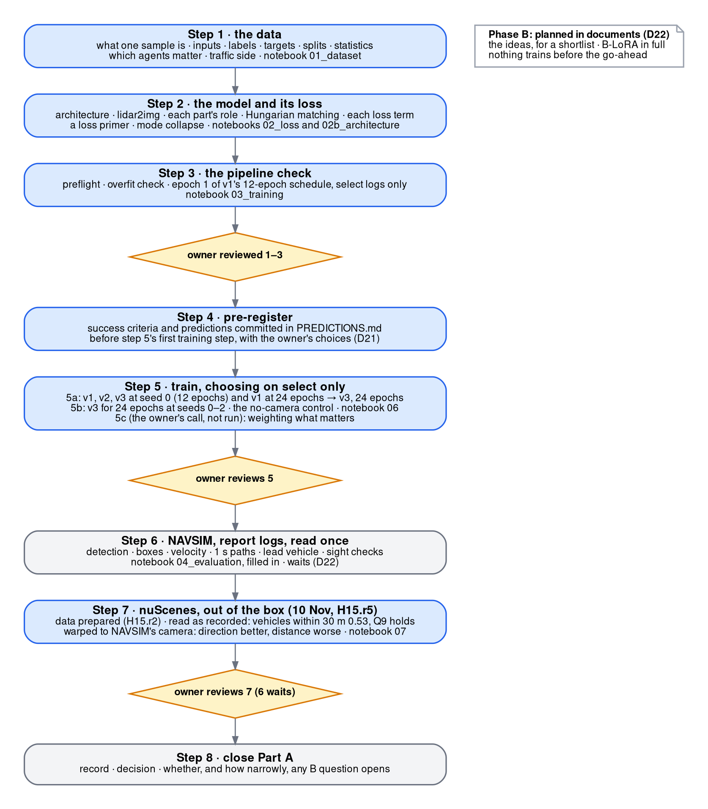
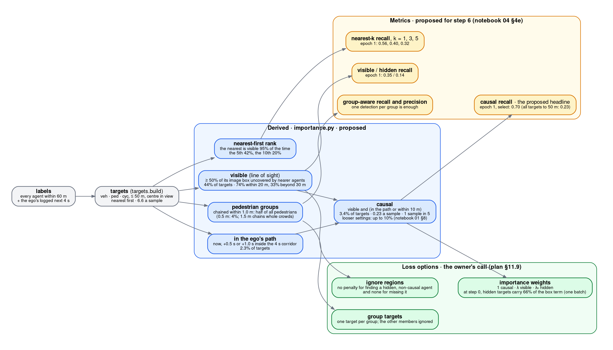
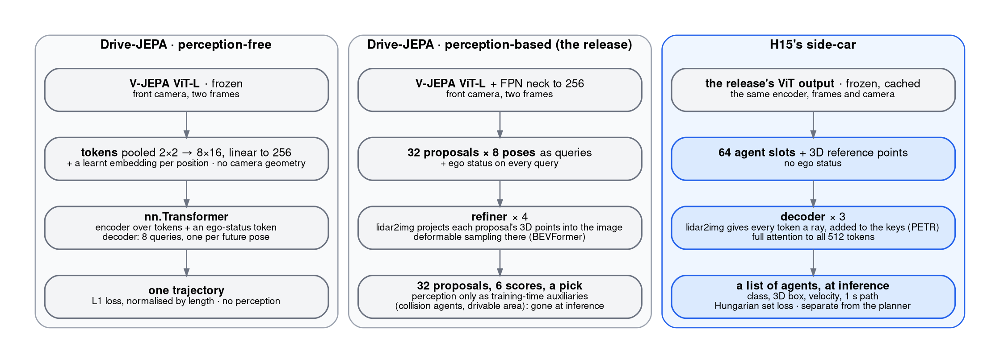
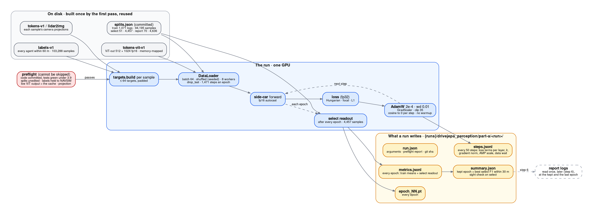

# H15, Part A, revised: the perception side-car alone, one reviewed step at a time

**Status (2026-11-10): steps 1–5 done on the select logs (§9.2, notebook 06), and step 7 done (§9.3,
notebook 07): on nuScenes the side-car finds 0.53 of the vehicles within 30 m, so Q9 holds. Step 6, the report
logs, waits: no report-log number exists. The owner has opened phase B's planning alongside (D22,
[the ideas](drivejepa-perception-sidecar-B-ideas.md), [the plan](drivejepa-perception-sidecar-B.md)).**

**Why a revision.** The first pass ([its plan](drivejepa-perception-sidecar.md), [its
record](../experiments/H15_perception_sidecar/README.md)) ran the side-car and every phase-B question
in a day and a half. It produced too much to review, so the owner judged its results inconclusive.
This plan covers **Part A only**, training the side-car and measuring it. It breaks Part A into eight
steps. The owner reviews each block before the next one starts.

**What to review, in order:**

| Step | Artifact |
|---|---|
| 1 · the data | [notebooks/01_dataset.ipynb](../experiments/H15_perception_sidecar/notebooks/01_dataset.ipynb), §3 |
| 2 · the model, part by part | [notebooks/02b_architecture.ipynb](../experiments/H15_perception_sidecar/notebooks/02b_architecture.ipynb), §4 |
| 2 · the loss: by hand, a primer, mode collapse, weighting what matters | [notebooks/02_loss.ipynb](../experiments/H15_perception_sidecar/notebooks/02_loss.ipynb), §5 |
| 3 · the training recipe and the pipeline check | [notebooks/03_training.ipynb](../experiments/H15_perception_sidecar/notebooks/03_training.ipynb), §6 and §9 |
| the plan for steps 4–8 | [notebooks/04_evaluation.ipynb](../experiments/H15_perception_sidecar/notebooks/04_evaluation.ipynb), §7–8 and §11 |
| step 7's nuScenes data, prepared | [notebooks/05_nuscenes.ipynb](../experiments/H15_perception_sidecar/notebooks/05_nuscenes.ipynb), §8.2 |
| 4 · the success criteria, committed | [PREDICTIONS.md](../experiments/H15_perception_sidecar/PREDICTIONS.md), the rerun's section |
| 5 · three sizes, then the chosen one at three seeds: what it predicts | [notebooks/06_predictions.ipynb](../experiments/H15_perception_sidecar/notebooks/06_predictions.ipynb), §9.2 |
| 7 · nuScenes, as recorded and warped to NAVSIM's camera | [notebooks/07_nuscenes_readout.ipynb](../experiments/H15_perception_sidecar/notebooks/07_nuscenes_readout.ipynb), §9.3 |

**The second review's questions, and where each is answered:**

| Question | Answered in |
|---|---|
| What `lidar2img` is, and what it does to the tokens | §4.1; notebook 02b §1 |
| The N queries, query position, self- and cross-attention: what each adds, and why this arrangement | §4.2; notebook 02b §2 |
| One small network per head, or one vector of logits decoded | §4.3; notebook 02b §3 |
| The readout, and explainability | §4.4; notebook 02b §4 |
| The side-car against Drive-JEPA's two variants | §4.5; notebook 02b §5 |
| Left- or right-hand traffic as a controllable input | §4.6; notebook 01 §9 |
| Hidden agents, causal agents, pedestrian groups, nearest first | §3.8, §5.3, §8.1; notebooks 01 §8, 02 §9, 04 §4e |
| A primer on loss functions, how they reach the network, and mode collapse | §5.1–5.2; notebook 02 §7–8 |
| The epoch-1 model's predictions, drawn on images | notebook 03 §8 |

- **Rerunning the notebooks:** use the `drive-jepa-v2` kernel at this site, which starts
  `[python] drivejepa` (Python 3.9, torch 2.1). The kernels to avoid, and a headless runner, are listed
  in the experiment's README.
- **Labels on numbers:**
  - *counted*: on disk at this site;
  - *measured*: from a run;
  - *read*: in code;
  - *estimate* and *argued*: as named.
- **First-pass numbers** are quoted as reference only. Part A re-measures what it claims.

## 1. The question

**H-A.** A side-car of a few million parameters reads Drive-JEPA's frozen ViT output. Can it find the
agents in front of the car, in 3D, and say where each one will be in the next second? It must do
better than baselines that do not look at the image.

- **Agents** are vehicles, pedestrians and cyclists.
- **Each agent's output:**
  - class;
  - box (x, y, z, length, width, height, yaw);
  - velocity;
  - position at t + 0.5 s and t + 1.0 s.

**Out of scope until Part A closes:** anything about planning.
- B1 (scorer), B2 (refiner), B3 (ViT LoRA) and C (adapter and gate) wait.
- The side-car changes nothing in the planner, so Part A cannot regress it.

## 2. What changed from the first pass

| | First pass | This plan |
|---|---|---|
| Scope | A, B1, B2, B3, nuScenes for every B model | A only |
| Pace | all steps back to back | 8 steps; the owner reviews after steps 3, 5 and 7 |
| Report logs | read at the end of every run | read once, at step 6, after the choices on select are frozen (`--no-report` until then) |
| What a run records | mean train loss per epoch, select readout | every 50 steps: each loss term per layer, learning rate, gradient norm, AMP scale, fit of the matched slots, data wait. Per epoch: the full select readout (§6.7) |
| Live check of the inputs | post-projector tokens only | also the ViT output, which is what the side-car reads (§6.8) |
| Architecture | one size (+ 128 queries on one seed) | three variants, chosen on select (§6.4) |
| Epochs | 12, untested | 12 against 24, chosen on select (§6.3) |
| Success criteria | written for A and B together | Part A's own, committed at step 4 before any reported run (§7) |
| nuScenes | part of the B readouts | its own step, with a side-car-only readout (§8.2) |
| Metrics | recall and precision at one threshold, centre and velocity error, paths | the same, plus proposals for box size and yaw errors, AP, motion apart from position, per city (§8.1) |
| Which agents matter | every target the same | derived labels proposed (visible, causal, pedestrian groups, nearest first), with metrics and loss options (§3.8, §5.3) |
| Camera geometry | assumed to be used | tested: one epoch in, the side-car does not use it geometrically (§4.1) |

## 3. The data (step 1)

Everything here is reviewed in notebook 01, which draws real samples and every distribution.

### 3.1 One sample

- **A sample** is a navtrain token, the current frame *t* of a 14-frame window:
  - 4 frames of history, ending at *t*, then 10 of future;
  - every frame 0.5 s apart (2 Hz). *Counted*: 0.5 s between frames in the logs.
- **Its source** is an OpenScene log pickle (nuPlan's data, re-packaged).
  - Each frame holds the 8 cameras' file paths and calibration, the ego pose and dynamics, and the
    annotations.
- **Cities**, by navtrain logs (*counted*): Las Vegas 63%, Boston 19%, Pittsburgh 10%, Singapore
  one-north 8%.

### 3.2 What the side-car reads

| Input | Shape | What it is | Where it comes from |
|---|---|---|---|
| ViT-out tokens | 512 × 1024, fp16 | The released V-JEPA ViT-L/16's output, before the projector. It sees CAM_F0 at t − 0.5 s and at t, each cropped to rows 28–1052 and resized to 512×256. Tubelet 2 fuses the two frames, so the 512 tokens are one 16 × 32 grid of 16 × 16-pixel patches | `tokens-vit-v1`, cached once (*measured*: equal to the full forward's tap on 32 rows, largest difference 0.0) |
| CAM_F0 projection | 4 × 4 | The vendor's `lidar2img` for CAM_F0 (slot 1), composed with `TO_512`: ego coordinates → pixels of the 512×256 token image | `tokens-v1/lidar2img.npy` and `targets.front_projection` |

- **Why the ViT's own output.** The first pass's A0 probe chose it over the post-projector tokens and
  over block 12: select recall within 30 m 0.343 against 0.249 and 0.269. It is reused, not
  re-tested.
- **What `lidar2img` does to the tokens: nothing.** The ViT reads pixels only. The projection gives the
  side-car each token's ray, which is added to the keys (§4.1).
- **Not an input: the ego's own motion.** The velocity labels are each agent's ground velocity, not
  its velocity relative to the ego.
  - A parked car has velocity zero while the ego drives past it.
  - So the side-car must infer the ego's motion from the two frames. Ego speed is cached
    (`ego_status`, 4 × 11 per sample), so adding it is cheap.
  - Whether it should be added is an open question (§11.3). Notebook 01 shows how far labelled
    velocity and image motion differ.

### 3.3 The labels (`labels-v1`, built by `navsim_data` from `6efd8e6`)

- **Every annotated agent within 60 m at *t*,** in *t*'s ego frame (x forward, y left, metres). Each
  has:
  - class: vehicle, pedestrian, bicycle, or static;
  - box: x, y, z, length, width, height, yaw;
  - velocity: vx, vy;
  - **its centre at t + 0.5 s and t + 1.0 s:** frames t+1 and t+2, joined on `track_token` and moved
    from each frame's ego coordinates through global into *t*'s. A step whose track ended is masked,
    never extrapolated.
- **Checked against NAVSIM's and nuPlan's own code** at build time (`navsim_data check`, 60 windows,
  *measured*):
  - the ego future is 1.9e-6 off;
  - path points are 3.7e-6 m off;
  - re-runs equal the stored labels;
  - 0.33% of joins change box size by more than 0.5 m.
- **Counted:** 7,104,100 agents within 60 m, 47% of them in the three side-car classes.

### 3.4 The targets (`targets.build`)

**Which agents are targets.** All of these must hold:
1. a vehicle, pedestrian or cyclist;
2. within 50 m;
3. its **centre** projects inside the 512×256 image, in front of the camera (H04's "seen" rule);
4. among the nearest 64.

Everything else is neither a positive nor a negative. Paths become offsets from the agent's own
centre.

**Per split** (*counted*; "≤ 30 m" is the readout's headline range):

| | train | select | report |
|---|---|---|---|
| samples | 94,195 | 4,457 | 4,636 |
| targets | 660,723 | 32,375 | 24,216 |
| targets per sample: mean, median, 99th percentile, max | 7.01, 5, 42, 64 | 7.26, 5, 39, 64 | 5.22, 4, 29, 56 |
| samples with no target | 14.5% | 15.9% | 18.2% |
| samples with more than 64 seen agents (truncated) | 166 | 7 | 0 |
| vehicles, pedestrians, cyclists | 56.4%, 43.0%, 0.5% | 55.3%, 44.0%, 0.7% | 64.7%, 34.6%, 0.7% |
| range 0–20, 20–30, 30–50 m | 18.2%, 26.7%, 55.2% | 17.7%, 27.4%, 54.9% | 16.7%, 24.3%, 59.0% |
| moving (> 1 m/s) | 43.8% | 44.1% | 43.6% |
| path known at +0.5 s, +1.0 s | 98.7%, 97.5% | 98.7%, 97.6% | 98.6%, 97.2% |
| 1 s displacement: median, 90th percentile | 0.71, 6.05 m | 0.77, 6.01 m | 0.47, 7.13 m |

**What the table changes in the plan:**
- **More than half of all targets are beyond 30 m.** The headline (within 30 m) reads 41–45% of
  them; the 30–50 m bin is reported beside it.
- **The report logs are easier than the select logs:**
  - fewer targets per sample (5.2 against 7.3);
  - fewer pedestrians (35% against 44%), and pedestrians are the harder class;
  - so all-class recall on report sits above select from the class mix alone (*argued*).
  - Per-class numbers are reported beside every all-class one, and nothing compares select and
    report all-class numbers directly.
- **Cyclists are 0.5–0.7% of targets** (about 170 on report): their numbers carry wide intervals and
  decide nothing.
- **The 64-target cap almost never binds** (166 of 94,195 train samples), so 64 queries are not
  short of targets.
- **Beyond about 20 m, every agent sits in two token rows** (*read* through the projection, notebook
  01 §4):
  - the top half of the 16 × 32 grid looks above the horizon;
  - token row 9's centre meets the road 20 m ahead, row 8's at 46 m.
  - So an agent's distance there rests on where within one or two rows it meets the road, and on its
    apparent size. This is the reason for the range bins.

### 3.5 The splits

| Split | Role | Logs | Samples | Cities (logs: Las Vegas, Boston, Pittsburgh, Singapore) |
|---|---|---|---|---|
| train | training | 1,071 | 94,195 | 674, 206, 105, 86 |
| **select** | validation: every choice (epoch, variant, schedule) | 51 (H04's held-out navtrain logs) | 4,457 | 33, 9, 7, 2 |
| **report** | test: read once, at step 6 | 70 (seeded draw) | 4,636 | 40, 14, 8, 8 |

- **Committed** in `recipes/drivejepa_perception/splits.json`.
  - Every run re-draws the lists from their rule and refuses an edited file.
  - The split is by log, so no scene is in two splits. Samples of one log are 0.5 s apart and
    nearly identical.
- **In-sample for the encoder.** The released model trained on all of navtrain, the select and
  report logs included.
  - The side-car never sees their labels.
  - The ViT has seen their images, through the planner's training.
  - Report numbers may be slightly optimistic for an encoder on new scenes (*argued*). nuScenes
    (§8.2) and, if the owner allows it, navtest (§8.3) are the clean checks.
- **Read before.** The first pass already read the report logs for its A1 runs. The variants below
  were designed knowing that 128 queries scored higher there. §7 and §8.3 say how that is handled.

### 3.6 Caches reused, unchanged (`{runs}/drivejepa_perception/`)

| Cache | Size | Built by (commit) | Held to, at build time |
|---|---|---|---|
| `labels-v1` | 0.5 GB | `navsim_data labels` (`6efd8e6`) | NAVSIM's and nuPlan's code (§3.3) |
| `tokens-v1` | 56 GB | `tokens` (`a2c5255`) | batch 16 equal to batch 1 on 32 rows; the fast inputs equal the vendor's on 12 rows |
| `tokens-vit-v1` | 108 GB | `tokens --vit-out-all` (`30b9fdb`) | the full forward's ViT tap, on 32 rows, exactly |

No new data pass is needed for steps 1–6.

### 3.7 What the labels cannot tell

- **Occlusion.** OpenScene's annotations have no visibility flag and no lidar-point count (*read*:
  their keys are boxes, names, velocities and two token lists).
  - An agent fully hidden behind a truck is still a target. Recall cannot reach 1 for a camera,
    least of all at range.
  - A rough measure (notebook 01 §7) is the share of targets whose image box is at least 90% covered
    by nearer targets' boxes. It is 6% / 19% / 30% on report and 11% / 26% / 38% on select, for
    0–20 / 20–30 / 30–50 m (*counted*).
  - The measure errs both ways: it ignores occluders that are not targets, and it compares
    rectangles, not silhouettes.
  - nuScenes keeps only boxes some lidar point hit (§8.2), so the two datasets' recalls are not
    measured against the same kind of target.
- **"Seen" is decided by the centre alone.** A truck half in view with its centre outside the image
  is not a target. A detection of it counts against precision.
  - There are 0.48 such agents a sample on report and 0.63 on select, against 5.2 and 7.3 targets
    (*counted*).
- **Box height (z).** Vehicle z varies by log: medians 0.23–0.95 m on four logs, for heights near
  1.8 m (*counted*).
  - Projected onto the image with z as the box's centre, the boxes sit on the road and reach the
    roofs, on every split and city drawn (notebook 01 §3).
  - So z is the centre, as `views.box_corners` assumes.
- **Auto-labels.** NAVSIM's boxes are machine-made.
  - Box size drifts along a track: 0.43% of joined steps change by more than 0.5 m and 3.9% by more
    than 0.2 m (*counted*, notebook 01 §7).
  - Yaw means little for pedestrians: even the pipeline check's hits are 72° off for them, against
    7° for vehicles (notebook 04 §4b).

### 3.8 Which agents matter (proposed; notebook 01 §8 and §9)

Not every target matters equally to the ego. These labels are derived from the existing ones by
`importance.py`, for review. **None changes v1's targets, loss or readout.**

| Label | Rule | *Counted*: select, report and 10,000 train samples |
|---|---|---|
| **visible** (line of sight) | at least 50% of the target's image box uncovered by nearer agents' boxes | 44% of targets: 74% within 20 m, 46% at 20–30 m, 33% beyond; pedestrians 28% |
| **in the ego's path** | now, +0.5 s or +1.0 s within the ego's logged 4 s corridor, as wide as both half-widths plus 0.5 m | 2.3% of targets |
| **causal** | visible, and in the path or within 10 m | 3.4% of targets; 0.23 a sample; one sample in five has one |
| **pedestrian group** | pedestrians chained within a radius | at 0.5 m, 4% of pedestrians group; at 1.0 m, 52%; at 1.5 m, 71% |
| **nearest-first rank** | by distance, `targets.build`'s order | the nearest target is visible 95% of the time, the fifth 42%, the tenth 20% |

**What these say:**
- **The causal rule is a choice, and it moves the answer several-fold** (*counted* on the select and report
  logs only, so the strict row differs slightly from the table above):

  | Setting | Causal share of targets | Per sample | Samples with one |
  |---|---|---|---|
  | strict (the module's defaults) | 3.5% | 0.22 | 20% |
  | + a 4 s look-ahead at constant velocity | 3.7% | 0.23 | 20% |
  | + a 2 m margin (adjacent lanes) | 6.9% | 0.43 | 31% |
  | + near means 15 m | 10.3% | 0.64 | 43% |

  The look-ahead adds little; the margin and the near radius decide it (§11.7).
- **Pedestrian groups:** 0.5 m groups almost no one, since a body is about that wide; 1.0 m groups half.
  Single linkage at 1.5 m chains whole crowds into "groups" several metres wide, too lenient for "one
  detection stands for all". Proposed: 1.0 m, with a cap on a group's width (§11.8).
- **Nearest first is close to "what can be seen":** the nearest targets are the visible ones, and nearest-k
  recall is cheap to read (§8.1).
- **The corridor is the human's own future**, so these are labels for training and grading, never inputs.
- **The visibility proxy is rough:** rectangles, not silhouettes, and only labelled agents occlude. In crowds
  it overstates occlusion.

**Traffic side** (notebook 01 §9, *counted*): oncoming vehicles pass on the ego's left 93% of the time in
Boston and Pittsburgh and 80% in Las Vegas, but only 19% in Singapore. A detector can learn the side as a
prior; §4.6 says how to handle it.

## 4. The model (step 2)

| Part | What it does | Parameters (v1) |
|---|---|---|
| input projection | LayerNorm(Linear 1024 → d) on every token: the cross-attention's values, and its keys' content | 0.26 M |
| token rays | For each token, the camera centre plus 16 points along the ray through its pixel centre, 1–60 m log-spaced, scaled by (1/64, 1/64, 1/8) → MLP 48 → 256 → d. Added to the keys only (PETR-style) | 0.08 M |
| queries | N learned vectors (d) and N learned reference points (x, y, z in metres) | 0.02 M |
| query position | MLP 3 → 256 → d of the reference point, added to queries and keys in self-attention and to queries in cross-attention | 0.07 M |
| decoder layer × L | pre-norm self-attention among queries → cross-attention to the 512 tokens → FFN (d → 1024 → d, ReLU, dropout 0.1). Every layer has its own heads | 1.32 M each |
| heads, per layer | class (4 logits: vehicle, pedestrian, cyclist, none); Δcentre (3); box (log l, log w, log h, sin yaw, cos yaw); velocity (vx, vy); path (2 steps × 2 offsets) | in the layer |

**How a layer's output becomes the next layer's input.**
- The predicted centre is reference + Δcentre. It becomes the next layer's reference point,
  detached, as in Deformable DETR's box refinement.
- Δcentre's last layer starts at zero, so each slot's first centre is its reference point.

**Initial state** (*read* in `sidecar.py`):
- The "none" logit's bias is 2.0, so every slot starts at p(none) ≈ 0.71: few false alarms at the
  start.
- The reference points start uniform over x 2–50 m, |y| < 30 m, z 0.
  - **32 of v1's 64 points start outside the camera's view, and 63 of v2's 128** (*counted* at seed
    0, notebook 02 §2).
  - With AdamW at 2e-4 a reference point moves at most about 2 m over training (*argued*). A slot
    is still not stuck: its first layer's Δcentre can move its centre anywhere.
  - Kept as is in v1 for comparability with the first pass. A better start inside the view is a
    possible later change, not part of this plan.

**What the outputs mean.**
- All positions are in the ego frame at *t*, metres.
- Velocity is the agent's ground velocity, in m/s along the ego's axes.
- Path offsets are relative to the agent's own predicted centre, at +0.5 s and +1.0 s.
- At readout only the last layer counts (`evaluate.decode`):
  - confidence = 1 − p(none);
  - class = the most likely of the three;
  - a slot is a detection when its confidence is at least 0.5.

### 4.1 `lidar2img`: what it is, and what it does (notebook 02b §1)

- **What it is:** the vendor's 4 × 4 matrix for CAM_F0, intrinsics times extrinsics at the 0.4 scale of
  its padded frame. Composed with `TO_512`, it maps an ego point to a pixel of the 512×256 image the ViT read.
- **What it does to the tokens: nothing.** The ViT computes its tokens from pixels alone. The release's image
  encoder even has the line that would add a `lidar2img` embedding to its tokens, commented out.
- **What it does in the side-car:** it gives each token its ray. 16 points along the ray (1–60 m) go through
  an MLP, and the result is **added to the keys, not the values**. Geometry decides where a slot looks; the
  token says what is there (PETR, Liu et al., ECCV 2022).
  - The release uses `lidar2img` the other way round: it projects 3D proposal points into the image and
    samples there (BEVFormer, Li et al., ECCV 2022).
- **How much it varies** (*measured*):
  - across all 103,288 NAVSIM samples, a token's ray direction varies by 0.5° (standard deviation), a quarter
    of a token, and the camera's position by 1–2 cm: one rig;
  - nuScenes' rays differ from NAVSIM's by 1.4° in azimuth and 2.1° in elevation on average, about a token.
- **Whether the side-car uses it** (*measured* on the pipeline check's checkpoint, select logs):

  | Change to the geometry input only | Recall within 30 m | Detections turn by | Their range, × |
  |---|---|---|---|
  | as recorded | 0.405 | — | 1 |
  | camera turned 2° (yaw, either way) | 0.405 | 0.01° | 1.000 |
  | camera tilted 2° (pitch) | 0.396 | 0.13° | 1.003 |
  | rays removed from the keys | 0.358 | 0.11° | 1.005 |

  - **One epoch in, it does not place agents by their rays.** It places them by what the tokens say, and the
    tokens carry their position through the ViT's own positional encoding.
  - **The rays act as a fixed code:** removing them costs 0.047 recall. A single camera can teach no more.
- **Why it matters:** beyond 20 m an agent's distance rests on one or two token rows (notebook 01 §4). At
  20 m, an error of one degree in elevation puts it at 16 or 26 m; two degrees, at 14 or 37 m.
- **What the plan does about it:**
  - step 5: run the same test on the trained models;
  - step 7: read nuScenes as it is, and with its images warped to NAVSIM's camera first. A rotation and a
    change of intrinsics are undone exactly by a homography, and the cameras' positions differ by
    centimetres. If the warp helps, the gap is geometry, not appearance (§11.12);
  - later, only if needed: geometric augmentation in training (crops, scales and small rotations, the
    projection changed to match). It needs the ViT run again on the augmented images.

### 4.2 The decoder, part by part (notebook 02b §2)

| Part | What it adds | Where it comes from |
|---|---|---|
| N queries (slots) | a fixed set of agent slots; the output is a set: no anchors, no non-maximum suppression | DETR (Carion et al., ECCV 2020) |
| reference points and query position | each slot gets a 3D place to look from | Deformable DETR (Zhu et al., ICLR 2021); DETR3D (Wang et al., CoRL 2021); conditional and anchor queries (Conditional DETR, DAB-DETR) |
| self-attention among slots | slots see each other, so two do not report one agent | DETR |
| cross-attention to the tokens | each slot gathers evidence: keys = content + ray, values = content | DETR; PETR's ray keys |
| FFN | per-slot computation | the Transformer |
| iterative refinement, detached | each layer moves its slot's point; the next looks again from there | Deformable DETR; DETR3D |
| heads on every layer | every layer supervised (deep supervision) | DETR's auxiliary losses |

- **The arrangement** is H04's `AgentDecoder`. It follows the camera-only 3D detectors of 2021–2023 (DETR3D,
  PETR, StreamPETR), reduced to one camera.
- **What one epoch shows** (pipeline check, select):
  - the detected slots attend to the same band of tokens along the horizon, not yet each to its own agent;
  - the first layer moves a slot 19 m on average, the later two by 3 and 7 cm;
  - most slots attend to the detected ones, which is how duplicates get suppressed.
  - Step 5's models are read with the same cells.

### 4.3 The heads (notebook 02b §3)

The side-car already has one small network per output, not one vector of logits decoded: a linear layer
for the class, and MLPs for the centre, the box, the velocity and the path. The options (none in v1):

| Option | What it changes | Why |
|---|---|---|
| path as a correction to constant velocity | path = velocity × t + a learnt offset | the paths barely beat constant velocity; the head would learn only the deviation |
| uncertainty per output | each regression gets a Laplace scale b; loss \|r\| / b + log b | a calibrated "how sure"; hopeless targets stop pulling (Kendall & Gal, NeurIPS 2017) |
| yaw relative to the ray | predict the allocentric angle, add the ray's azimuth | appearance shows the allocentric angle (Mousavian et al., CVPR 2017) |
| size from a class prior | predict log(size / class mean) | starts near the right size |
| depth along the ray | place the centre by depth on its token's ray | depth is the hard part (§4.1) |
| several paths per agent | K modes, winner-takes-all | junctions; risks mode collapse (§5.2) |

**Proposed first** (§11.11): path as a correction to constant velocity, and uncertainty outputs. Neither
changes the readout's interface.

### 4.4 The readout and explainability (notebook 02b §4)

- **The readout** turns the last layer's raw outputs into the list a person or a planner reads:
  confidence = 1 − p(none), the most likely class, the box, velocity and path. A slot is a detection at
  confidence ≥ 0.5.
- **It changes nothing in training:** the loss reads every layer's raw outputs.
- **For explainability it is the interface.** Each detection is a named agent with attributes, and with its
  cross-attention (where it looked), so it can be checked against the image.
- **What it cannot show is a missed agent.** That is why recall is measured by range, class and importance.

### 4.5 Beside Drive-JEPA's two variants (notebook 02b §5)

| | Perception-free | Perception-based (the release) | The side-car |
|---|---|---|---|
| Encoder | V-JEPA ViT-L, frozen | V-JEPA ViT-L + an FPN neck | the release's ViT output, frozen |
| Camera geometry | none: a learnt embedding per token position | 3D proposal points projected into the image (BEVFormer) | rays added to the keys (PETR) |
| Queries | 8, one per future pose | 32 proposals × 8 poses | 64 agent slots with 3D reference points |
| Ego status | a token | on every query | not an input |
| Output at inference | one trajectory | 32 proposals, 6 scores, a pick | a list of agents |
| Perception | none | training-only auxiliaries (collision agents, drivable area), dropped at inference | its whole output, at inference |

- **The same:** encoder, frames, camera, and building blocks.
- **Different:** it predicts the agents themselves, at inference, as a readable list, separate from the
  planner.

### 4.6 Left- or right-hand traffic (notebook 01 §9)

- **Measured:** where oncoming traffic passes flips between the US cities (80–93% on the ego's left) and
  Singapore (19%). Singapore is 8% of the train logs, and 36 of the 100 nuScenes scenes.
- **The steering wheel's side** (left- or right-hand drive) does not matter here: the front camera sits on
  the car's centre line (y = −0.01 m).
- **The options:**

  | Option | How | Cost | Control |
  |---|---|---|---|
  | do nothing | the side-car learns side priors from the image (signs, parked cars) | none | none: the side is confounded with the city |
  | a traffic-side input | a learnt embedding of the side, added to every query (or one extra memory token) | small | partial: from 8% of the data, the input and the city's appearance are confounded |
  | **the input, trained with mirrored scenes** | each training scene also seen mirrored (image flipped; y, yaw and vy negated) with the input toggled, so the input is the only cue for the side | a mirrored ViT-out cache: one more pass, about 40 minutes and 108 GB | yes, and testable: flip the input, the priors flip |
  | mirror at inference | flip left-hand scenes so they look right-hand, then flip the outputs back | a second ViT pass at inference, since the planner reads the unflipped tokens | yes, but costly |

- **Recommended: measure first** (§11.10).
  - Step 6 reads recall and precision by traffic side; report has 8 Singapore logs.
  - Step 7 reads them by nuScenes location.
  - Only if left-hand scenes are clearly worse, add the input with mirrored training scenes.
  - The side comes from metadata: NAVSIM's map location, nuScenes' location, the region in deployment.

## 5. The loss (step 2)

Notebook 02 builds each term by hand on a toy example and on a real batch, and checks it against
`sidecar.SideCarLoss`.

**Per layer ℓ, per batch:**
1. **Hungarian matching**, per sample. Slot *q* is paired with target *g* to minimise the sum of
   `2 · (−p_q(class of g)) + 0.25 · |centre_q − centre_g|₁` (3D, metres).
   - Each target gets exactly one slot.
   - Unmatched slots are trained towards "none".
   - Every layer is matched on its own.
2. **Class:** softmax focal loss, γ = 2, no α, over all N slots of every sample. A slot's target is
   its matched target's class, or "none".
3. **Box:** L1 over 8 terms of each matched slot: x, y, z (m), log l, log w, log h, sin yaw,
   cos yaw.
4. **Velocity:** L1 over (vx, vy) of each matched slot, m/s.
5. **Path:** L1 over the offsets of each matched slot, only at steps where the label's track lasted.

`L_ℓ = 2 · focal/n + 0.25 · box/n + 0.25 · velocity/n + 0.25 · path/n_path`, and the loss is the
sum of L_ℓ over the L layers.
- *n* is the batch's number of targets.
- *n_path* is its number of valid path steps.

**What to notice when reviewing it** (*read*; none is changed in v1, so v1 stays comparable with the
first pass):
- **Units are mixed.** The box term adds metres (x, y, z) to unitless log-sizes and sin/cos. Once
  sizes are learnt, position dominates it.
- **Normalisation differs between terms.** The path term divides by valid path steps (about 2 per
  target), the others by targets. So per target, the path weighs about half of what 0.25 suggests.
- **The class term is summed over all 64 × 64 slots of a batch,** but divided by about 450 targets.
  The many easy "none" slots are what the focal γ is there to quiet.
- **Weight decay** (0.01, decoupled) applies to every parameter, LayerNorms, biases, queries and
  reference points included.

### 5.1 The options, and how they shape the gradient (notebook 02 §7)

**Notebook 02 §7 is a primer, with references.** It covers:
- classification losses (cross-entropy, focal, sigmoid focal, quality focal, label smoothing);
- regression losses (L2, L1, Huber, Laplace with a learnt scale, the IoU family, disentangled);
- yaw, size and depth;
- paths (L1, winner-takes-all, mixtures);
- matching (one-to-one, one-to-many, denoising);
- combining terms (fixed weights, normalisation, uncertainty weighting, GradNorm, dynamic averaging,
  PCGrad, MGDA), and regularisation.

**What its measurements add** (*measured*, a real batch):
- **The class term drives the shared layers early.** On the projection and the attention layers its
  gradient is 14 times the box term's at step 0, and 1.65 times after epoch 1, as focal loss quiets
  confident slots.
- **The token-ray MLP gets almost no gradient from any term**: two orders of magnitude below attention,
  consistent with §4.1.
- **Uncertainty weighting** (Kendall, Gal & Cipolla, CVPR 2018), applied to epoch 1's per-term losses, would
  halve the class term's weight. It would give velocity and path about 2.6 and 3.4 times theirs, shifting
  effort towards motion.
- **No gradient leaves the side-car.** The ViT is frozen and cached, so no loss choice here can change the
  planner's tokens. A shared LoRA (B3) would.

### 5.2 Does this model have a mode-collapse problem? (notebook 02 §8)

- **Representation collapse** (the failure JEPA encoders guard against) cannot happen: the encoder is frozen,
  and the side-car learns from labels.
- **Trajectory mode collapse** cannot either: the path head has one mode. Its failure is averaging between
  possible futures.
- **Query collapse**, DETR's version, can. After epoch 1 (select):
  - **under-detection:** 3.3 detections a sample against 7.3 targets;
  - **duplicates:** about one duplicate pair a sample; a quarter of detections have a same-class twin
    within 2 m;
  - **slot use:** all 64 slots in use, the busiest 8 making half the detections.
- **What step 5 does about it:**
  - a converged decoder should lose the first two signs, so step 5 records detections per sample, duplicate
    pairs and slot use every epoch (a small addition to the readout);
  - if duplicates persist: one-to-many matching or denoising queries;
  - if under-detection persists: the class term's weight.

### 5.3 Weighting what matters (proposals; notebook 02 §9)

| Option | The change | Effect on the gradient |
|---|---|---|
| importance weights | each matched target's terms weighted 1 (causal), λ (visible), λₕ (hidden) | causal targets pull hardest |
| ignore regions | slots near hidden, non-causal targets are not pushed to "none", and those targets are not misses | no gradient for agents the camera cannot see |
| group targets | one target per pedestrian group (1.0 m); the other members ignored | one detection per group suffices |
| nearest first | weights falling with distance rank | near agents pull hardest |

- **Measured on one batch of 16, at step 0:** hidden targets are 60% of the targets and carry 66% of the box
  term. Weights of 1 / 0.3 / 0.1 would raise the causal targets' share from 1.3% to 7.4%.
- **Proposed as step 5c** (§6.6, §11.9): one run of the chosen variant with importance weights, group targets
  and ignore regions.
  - It would be read on select by causal recall, with every other number beside it.
  - The importance labels would then enter training, so the preflight gains a check that the trainer's
    labels equal `importance.py`'s.

## 6. The training recipe (step 3)

### 6.1 Optimisation

| Setting | Value | Note |
|---|---|---|
| Optimiser | AdamW, β = (0.9, 0.999), ε = 1e-8 | PyTorch defaults; H04's recipe |
| Learning rate | 2e-4, cosine to 0 per optimizer step | no warmup |
| Weight decay | 0.01 | on every parameter |
| Batch | 64 samples | `drop_last`: 1,471 steps an epoch, 51 samples left out per epoch, different ones each time |
| Epochs | 12 (17,652 steps), or 24 if step 5 chooses it (§6.3) | |
| Precision | fp16 autocast for the forward; the loss in fp32; GradScaler | scale 65,536 at the start, halved on overflow (that step is skipped), doubled every 2,000 clean steps |
| Gradient clip | global L2 norm 35, after unscaling | H04's. How often it acts is logged |
| Dropout | 0.1 in attention and FFN | |
| Seeds | 0, 1, 2 | the seed sets the model's start (`torch.manual_seed`) and the data order (a seeded generator) |
| Augmentation | none | the tokens are cached, so the images cannot be augmented |

### 6.2 Data loading

- **8 loader workers.** Each item copies one sample's tokens out of the memory-mapped
  `vit_out.npy`: 1 MB fp16, 64 MB a batch.
- **An epoch reads about 99 GB** of the 108 GB file. Once read, it can stay in the page cache: the host
  has 1 TB of RAM, most of it cache (*counted*).
- **Targets for all 103,288 samples** are built once, at start-up. That takes 6 s (*measured*).
- **Whether the loader keeps the GPU fed** is measured: `data_s` against `step_s` in `steps.jsonl`.

### 6.3 How many epochs

- **12 is the first pass's number.** Its A1 runs kept epoch 11, 11 and 12 of 12.
  - With a cosine schedule the last epochs are the best almost by construction: the learning rate
    reaches 0.
  - So it does not show that 12 epochs suffice (*argued*).
- **Step 5a trains v1 for 24 epochs beside the 12-epoch runs.** 24 becomes the schedule if its kept
  epoch beats 12's by at least 0.01 select F1.

### 6.4 The three architecture variants

| | v1 | v2 | v3 |
|---|---|---|---|
| width d | 256 | 256 | 384 |
| attention heads | 8 | 8 | 12 |
| FFN width | 1024 | 1024 | 1536 |
| decoder layers | 3 | 6 | 6 |
| queries | 64 | 128 | 128 |
| parameters (*counted*, `train_sidecar.VARIANTS`) | 4.39 M | 8.37 M | 18.44 M |
| share of the 307.86 M inference path (budget ≤ 10%) | 1.4% | 2.7% | 6.0% |
| why | the first pass's A1: the reference, and a reproduction | DETR-style decoders usually have 6 layers. The first pass's 128-query run gained precision (one seed, report logs) | Is width the limit? The first pass's A2 found the side-car data-limited, so a larger model may not help (*argued*) |

- A d = 512 version (32.45 M) is over the 30.8 M budget and is not considered.
- Query count and depth change together in v2, so a v2 gain cannot be split between them. Splitting
  it would cost one more run, and only if v2 wins.

### 6.5 What is chosen, and on what

| Choice | Rule | Read on |
|---|---|---|
| Kept epoch | best F1 at 2 m within 30 m | select, after every epoch |
| Variant | the smallest variant within 0.01 F1 of the best, at its kept epoch, seed 0 | select |
| Schedule | 24 epochs if v1-24 beats v1-12 by ≥ 0.01 F1, else 12 | select |

- **The last epoch is reported beside the kept one.** The kept epoch is a maximum over epochs; the
  last is not.
- **0.01 F1 is about 2.5 times the first pass's seed range** (0.004, *measured* on report).

### 6.6 The runs (step 5, after the review)

| Run | What | Purpose |
|---|---|---|
| 5a | v1, v2, v3 at seed 0, 12 epochs; v1 at seed 0, 24 epochs | choose the variant and the schedule |
| 5b | the chosen variant and schedule, seeds 1 and 2 (and seed 0 if 5a did not train that pair) | seed spread |
| 5b | the chosen variant, tokens zeroed throughout (`--blind`), seed 0 | the no-camera control: what can be learnt without the image |
| 5c (the owner's call, §11.9) | the chosen variant with importance weights, group targets and ignore regions (§5.3) | does weighting what matters raise causal recall without costing the rest? |

- **v1 at seed 0 for 12 epochs repeats the first pass's A1 seed 0:** same code path, start and data
  order. Its select F1 should match that run's to within GPU nondeterminism (G5). If it does not,
  something changed, and that is found before any claim.

### 6.7 What a run records, and the plots

**`steps.jsonl`**, every 50 steps, the means over those steps:
- each loss term of each layer (`cls0..`, `box0..`, `vel0..`, `path0..`) and the total;
- the learning rate;
- the gradient norm before clipping, with non-finite norms counted apart;
- the AMP scale;
- the number of matched targets;
- the matched slots' centre error and class accuracy;
- time waiting for data, and time per step.

**Added at step 5**, every epoch, on select:
- detections per sample, duplicate pairs and slot use (§5.2);
- causal and nearest-k recall (§3.8).

**`metrics.jsonl`**, every epoch:
- the epoch's means of all of the above;
- clipped and skipped steps;
- peak GPU memory;
- the full select readout.

**Plots** (notebook 03; the same code reads every later run):
1. total loss against step, with the epoch boundaries;
2. each term (class, box, velocity, path) by layer: later layers should sit lower;
3. learning rate: the planned schedule, and the part that ran;
4. gradient norm against the clip at 35;
5. AMP scale: flat, or halving on overflows;
6. the matched slots' centre error and class accuracy: the fit, while it trains;
7. data wait against step time: is the loader the bottleneck?
8. per epoch, on select:
   - recall, precision and F1 within 30 m;
   - recall by range bin and by class;
   - centre and velocity error;
   - path FDE against constant velocity;
   - detections per sample against targets per sample.

**What would be wrong:**
- a loss that rises, or stalls in the first few hundred steps;
- later layers no better than the first;
- clipping on most steps;
- repeated AMP overflows;
- class accuracy stuck at the "none"-heavy start;
- loader waits as long as the steps.

### 6.8 Checks before and during a run

- **Preflight**, before the first step, with no way to skip it (`preflight.run`). It checks:
  - the code is committed and the test suite passes under Drive-JEPA's 3.9;
  - the splits are unedited and each run's rows are in their split;
  - the labels hold to NAVSIM's code on 8 windows;
  - a live batch-1 forward of 6 select samples equals the cache: the post-projector tokens to fp16
    rounding, the release's pick exactly, and **(new) the ViT output, which the side-car reads,
    within `tokens.VIT_LIMITS`**;
  - a point 20 m ahead projects near the image's centre column.
- **The overfit check**, per variant before its first run: 64 train samples, one batch, until the
  matched centre error is under 0.5 m and class accuracy over 95%, within 4,000 steps.
- **During the run:** a non-finite loss stops it.

### 6.9 Cost

**v1's epoch.** One epoch of v1 took **46 s, including the select readout** (*measured* by step 3, on
a GPU other jobs kept at full load).
- Data waits were about 1 ms a step against 20–30 ms of compute: the token cache sits in the page
  cache.
- A 12-epoch v1 run is therefore about 9 minutes.

**v2 and v3** were not run. Notebook 03 §6 times their training step against v1's on one batch:
2.5 and 2.8 times as long (*measured*; the absolute step times move with the other jobs' load).

| Step 5 | Wall clock, one GPU (*estimate*) |
|---|---|
| 5a: v1, v2, v3 at 12 epochs and v1 at 24 | about 1.3 h |
| 5b, if v1 at 12 epochs is chosen: seeds 1, 2 and the blind control | about 0.5 h |
| 5b, if v3 at 24 epochs is chosen: seeds 0, 1, 2 and the blind control | about 3.5 h |

**Memory and disk.**
- Peak GPU memory: 3.7 GB for v1 in the run; 0.8, 1.8 and 2.7 GB for the three in notebook 03's
  timing, without the readout.
- A checkpoint is 18, 33 or 74 MB.

## 7. How success is measured (a draft, for step 4)

**What this section is.**
- It was written and committed before step 3's pipeline check ran. That check reads only the train
  and select logs.
- At step 4 the owner approves or edits it, and it is copied into PREDICTIONS.md as its own dated
  section.
- An edit made after reading step 3's numbers is labelled as such there.

### 7.1 Gates: each must hold to go on

| # | Gate |
|---|---|
| G1 | every run's preflight passes, and its report is in `run.json` |
| G2 | each variant passes the overfit check before its first run |
| G3 | no run has a non-finite loss. Skipped (overflow) steps stay under 1% of steps. Clipped steps are reported |
| G4 | the owner has seen a run's curves (notebook 03) before its report numbers exist |
| G5 | v1 seed 0 (12 epochs) reproduces the first pass's A1 seed 0: select F1 at epoch 11 within ±0.01 of the 0.669 that run recorded there (its reread, quoted by B3.1's preflight in the README; its per-epoch files were deleted) |

### 7.2 Predictions

**Scope.** Report logs, front view, within 30 m, unless stated; the chosen variant, three seeds.
**First-pass reference values** (A1, v1, report logs): recall 0.630–0.632, precision 0.736–0.742,
moving vehicles 0.935–0.936, lead-gap error 2.14–2.36 m against the prior's 8.53 m.

| # | Metric | Baseline | Predicted | Support | Refuted |
|---|---|---|---|---|---|
| Q1 | recall and precision at 2 m | the blind control | recall 0.60–0.70, precision 0.72–0.85 | recall ≥ 0.55 and precision ≥ 0.65 on every seed | recall < 0.40 on any seed |
| Q2 | recall of moving vehicles within 20 m | the blind control | ≥ 0.90 | ≥ 0.85 on every seed | < 0.70 on any seed |
| Q3 | per class: vehicle and pedestrian recall | — | vehicles ≥ 0.70, pedestrians 0.35–0.55 within 30 m | reported, not decided: the class mix differs between splits (§3.4) | — |
| Q4 | 1 s path FDE of matched moving agents | constant velocity from the side-car's own velocity | lower, by 3–8% | lower beyond 2 SE (clustered by log) on every seed | not lower on any seed |
| Q5 | lead-vehicle gap error | the train-mean prior | ≤ 2.5 m | ≤ half the prior's error on every seed | ≥ the prior's error |
| Q6 | sight: recall with another log's tokens | own tokens | ≤ 0.06 | ≤ 0.10 on every seed | > 0.20 on any seed |
| Q7 | variant (select, seed 0) | v1 | v2 beats v1 by 0.01–0.04 F1. v3 is within 0.01 of v2 | — (a choice by §6.5, recorded) | — |
| Q8 | schedule (select, v1 seed 0) | 12 epochs | 24 beats 12 by 0.005–0.02 F1 | — (a choice by §6.5, recorded) | — |
| Q9 | nuScenes, zero-shot: vehicle recall at 2 m within 30 m | — | 0.40–0.55 | ≥ 0.30 | < 0.20 |

**Q10 and Q11, added after the second review** (4 Nov). They were drafted with step 3's epoch-1 values
known (on select, causal recall 0.70 and nearest-1 recall 0.56); like the rest of this section, they are
drafts until step 4:

| # | Metric | Baseline | Predicted | Support | Refuted |
|---|---|---|---|---|---|
| Q10 | causal recall (§3.8's rule as chosen at §11.7) | the blind control | 0.85–0.95 | ≥ 0.80 on every seed | < 0.70 on any seed |
| Q11 | recall of each sample's nearest target | — | 0.80–0.90 | reported, not decided | — |

**Q6's companion.** With the tokens zeroed, the first pass found 27 detections a sample on one
seed. That input never occurs in real data, so it is recorded as a diagnostic, not a gate.

### 7.3 Decision rules

- **G5 fails:** stop. Find what differs between the passes before any other run.
- **Q1 refuted:** H-A is refuted for this design. Step 8 records it, and no B question opens.
- **Q1 to Q6 supported:** H-A holds on NAVSIM. Step 8 decides, with the owner, whether one B question
  opens, and which one.
  - Q9 says whether the side-car can be trusted out of domain.
- **Q9 refuted:** the side-car is NAVSIM-only. That limits any B question to NAVSIM and to the gate's
  in-domain benchmarks.

## 8. Evaluation

### 8.1 NAVSIM, the report logs (step 6)

**Protocol.**
- Read once, after the owner has reviewed step 5 and the choices are recorded.
- Every seed of the chosen variant, at its kept epoch and its last.
- The blind control and the sight checks on the same logs.
- `train_sidecar reread` exists for this. It needs one change, written at step 6: reading kept and
  last in one call.

**What is computed:**

| Group | Metric | Now in `evaluate.readout` | Note |
|---|---|---|---|
| Detection | recall, precision, F1 at 2 m (centre x-y, same class), within 30 m and per range bin (0–20, 20–30, 30–50 m) | yes | a detection is confidence ≥ 0.5; greedy matching by confidence |
| | the same per class, and per class within 30 m | yes | |
| | **AP at 2 m per class** (and at 0.5, 1, 4 m), threshold-free | **proposed** | nuScenes' definition. Separates "can rank" from "the 0.5 threshold is right" |
| | detections per sample against targets per sample | yes (detections) | |
| | **confidence calibration**: hit rate by confidence bin | **proposed** | phase B reads a thresholded list, so the threshold's meaning matters |
| Boxes (matched) | centre error x-y | yes | |
| | **z, size (1 − IoU of aligned boxes), yaw error** | **proposed** | the side-car predicts them, and nothing reads them yet |
| Motion (matched) | velocity error | yes | |
| | 1 s path ADE and FDE, against stationary, constant velocity from its own velocity, and constant velocity from the label's | yes | |
| | **displacement error**: (predicted path − predicted centre) against (true path − true centre) | **proposed** | motion apart from position. The first pass's centre error (0.90 m) was most of its path error |
| Lead vehicle | gap error to the nearest vehicle ahead with \|y\| ≤ 1.75 m, against the train-mean prior | yes | a straight-lane proxy |
| Sight | recall with zeroed tokens, and with another log's tokens | yes (`sight`) | |
| Breakdowns | by city; by ego speed (stopped, < 5, ≥ 5 m/s); by traffic side | **proposed** | report has more Singapore logs than select |
| What matters | causal recall; visible and hidden recall; group-aware recall and precision; nearest-k recall | **proposed** | the proposed headline is causal recall (§3.8). Epoch 1, select: 0.70 against 0.23 for all targets out to 50 m (notebook 04 §4e) |

**Uncertainty.**
- The spread over three seeds.
- A 95% interval from resampling whole logs (1,000 draws), because samples of one log are not
  independent.
- Paired comparisons (Q4) use the SE clustered by log, as the first pass did.

**Recording.**
- Each number goes into `experiment.toml` with its *n* counted in the subset it describes.
- The first pass's A1 record gave n = 24,216 for "recall within 30 m". That is the report logs'
  count at every range; within 30 m there are 9,918 targets (*counted*).

**Notebook 04** shows each metric's definition on a toy case and on the pipeline check's
checkpoint, on select. The proposed metrics are prototyped there, and move into `evaluate.py`, with
tests, only if the owner adopts them.

### 8.2 nuScenes, out of the box (step 7)

**What it tests.** The side-car never saw nuScenes, and neither did the released model. So this is
the one clean out-of-sample check H15 has.
- The camera is nearly NAVSIM's (*read* in the nuScenes calibration tables, all 850 trainval
  scenes):

  | | NAVSIM CAM_F0 | nuScenes CAM_FRONT |
  |---|---|---|
  | image | 1920×1080 | 1600×900 |
  | focal length on the 512×256 token image, x / y | 412 / 386 px | 401–405 / 380–384 px |
  | horizontal field of view | 63.7° | 64.6–65.1° |
  | mounting (forward, up from the ego origin) | 1.62–1.67, 1.52 m | 1.67–1.72, 1.49–1.54 m |

- **So the gap is mostly the image and the labels:**
  - a 2018 camera against a 2021 one;
  - different streets in Boston and Singapore;
  - human labels against auto-labels.
- NAVSIM already has Boston and Singapore one-north logs. Singapore drives on the left in both.

**Steps** (1–4 done on 4 Nov, at the owner's request, while steps 1–3 are reviewed; *counted* unless
marked):
1. **Site root: done.**
   - `gallops.toml` and paddock's site config both name a folder that had been deleted.
   - Paddock's config describes it as a view, not a copy: links to the shared download, plus its CAN
     bus, which sits beside the download rather than inside it.
   - That view was recreated at the same path, so neither config changed and nothing was copied.
2. **The draw: done, committed** in `recipes/drivejepa_perception/ood_scenes.json` (`bd7b577`).
   - It draws 100 nuScenes **train** scenes, seed 0:
     - only scenes with CAN-bus poses (685 of the devkit's 700);
     - no scene behind a neuroNCAP scenario or a reconstructed one (679 candidates left);
     - not val, which paddock's nuScenes benchmark reads.
   - **It runs in two interpreters.** It imports the official split from the nuScenes devkit and the
     neuroNCAP scenes from paddock's harness. Paddock needs Python ≥ 3.11 (`tomllib`), and no
     interpreter with the devkit here is that new.
     - So `ood-train-scenes` runs in Drive-JEPA's interpreter, and `ood-draw` in paddock's own
       (`[python] paddock`).
     - The record names devkit 1.1.11, paddock `a1dd55e` and the 20 scenes kept out.
   - **What was drawn:**
     - Boston seaport 64 scenes; Singapore one-north 17, Holland Village 10, Queenstown 9;
     - 11 at night and 21 in rain, by their descriptions.
3. **`ood-extract`: done** (CPU, 62 s, *measured*).
   - It saved keyframes, poses, calibration, annotations and scene descriptions.
   - 2,917 of the drawn scenes' 4,019 keyframes have the 0.5 s of history and 4 s of future the rule
     asks for.
4. **`ood-pass`: done** (the release at batch 1 on GPU, 177 s, *measured*, from `bd7b577`; the
   manifest marks it `-dirty` because notebooks and documents were being edited; `src/`, `tests/` and
   `recipes/` equal that commit).
   - All 2,917 kept keyframes were built: each one's ViT output (the side-car's input, 3.1 GB), its
     geometry and its labels.
   - The vendor's projection equals the one built from each scene's calibration to 1.4e-5 px, against
     the 0.5 px limit.
   - **Labels:** 82,718 agents. Targets by the side-car's rule:
     - 3.8 a keyframe (5.2 on the NAVSIM report logs);
     - vehicles 69.5%, pedestrians 28.3%, cyclists 2.3%;
     - 47% within 30 m.
   - **Notebook 05** draws the keyframes with their targets through the side-car's own projection.
     The boxes sit on the agents.
5. **A side-car-only readout: done on 10 Nov (§9.3, `H15.r5`).** The existing `ood read` also reads every B1 run,
   which Part A has none of. It reads nuScenes as it is, and again with each image warped to NAVSIM's
   camera (§4.1), to tell geometry from appearance. It reports:
   - every §8.1 metric;
   - by location (Boston seaport, Singapore one-north, Queenstown, Holland Village);
   - night and rain apart, from the scene descriptions (99 night and 165 rain scenes of the 850,
     *counted*).
     - In this draw, all 11 night scenes are in Singapore and all 21 rain scenes in Boston. So night
       and rain cannot be told apart from place on these scenes, and the breakdown says so.

**Labels on nuScenes** (`ood.keyframe_agents`, *read*):
- **Classes:** `vehicle.*` (car, truck, bus, trailer, construction, emergency) → vehicle; bicycle and
  motorcycle → cyclist; `human.pedestrian.*` → pedestrian.
- **Only boxes with at least one lidar point**, nuScenes' detection convention. NAVSIM has no such
  filter (§3.7). nuScenes recall is therefore against more visible targets.
- **Velocity** is the devkit's central difference over neighbouring annotations.
- **Paths** are the same instance at the next two keyframes, 0.5 s apart.
- Whether NAVSIM's "bicycle" includes motorcycles is not established here.

**Success** is Q9. Per class and per range are reported beside it.

### 8.3 navtest as a fresh in-domain test (an option for the owner)

**What it is.** navtest's 136 logs and 12,146 samples (*read* in `navtest.yaml`) are on disk with
the rest of NAVSIM's 147 test logs (*counted*).
- The released encoder never trained on them.
- No H15 run has read them.

**What it needs:**
- a labels pass with navtest's scene filter, about 2 minutes on CPU;
- a ViT-out pass over its 12,146 samples, about 5 minutes on GPU and 13 GB (*estimate*, scaled from
  `tokens-vit-v1`);
- a split entry for it.

**Why consider it.** It is the only test set that is in domain and clean of both the encoder's
training and the first pass's reading.

**Why not by default.** The plan so far reserved navtest for the gate (planning EPDMS). Reading
perception metrics there chooses nothing about planning, but whether to touch navtest at all is the
owner's call (§11.2).

## 9. What has run

### 9.1 Step 3's pipeline check

Run `H15.r1`, from `d1bacdc`, on the full train split. It wrote to
`{runs}/drivejepa_perception/part-a/r1-pipeline-v1-s0/` with `--epochs 12 --stop-after 1 --no-report`.
All numbers *measured*; notebook 03 holds every curve.

**The overfit check** (`part-a-overfit`, before the run) passed at step 1,300 of 4,000: matched centre
error 0.49 m, class accuracy 1.00.

**The preflight** (in the run's `run.json`):

| Check | Measured | Limit |
|---|---|---|
| code | committed; 238 passed, 95 skipped under Drive-JEPA's 3.9 | no failure |
| rows | labels = token cache = ViT-out cache = 103,288 | equal |
| labels against NAVSIM's code, 8 windows | no problem (path points 1.9e-6 m off) | — |
| live post-projector tokens − cache | 0.0038 | ≤ 0.01 |
| live picks = cache | 6 of 6 | all |
| **live ViT output − ViT-out cache** (new) | largest 0.0156, mean 3.6e-4 | ≤ 0.1, ≤ 1e-3 |
| a point 20 m ahead | u = 252.6–257.2 | within 64 of 256 |

**The epoch** (1,471 steps, 46 s with the readout):
- **Loss:** 17.9 over steps 1–50, 8.4 over the last 50, still falling. Every term, by the last 50
  steps, is lower in layers 1–2 than in layer 0.
- **Gradients:** the norm started near the clip and settled near 12; 16 steps clipped, all early.
- **Precision:** the loss scaler backed off 3 times in the first 50 steps (65,536 → 8,192), 0.2% of
  steps (G3 allows 1%), then held.
- **Data:** about 1 ms a step; peak memory 3.7 GB.
- **The logged learning rate** follows the 12-epoch schedule to 2e-9.

**The select readout after epoch 1 of 12** (`smoke`: a pipeline reading, not a result):
- recall 0.405 and precision 0.578 within 30 m (F1 0.477);
- recall by range: 0.64 / 0.26 / 0.08;
- vehicles 0.53, pedestrians 0.24;
- 3.3 detections a sample against 7.3 targets;
- 1 s paths not yet better than constant velocity (1.472 against 1.470 m);
- zeroed tokens: 0 detections a sample.

For orientation only: the first pass's v1 seed 0 read select F1 0.669 at its kept epoch 11 (gate G5's
reference).

**Notebook 04, on this checkpoint:**
- It recomputes the run's select readout from the saved weights and gets the same numbers to 1e-9.
- It prototypes every proposed metric: AP at 2 m is 0.58 for vehicles and 0.30 for pedestrians.
- It runs the sight check on select: with another log's tokens, recall falls from 0.405 to 0.031.

**What step 3 changes in the plan:**
- Step 5's runs are cheap (§6.9).
- Nothing blocks step 5.
- What one epoch cannot show is the shape of the later epochs' select curves, which is what step 5a
  is for.

### 9.2 Step 5: three sizes, then the chosen one at three seeds (4 Nov), on the select logs

Runs `H15.r3` (5a, from `9d32b80`) and `H15.r4` (5b, from `97727a8`). They wrote to
`{runs}/drivejepa_perception/part-a/5a-*` and `5b-*`, all with `--no-report`: no report-log number exists.
[Notebook 06](../experiments/H15_perception_sidecar/notebooks/06_predictions.ipynb) holds every number
below, and the pictures. All are *measured* on the select logs. Those logs chose the epochs and the
variant, so each number flatters the chosen run a little.

**The gates:**
- **G1:** every preflight passed.
- **G2:** the overfit check passed for v2 at step 1,000 and v3 at 700 (v1 at 1,300, at step 3).
- **G3:** no non-finite loss; skipped steps 0.05–0.07%, clipped 0.06–1.1%.
- **G5:** v1 at seed 0 reads 0.671 at epoch 11, against the first pass's 0.669.

**5a, the sizes** (seed 0; minutes on one GPU shared by four runs and another job):

| Run | Parameters | Kept epoch | Select F1, kept · last | Recall · precision | Minutes |
|---|---|---|---|---|---|
| v1, 12 epochs | 4.39 M | 11 | 0.671 · 0.670 | 0.638 · 0.708 | 24 |
| v2, 12 epochs | 8.37 M | 12 | 0.679 · 0.679 | 0.620 · 0.749 | 37 |
| v3, 12 epochs | 18.44 M | 12 | 0.699 · 0.699 | 0.646 · 0.761 | 38 |
| v1, 24 epochs | 4.39 M | 23 | 0.698 · 0.697 | 0.658 · 0.742 | 39 |

**The choices** (§6.5, as committed):
- **Variant v3.** v2 and v1 trail it by 0.020 and 0.028. The 95% intervals, resampling the select logs,
  are +0.009 to +0.029 and +0.016 to +0.037.
- **Schedule: 24 epochs.** v1 gains 0.027 from it (+0.017 to +0.035).
- **Q7 and Q8 record the choices; neither gates.**
  - Q7 predicted v2 − v1 between +0.01 and +0.04, and v3 within 0.01 of v2: measured +0.008 and +0.020.
  - Q8 predicted 24 epochs beating 12 by 0.005–0.02: measured +0.027.

**5b, the chosen side-car** (v3 for 24 epochs; seed 0 is new, since 5a trained v3 for 12 epochs only):

| Run | Kept epoch | Select F1, kept · last | Recall · precision | Causal recall |
|---|---|---|---|---|
| seed 0 | 24 | 0.719 · 0.719 | 0.680 · 0.763 | 0.898 |
| seed 1 | 21 | 0.718 · 0.718 | 0.673 · 0.770 | 0.903 |
| seed 2 | 24 | 0.713 · 0.713 | 0.666 · 0.768 | 0.897 |
| no camera, seed 0 | 23 | 0.041 · 0.024 | 0.057 · 0.032 | 0.108 |

- **The seeds agree to 0.006 F1.** The 0.01 rule sits above that, though by less than §6.5 assumed (it took
  the first pass's 0.004).
- **The no-camera control finds almost nothing,** as the first pass's did. It detected nothing until epoch
  22, then 8 guesses a sample at nearly fixed places.
- **Its training was unhealthy, for a reason not found.**
  - 95% of its steps were clipped, its gradient norm reached 3 × 10⁶, and the AMP scale fell to 1.5 × 10⁻⁵.
  - G3 holds by its letter: 0.12% of steps skipped.
  - It is not the LayerNorm on a vanishing input: the projection's bias, its only input, keeps the spread
    it has in the camera runs.
- **The camera runs were healthy:** skipped steps 0.05%, clipped 0.7–1.7%.

**What notebook 06 finds in the predictions** (v3 on 24 epochs unless stated):
- **Direction is right, distance is not.**
  - The median direction error is under 1° at every range.
  - The median depth error grows from 0.24 m within 10 m to 1.20 m at 30–50 m. Beyond 30 m, 30% of agents
    are more than 2 m off in depth, and far agents are placed too near.
  - This is the largest share of the misses (43% have a detection of their class 2–4 m away) and of the
    false alarms (45% are 2–4 m from a target of their class).
  - Size and schedule barely change it.
- **Hidden agents are rarely found:** recall 0.36, against 0.63 for visible ones. Three quarters of the
  misses are hidden agents.
- **The agents that matter are found:** causal recall 0.90 (0.11 without the camera), the nearest target
  0.79, moving vehicles within 20 m 0.96.
- **Cyclists are almost never found:** 212 on select, found as cyclists 4% of the time and as pedestrians
  18%.
- **No query collapse, but under-detection:**
  - every slot is used;
  - true duplicates run about 1.2 a sample;
  - detections run 5.2 a sample against 7.3 targets.
- **Refinement happens in the first three decoder layers.** v3 on 12 epochs reads the same F1 at layer 3
  as at layer 6. Its gain over v2 (the same depth) comes from width.
- **No ego motion leaks into the agents':** parked agents get 0.07–0.10 m/s of velocity error at any ego
  speed up to 10 m/s.
- **The 1 s paths beat constant velocity by 4–5% in every run** (Q4 predicts 3–8%).
- **The rays are a learnt position code, not geometry.**
  - Turning the camera 2° turns the detections by under 0.1°.
  - Removing the rays costs 0.07–0.12 recall.
  - So step 7's image warp (§11.12) is what can correct a different camera.
- **Each detection's attention lies mostly on its own agent:** 3.0 times its share of the image, at the
  median.
- **Confidence is over-confident below 0.7** in every run, and for v3 on 24 epochs above it too.
- **Left-hand traffic reads lower:** recall 0.40–0.43 against 0.67–0.68, on only two Singapore logs.

**For the owner's review of step 5:**
- **Step 6:** the report logs, read once, for v3 on 24 epochs at three seeds and the no-camera control.
- **The no-camera control:** keep it as the baseline, or retrain it in fp32 first.
- **Still open:** weighting what matters (5c, §11.9) and head changes (§11.11). The measured weak point
  suggests trying depth along the ray, with an uncertainty, first.
- **Not a step-5 choice:** v3's layers 4–6 add little, so a three-layer v3 (about 10 M, *estimate*) would
  likely do as well.

### 9.3 Step 7: nuScenes, as recorded and warped (10 Nov, `H15.r5`)

**What ran** (recipe stages `part-a-7-warp-pass` and `part-a-7-read`, code at `19456b5`; nothing trains).
- **Runs read:** v3 for 24 epochs at seeds 0–2 and the no-camera control, at kept epochs (24, 21, 24; 23) and
  last.
- **Rows:** all 2,917 keyframes of H15's 100 scenes, the same rows in both reads.
- **The warp.**
  - Each scene's frames are turned onto a NAVSIM camera chosen by a fixed rule: the navtrain train row whose
    CAM_F0 lands a grid ahead closest to the per-point median. It has focal 1545 px and principal point (960, 560).
  - The warp keeps nuScenes' camera centre. It turns Boston's camera 2.41° and Singapore's 1.31°.
  - 3.5% of the rows the ViT reads come out black, at the bottom.
- **Checks, before anything was read** (*measured*):
  - (a) each run, read by the new code on NAVSIM's select logs, gives its recorded select F1 exactly;
  - (b) the identity warp reproduces `nusc-v1`'s ViT output exactly on 32 rows;
  - (c) each homography and its warped camera agree to 3e-12 px.

**Q9 is supported on every seed** (*measured*; 95% intervals over 1,000 draws of whole scenes):

| Run | Vehicle recall within 30 m, as recorded | Its interval | Warped |
|---|---|---|---|
| seed 0 (kept 24) | 0.526 | 0.481–0.570 | 0.446 |
| seed 1 (kept 21) | 0.532 | 0.485–0.578 | 0.424 |
| seed 2 (kept 24) | 0.537 | 0.495–0.583 | 0.444 |
| no camera (kept 23) | 0.120 | 0.097–0.145 | 0.131 |

- **Against the committed rule:**
  - predicted 0.40–0.55; supports at ≥ 0.30 on every seed;
  - the first pass's v1 read 0.480, on its own draw.
- **How it fails out of domain** (as recorded, three seeds):

  | Measure | nuScenes | NAVSIM select |
  |---|---|---|
  | F1 within 30 m | 0.49–0.50 | 0.713–0.719 |
  | recall · precision within 30 m | 0.41 · 0.62–0.64 | |
  | pedestrians found within 30 m | 0.15–0.16 | 0.46–0.49 |
  | AP: vehicles · pedestrians | 0.53–0.56 · 0.24 | |
  | causal recall, the chosen rule | 0.62–0.67 | 0.90 |
  | moving vehicles within 20 m | 0.74–0.76 | 0.95–0.96 |
  | median depth error within 10 m | 0.62–0.95 m | 0.24 m |
  | direction error | 1.6–2.3° | under 1° |

  - nuScenes keeps only boxes with a lidar point, so its targets are more visible than NAVSIM's (§8.2).
- **By place:**
  - Left-hand traffic costs vehicles nothing: 0.54 in Singapore against 0.52 in Boston. Choice 11.10's measurement
    finds no case for a traffic-side input. Singapore's all-class F1 is lower (0.45 against 0.51), mostly
    pedestrians.
  - Queenstown is the weakest and least certain place: 9 scenes, 0.36.
  - Night and rain coincide with city in this draw, so they cannot be told apart from it.
- **The warp does not help** (choice 11.12, *measured*):
  - Direction improves at every range: the median beyond 20 m falls from 1.6–1.8° to 1.2°.
  - Distance gets worse. Within 20 m, agents are placed a median 1.0–1.4 m too far, against 0.5–0.7 m as
    recorded.
  - Recall falls 8–11 points within 30 m.
- **So the gap is not shown to be the camera's geometry** (*argued*).
  - The warp aligns each camera's rotation on its own ego frame. The side-car judges distance from where an agent
    meets the road, which depends on the camera's pitch against the road.
  - If the datasets' ego frames sit differently on it, an exact ego-frame warp tilts the view. About a degree
    moves a placement at 10 m by about half a metre, the size of the change.
  - The warp also adds the black band and a second resampling.
  - This read cannot separate the three. A warp of the yaw alone, or one fitted to the ground, would.

**For the owner's review of step 7:**
- Q9's verdict, and whether the out-of-domain weaknesses (pedestrians, depth near the car) bear on which phase-B
  ideas to shortlist.
- Whether to test the warp's three changes apart: yaw only; pitch fitted to the ground; the black band cropped.
  Each needs a warp pass and a readout, minutes of GPU, and no training.
- Step 6, the report logs, still waits for the review of step 5.

## 10. Code

**For steps 1–3** (`8da23d6`, plus `views`' palette in the notebooks' commit; tests in both
interpreters):
- **`train_sidecar`:**
  - the variants (`--variant`);
  - `--stop-after`;
  - `--no-report`;
  - per-step telemetry;
  - `build_model`, which rebuilds first-pass runs as they trained.
- **`preflight`:** the live ViT-output check.
- **`views`** (new): what the notebooks draw with. It holds a sample's window from its log, the image
  the ViT reads, box corners and projection, and the camera's view from above.
- **Recipe stages** `part-a-overfit` and `part-a-pipeline`, writing under
  `{runs}/drivejepa_perception/part-a/`.

**For the second review** (no training code changed):
- **`importance.py`** (new, tested): the derived labels of §3.8. Not used in training.
- **`targets.target_index`**: `targets.build`'s choice of agents, factored out so the labels can follow it.
- **Notebooks:** `02b_architecture` (new); sections added to 01, 02, 03 and 04.

**For step 7** (`19456b5`, tests in both interpreters):
- **`ood warp-pass` and `ood read-sidecar`:** the warp and its checks, and the side-car-only readout (§9.3).
- **`evaluate`:** AP, calibration, the ray split of the position error and per-sample counts, moved out of
  notebooks 04 and 06 so step 6 reads them the same way.

**Later, each in its own step, after the review that opens it:**
- step 6's `reread` of kept and last in one call, reading the measures `evaluate` now has.

## 11. Decisions for the owner at the review of steps 1–3

**Decided on 4 Nov: "use recommended settings".** PREDICTIONS.md records each choice. Where none was marked
as recommended: 11.4 adopts every proposed metric, since they are readouts; 11.9 (step 5c) and 11.11 (head
changes) stay open for the review of step 5.

- **11.1 · Success criteria (§7):** approve as written, or edit, before step 4 commits them.
- **11.2 · Test set:** the report logs only (the default), or navtest as well (§8.3).
- **11.3 · Ego motion as an input:**
   - velocity labels are ground velocity, which the side-car must infer from two frames (§3.2);
   - adding the cached ego speed as one more token is a fourth, separate variant;
   - recommended only after step 6, if velocity error is the weak point.
- **11.4 · Proposed metrics (§8.1):** AP, box errors, displacement error, calibration, breakdowns.
  Adopt all, some or none.
- **11.5 · nuScenes site root (§8.2, step 1):** settled on 4 Nov, at the owner's request ("prepare
  nuscenes"): the view at the configured path was recreated.
- **11.6 · Budget:** the step-5 runs as listed (§6.6), or fewer.

**Added by the second review:**
- **11.7 · The causal rule** (§3.8):
  - the strict setting;
  - or with the 4 s look-ahead and a 2 m margin for adjacent lanes: 6.9% of targets, a sample in three
    (recommended for training weights);
  - or near = 15 m.
  - Causal recall would be reported under the strict and the chosen settings.
- **11.8 · Pedestrian groups:** 1.0 m (recommended), with a cap on a group's width (for example 3 m). 0.5 m
  groups almost no one.
- **11.9 · Weighting what matters in training (step 5c):** yes or no; which weights (1 / 0.3 / 0.1 to
  start); with group targets and ignore regions, or not.
- **11.10 · Traffic side:** measure first (recommended), or add the input with mirrored training scenes now.
- **11.11 · Heads:** path as a correction to constant velocity, and uncertainty outputs, as one run after
  the base is chosen; or no head changes until Part A closes.
- **11.12 · Geometry:** step 7 also reads nuScenes with its images warped to NAVSIM's camera (recommended).
  Geometric augmentation only if the warp shows geometry is the gap.

## 12. Risks

1. **The shared GPUs.** Both run near full load. Runs are slow and their timing is noisy, and the
   plan quotes wall time, not GPU-hours.
2. **Page cache eviction.** If other jobs push `vit_out.npy` out of memory, epochs read it from the
   network disk again. `data_s` will show it.
3. **The first pass's report reading.** The 128-query result shaped v2 and v3. §8.3 is the clean
   remedy; otherwise the comparison is flagged.
4. **Label limits.** Occluded targets and centre-only visibility (§3.7) cap recall in ways no model
   change fixes. Per-range numbers keep that visible.
5. **The side-car may ignore camera geometry** (one epoch in, §4.1). If the trained models do too, any
   camera change (nuScenes, another vehicle) moves its depth. §4.1's test and warp cover it.
