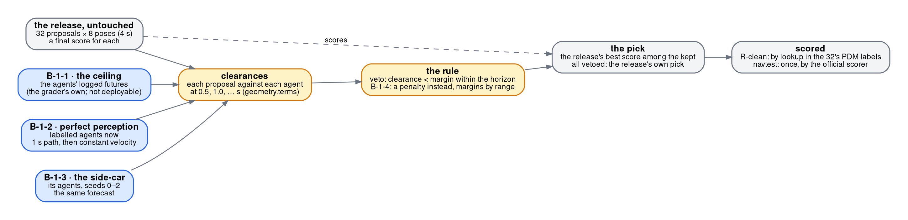
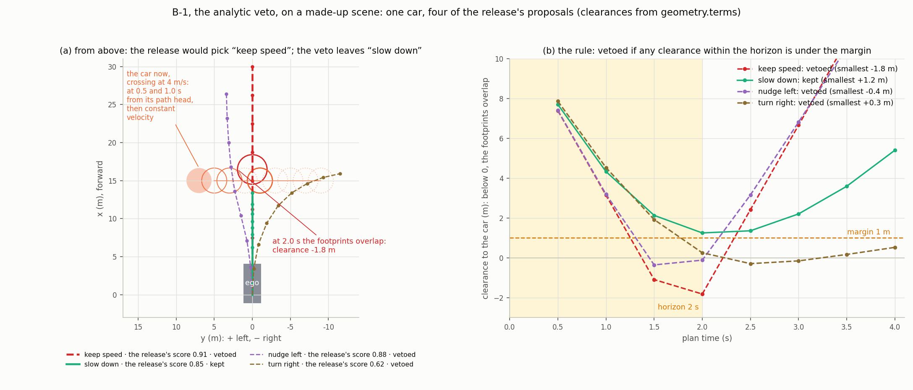

# H15 Part B · B-1: the analytic veto. Can a rule on the agents pick better than the release?

**Status (11 Nov 2026): planned, not run. Nothing here trains.**
- [The overview](drivejepa-perception-sidecar-overview.md) holds the tracker, the naming and the log.
- This plan stands on [B-0, the foundations](drivejepa-perception-sidecar-B.md).
- It was C4 in [the ideas](drivejepa-perception-sidecar-B-ideas.md). The owner chose it first on 11 Nov.

## The crux

**Without training anything:** if the planner knew where the agents are and will be, could a plain rule reject
the release's proposals that come too close to them, and leave a better pick?
- B-1 changes only the pick, and only by removing proposals; the release still proposes and scores.
- First, with perfect knowledge: is there room at all?
- Then with the side-car's agents: is perception good enough to use it?

## What to expect

- **The ceiling (B-1-1) will beat the release**, by construction. It knows from the grader's own labels which
  proposals collide. Its size says how much any agent-based pick could add on navtest.
  - *Argued*: +0.5 to +1.5 points. This is bounded by the NC and TTC failures that have a safe alternative among
    the 32 (B-0-3 counts them).
- **Perfect front-camera perception with a simple forecast (B-1-2)** keeps part of that.
  - Lost: agents out of view, forecasts beyond 1 s at constant velocity, the round footprints.
  - *Argued*: +0.2 to +0.8.
- **The side-car's agents (B-1-3)** keep less, and may lose.
  - 23% of its detections at 0.5 confidence are wrong (select logs, *measured*), mostly misplaced in depth.
  - Each wrong veto can cost progress (EP).
  - *Argued*: −0.3 to +0.4.
- **What it is worth either way:**
  - If B-1-2 does not beat the release on navtest, agents carry little that the release's own scorer has not
    already used. B-2 to B-4 are then unlikely to show a NAVSIM gain, and the closed-loop gate (B-14) becomes
    the place.
  - If B-1-3 beats it, B-2 to B-4 have a bar to clear: a learned use of the agents must do better than a
    rule.

## The concepts, question by question

**Q1. How does the release choose its plan today?**
- It makes 32 proposals, each 8 poses over 4 s. Its scorer gives each a final score, learned against NAVSIM's
  PDM scores of proposals on navtrain.
- The pick is the highest.
- At inference it sees no list of agents. What it knows about them comes through the image features each proposal
  sampled.

**Q2. What does NAVSIM punish when a plan meets an agent?**
- Two sub-scores, both computed by simulating the plan against the agents' *logged* futures over 4 s:
  - **NC, no at-fault collision.** It multiplies the whole score: a collision zeroes the scene.
  - **TTC, time to collision within bound.** Weight 5 of 16 in the weighted part.
- EPDMS = NC × DAC × DDC × TLC × (5 EP + 5 TTC + 2 LK + 2 HC + 2 EC) / 16 (`pdm_scorer.py:58–63`, *read*).
- On navtest the release scores NC 0.985 and TTC 0.979 (*read*: H04's account). That is 1.5% and 2.1% of scenes.

**Q3. What is a clearance?**
- The gap between the ego's footprint at a proposal's pose and an agent's footprint, at the same time.
- `geometry.terms` computes it (*read*) at each of the 8 plan times:
  - each footprint is a circle of its box's area;
  - clearance = the centres' distance − both radii;
  - below zero, the footprints overlap.
- The agent's position at each time comes from the side-car's own path head at 0.5 s and 1.0 s, then constant
  velocity, as PDM simulates other agents.
- The figure below shows it on a made-up scene.

**Q4. What is the rule?**
- **Veto.** A proposal is removed if any clearance within the horizon H is under the margin m, against any agent
  at confidence c or more.
- The pick is the release's highest score among the proposals left.
- **If every proposal is vetoed,** the release's own pick stands, or the proposal with the largest clearance
  (decision (b)).
- **A softer variant (B-1-4):** subtract λ × max(0, m − clearance) from each score instead of removing the
  proposal, and widen m with range, where depth is less certain.

**Q5. Why might a rule help a learned scorer?**
- The scorer learned navtrain's scenes, and learned them well: in-sample NC is 0.996.
- On scenes it never saw, its implicit sense of where the agents are is exactly what may not transfer.
- A rule on explicit positions does not depend on having seen the scene.
- Scoring candidates against forecasts of the labelled agents is what PDM-Closed does, and it is a strong NAVSIM
  baseline (*argued*).

**Q6. Why start from perfect knowledge (B-1-1, B-1-2)?**
- The side-car's errors and the rule's limits are tangled in its result. Two clean points separate them:
  - **B-1-1, the ceiling.** It vetoes exactly the proposals the grader's own labels mark as failing NC or TTC.
    No deployable rule can know more about safety. It is not deployable: it reads the answer.
  - **B-1-2, perfect perception.** The labelled agents in CAM_F0's view, within 50 m, with the side-car's
    forecast model: their 1 s path, then constant velocity.
- B-1-1 − B-1-2 is what the camera's view, the forecast and the round footprints cost.
- B-1-2 − B-1-3 is what the side-car's errors cost.

**Q7. What can go wrong?**
- **False vetoes.**
  - A false alarm, or an agent placed 2 m too near, removes a good proposal.
  - Progress is lost (EP), or a worse proposal is picked.
  - 45% of the side-car's false alarms are such misplacements (*measured*).
- **Missed agents.** No veto, no help. The side-car finds 36% of hidden agents.
- **Dense scenes.** Every proposal may be vetoed, and the fallback decides.
- **Agents outside the front camera.** A car behind or beside the ego is invisible to the side-car and to the
  release alike.
- **The human filter.** EPDMS forgives a failure the human driver also has, so some vetoes change nothing.

**Q8. How are the settings chosen without fooling ourselves?**
- On the R-clean split (B-0, Q3): never on navtest, and never on navtrain, where there is no room.
- The release's 32 proposals there get PDM labels once (vendored). Then any setting's pick is scored by lookup:
  a full grid costs CPU minutes.
- The setting with the best R-clean EPDMS, reweighted to navtest's cities, is frozen. Navtest is read once, by
  the official scorer.

**Q9. What does B-1 need that does not exist yet?**
- B-0-1: navtest and R-clean labels, the release's 32 proposals on them and their PDM labels; the side-car's
  agents.
- B-0-2: the official scorer on stored picks, and the anchor reproduced.
- B-0-3, the headroom check, says before B-1 runs how much B-1-1 can find.

## The plan

### Sub-versions

| ID | The agents | Forecast | Deployable? | It asks |
|---|---|---|---|---|
| **B-1-1** | none: the grader's own NC and TTC labels of each proposal | — | no: the ceiling | how much could knowing which proposals fail add? |
| **B-1-2** | labelled agents in CAM_F0's view within 50 m | the label's 1 s path, then constant velocity | no: perfect perception | how much does a front-camera agent list with a simple forecast add? |
| **B-1-3** | the side-car's agents, seeds 0–2 | its path head, then constant velocity | **yes** | how much does this side-car add? |
| B-1-4 | as B-1-3 | as B-1-3 | yes | a penalty, margins widening with range, confidence-weighted: if B-1-3 loses on progress |

### Steps

1. **Wait for B-0**, then read B-0-3's headroom counts.
2. **The grid, on R-clean, vendored labels.**
   - Margins 0.5, 1 and 2 m; horizons 1 and 2 s; confidence 0.5 and 0.7, for the side-car only.
   - That is 12 settings for B-1-3, and 6 for B-1-2.
   - B-1-1 has no setting.
3. **Freeze** each sub-version's best setting by R-clean EPDMS, reweighted to navtest's cities.
4. **Navtest, once.**
   - The picks of B-1-1, B-1-2 and B-1-3 (each seed), replayed through the official scorer.
   - Each is paired against R.
5. **The analysis (B-0-4).**
   - The veto rate and the fallback rate.
   - Which vetoes were right: a vetoed proposal that truly fails NC or TTC, against one that passes. A confusion
     table per source.
   - EP lost to vetoes, by range and class of the agent behind each veto.
6. **Record** `H15.r<n>`, label "B-1", in `experiment.toml`, and a line in the overview's log.

### What is measured

| Measure | Where | Read against |
|---|---|---|
| EPDMS (human filter), and the CSV score | navtest, official | R, paired per scene, clustered by log |
| NC, TTC, EP, EC of the pick | navtest, official | R |
| veto rate · all-vetoed rate · pick-switch rate | both splits | — |
| right vetoes · wrong vetoes | both splits, vendored labels | B-1-1's vetoes |
| the same on the subsets: lead vehicle, slowing, agent within 10 m | navtest | R |

### Success criteria (a draft, for PREDICTIONS.md once approved)

| # | What | Predicted | Supports if | Refutes if |
|---|---|---|---|---|
| V1 | B-1-1 − R | +0.5 to +1.5 points | beyond 2 SE | — (the ceiling) |
| V2 | B-1-2 − R: room for perfect front-camera agents | +0.2 to +0.8 | beyond 2 SE | under 0 beyond 2 SE |
| V3 | B-1-3 − R, each seed | −0.3 to +0.4 | above 0, beyond 2 SE, every seed | under 0, beyond 2 SE, any seed |
| V4 | the share of B-1-2's gain B-1-3 keeps | 0.2 to 0.6 | — (reported) | — |
| V5 | EP lost to vetoes, B-1-3 | under 0.3 points | — | over 0.6 |

### Decisions for the owner

| | Decision | Recommended |
|---|---|---|
| (a) | the grid above, or a different one | as above; small, so the choice borrows little luck |
| (b) | when every proposal is vetoed: the release's pick, or the largest clearance | the release's pick: the rule only removes, never invents |
| (c) | read B-1-1 on navtest, or only count it in B-0-3 | read it: it is the scale every other number is read against |
| (d) | B-1-4, now or only if B-1-3 loses progress | only if it does |

### Risks

1. **Tuning on a small, Las-Vegas-heavy split.** It is reweighted by city, and the grid is small.
2. **A ceiling that reads the answer (B-1-1)** must never be reported as a result: flagged in every table.
3. **The replayed pick and EC.** A veto that switches the pick between frames can lose EC; it is measured.

### Cost (*estimate*)

After B-0: minutes of CPU for the grid, and one official scoring run per sub-version and seed (10–30 min of CPU
each).

## Questions B-1 can answer

| Question | Read from |
|---|---|
| Of the release's navtest collisions, how many could a better pick among its own 32 have avoided? | B-1-1, B-0-3 |
| How much of that needs perfect agents, and how much survives a front camera and a simple forecast? | B-1-1 against B-1-2 |
| Is this side-car good enough to use, by a rule? | B-1-3 against B-1-2 and R |
| Do its false alarms (depth) or its misses cost more? | the confusion of vetoes, by range |
| Which agents matter on navtest: vehicles or pedestrians, near or far, moving or parked? | the vetoes that were right, by class and range |
| Would a longer forecast help (B-8)? | B-1-1 − B-1-2 on scenes whose at-fault agent turns or brakes after 1 s |
| What is the bar for a learned scorer (B-2)? | B-1-3's navtest EPDMS |

## What B-1 does not answer

- **Whether agents can make the proposals themselves better:** B-3.
- **Whether a learned scorer can trade safety against progress better than a rule:** B-2.
- **Anything in closed loop,** where the agents react: B-14.
