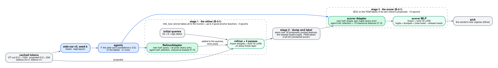

# H15 Part B · B-4: the agents into the refiner and the scorer, with LoRA. Does it meet or beat the release?

**Status (11 Nov 2026): planned, not run. Nothing trains before the owner's go-ahead.**
- [The overview](drivejepa-perception-sidecar-overview.md) holds the tracker, the naming and the log.
- This plan stands on [B-0](drivejepa-perception-sidecar-B.md), [B-2](drivejepa-perception-sidecar-B-2-scorer.md)
  and [B-3](drivejepa-perception-sidecar-B-3-refiner.md).
- How LoRA adapts both: [the LoRA primer](drivejepa-perception-sidecar-B-lora-primer.md).
- It was C3, "B-LoRA", in [the ideas](drivejepa-perception-sidecar-B-ideas.md): the owner's first idea of 10 Nov,
  placed fourth on 11 Nov so that it builds on B-1 to B-3.

## The crux

**The owner's idea, whole:** the side-car's agents go into both halves of Drive-JEPA's downstream planner.
- The refiner shapes the 32 proposals knowing the agents. The scorer, retrained on those very proposals, chooses
  among them knowing the agents too.
- Both are adapted by LoRA, and everything else is frozen.
- Read once on navtest by NAVSIM's official scorer, the question is:
  - does it **meet or beat the release's 87.78**;
  - does it do so **because of the agents**, by more than the same adaptation without them;
  - and **how do its proposals change**?

## What to expect

- **It is bounded by its parts** (*argued*).
  - If B-2 and B-3 are both neutral, B-4 most likely is too. Its value is then the proposal analysis and a clean
    negative.
  - If B-3 makes better proposals that the release's scorer cannot pick (B-3's R3), B-4 is where that shows: its
    scorer is trained on exactly those proposals.
- **Predicted:**
  - F − C: +0.0 to +0.4 points.
  - F − R: −0.3 to +0.5.
  - "Meets", in the sense below, is more likely than "beats".
- **The adaptation itself may cost out of sample.**
  - H07's exp3 fine-tuned the generator and scorer, and fell at the gate from 0.857 to 0.753 EPDMS (D18).
  - The first pass's refitted scorer was worse on nuScenes; its retrained refiner was better.
  - Arm C and R̃ make whichever happens here visible.
- **EC may drop silently:** picks that switch between neighbouring frames lose two-frame comfort, which no training
  label carries. It is measured.

## The concepts, question by question

**Q1. Why both halves, when B-2 and B-3 each test one?**
- B-3 alone changes the proposals, but the release's scorer misjudges new proposals: the first pass measured 0.1–0.25
  points lower.
- B-2 alone can only re-rank the release's own 32.
- Only together can proposals and scorer change for each other, with the agents in both.

**Q2. Why two stages, not one joint training?**
- The release trains jointly: each step's new proposals are scored by PDM online, on CPU workers, for its score
  loss. That costs about a CPU-hour of scoring an epoch (*estimate*).
- Two stages:
  1. train the refiner (B-3-1's recipe);
  2. dump its proposals and features for every row, and label them once;
  3. train the scorer (B-2-1's recipe) on exactly those.
- This is far cheaper, and the scorer learns precisely the proposals it will be read on.
- **Stage 1 is B-3-1's runs, reused,** and stage 2 is B-3's dumps. B-4-1 adds only stage 3 and its read.
- What is lost: the score loss never shapes the refiner's features. B-4-2 restores it, if B-4-1 shows the scorer is
  the limit.

**Q3. How can the scorer start exactly as the release, on new proposals?**
- Its logits are re-based on stage 2's own logits: the release's head on the trained refiner's pooled features,
  plus (the adapted head − the release's head).
- At step 0 the bracket is zero, so the scorer starts as "the release's scorer on these proposals", exactly. The
  preflight checks it on 512 rows.

**Q4. Then what is the whole model's starting point?**
- **R̃:** the release through the same cached path, with zero adapters (B-0, Q6).
- Every arm starts from R̃, so F − C is exact.
- The release itself (R) is read beside it, and R̃ − R is measured on every navtest scene.

**Q5. What do "meet" and "beat" mean, in numbers?**
- Both are paired per navtest scene, with a 95% interval clustered by log, on every seed.
- **Meet:** the interval's low end is no worse than −0.4 points. That is H04's interval half-width: no loss
  bigger than navtest can resolve.
- **Beat:** the interval's low end is above 0.
- **Agents' own effect:** F − C beyond C's seed range and 2 SE, every seed (H15's rule).

**Q6. How will we know how the proposals changed, and why?**
- B-0-4's analysis, F against C against R̃:
  - best of 32 and the pick;
  - each proposal's clearance to the labelled agents;
  - the 32's spread;
  - which proposals moved (matched one to one);
  - the pick-switch rate and its steadiness between frames;
  - the subsets, and the scenes where the side-car found the causal agents or missed them.
- **Counterfactuals on F, with no retraining:**

| Change to F's input | It tells |
|---|---|
| no agents · another log's agents | whether F uses its input at all |
| the agent F names deleted, against a random detected one | whether its reason is real |
| that agent moved 2 m along its camera ray | sensitivity to the side-car's main error, depth |
| labelled agents instead | the cost of perception errors, without retraining |
| agents to the refiner only · to the scorer only | which route carries the effect |

**Q7. What does each arm isolate?**
- **R and R̃:** the bar.
- **C:** what adapting both halves on navtrain does without agents.
- **F − C:** the agents.
- **O − F:** what better perception would add.
- **F against B-1-3:** whether a learned use of the agents beats the rule.

**Q8. What can go wrong?**
- **The adaptation costs out of sample**, as H07's did: C − R and nuScenes show it.
- **The agents are better on the train rows than at test** (B-0-1's measure; cross-fitting if needed).
- **The proposals' spread collapses** in stage 1, leaving the scorer little to choose from (B-3's R5).
- **EC drops** (above).
- **Shipping is not free.**
  - LoRA merges into the release's weights for inference: W + (α / r) B A.
  - The adapters remain new modules, so the gate needs Paddock's Drive-JEPA adapter extended (B-14).

## The plan

### Sub-versions

| ID | What | Arms × seeds | Recommended |
|---|---|---|---|
| **B-4-1** | two stages: B-3-1's refiner, then B-2-1's scorer on its dumped proposals | C, F, O × 0–2 (F seed k reads side-car seed k) | yes |
| B-4-2 | joint training with online PDM scoring, the release's way | F, C × 0–2 | if B-4-1's best of 32 rises but its pick does not |
| B-4-3 | the better fusion and scorer from B-2 and B-3 (for example B-3-2's agent look with B-2-2's scorer) | C, F, O × 0–2 | if B-2-2 or B-3-2 beat B-2-1 or B-3-1 |

### Steps

1. **After B-2's and B-3's reviews,** pre-register the criteria below, as approved.
2. **Stage 1:** B-3-1's trained refiners, per arm and seed, reused. Their preflight reports are reread.
3. **Stage 2:** B-3's dumps and their vendored labels (navtrain, R-clean, navtest), checked to be the saved
   models' output, bit for bit, on 64 rows.
4. **Stage 3:** B-2-1's scorer recipe on each dump: BCE, 10 epochs, batch 256, learning rates 1e-4 (adapter) and
   2e-5 (head), the last epoch kept.
   - Preflight: the identity on 512 rows; exact PDM re-scores; no report-log row.
5. **Health read on select,** which chooses nothing. The owner sees the curves.
6. **Navtest, once:** R̃, C, F and O, every seed, replayed through the official scorer. Momentum off, as the anchor;
   with it, as a second read.
7. **Analysis and counterfactuals** (Q6). BEV drawings of the scenes whose pick changed.
8. **nuScenes:** every arm, scored by L2 at 1, 2 and 3 s, collisions within 3 s, and best-of-32 ADE.
9. **Record** `H15.r<n>`, label "B-4-1", and a line in the overview's log. The owner then decides whether the gate
   (B-14) opens.

### Success criteria (a draft)

| # | What | Predicted | Supports if | Refutes if |
|---|---|---|---|---|
| J1 | **F − C**, navtest EPDMS: the agents' own effect | +0.0 to +0.4 points | beyond C's seed range and 2 SE, every seed | negative beyond 2 SE, any seed |
| J2 | **F against R:** meets or beats | F − R from −0.3 to +0.5 | meets: the low end ≥ −0.4, every seed; beats: above 0, every seed | the high end < 0, any seed |
| J3 | C − R: the adaptation itself | −0.5 to +0.3 | reported | — |
| J4 | where F − C lands | at least half in NC and TTC | if J1 holds | — |
| J5 | O − C | +0.2 to +0.8; O ≥ F | reported | — |
| J6 | best of 32, F − C | +0.1 to +0.5 | beyond 2 SE, every seed | — |
| J7 | F uses its agents: another log's agents change its pick on ≥ 5% of scenes; deleting its named agent moves the pick ≥ 3× as often as deleting a random one | as stated | both | ratio < 1.5 |
| J8 | EC, F − R | within ± 0.02 | — | lower by more than 0.02 |
| J9 | F against B-1-3 | ≥ 0 | reported: the learned use against the rule | — |

### Decisions for the owner

| | Decision | Recommended |
|---|---|---|
| (a) | two stages (B-4-1) first, or joint (B-4-2) first | two stages first |
| (b) | B-4-3 now, or only if B-2-2 or B-3-2 win | only if they win |
| (c) | arm O | yes: it is what tells perception's limit from the planner's |
| (d) | if J2 "beats": export a checkpoint with LoRA merged and the adapters, for the gate (B-14) | yes, with Paddock's adapter extended first |

### Risks

1. **The cost of adapting**, out of sample (J3). It is reported beside every gain; nothing ships that loses to R.
2. **Power.** A real +0.2 may stay unresolved at 3 seeds. B-0-3 says beforehand how large a gain could be.
3. **EC** (J8).
4. **The report logs** are never read: the preflight's guard, as in B-0.

### Cost (*estimate*)

After B-3, which provides stage 1 and stage 2:
- B-4-1 adds 9 scorer runs (5–15 min of GPU each) and 10 official scoring runs (10–30 min of CPU each).
- B-4-2 would add about 3 GPU-hours of training and about a CPU-hour of scoring per epoch per run.

## Questions B-4 can answer

| Question | Read from |
|---|---|
| Does the planner, given the agents in both halves, plan better on unseen scenes? | J1 |
| Does it meet or beat the release on navtest? | J2 |
| Is that the agents, or the adaptation? | J1 against J3 |
| How do the 32 proposals change: safer, closer to the human, more or less spread? | B-0-4, F against C against R̃ |
| Which route carries the effect, the refiner or the scorer? | the route counterfactuals |
| How sensitive is the plan to the side-car's depth error? | the 2 m shift |
| How much would better perception add? | O − F, and F with labelled agents |
| Can the planner explain its pick by an agent, faithfully? | J7, the deletion test |
| Does a learned use beat B-1's rule? | J9 |

## What B-4 does not answer

- **Closed loop, where agents react:** the gate (B-14), which needs Paddock's adapter extended first.
- **Whether a better side-car would change the answer:** O bounds it; B-8 and B-9 would build it.
