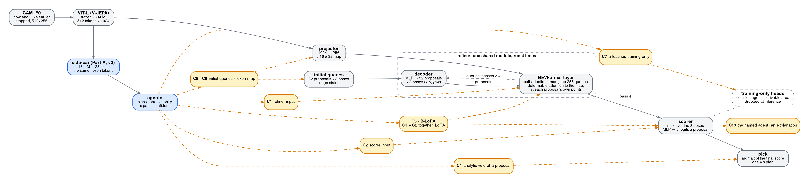

# H15, Phase B: where the side-car could connect to Drive-JEPA (ideas, for a shortlist)

**Status (10 Nov 2026): ideas only. Nothing here has run, and nothing trains until the owner shortlists.**
- The plan for whatever is shortlisted is [drivejepa-perception-sidecar-B.md](drivejepa-perception-sidecar-B.md).
- It plans the owner's first idea (C3, "B-LoRA") in full.
- Part A, the side-car itself: [the plan](drivejepa-perception-sidecar-A.md) and
  [the executive update](drivejepa-perception-sidecar-A-update.md).

**Labels on numbers.**
- *counted*: on disk at this site;
- *measured*: from a run;
- *read*: in code or in a record;
- *argued*: reasoned, not measured.
- First-pass numbers (3–4 Nov) are quoted as reference only. They are in-sample for the release.

## Summary

**The question every idea answers.** The side-car reads the same frozen ViT tokens the planner reads. So it
adds no new sensor information. What it adds:
- an explicit, supervised account of the agents ahead: where each one is, what it is, how fast it moves, and
  where it will be in a second;
- the geometry and time that account makes computable: clearances to every proposal, at every step.

Each idea below is a way of handing that account to the planner. Each says why the planner might plan better
with it on scenes it never trained on.

| # | Idea | Connects at | Aims at | Trains | Cost at inference | Evidence so far | Main risk | Suggested |
|---|---|---|---|---|---|---|---|---|
| C1 | agents shape the proposals | refiner, all 4 passes | NC, TTC, best of 32 | adapter + LoRA | one attention per pass | B2: neutral in-sample | the release's scorer picks worse among new proposals | inside C3 |
| C2 | agents shape the pick | scorer | NC, TTC of the pick | adapter + LoRA | one attention | B1: neutral in-sample; a refitted scorer cost 0.2–0.4 m on nuScenes | fitting the scorer to navtrain | inside C3 |
| **C3** | **B-LoRA: both, with LoRA** | refiner + scorer | NC, TTC, EP | adapters + LoRA, two stages | C1 + C2 | none jointly; H04's Run 3A comes closest | H07's regression; the agents are better on the train rows than at test | **first (the owner's)** |
| C4 | analytic veto | after the scorer | NC, TTC | nothing | clearances only | never run as a rule | false alarms cost progress | **yes: cheap, and it bounds C1–C3** |
| C5 | agent-aware initial proposals | the 32 × 8 initial queries | best of 32 | adapter | one pooling | none | small beyond C1 | a C3 variant |
| C6 | agents written into the token map | the projected tokens | everything downstream | adapter + LoRA | one scatter | none | errors enter the image path | later |
| C7 | the side-car as a teacher | training only | the planner's own features | auxiliary losses | none | the release's own auxiliaries; H14 cancelled (D19) | little beyond the release's auxiliaries | later |
| C8 | 4 s forecasts | the side-car's path head | the clearances C1–C4 read | a labels pass + the side-car | none | 1 s paths beat constant velocity by 4–5% | reopens Part A | if C3 or C4 shows reliance |
| C9 | uncertainty and calibration | side-car heads → C1–C4 | fewer false vetoes | the side-car | none | over-confident below 0.7 | reopens Part A | if C4's false alarms dominate |
| C10 | tracks over frames, steadier plans | the side-car over time | EC (0.478), velocity | a tracker | per frame | none | EC is mostly the pick's consistency, not perception | later |
| C11 | a road-structure side-car | a second side-car | DAC, LK, DDC | new labels and a model | one more decoder | none | a Part A of its own | separate question |
| C12 | data | outside the planner | where no metric cache exists | the side-car labels video | none | step 7 tells how far it transfers | pseudo-labels are only as good as the side-car | with C14 |
| C13 | the named agent as an explanation | the scorer's attention | none (a product) | comes with C2 or C3 | none | B1.6: faithful in-sample | explains a pick that is no better | with C3 |
| C14 | closed loop | the gate | collisions in neuroNCAP and Bench2Drive | nothing new | none | the first pass's own advice | needs Paddock's adapter (phase C) | after C3 or C4 |
| C15 | ViT LoRA shared with the planner | the encoder | everything | LoRA | none | B3: nothing | none worth the cost | **no** |
| C16 | the refiner-retrain finding | refiner, no agents | nuScenes L2 and collisions | the refiner | none | 0.3 m better at 3 s on nuScenes, unexplained | it is not about agents | C3's arm C |

**A suggested shortlist (*argued*).**
1. **B0, the headroom check (no training).** How many of the release's navtest collisions and TTC failures
   involve an agent the side-car could see: the front camera, within 50 m. It needs only the data step every
   idea needs.
2. **C4 with ground-truth agents, then with the side-car's (no training).** If even perfect agents, used by a
   rule, do not beat the release on navtest, NAVSIM holds no agent headroom the release has not already
   taken. Then C14, closed loop, is where the side-car matters.
3. **C3, B-LoRA.** Arms: R (the release), C (the same adaptation, no agents; this is C16 too), F (the
   side-car's agents) and O (ground-truth agents).

**What to defer.**
- C5–C11, until C3 or C4 shows whether explicit agents carry information the planner uses.
- C14, until there is a model worth gating.
- C15 is not recommended.

## 1. How Drive-JEPA plans, and where information flows

*Read* in `{code.drivejepa}/navsim_v2/navsim/agents/drive_jepa_perception_based/`; the figure above.

| Part | What it does | Size |
|---|---|---|
| ViT-L (V-JEPA) | the front camera, now and 0.5 s earlier, as one tubelet: 512 tokens of 1024 | 304 M, frozen in every idea here |
| projector | 1024 → 256: a 16 × 32 map | 0.26 M |
| initial queries | 32 proposals × 8 poses, learned, plus the encoded ego status | 0.07 M |
| refiner, one module run 4 times | an MLP decodes 32 proposals × 8 poses (x, y, yaw); a BEVFormer layer then updates the 256 queries: self-attention among them, deformable attention to the map at each proposal's projected points | 2.32 M |
| scorer | max over each proposal's 8 poses, then an MLP → 6 logits; only the last (the final score) was trained | 1.32 M |
| pick | argmax of the final score; momentum-aware selection adds two-frame comfort when the previous plan is given | — |
| training-only heads | collision agents' corners, drivable area | dropped at inference |

**What the planner knows about agents today.**
- **Implicitly.** Each proposal's deformable attention samples the map at that proposal's own points. An agent
  off a proposal's path reaches it only through self-attention, from proposals that do pass over it.
- **At training only.** Two auxiliary heads learn collision agents and the drivable area from the scorer's
  features. They shape those features, and are dropped at inference.
- **Not at all.** An explicit list of agents, their velocities or forecasts at inference, or anything a person
  can read.

**What the side-car would add, and what it cannot.**
- **It adds no new view.** Both read CAM_F0 alone: the release keeps one camera's projection
  (`drive_jepa_model.py`, `lidar2img[:, 1:2]`). An agent behind or beside the car is invisible to both.
- **It adds supervision the planner never had at inference:** a decoder trained on 660,723 labelled agents
  (*counted*, Part A §3.3) to say where they are.
- **It adds geometry and time made explicit.** `geometry.terms` turns agents and a proposal into clearances
  at each of the 8 plan times (*read*), the quantity NC and TTC are computed from.

## 2. Where the points are lost

**On navtest the release has headroom; on navtrain it has none.**

| Sub-score | navtest, official v2 (12,146 scenes) | navtrain report logs, in-sample, vendored scorer (4,636) |
|---|---|---|
| no at-fault collision (NC) | 0.985 | 0.996 |
| drivable area (DAC) | 0.986 | 0.994 |
| driving direction (DDC) | 0.991 | 0.989 |
| traffic lights (TLC) | 0.998 | 0.979 |
| ego progress (EP) | 0.891 | 0.919 |
| time to collision (TTC) | 0.979 | 0.996 |
| lane keeping (LK) | 0.976 | 0.860 |
| history comfort (HC) | 0.978 | 0.975 |
| two-frame extended comfort (EC) | 0.478 | not in the vendored scorer |
| **EPDMS** | **87.78** with the human filter; 84.49 as navsim's CSV scores it | pick 0.914 |

- **Sources** (*read*):
  - navtest: H04's account (branch `drivejepa-wajepa/run3a`, `docs/drivejepa_wajepa.md`), copied into H01's
    and H04's records. It was measured off this site, with no momentum-aware selection.
  - navtrain: the H15 README's first-pass account.
- **How the terms combine** (*read*, `pdm_scorer.py:58–63`): EPDMS = NC × DAC × DDC × TLC × (5 EP + 5 TTC +
  2 LK + 2 HC + 2 EC) / 16.
- **The most each term could add** (*argued*). This is if every failure of that term alone were fixed and
  nothing else moved; terms overlap, so the sum is not a bound.

  | Term | At most | Agents bear on it? |
  |---|---|---|
  | NC | about +1.3 points | yes: the agent hit |
  | TTC | about +0.6 | yes |
  | EP | about +3 | partly: going when the way is clear |
  | DAC | about +1.2 | no: road structure |
  | EC | about +6 | not directly: whether consecutive picks agree |

- **What can be resolved.** H04's paired navtest CI was ±0.4 points. To be seen, an agent-driven gain must fix
  roughly a quarter of the NC and TTC failures, and cost nothing elsewhere.
- **What is not known.** How many of the release's navtest NC and TTC failures involve an agent in CAM_F0's
  view, within 50 m. The vendored scorer names the at-fault agent and its time (`pdm_labels.score`, *read*).
  So B0 counts it once the navtest metric cache exists.

## 3. The side-car as an input

Part A, v3 for 24 epochs, select logs, three seeds (*measured*; the executive update):

| | Value |
|---|---|
| agents within 30 m found · detections real · F1 | 67% · 77% · 0.717 |
| agents in or near the ego's path found (causal) | 90% |
| moving vehicles within 20 m found | 95–96% |
| direction error | under 1° at every range |
| distance error | 0.24 m within 10 m; 1.2 m at 30–50 m; 30% of agents beyond 30 m off by more than 2 m |
| hidden agents found · cyclists found | 36% · 4–5% |
| confidence | over-confident below 0.7: a detection at 0.55 is right about 40% of the time |
| velocity error on agents found | 0.42 m/s |
| 1 s path against constant velocity | 4–5% lower error |
| out of domain (step 7, `H15.r5`, nuScenes) | 53% of vehicles within 30 m (Q9 holds); F1 0.50; pedestrians 15–16%; causal recall 0.62–0.67; depth error within 10 m 0.6–0.95 m; direction 1.6–2.3°. Warping the frames to NAVSIM's camera does not help |

**What this means for a planner** (*argued*).
- **Near agents are placed well.** Within 10 m the error is 0.24 m. NC and TTC are decided near the ego.
- **Out of domain, every weakness grows** (step 7, *measured*): on nuScenes the agents a planner would get are
  fewer (F1 0.50) and placed worse near the car (0.6–0.95 m within 10 m), and pedestrians are mostly missed.
  Any idea read on nuScenes reads it with that input.
- **Far agents are placed badly in depth.** A rule that vetoes on clearance (C4) would act on false alarms
  2–4 m from real cars: 45% of the false alarms are such misplacements. Margins must widen with range, or come
  from an uncertainty head (C9).
- **The forecast is short.** The planner plans 4 s, and `geometry.agent_centres` extrapolates beyond 1 s at
  the predicted velocity (*read*), as PDM simulates other agents. Turning and braking beyond 1 s are guessed.
- **The agents on the train logs are better than at test.** The side-car trained on those rows. A planner
  fine-tuned on its train-row outputs learns to trust agents better than the ones it will meet. This is
  measured before any B training (the B plan, §3.4).

## 4. The ideas

Every idea is tested against its own control: the identical adaptation without agents. It is read where the
release has headroom and never trained: navtest, read once, and an R-clean split for choices (the B plan,
§3).

### C1 · Agents shape the proposals (refiner input)

- **What.** The side-car's agents enter each of the refiner's 4 passes, so the 32 proposals are formed knowing
  where every agent is and will be.
- **Why it might help.**
  - The refiner sees an agent only through its own proposals' sample points.
  - An explicit list lets every proposal see every agent, with its clearance at each plan time.
  - Fewer proposals should pass through agents, raising the best of 32 in NC and TTC.
  - Proposals that follow a lead vehicle instead of stopping short should raise EP.
- **How.**
  - B2's `RefinerAdapter`: a pre-hook on `Bev_refiner` adds, to every query, attention over the agents biased
    by the analytic clearance to that query's proposal. The output layer starts at zero, so step 0 is the
    release.
  - Rank-16 LoRA on the refiner's linear layers.
  - The release's own planning loss: winner-takes-all to the human, plus up to 4 good-anchor teachers
    (`drivejepa_b2d.train_generator.mtd_loss`).
- **A variant from H04's Run 3A.** Its "agent look", after each round: per waypoint, the 16 nearest detections
  moved to that waypoint's time, coded relative to it, attended with a learned "nothing" slot.
- **Cost.** About 15 minutes a run (B2's 0.20 s a batch, *measured* in the first pass), once the data step
  exists.
- **Evidence so far.**
  - B2, in-sample: neutral in every mode. Best of 32, F − C was +0.004, −0.013 and +0.001 by seed (full mode),
    and ground-truth agents were neutral too.
  - On nuScenes, the retrained refiner was better with or without agents (C16).
  - **H04's Run 3A** (a different base: WA-JEPA tokens from 4 cameras, the planner retrained from scratch)
    combined an agent look with twelve new scorer heads and new labels. It scored navtest EPDMS 87.30 against
    its own base's 85.27, but still below the release's 87.78. The agents' share was never isolated.
- **Risks.**
  - With new proposals, the release's frozen scorer picked 0.1–0.25 points *worse* in B2: it was trained on the
    old ones. Proposals and scorer must change together, which is C3.
- **Test.** Best of 32 and the collision-free share among the 32, F against C, on the R-clean split and then on
  navtest.
- **What would kill it.** F ≈ C on navtest, with ground-truth agents (O) ≈ C as well.

### C2 · Agents shape the pick (scorer input)

- **What.** The scorer reads the agents to score each of the 32 proposals.
  - Attention over agents is biased by clearance.
  - 13 geometric features per proposal: the smallest clearance at each time, the overall minimum and its time,
    and the minimum within 1 s and 2 s.
- **Why it might help.**
  - NC and TTC are functions of the agents' future positions against the proposal.
  - The release's scorer infers them from pooled features; explicit clearances make them direct.
- **How.** B1's `Adapter`, in four modes: frozen (adapter only), LoRA, full, or a replacement scorer with named
  sub-score heads.
- **Cost.** Minutes a run, from cached features.
- **Evidence so far.**
  - B1, in-sample: neutral in all four modes. Full mode, F − C was −0.13, −0.11 and −0.00 points by seed.
  - Ground-truth agents were neutral too.
  - On nuScenes, refitting the scorer cost 0.23–0.44 m at 3 s, with or without agents. The replacement scorer
    transferred best.
- **Risks.** The scorer fits navtrain and loses out of domain.
- **Test.** The pick's EPDMS, F against C, on navtest, and on the pre-registered subsets: a lead vehicle in
  lane, the human slowing, an agent within 10 m of a proposal.
- **What would kill it.** As C1, read on the pick.

### C3 · B-LoRA: both together, with LoRA (the owner's first idea)

- **What.** The agents go into the refiner (C1) and the scorer (C2). LoRA adapts both; the rest is frozen.
- **Why it might help.**
  - C1 alone left the release's scorer misjudging new proposals.
  - C2 alone can only re-rank the release's 32.
  - Together, proposals and scorer adapt to each other and to the agents. On navtest there is headroom
    (§2).
- **How** (the B plan, §4–6).
  - Two stages:
    1. Train the refiner (adapter + LoRA, its planning loss).
    2. Dump its proposals and pooled features for every row.
    3. Label every proposal with the PDM scorer.
    4. Train the scorer (adapter + LoRA, BCE) on that refiner's own proposals.
  - Joint training with PDM scoring online is the release's way. It is offered as a decision: it costs about
    a CPU-hour of scoring per epoch.
- **Arms.**
  - R: the release.
  - C: the same two stages, no agents. C1's adapter keeps its agent-free half; this arm is also C16.
  - F: the side-car's agents, its seed k for the planner's seed k.
  - O: ground-truth agents, a diagnostic.
- **Cost.** About 5 GPU-hours for C, F and O at 3 seeds, plus the data step (the B plan, §6.6;
  *estimate*).
- **Evidence so far.** None jointly. Its parts were neutral in-sample. H04's Run 3A is the nearest relative
  (C1).
- **Risks.**
  - H07's exp3 fine-tuned generator and scorer, and the gate's NAVSIM EPDMS fell from 0.857 to 0.753 (D18).
  - The agents are better on the train rows than at test (§3).
  - Picks that switch between neighbouring frames lose EC, which no training label carries.
- **Test.** On navtest, official EPDMS: F − C by H15's rule, and F against R as "meets" or "beats". Plus how
  the 32 proposals change (the B plan, §8.2).
- **What would kill it.** F ≈ C at navtest's resolution, with O ≈ C too: the agents carry nothing this planner
  can use on NAVSIM.

### C4 · An analytic veto (no training)

- **What.** No learning.
  - For each proposal, the clearance to each forecast agent over its first 2 s (`geometry.terms`).
  - Proposals under a margin are vetoed, or their score is penalised.
  - The release's scorer picks among the rest.
  - The settings are the margin, the horizon and the confidence an agent needs.
- **Why it might help.**
  - It asks, at no training cost, whether the side-car knows something about collisions that the scorer does
    not.
  - A rule on forecasts is how PDM-Closed scores well on NAVSIM.
  - It explains itself: "vetoed: agent 3 is 1.2 m away at 1.5 s".
  - It is the baseline any learned C1–C3 must beat.
- **How.** Cached proposals and agents; the veto; scored offline and then by the official scorer.
- **Cost.** Minutes of CPU per setting, after the data step.
- **Evidence so far.** B1's frozen adapter read these features, and was neutral in-sample. Never tried as a
  rule.
- **Risks.**
  - False alarms veto good proposals and cost progress: 23% of detections at 0.5 confidence are wrong, mostly
    misplaced in depth.
  - The settings are a choice, so they are tuned on the R-clean split and read on navtest once.
- **Test.** The pick's EPDMS with the veto, against R. O's version (labelled agents) bounds what perception
  could give.
- **What it tells, either way.**
  - O's veto does not beat R on navtest: there is no agent headroom left on NAVSIM, and C1–C3 are unlikely to
    show one. Go to C14.
  - O's veto beats R and the side-car's does not: perception is the limit. Go to C8 or C9 before C3.
  - Both beat R: C3 has something to learn, and C4 is its bar.

### C5 · Agent-aware initial proposals

- **What.** A pooled summary of the agents is added to the 32 × 8 initial queries.
- **Why.**
  - The refiner starts from the same 32 learned anchors every time; pass 1's proposals are decoded before any
    adapter acts.
  - Agent context could open the right modes from the start (follow, yield, nudge) instead of correcting them
    over 4 passes.
- **How.** An adapter on the initial queries, starting at zero.
- **Evidence.** None.
- **Suggested.** A variant inside C3 if C3 shows the agents are used.

### C6 · Agents written into the token map

- **What.** Each detection's embedding is added to the 16 × 32 map's cells its box covers.
- **Why.** No new attention path: the planner's own deformable sampling reads object-level features exactly
  where the image shows the agent.
- **How.** A learned projection of each agent, scattered onto its cells, starting at zero; LoRA downstream.
  Notebook 06's `box_cells` already finds a box's cells.
- **Risks.** The side-car's errors enter the image path, and the effect is hard to read.
- **Suggested.** Later.

### C7 · The side-car as a teacher, at training only

- **What.** The side-car's outputs, or the labels, become extra targets for the planner's own features while it
  is fine-tuned. For example, the collision-agent head's targets come from the side-car's forecasts.
- **Why.** No inference cost and no new input: the planner's features learn to carry the agents.
- **Evidence.**
  - The release already trains collision-agent and drivable-area auxiliaries.
  - H14, auxiliary heads on the refiner, was cancelled as inconclusive (D19). This would be built fresh, not on
    its code.
- **Suggested.** Later; little is expected beyond the release's own auxiliaries.

### C8 · 4 s forecasts

- **What.** The side-car's path head grows from 1 s to 4 s (8 steps of 0.5 s), the planner's horizon.
- **Why.**
  - NC and TTC are graded against the agents' logged futures over 4 s.
  - Beyond 1 s, C1–C4 now use constant velocity. A learned forecast could turn and brake.
- **How.** A labels pass with 4 s tracks, then the side-car retrained, about 1.75 h per seed (*measured* in step
  5).
- **Evidence.** The 1 s paths beat constant velocity by only 4–5%; longer horizons are harder.
- **Suggested.** If C3 or C4 shows the planner relies on the agents.

### C9 · Uncertainty and calibration

- **What.** Per-agent position uncertainty (Part A §4.3's Laplace scales, choice 11.11, still open) and
  calibrated confidence. C1–C4 then weigh agents and set margins by them.
- **Why.**
  - Depth error grows with range.
  - The side-car is over-confident below 0.7.
  - A planner, or a veto, should discount a far, uncertain agent and keep its distance from a near, uncertain
    one.
- **Suggested.** If C4's false vetoes dominate its result.

### C10 · Tracks over frames, and steadier plans

- **What.**
  - The side-car runs on consecutive frames and associates its detections into tracks.
  - Velocities come from tracks, not from two frames.
  - The planner gets each agent's short history, and picks that agree with the agents' tracks.
- **Why.**
  - EC, the two-frame extended comfort, is 0.478 on navtest: the largest single term lost (§2).
  - Momentum-aware selection (D17) targets it.
- **Risks.** EC is mostly about whether consecutive picks agree, which perception does not decide.
- **Suggested.** Later; H05's memory layer is related.

### C11 · A road-structure side-car

- **What.** A second side-car for lanes, road edges and drivable area.
- **Why.** DAC (0.986) and LK (0.976) on navtest are not agent problems: together about 1.5 points (*argued*).
  The release's BEV-map auxiliary exists but is off (`bev_map=False`, *read*).
- **Suggested.** A separate question, with its own Part A.

### C12 · Data

- **What.**
  - (a) The side-car as an auto-labeller of agents in unlabelled driving video. That allows a collision- and
    TTC-only score where no metric cache exists: nuScenes, KITScenes.
  - (b) An R-clean selection split from the trainval logs no NAVSIM split uses.
- **Why.**
  - The data constraint binds (`docs/STRATEGY.md`).
  - Every B choice needs a split the release never trained on.
- **Evidence.**
  - Step 7 measured how far the side-car transfers: on nuScenes it finds 53% of the vehicles within 30 m, but
    15–16% of the pedestrians, and places agents near the car two to three times worse than on NAVSIM.
  - For (b), *counted*: 118 trainval logs are in no NAVSIM scene filter.
    - Only 58 of them have a routed window; 11,340 windows in all.
    - By city: Las Vegas 9,895, Pittsburgh 975, Boston 470, Singapore none.
    - So it is small, 87% Las Vegas, and has no left-hand traffic.
- **Suggested.** (b) is part of the B plan's data step; (a) goes with C14.

### C13 · The named agent, as an explanation

- **What.** The agent the scorer attended to most for its pick, shown with the plan. Separately, the side-car's
  confidence as a runtime monitor.
- **Why.** It is a product surface (`docs/STRATEGY.md`: "fine-tuning is a product surface").
- **Evidence.** B1.6, in-sample:
  - deleting the named agent moved the pick 3.1–4.9× as often as deleting a random one;
  - the named agent was real 86% of the time.
- **Risks.** It explains a pick that is no better.
- **Suggested.** It comes with C3. Read it on navtest.

### C14 · Closed loop

- **What.** Put a side-car-equipped planner (from C3 or C4) through neuroNCAP and Bench2Drive.
- **Why.**
  - Open-loop NAVSIM grades one 4 s plan against logged agents.
  - Agent awareness should matter most where agents threaten: neuroNCAP's collision scenarios.
  - The first pass's record says further B work belongs there and on navtest, behind the gate.
- **How.** Paddock's Drive-JEPA adapter, extended (phase C, deferred):
  - the agents added inside the vendor's forward;
  - the release's logits kept beside the new ones;
  - a declared `DRIVEJEPA_SIDECAR`.
- **Cost.** A 200-sample neuroNCAP run is about 10.6 h (`CLAUDE.md`). It is a gate, not a training signal.
- **Suggested.** After C3 or C4 gives a model worth gating.

### C15 · ViT LoRA shared with the planner (B3)

- **Evidence.**
  - B3.1: LoRA on the last 4 blocks moved recall by +0.001.
  - B3.2: shared with the release's planner, the pick moved by −0.02 points (SE 0.09).
- **Suggested.** Not again.

### C16 · The refiner-retrain finding

- **What.** Retraining the refiner on navtrain with no agents (B2's arm C) made the release plan better on
  nuScenes.
  - L2 at 3 s was 0.28–0.36 m lower in full mode.
  - Collisions were 0.5–0.8 points fewer.
- **Why it matters here.** It is C3's arm C. Any F − R gain has to be told apart from it.
- **Its own test.** Two candidate causes, untested: training through `batch_fix`, or H15's draw of the
  teachers. One arm each, about 15 minutes a run.

## 5. What every idea needs, and what exists

| Need | Exists? | Cost (*estimate*) |
|---|---|---|
| the v3 side-car's agents on train and select rows | no: `agents-a1-s0` is the first pass's v1 | minutes of GPU |
| navtest: labels, tokens (ViT and projector), agents | no | about 10 min of GPU, 16 GB |
| the navtest metric cache | no: not at this site | about 1 h of CPU |
| official scoring of stored picks, EPDMS with the human filter | no: H04's code is on a branch | a port; 10–30 min of CPU a read |
| the release re-measured through that pipeline = 87.78 | no | one read |
| the R-clean split (58 routed logs, 11,340 windows) | no | a metric cache and passes, about 1 h |
| the proposal analysis | in pieces: `train_generator.evaluate`, `explain.py` | a module |
| cross-fitted agents for the train rows, if the optimism matters | no | about 5 × 1.2–1.7 h per seed |
| a trainer for the refiner and scorer together | no | a module |

## 6. A suggested order (*argued*)

1. **The data step, then B0.** Both are needed by every idea, and neither trains.
2. **C4 with labelled agents, then with the side-car's.** No training.
3. **C3, B-LoRA**, arms R, C, F and O.
4. **Then, by what C3 and C4 show:**
   - perception is the limit (O ≫ F): C8 or C9;
   - the agents are used (F > C): C14, the gate;
   - C13 either way, if its explanations hold on navtest.

The owner's first idea is C3. B0 and C4 are suggested before it because they cost no training and make its
result readable. They do not replace it.
