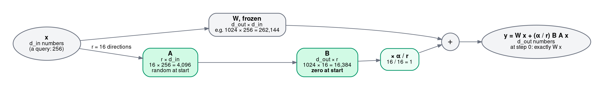
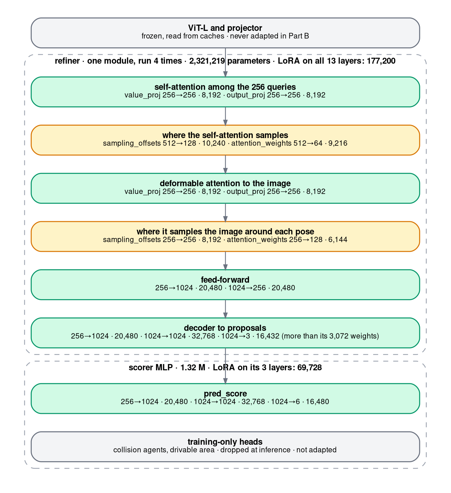

# H15 Part B · A primer on LoRA, for B-2, B-3 and B-4

**Status (11 Nov 2026): a primer, written for these experiments.** Every count below is *counted* on 11 Nov from the
release's own modules, unless labelled otherwise.
- [The overview](drivejepa-perception-sidecar-overview.md) holds the tracker, the naming and the log.
- It serves [B-2, the scorer](drivejepa-perception-sidecar-B-2-scorer.md),
  [B-3, the refiner](drivejepa-perception-sidecar-B-3-refiner.md) and
  [B-4, both](drivejepa-perception-sidecar-B-4-joint-lora.md).

## The crux

- **LoRA changes a frozen network by learning a small correction to some of its weight matrices.**
  - The correction has low rank: few parameters.
  - It starts at exactly zero: the network starts as it was.
- **In Part B, it is how the release's refiner and scorer make room for the side-car's agents:**
  - without forgetting what they learned;
  - with a change small enough to attribute;
  - starting from a model that is the release, bit for bit.

## What to expect from it here

- **LoRA is capacity to adapt, not a gain by itself.**
  - Arm C, the same LoRA without the agents, measures what adapting alone does. F − C is the agents.
- **It is small:**
  - rank 16 on all 13 of the refiner's linear layers: 177,200 parameters;
  - on the scorer's 3: 69,728;
  - against the 307.9 M of the inference path.
- **Its main risk is the data.**
  - It trains on navtrain, which the release already fits well (in-sample NC 0.996).
  - So it may learn little, or fit what the release already knew.
  - That is why every result is read out of sample, beside arm C.

## The concepts, question by question

**Q1. What does "fine-tuning" mean in these experiments?**
- Continuing to train the released planner on navtrain's train logs, with its own losses, after giving it a new
  input: the side-car's agents.
- The ViT and the projector stay frozen (they are read from caches), and so does the side-car.

**Q2. Why not train every weight of the refiner and scorer?** The first pass tried it ("full" modes), and history
argues against it.
- **The scorer, fully refitted on navtrain, cost the release 0.23–0.44 m at 3 s on nuScenes**, with or without
  agents (the first pass's B1, *read*).
- **H07's exp3 fine-tuned the generator and the scorer,** and the gate's NAVSIM EPDMS fell from 0.857 to 0.753
  (D18).
- **A full fine-tune spreads change everywhere,** and makes F − C harder to read.
- **The release already fits navtrain:** freedom mostly buys overfitting.

LoRA keeps the release's weights, and learns a bounded change.

**Q3. What is LoRA, exactly?**
- Take one linear layer, y = W x, where W has d_out × d_in numbers and is frozen. LoRA adds a second path:

  **y = W x + (α / r) · B A x**

  - A is r × d_in, and B is d_out × r. Only A and B train.
  - r, the rank, is much smaller than d_in and d_out.
- Their product B A is a full d_out × d_in matrix, but of rank at most r. So the change to W can move the layer's
  output in at most r independent directions.
- Hu et al. (ICLR 2022) found that adaptations of large networks often fit in such a small space.

**Q4. Why does B start at zero, and A at random?**
- **B = 0 makes the change zero,** so before the first step the model is exactly the release. The preflight checks
  it bit for bit.
- **A is random, so gradients reach B at once.**
  - The gradient for B is (α / r) · (∂loss / ∂y) · (A x)ᵀ, which is not zero.
  - The gradient for A is (α / r) · Bᵀ (∂loss / ∂y) xᵀ, which is zero while B is.
- So B moves first, and A follows. If both started at zero, nothing would move.

**Q5. What do the rank r and the scale α do?**
- **r is capacity:** how many directions the layer's output can change in.
- **α / r scales the change.** H15's `LoRALinear` uses r = 16 and α = 16 (*read*: `scorers.py`), so the scale is
  1.
- Changing r while keeping α changes the effective step size too. A rank sweep should keep α / r fixed, or say it
  did not.

**Q6. How many parameters does it add, and where?** Each layer adds r × (d_in + d_out):

| Where | Layer | d_in → d_out | Its weights | LoRA, rank 16 |
|---|---|---|---|---|
| refiner, self-attention | value_proj · output_proj | 256 → 256 each | 65,536 each | 8,192 each |
| | sampling_offsets · attention_weights (*where* it samples) | 512 → 128 · 512 → 64 | 65,536 · 32,768 | 10,240 · 9,216 |
| refiner, deformable attention to the image | value_proj · output_proj | 256 → 256 each | 65,536 each | 8,192 each |
| | sampling_offsets · attention_weights (*where* it samples) | 256 → 256 · 256 → 128 | 65,536 · 32,768 | 8,192 · 6,144 |
| refiner, feed-forward | two layers | 256 → 1024 → 256 | 262,144 each | 20,480 each |
| refiner, decoder to proposals | three layers | 256 → 1024 → 1024 → 3 | 262,144 · 1,048,576 · 3,072 | 20,480 · 32,768 · 16,432 |
| **the refiner, all 13 layers** | | | **2,321,219 parameters in all** | **177,200** |
| scorer MLP (`pred_score`) | three layers | 256 → 1024 → 1024 → 6 | 262,144 · 1,048,576 · 6,144 | 20,480 · 32,768 · 16,480 |
| **the scorer, its 3 layers** | | | **1.32 M** | **69,728** |

- **One oddity worth knowing.** The decoder's last layer (1024 → 3) has 3,072 weights, but rank-16 LoRA on it has
  16,432.
- A rank larger than the layer's output adds nothing but parameters. Training that small layer outright, or
  leaving it frozen, is cheaper (a variant, not the plan).

**Q7. Why there, and not elsewhere?**
- **The refiner and the scorer** are what must learn to use a new input: B-3 and B-2.
- **Not the ViT or the projector.**
  - They are frozen and read from caches.
  - The first pass's B3 put LoRA on the ViT's last four blocks and found nothing for the side-car (recall
    +0.001).
  - H07 put it on the whole ViT and failed the gate.
- **Not the training-only heads,** which are dropped at inference.

**Q8. The refiner runs four times. Is its LoRA shared too?**
- Yes. The release uses one refiner module for all four passes, and LoRA modifies that module's layers. So one
  change applies to every pass.
- Separate LoRA per pass would cost four times the parameters and break the release's sharing. It is not planned.

**Q9. What if LoRA adapts *where* the refiner looks?**
- Four of the refiner's layers compute the deformable attention's sampling offsets and weights: where around each
  pose it reads the image.
- LoRA there lets the agents change *where* the refiner looks. That is powerful, and can drift from the release.
- B-3's plan keeps them adapted, as the first pass did. Its variant B-3-4 leaves them frozen: "look where the
  release looks, take something different".

**Q10. How does LoRA differ from the adapters?**

| | The adapters | LoRA |
|---|---|---|
| What it is | new modules: an own half (every arm) and an agent half (F, O) | a low-rank change to existing linear layers |
| What it adds | a new input, the agents, and a path for it | room for the existing paths to use what the adapter adds |
| How it starts | output layers at zero | B at zero |
| Parameters, refiner (B-3-1) | 198,144 (C) · 336,004 (F, O) | 177,200 |
| Parameters, scorer (B-2-1) | 207,872 (C) · 345,732 (F, O) | 69,728 |

- Arms C and F share the same LoRA and the same own half; only the agent half differs. That is why F − C is the
  agents' effect, not the adaptation's.

**Q11. What does LoRA learn from, and how fast?** H15's first-pass settings, fixed:

| | B-2-1 · scorer | B-3-1 · refiner | B-4-1 · both |
|---|---|---|---|
| loss | BCE on each proposal's PDM final score | `mtd_loss`: winner-takes-all to the human + good-anchor teachers | each stage its own |
| learning rate | 1e-4 adapter · 2e-5 head LoRA | 1e-4 adapter and LoRA | each stage its own |
| schedule | 10 epochs, batch 256, the last kept | 3 epochs, batch 64, cosine, clip 10, the last kept | — |
| weight decay | AdamW 0.01 | AdamW 0.01 | — |
| trained in all | 277,600 (C) · 415,460 (F, O) | 375,344 (C) · 513,204 (F, O) | 652,944 (C) · 928,664 (F, O) |

- **Weight decay** on A and B pulls the change back toward zero, which means toward the release: a quiet
  regulariser.

**Q12. How do we know LoRA is not wrecking the release?**
- **At step 0:** the composed model equals R̃ bit for bit. The preflight refuses otherwise.
- **While training:** each layer's ‖(α / r) B A‖ / ‖W‖ is logged every epoch. A layer that runs away shows there
  first.
- **At the end:**
  - C − R̃ on navtest: the adaptation's own effect;
  - nuScenes: out of domain;
  - EC: whether picks stay steady between frames.

**Q13. What can go wrong?**
- **Little to learn.** The release already fits navtrain, so LoRA may stay near zero, or fit noise. C − R̃ and the
  curves show which.
- **Overfitting to navtrain:** read on navtest and nuScenes, never on navtrain.
- **Drift of where the refiner looks:** B-3-4 is the check.
- **Seed variance.** In the first pass, the scorer's LoRA mode was the most variable: F − C from −0.21 to +0.24
  points. Three seeds, and H15's rule.
- **Tiny layers:** Q6's oddity.

**Q14. How would it ship?**
- **LoRA merges away exactly:** W' = W + (α / r) B A, computed once. The planner then runs at the release's speed,
  with the release's layer shapes.
- **The adapters do not merge.** They are new modules with a new input, so a checkpoint needs:
  - its `checkpoint.json` (the contract with Paddock, `docs/checkpoints.md`);
  - and Paddock's Drive-JEPA adapter extended to feed the agents (B-14).
- `drivejepa_b2d/write_checkpoint.py` writes a vendor checkpoint today; a merge step is still to write.

**Q15. How is this different from H07's LoRA, and from the first pass's B3?**

| | H07, exp3 | First pass, B3 | Part B |
|---|---|---|---|
| Where | every attention and MLP layer of the ViT (6.3 M) | the ViT's last 4 blocks (1.05 M) | the planner only: refiner and scorer (0.25 M of LoRA) |
| Trained on | KITScenes frames, self-supervised; then generator and scorer | the side-car's loss | navtrain, the release's own losses |
| Result | failed the gate: NAVSIM 0.857 → 0.753 | recall +0.001 | — |

**Q16. If LoRA under-fits or over-fits, what changes first?**
- Under-fitting:
  - rank 32 (α 32);
  - the learning rate ×2;
  - the decoder's last layer trained outright.
- Over-fitting:
  - rank 8;
  - fewer epochs;
  - LoRA off the sampling layers.
- **Each is a choice, so it is made on the R-clean split, never on navtest** (B-0, Q2).

## Glossary

| Term | Meaning here |
|---|---|
| rank r | how many directions the layer's output can change in; 16 here |
| α | the scale of LoRA's change, as α / r; 16 here, so 1 |
| ΔW | (α / r) B A, the learned change to a weight W |
| adapter | a new module that brings the agents in; its output starts at zero |
| identity at step 0 | before training, the model equals R̃ bit for bit |
| R̃ | the release through the experiments' cached path, all changes at zero |
| merge | W' = W + ΔW, so inference runs without LoRA's extra path |
| arm C | the same LoRA and adapter, without agents: what adapting alone does |
