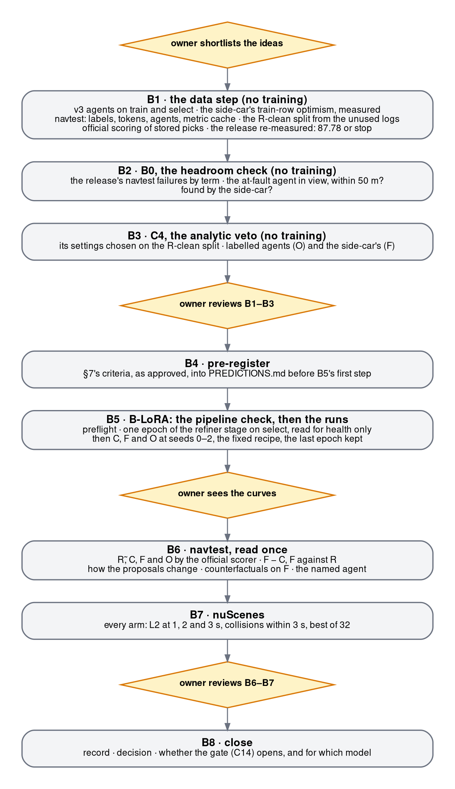
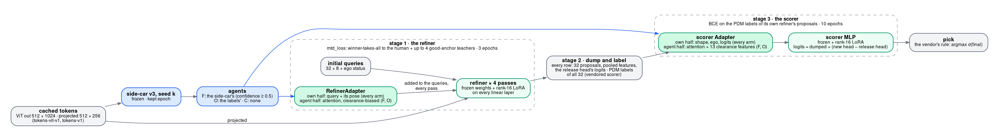

# H15, Phase B: the side-car inside Drive-JEPA's planner, one reviewed step at a time

**Status (10 Nov 2026): planning only. Nothing in this plan has run, and nothing trains until the owner approves
a shortlist from [the ideas](drivejepa-perception-sidecar-B-ideas.md).** It plans the owner's first idea in
full:
- the side-car's agents as an extra input to the downstream planner (refiner and scorer);
- adapted with LoRA;
- read on navtest against the released model, with an analysis of how the 32 proposals change.

The steps every idea shares (the data, the official scorer, the analysis) are planned here too. The other ideas
are planned in short (§9) and expanded once shortlisted.

**Why a plan first.**
- H15's first pass ran Part A and every phase-B question in a day and a half, and was judged inconclusive
  (D20).
- Part A was redone one reviewed step at a time
  ([its plan](drivejepa-perception-sidecar-A.md)); Phase B follows the same pattern.
- Opening B before Part A's steps 6 and 8 is the owner's call of 10 Nov (D22).
  - Step 7 (nuScenes) ran alongside, on 10 Nov (`H15.r5`): Q9 holds; the agents are weaker out of domain.
  - Step 6 (the report logs) waits, and nothing in Phase B reads the report logs.

**What to review, in order:**

| Step | What it settles | Trains? |
|---|---|---|
| shortlist | which ideas go on ([the ideas](drivejepa-perception-sidecar-B-ideas.md), §11 here) | — |
| B1 · the data step | every split's inputs; the official scorer reproducing the release's 87.78; the side-car's train-row optimism | no |
| B2 · the headroom check | how many of the release's navtest failures involve an agent the side-car could see | no |
| B3 · the analytic veto (C4) | whether agents, used by a rule, beat the release at all | no |
| B4 · pre-register | §7, approved, into PREDICTIONS.md | — |
| B5 · B-LoRA | the pipeline check, then the runs | **yes, on the go-ahead** |
| B6 · navtest, once | F − C, F against R, the proposals, the counterfactuals | no |
| B7 · nuScenes | the arms out of domain | no |
| B8 · close | the record and the decision | — |

**Labels on numbers** (as in Part A):
- *counted*: on disk at this site;
- *measured*: from a run;
- *read*: in code or a record;
- *estimate* and *argued*: as named.

First-pass numbers are reference only. They are in-sample for the release.

## 1. The question

**H-B.** The side-car reads the frozen ViT the planner reads, and lists the agents ahead. Given that list, does
Drive-JEPA's planner plan better on scenes it never trained on?

**For B-LoRA (C3):**
- The list enters both the refiner and the scorer.
- Both are adapted with LoRA, and everything else is frozen.
- "Better" is read on navtest, by NAVSIM's official v2 scorer:
  - against the identical adaptation without agents (C), which isolates the agents;
  - against the release (R), which answers "meet or beat".

**Out of scope here:** closed loop (C14, the gate, deferred), and any change to the side-car (Part A).

## 2. What changes from the first pass

| | First pass (B1, B2, 3–4 Nov) | This plan |
|---|---|---|
| Where it is read | navtrain report logs, in-sample for the release: its pick scores NC and TTC 0.996 there | navtest, where the release never trained (NC 0.985, TTC 0.979), read once; choices on an R-clean split (§3.3) |
| What adapts | scorer (B1) or refiner (B2), never both | refiner, then the scorer on that refiner's own proposals |
| Scorer of record | the vendored PDM scorer | NAVSIM's official v2 `run_pdm_score.py`, as the 87.78 anchor was; the vendored one for proposals the official run never scores |
| Report logs | read after every run | never: they are Part A's step 6 |
| The agents | the first pass's v1 side-car (A1, seed 0, epoch 11), 4.86 a row | v3 for 24 epochs; the planner's seed k reads the side-car's seed k |
| Train-row optimism | not measured | measured before training (§3.4), cross-fitting if it matters |
| The pick | argmax of the raw logit | the vendor's rule, argmax of σ(final), no momentum (§8.1) |
| Pace | every mode, arm and seed back to back | a pipeline check reviewed before the runs; navtest once, after all runs |

**What carries over.**
- The arms C, F and O, and H15's rule: F beats C when, on every seed, F − C exceeds both C's seed range and
  twice the paired SE, clustered by log.
- B2's refiner adapter and B1's scorer adapter, unchanged.
- The zero-initialised outputs.

## 3. The data (B1, no training)

### 3.1 The splits

| Split | Logs · samples | Role | In-sample for the release? | For the side-car? |
|---|---|---|---|---|
| train | 1,071 navtrain logs · 94,195 | training | yes | yes |
| select | H04's 51 held-out navtrain logs · 4,457 | health checks and the pipeline check only; nothing is chosen on it | yes | no |
| **R-clean** (new, §3.3) | 58 routed trainval logs in no NAVSIM split · up to 11,340 windows | every choice any B idea makes | **no** | no |
| **navtest** | 136 logs · 12,146 | the one read: B6 | **no** | no |
| report | 70 navtrain logs · 4,636 | **untouched**: Part A's step 6 | yes | no |
| nuScenes | H15's 100 train scenes · 2,917 keyframes | out of domain: L2 and collisions (no metric cache) | no | no |

- **How the new lists are kept.** `navtest.json` and `fresh.json` sit beside `splits.json` in
  `recipes/drivejepa_perception/`. Each records:
  - its rule, and the sha256 of the source scene filter (`navtest.yaml`, the trainval logs);
  - its tokens' sha256.
- **They are re-derived and refused if edited,** as `splits.json` is.
- **`splits.json` itself does not grow.** Its loader compares only its own keys (`navsim_data.load_splits`,
  *read*), so an added key would escape the edit check.

### 3.2 What each split needs

| Pass | train / select | R-clean | navtest | Cost (*estimate*) |
|---|---|---|---|---|
| labels (agents, the ego's future) | `labels-v1`, exists | new | new | under a minute each |
| projected tokens and ViT output | `tokens-v1`, `tokens-vit-v1`, exist | new | new | about 8 GPU-min for navtest (`tokens-v1` ran 103,288 rows in 3,786 s); 3.2 + 12.7 GB |
| the side-car's agents, seeds 0–2 | new (`agents-a1-s0` is the first pass's v1) | new | new | minutes of GPU |
| metric cache | Drive-JEPA's pruned v2 train cache, exists | new | **new: none at this site** | about 1 h of CPU each, 48 workers |
| PDM labels of the release's 32 | `pdm-v1`, exists | new | new (analysis only) | `pdm-v1` took 596 s for 103,288 rows |

**Every pass gains a split source:** navtrain (the default, so `labels-v1` and `tokens-v1` stay reproducible),
navtest or fresh. Today the labels pass, the token passes, the preflight and `train_sidecar.load` are hard-wired
to navtrain and trainval (*read*: `navsim_data.py:311–313`, `tokens.py:162–164`, `preflight.py:132–133`,
`train_sidecar.py:161–164`).

### 3.3 The R-clean split, from trainval's unused logs

- **What is there** (*counted* on 10 Nov):
  - 118 trainval logs are in no NAVSIM scene filter: not navtrain, navtest, navmini, warmup or navsafe.
  - The release trained on navtrain only (`train_drive_jepa_perception_based.sh`).
  - Only 58 of them have a window with a route, which every NAVSIM filter requires: 11,340 windows, 4 frames
    of history and 10 of future.

  | City | Logs · with a route | Routed windows |
  |---|---|---|
  | Las Vegas | 71 · 53 | 9,895 |
  | Pittsburgh | 20 · 3 | 975 |
  | Boston | 26 · 2 | 470 |
  | Singapore | 1 · 0 | 0 |

- **So it is small, 87% Las Vegas, and has no left-hand traffic.**
  - Choices made on it are reweighted to navtest's city mix.
  - Its traffic-side breakdowns are empty.
- **Why NAVSIM left these logs out is not known.** B1 checks them before use: annotation coverage, the ego's
  speed and the commands, against navtest's.
- **The window rule** is a decision (B.5):
  - all routed windows; or
  - a navtrain-like "non-trivial" filter. NAVSIM ships token lists, not its rule. One would be validated by how
    well it reproduces `navtest.yaml`'s membership on about 10 navtest logs.
- **An option:** 2 routed test logs outside navtest (306 Boston windows).

### 3.4 The agents as an input

- **The format** is `train_sidecar.agent_arrays` (*read*). Each slot has:
  - class, confidence (1 − p(none)), centre, size, yaw, velocity, and its path offsets at +0.5 s and +1.0 s;
  - a mask of the slots at confidence ≥ 0.5, the readout's threshold.
- **The checkpoint.** v3 for 24 epochs at its kept epoch: seeds 0, 1, 2 at 24, 21, 24.
  - The planner's seed k reads the side-car's seed k, so the seed range covers both.
  - The side-car never trains in Phase B.
- **Arm O** reads the labels' agents in the camera's view, in the same format (`train_scorer.truth_agents`,
  *read*).
- **Train-row optimism, measured before anything trains.**
  - The side-car trained on the train logs, so its agents there are better than on the scenes the planner
    meets at test. F could learn to trust agents more than it should.
  - B1 reads each seed on a seeded draw of 51 train logs and on select: F1, causal recall, depth error by
    range.
  - If train − select exceeds 0.03 in F1 or in causal recall, the train rows' agents are cross-fitted.
    - That means 5 side-cars, each trained on four fifths of the train logs, each giving the agents of the
      rest.
    - About 5 × 1.75 h a seed (step 5's v3 took 4.5 min an epoch, *measured*).
    - The threshold is decision B.11.

## 4. The model (C3, B-LoRA)

**What is frozen:**
- the ViT, the projector (both read from caches) and the side-car;
- every weight of the release's refiner and scorer;
- what changes them is LoRA and two adapters.

**What trains:**

| Part | What it is (*read*) | Arms |
|---|---|---|
| refiner adapter | `train_refiner.RefinerAdapter`, a pre-hook on the shared `Bev_refiner` that adds to its 256 input queries on every pass. Its own half: an MLP over each query and its proposal's pose. Its agent half: `scorers.AgentRead`, query → agent attention (4 heads, width 128, a learned "no agent" slot), biased by −clearance / 5 × a learned per-head scale, plus the 13 clearance features of `geometry.terms`, through a `Linear(141 → 256)` | own half: every arm; agent half: F, O |
| refiner LoRA | `scorers.LoRALinear`, rank 16, α 16, on every linear layer of the shared refiner; B starts at zero | every arm |
| scorer adapter | B1's `scorers.Adapter`. Its own half reads the proposal's shape, the ego status and the logits. Its agent half reads attention and clearance features, as above | own half: every arm; agent half: F, O |
| scorer LoRA | rank 16 on the scorer MLP's three linear layers (`scorers.with_lora`) | every arm |

**Before the first step, the model is the release run through the cached path (R̃).**
- Every adapter's last layer starts at zero, and every LoRA's B does, so the additions are exactly zero.
- **But R̃ is not exactly R.** The refiner reads fp16 cached tokens at batch 64 through `batch_fix`, while the
  release ran live in fp32 at batch 1.
  - B2's preflight allowed 5 cm and 95% of picks equal for that reason (`preflight.py:226, 284–288`).
  - B3.2 met one non-picked proposal 0.75 m off.
- So:
  - R̃ is the exact baseline every arm starts from;
  - R is read beside it;
  - R̃ − R is measured on every navtest row (gate GB3).
  - F − C does not depend on it.

**The scorer's logits are re-based, not replaced.**
- B1 writes logits = the cached logits + (the adapted head(f + δ) − the release head(f)) (`scorers.py:239–240`,
  *read*). That is exact at step 0, whatever the cached logits are.
- Here the "cached logits" are stage 2's: the release head on the trained refiner's own pooled features.
- So B1's model, its fitting loop and its preflight identity run unchanged.

**Two routes, one each.**
- On pass 4, the refiner adapter's output reaches only the scorer's input: the proposals are decoded before
  `Bev_refiner` runs (`traj_refiner.py:23–29`, *read*).
- So in F the scorer meets the agents twice: through pass 4's adapter, which the planning loss never trains, and
  through its own adapter.
- §8.3's counterfactuals separate the two: agents to the refiner only, and to the scorer only.

**Size** (*estimate*, from the first pass's counts):
- the refiner adapter and LoRA, about 0.4 M;
- the scorer adapter and LoRA, 0.28 M;
- under 0.3% of the inference path's 307.9 M.

## 5. The loss

- **Stage 1, the refiner.**
  - The release's own planning loss, `drivejepa_b2d.train_generator.mtd_loss`: winner-takes-all L2 to the human
    plus 0.5 × up to 4 teachers, on every pass, earlier passes at 0.1.
  - The teachers are drawn, as the release drew them, from its good anchors: `anchors_scores_index_v2`, score
    ≥ 0.95, up to 256 a row (`train_refiner.py:130–133`).
  - Rows without anchors take the human alone. The first pass found that rows without anchors were pulled toward
    a stop until that was fixed (README).
- **Stage 3, the scorer.**
  - BCE on the final score of every proposal against its PDM label.
  - B1 chose BCE on select in the first pass. The plan's imitation term made every control worse (0.893–0.896
    against the release's 0.920), because the human's own plan scores 0.906.
- **Two stages, or one joint run** (decision B.2).
  - The release trains jointly: each step's new proposals are PDM-scored online, on CPU workers, for the score
    loss.
  - Two stages cost far less. The scorer then trains on exactly the proposals it will be read on.
  - What is lost: the score loss never shapes the refiner's features.
  - Recommended: two stages first. Joint training is the variant if B6 finds the scorer to be the limit.

## 6. The training recipe (B5, on the go-ahead): fixed, nothing chosen

### 6.1 The stages

1. **Stage 1, the refiner.** Train rows only.
   - `train_refiner.build(entered, "lora", agents)`, with B2's loop: AdamW, weight decay 0.01, learning rate
     1e-4, batch 64, gradient clip 10, cosine.
   - 3 epochs. The last epoch is kept: nothing chooses an epoch.
2. **Stage 2, the dump.**
   - The trained refiner over every train, select, R-clean and navtest row, in sorted 64-row chunks.
   - It writes the 32 proposals, the pooled scorer input (fp32), the release head's logits and the vendor's
     pick.
   - Then the PDM labels of all 32: the train cache for navtrain rows, the new caches for R-clean and navtest.
3. **Stage 3, the scorer.** Train rows only.
   - `scorers.B1Model("lora", agents, head)` and `train_scorer._fit`, BCE, 10 epochs, batch 256.
   - Learning rates: 1e-4 for the adapter and 2e-5 for the head's LoRA. The last epoch is kept.

**Arms and seeds:**
- C, F and O at seeds 0, 1 and 2: nine runs.
- R̃ is a dump with zero adapters (`--zero`).
- S (another log's agents) is read at evaluation only, as a counterfactual (decision B.3).

### 6.2 What a run records

Part A's telemetry, per stage:
- `steps.jsonl` every 50 steps: each loss term, the learning rate, the gradient norm, the AMP scale, and the
  data wait;
- `metrics.jsonl` per epoch: the select health readout, which chooses nothing;
  - the losses;
  - the agent half's mean attention to the "no agent" slot, which shows whether it is used;
  - best of 32 and the pick against the vendored labels.
- `run.json` holds the preflight's report. The dumps' manifests record their rows; a report-log row is
  refused.

### 6.3 The pipeline check (B5's first part)

- Before the nine runs: arm F, seed 0, epoch 1 of stage 1, and a 1-epoch stage 3 on its dump.
- It reads the select logs only, as Part A's step 3 did.
- The owner sees its curves before the runs start, and before any navtest number exists (gate GB5).

### 6.4 The preflight (`preflight.run_downstream`)

Each check is of the form "what the trainer computes equals what was recorded".

| Check | Holds |
|---|---|
| code | `src/` and `tests/` committed; the suite passes under the interpreter that trains (Python 3.9) |
| splits | `splits.json`, `navtest.json` and `fresh.json` re-derived; **no report-log row in any row set or manifest** |
| tokens | 6 select and 6 navtest rows run live equal the caches (the existing `_live_equals_cache`, extended) |
| labels | `check_labels` on 8 windows of each split |
| anchors | the gathered teachers equal their source files on 16 rows (B2's) |
| agents | the manifest names seed k's kept epoch; 16 rows decoded again live equal the stored ones (mask and class exactly); report rows masked |
| identity, stage 1 | the untrained composed refiner equals R̃ bit for bit (`torch.equal`) on 64 select rows |
| the dump | recomputed from the saved state on 64 rows, bit for bit; its logits equal the head on its pooled features; its pick follows the vendor's rule |
| grading | `pdm_labels.check`: exact re-scores on 5 rows per metric cache |
| identity, stage 3 | the untrained scorer reproduces the dump's logits exactly and its pick on every one of 512 select rows (B1's check) |
| plans for scoring | the npz equals `proposals[pick]`, and its tokens equal `navtest.json`'s |

### 6.5 Checks during a run

These are Part A's: no non-finite loss, skipped steps under 1%, clipped steps reported, and the data wait
watched.

### 6.6 Cost (*estimate*; one shared H200)

| Item | GPU | CPU |
|---|---|---|
| B1's passes (navtest, R-clean, agents) | about 0.5 h | metric caches about 2 h; labels minutes |
| the fidelity gate: the live release on navtest once (B.8) | 1–4 h | the official scoring |
| stage 1 × 9 | about 15 min each (B2: 0.20 s a batch, *measured*) | — |
| stage 2 × 10 dumps | minutes each | PDM labels about 10 min each |
| stage 3 × 9 | 5–15 min each | — |
| the navtest read | — | 10–30 min a run of the official scorer |

- **Totals:** about 6–10 GPU-hours and 8–15 CPU-hours, roughly two days on the shared machine.
- **Disk:** 70–120 GB.

## 7. How success is measured (a draft, for B4)

**Committed to PREDICTIONS.md only when the owner approves it, before B5's first training step.** Every number
below is a draft for the owner to edit.

### 7.1 Gates: each must hold to go on

| # | Gate |
|---|---|
| GB1 | every run's preflight passes, and its report is in `run.json` |
| GB2 | **the anchor reproduces:** the release's picks, replayed through the official scorer here, give navtest EPDMS 87.78 with the human filter and 84.49 as navsim's CSV scores it (± 0.02). The live release agrees token by token where the plans agree. Otherwise nothing on navtest is compared until the difference is found: navsim at `548bb82` (where 87.78 was measured) against this site's `e21f474`; upstream navsim later fixed a human-filter bug (`359c7f7`) |
| GB3 | R̃ against R: at least 99% of picks equal, and \|ΔEPDMS\| ≤ 0.05 points |
| GB4 | no non-finite loss; skipped steps under 1% |
| GB5 | the owner has seen the pipeline check's curves before any navtest number exists |
| GB6 | the side-car's train-row optimism measured; cross-fitted if over the threshold (§3.4) |

### 7.2 Predictions

Read on navtest, once, after every run has finished. Paired per scene; SE and intervals clustered by log (136
logs).

| # | What | Predicted | Supports if | Refutes if |
|---|---|---|---|---|
| PB1 | **F − C**, EPDMS (human filter): the agents' own effect | +0.0 to +0.4 points | beyond C's seed range and 2 SE, every seed (H15's rule) | negative beyond 2 SE on any seed |
| PB2 | **F against R:** meet or beat | F − R from −0.3 to +0.5 | *meets*: the 95% interval's low end ≥ −0.4 on every seed; *beats*: above 0 on every seed | the interval's high end < 0 on any seed |
| PB3 | C − R: the adaptation itself | −0.5 to +0.3 | reported | — |
| PB4 | where F − C lands | ≥ half in NC and TTC | if PB1 holds | — |
| PB5 | O − C: perfect agents | +0.2 to +0.8; O ≥ F | reported | — |
| PB6 | best of 32 (vendored), F − C | +0.1 to +0.5 | beyond 2 SE, every seed | — |
| PB7 | the agents are used: F's pick with another log's agents | changes on ≥ 5% of rows; deleting the agent F names moves the pick ≥ 3× as often as deleting a random one | both | ratio < 1.5 |
| PB8 | EC, F − R | within ± 0.02 | — | F loses more than 0.02 |
| PB9 | train-row optimism, train − select F1 | ≤ 0.03 | — | cross-fit (§3.4) |

### 7.3 Decision rules

- **GB2 fails:** stop.
- **PB1 supported:** the agents help this planner out of sample.
  - Read PB2 for "meet" or "beat".
  - The owner decides whether the gate (C14) opens.
- **PB1 neutral, O > C:** perception is the limit. C8 or C9 come before more planner work.
- **PB1 neutral, O ≈ C:** this planner uses nothing the agents add on NAVSIM, and B's NAVSIM route closes. C13
  and C14 remain.
- **PB3 negative:** the adaptation itself costs out of sample, as H07's did. F − C still stands, but nothing is
  shipped from it.

## 8. Evaluation

### 8.1 navtest, by the official scorer (B1 builds it; B6 reads it once)

1. **The metric cache.**
   - navsim v2's `run_metric_caching.py` with `train_test_split=navtest`, 48 workers in a process pool.
   - Written to `{runs}/drivejepa_perception/metric-cache-navtest-v2` (decision B.9).
   - Its manifest records the tokens found (12,146 expected), any missing, the filter's sha256 and the bytes.
   - The vendored scorer reads only fields both cache formats carry (*read*). `pdm_labels.check` is held on
     navtest rows before any proposal is labelled there.
2. **Scoring stored picks.**
   - A replay agent (`replay_agent.py`, `requires_scene=True`) returns each token's stored plan through the
     official `run_pdm_score.py`.
   - navsim's submission scorer is not used: it calls `pdm_score` without the traffic-agents policy v2 needs,
     and never computes EC (*read*).
   - The launcher:
     - sets `DRIVE_JEPA_MSDA=auto`, since this GPU's compiled kernel returns garbage without it;
     - puts the vendor tree and `src` on the path;
     - overrides `output_dir`, which by default writes into the shared models directory.
3. **The two scores.**
   - EPDMS with the human filter, and navsim's CSV score, by H04's arithmetic.
   - Its `navtest_score.py` (branch `drivejepa-wajepa/run3a`) is ported, Python-3.9-safe (it uses
     `zip(strict=True)`), with its test.
4. **Momentum.** The anchor has none. Every arm is read without momentum, then once with it, as a second read.
5. **The comparison.** Paired per scene, clustered by log, by `b_report`'s rule, written for navtest rows.

### 8.2 How the proposals change (`b_analysis.py`)

Every arm's 32 proposals on navtest and R-clean, PDM-labelled offline.

| Question | Measure |
|---|---|
| Do the proposals get better, or only the pick? | best of 32; the share of the 32 with NC and TTC = 1; the gap between best of 32 and the pick |
| Do they keep away from agents? | each proposal's smallest clearance to the labelled agents, and the pick's (`geometry.terms` with true agents) |
| Do they stay diverse? | the 32's spread: endpoint distances, lateral and longitudinal; minADE and miss rate (`train_generator.evaluate`) |
| Which proposals moved, and how far? | R̃'s 32 matched to C's and to F's (Hungarian, `scipy.optimize.linear_sum_assignment`): displacement by rank and by nearness to an agent |
| Does the pick move, and where to? | the pick-switch rate F against C and against R̃; its progress and clearance before and after |
| Does it stay steady? | the pick's agreement between consecutive frames, a proxy for EC, beside the official EC |
| Where does it help? | the first pass's subsets (a lead vehicle in lane within 30 m; the human slowing or stopped; an agent within 10 m of a proposal in the first 2 s), and whether the side-car found each row's causal agents (`importance.py`) |

The figures are BEV drawings of R̃'s and F's 32 proposals with the agents, true and detected:
- a seeded random draw of the rows whose pick changed;
- the largest gains and losses.

### 8.3 Counterfactuals on F (no retraining)

Each runs through the whole composed model and is scored offline.

| Change to F's input | What it tells |
|---|---|
| no agents | what F does without its input |
| another log's agents (S) | whether any input at all helps |
| the agent F names for its pick deleted, against a random detected agent | whether its reason is real (B1.6's test) |
| the named agent moved 2 m along its camera ray | sensitivity to the side-car's main error |
| labelled agents instead | the cost of perception errors, without retraining |
| agents to the refiner only; to the scorer only | which route carries the effect (§4) |

### 8.4 nuScenes (B7)

- Every arm on step 7's 2,917 keyframes: L2 to the human at 1, 2 and 3 s, collisions within 3 s
  (`nuscenes_data.collided`), and best-of-32 ADE.
- There is no metric cache, so there is no PDM score there.
- F reads the side-car's agents as recorded on nuScenes. Step 7 measured them there (`H15.r5`): vehicles within
  30 m 0.53, pedestrians 0.15–0.16, depth error within 10 m 0.6–0.95 m. So F meets weaker agents than on NAVSIM.
- This re-asks the first pass's two findings:
  - the refiner's retraining helped (C16);
  - the scorer's refit hurt.

## 9. The other ideas, as plans

Each reuses B1's data, §8's evaluation and the preflight's form. Each is expanded to Part A's detail once
shortlisted.

| Idea | What is new | Its steps | Cost (*estimate*) |
|---|---|---|---|
| **B0 · headroom** | none beyond B1 | 1. the release's navtest rows failing NC or TTC (official CSV); 2. the at-fault agent and its time (`pdm_labels.score`); 3. in CAM_F0's view within 50 m (`targets.seen`)? 4. found by each side-car seed? | minutes |
| **C4 · veto** | `veto.py`: clearance rule, margin, horizon, confidence | 1. 12 settings (margins 0.5, 1, 2 m; horizons 1, 2 s; confidence 0.5, 0.7) on R-clean, vendored labels; 2. the best by R-clean EPDMS, reweighted to navtest's cities; 3. navtest once, F and O | CPU minutes |
| **C16 · the refiner finding** | an arm switch | C3's stage 1 without agents, with `batch_fix` off, and with the release's teacher draw; read on nuScenes and navtest | 15 min a run |
| **C5 · initial queries** | an adapter on the initial queries | C3's stage 1 with it; F against C3's F | as C3 |
| **C8 · 4 s forecasts** | a 4 s labels pass; the path head to 8 steps | Part A's steps for a new variant; then C4 and C3 with its agents | a labels pass + about 1.75 h a seed |
| **C9 · uncertainty** | Laplace scales on the side-car's outputs (Part A §4.3, choice 11.11) | as C8; margins in C4 and features in C3 from the scales | as C8 |
| **C13 · explanations** | `explain.py` for navtest rows | from C3's F: the named agent, deletion, grounding | minutes |
| **C14 · the gate** | Paddock's adapter: agents inside the vendor's forward, the release's logits kept beside, `DRIVEJEPA_SIDECAR` declared | the quick tier, then the smoke; neuroNCAP at about 10.6 h a 200-sample run | days |

## 10. Code

**Reused, as is** (*read*):
- `train_refiner.build`, `RefinerAdapter`;
- `scorers.Adapter`, `AgentRead`, `LoRALinear`, `with_lora`, `B1Model`; `train_scorer._fit`;
- `geometry.terms`, `drivejepa_b2d.train_generator.refine_from_cache`, `mtd_loss`, `evaluate`;
- `drivejepa_b2d.batch_fix`;
- `pdm_labels.score`, `b_report.clustered_se`, `explain.py`'s deletion test;
- `train_sidecar.agent_arrays`;
- `preflight.run_refiner` and `preflight.run_scorer`'s checks.

**Extended:**

| Module | Change |
|---|---|
| `navsim_data`, `tokens`, `preflight` | a split source: navtrain (default), navtest, fresh |
| `pdm_labels` | `--root` (which metric cache) and `--rows` (which rows) |
| `train_sidecar` | `agents --rows --vit-tokens`: any split, report rows left masked |
| `evaluate` | done for step 7: AP, calibration, the ray split, per-sample counts |

**New** (inside `gallops.drivejepa_perception`, so the package's claim covers them):

| Module | What |
|---|---|
| `train_downstream.py` | `refiner`, `dump [--zero]`, `scorer` and `picks`: the two stages. Its own rows, never the report logs. The first pass's `train_refiner` and `train_scorer` keep their recorded behaviour for their recorded stages |
| `navtest.py` | `metric-cache`, `score` (the official scorer on stored picks; both EPDMS figures), `compare` |
| `replay_agent.py` + `recipes/drivejepa_perception/navsim_config/agent/replay_agent.yaml` | the replay agent, found by Hydra's search path |
| `b_analysis.py` | §8.2 and §8.3 |
| `veto.py` | C4, if shortlisted |

**Recipe stages,** written after the shortlist:
- `b-data-*`, `b-fidelity`;
- `b-refiner-{C,F,O}-s{k}`, `b-dump-*`, `b-scorer-*`;
- `b-navtest`, `b-analysis`.

Each is recorded in H15 as a run, `H15.r6` onward.

## 11. Decisions for the owner

| # | Decision | Recommended |
|---|---|---|
| B.1 | the shortlist | C3 (the owner's first), with B0 and C4 before it: neither trains, and both make C3's result readable |
| B.2 | two stages, or joint training with online PDM scoring | two stages |
| B.3 | arms | R, C, F and O; S only as a counterfactual at evaluation |
| B.4 | seeds | 3 |
| B.5 | the R-clean window rule; the 2 routed test logs | all routed windows; leave the test logs out |
| B.6 | momentum | none, as the anchor; with momentum as a second read |
| B.7 | Part A's step 6 before B6's navtest read | yes. They are independent, but step 6 closes Part A's criteria first |
| B.8 | the fidelity gate: the live release on navtest once (1–4 GPU-h), or the replay alone | both |
| B.9 | where the navtest metric cache lives | under `{runs}`, H15's; Paddock's own config can point at it later |
| B.10 | H04's EPDMS arithmetic | ported into H15 with its test, not cherry-picked from H04's branch |
| B.11 | the cross-fit threshold | 0.03 in F1 or causal recall |
| B.12 | the side-car read on navtest, for §8.2's strata | yes, flagged. Choice 11.2 kept navtest out of Part A's test; here it chooses nothing about the side-car |
| B.13 | budget | B1–B3 now; B5 on the go-ahead |

## 12. Risks

1. **The anchor may not reproduce here.**
   - 87.78 was measured off this site, in another Drive-JEPA tree.
   - GB2 stops everything until it reproduces.
2. **The agents are better on the train rows than at test.** F learns from agents better than it will get. GB6
   measures it, and cross-fitting answers it.
3. **The report logs, through reused code.**
   - `train_refiner`, `train_scorer`, `pdm_labels.build`, `train_sidecar agents` and `b_report` all read them
     today.
   - Hence the new trainer and the preflight's guard.
4. **EC.** It is in navtest's EPDMS but in no training label. Picks that switch between frames lose it
   silently. PB8 and §8.2's steadiness measure catch it.
5. **The adaptation itself may cost out of sample.**
   - H07's exp3 fell from 0.857 to 0.753.
   - The first pass's refitted scorer was 0.2–0.4 m worse on nuScenes.
   - Arm C and R̃ make this visible.
6. **The R-clean split is small and Las-Vegas-heavy:** 11,340 windows, 87% Las Vegas, no Singapore.
7. **Power.**
   - A paired SE of 0.1–0.2 points on navtest may leave a real +0.2 NEUTRAL at 3 seeds.
   - B2 (headroom) says beforehand how large a gain could be.
8. **The shared GPU.** Runs are slow and their timing noisy; the plan quotes wall time.
