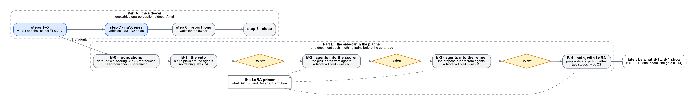
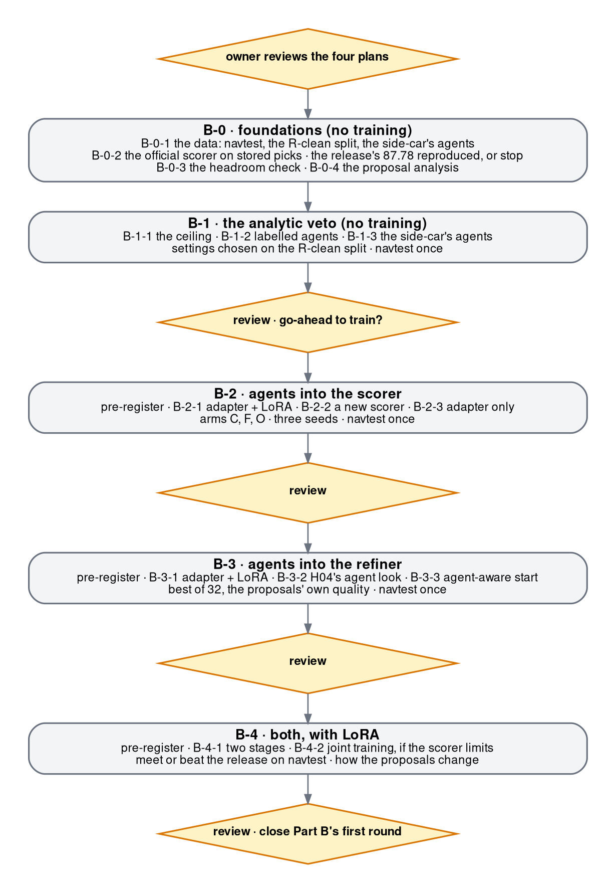

# H15 · The perception side-car: overview, tracker and discussion log

**Updated 11 Nov 2026.** This is the common record of H15. Every document of this work links here.
- Every change to one of them adds a dated line to the [log](#log) and updates the [tracker](#tracker).
- A decision also gets its D-number in [experiments/decisions.toml](../experiments/decisions.toml).

## The crux

Drive-JEPA plans from camera tokens, and has no explicit account of the other agents. H15 asks two questions.
- **Part A.** Can a small side-car, reading the same frozen ViT, find the agents ahead in 3D and say where each
  will be in a second?
- **Part B.** Given that account, does Drive-JEPA's planner plan better on scenes it never trained on?

## Where it stands (11 Nov)

- **Part A, the side-car.**
  - Steps 1–5 are done: v3, 18.4 M parameters, 24 epochs, select F1 0.717 over three seeds.
  - Step 7 is done: on nuScenes it finds 53% of the vehicles within 30 m, so Q9 holds. Warping the images to
    NAVSIM's camera did not help.
  - Step 6, reading the report logs once, waits for the owner.
- **Part B, the side-car in the planner.**
  - Four experiments are chosen and planned, one document each, in this order: B-1, B-2, B-3, B-4.
  - They share one plan of foundations, B-0, and a LoRA primer.
  - **Nothing in Part B has run.** The owner reviews the plans; execution starts in another session, with the
    owner's go-ahead.

## Naming

**Part B's experiments are named `B-<n>-<v>`.**
- `n` is the experiment:
  - 0 is the shared foundations;
  - 1 to 4 are the four chosen first, in the owner's order;
  - 5 to 16 are the other ideas, not chosen yet.
- `v` is a sub-version within it: 1, 2, and so on. For example, B-1-3 is the veto with the side-car's agents.
- **Runs** in `experiment.toml` keep the registry's IDs, `H15.r6` onward. Each run's label names its `B-<n>-<v>`.
- **The arms** of a trained experiment:

  | Arm | What it is |
  |---|---|
  | R | the released model |
  | R̃ | the release run through the same cached path, every adapter at zero |
  | C | the identical adaptation, without agents |
  | F | with the side-car's agents |
  | O | with the labelled agents |

**Old labels, and what they are now:**

| Was | Now | Note |
|---|---|---|
| C4, the analytic veto | **B-1** | chosen first |
| C2, agents into the scorer | **B-2** | chosen second |
| C1, agents into the refiner | **B-3** | chosen third |
| C3, "B-LoRA": both, with LoRA | **B-4** | chosen fourth |
| C5 to C16 | B-5 to B-16 | the same number |
| the 10 Nov plan's steps B1 (data) and B2 (headroom) | B-0-1, B-0-2 and B-0-3 | the foundations |
| that plan's B3 (the veto) | B-1 | |
| that plan's B4–B8 | each experiment's own pre-registration, runs, navtest read and close | |
| the first pass's B1, B2, B3, B3.2 (3–4 Nov) | **unchanged** | recorded runs `H15.b1`, `H15.b2`, `H15.b3`, `H15.b32`, always written with "the first pass" or the run ID. Their lineage: B-2 continues the first pass's B1; B-3 its B2 |

## The tracker

**Part B:**

| ID | The question | What changes | What trains | Status | Plan | Needs |
|---|---|---|---|---|---|---|
| B-0 | Can a planning gain be measured honestly here? | nothing: data, scoring, checks | nothing | planned | [B-0, the foundations](drivejepa-perception-sidecar-B.md) | — |
| B-1 | Does a rule on the agents pick better than the release? | the pick, by a rule | nothing | planned | [B-1, the veto](drivejepa-perception-sidecar-B-1-veto.md) | B-0 |
| B-2 | Does a scorer that reads the agents pick better? | the scorer | an adapter + LoRA: 0.28 M (C) to 0.42 M (F, O) | planned | [B-2, the scorer](drivejepa-perception-sidecar-B-2-scorer.md) | B-0; B-1 is its bar |
| B-3 | Do the proposals themselves get better? | the refiner | an adapter + LoRA: 0.38 M (C) to 0.51 M (F, O) | planned | [B-3, the refiner](drivejepa-perception-sidecar-B-3-refiner.md) | B-0 |
| B-4 | Both together: does it meet or beat the release? | refiner and scorer | both, in two stages | planned | [B-4, both with LoRA](drivejepa-perception-sidecar-B-4-joint-lora.md) | B-2, B-3 |
| B-5 to B-16 | the other ideas | — | — | not chosen | [the ideas](drivejepa-perception-sidecar-B-ideas.md) | by what B-1 to B-4 show |

- **What B-2, B-3 and B-4 adapt, and how:** [the LoRA primer](drivejepa-perception-sidecar-B-lora-primer.md).
- **Order of work:** B-0, then B-1, a review and the go-ahead to train, then B-2, B-3 and B-4, each closed by a
  review.

**Part A:**

| Step | Status | Run | Where |
|---|---|---|---|
| 1–3 · data, model and loss, pipeline check | done, reviewed (D21) | `H15.r1` | plan A §3–6, notebooks 01–03 |
| 4 · criteria committed | done | — | PREDICTIONS.md |
| 5 · three sizes, then v3 at three seeds | done | `H15.r3`, `H15.r4` | plan A §9.2, notebook 06 |
| 6 · report logs, read once | **waits for the owner** | — | plan A §8.1 |
| 7 · nuScenes, as recorded and warped | done | `H15.r2` (data), `H15.r5` | plan A §9.3, notebook 07 |
| 8 · close Part A | open | — | — |

## The discussion log

Newest last. Each entry is what was discussed or asked, what was decided, and what was done.

- **3 Nov · H15 registered; the first pass.**
  - Planned and run in a day and a half: the side-car (A), then its agents into the scorer (the first pass's B1),
    into the refiner (B2), and LoRA on the ViT (B3), plus nuScenes.
  - B1 and B2 came out neutral on navtrain's logs, where the release had trained: its pick scores NC and TTC
    0.996 there.
- **4 Nov · inconclusive; redone one step at a time.**
  - H14 is cancelled (D19).
  - The owner judges H15's first pass inconclusive: more ran than could be reviewed (D20). Part A is redone in
    eight reviewed steps, and phases B and C wait.
  - Steps 1–3 reviewed: "use recommended settings" (D21).
- **4–5 Nov · step 5.** v3 for 24 epochs, chosen by the committed rules: select F1 0.717.
- **9 Nov · the executive update** of Part A
  ([drivejepa-perception-sidecar-A-update.md](drivejepa-perception-sidecar-A-update.md)).
- **10 Nov · the next steps (D22).**
  - **The owner asked for:**
    - nuScenes validation in parallel;
    - a brainstorm of where the side-car could connect to Drive-JEPA;
    - as the first idea, the side-car as an extra input to the downstream planner with a LoRA fine-tune, meeting
      or beating NAVSIM, with an analysis of how the proposals change;
    - a plan for the other ideas.
  - **Asked and answered:**
    - Step 6 waits, and only step 7 runs.
    - Phase B is recorded inside H15.
    - A fixed recipe reads navtest once, and an R-clean selection split is built for later choices.
    - The pending Part A edits are committed on `-02` first.
    - Then: "documents first, like Part A; I shortlist; no training until the go-ahead". Step 7 runs now, since it
      is evaluation only.
  - **Done:**
    - the branch;
    - step 7 (`H15.r5`): Q9 holds; the warp does not help;
    - [the ideas](drivejepa-perception-sidecar-B-ideas.md) (then C1–C16) and the first B plan.
- **11 Nov · reprioritised and restructured (D23).**
  - **The owner chose four ideas, in order:** the veto, the scorer, the refiner, both with LoRA. They are now
    B-1 to B-4.
  - **The owner asked for:**
    - one plan document each, opening with the crux and what to expect, then the concepts as questions and
      answers that build to the plan;
    - a LoRA primer for these experiments;
    - diagrams;
    - one naming for B and C: `B-<n>-<v>`;
    - this overview as the common record;
    - the branch renamed `drivejepa/auxilliary-head-part-b`, committed and pushed.
  - **Not implemented.** The owner reviews the plans, and execution starts in another session.
  - **Counted for the primer:** the refiner's 13 linear layers and the scorer's 3. Rank-16 LoRA on them adds
    177,200 and 69,728 parameters.

## Open decisions for the owner

| From | Decision |
|---|---|
| Part A | step 6, the report logs, read once; retrain the no-camera control in fp32; weighting what matters (11.9); head changes (11.11); test the warp's three changes apart (plan A §9.3) |
| B-0 | the R-clean split's window rule; where the navtest metric cache lives; the live release run for the fidelity gate; momentum; the cross-fit threshold |
| B-1 | the settings grid; the fallback when every proposal is vetoed; whether B-1-1, the ceiling read from the grader's own labels, is read on navtest |
| B-2 | which sub-versions run (B-2-1 always; B-2-2 and B-2-3 or not); whether the scorer's sub-score heads train |
| B-3 | which sub-versions run; LoRA on the sampling offsets, or not |
| B-4 | two stages or joint; whether B-4-3 waits for B-2 and B-3 to differ |

Each experiment's own document gives these decisions in full, with a recommendation.

## The documents

| Document | What it is |
|---|---|
| [docs/drivejepa-perception-sidecar.md](drivejepa-perception-sidecar.md) | the first pass's plan (3 Nov), kept as it was |
| [docs/drivejepa-perception-sidecar-A.md](drivejepa-perception-sidecar-A.md) | Part A's plan, in reviewed steps, with what has run (§9) |
| [docs/drivejepa-perception-sidecar-A-update.md](drivejepa-perception-sidecar-A-update.md) | Part A's executive update (9 Nov) |
| [docs/drivejepa-perception-sidecar-B-ideas.md](drivejepa-perception-sidecar-B-ideas.md) | every idea for Part B, B-1 to B-16 |
| [docs/drivejepa-perception-sidecar-B.md](drivejepa-perception-sidecar-B.md) | **B-0**: the foundations and the protocol every experiment shares |
| [docs/drivejepa-perception-sidecar-B-1-veto.md](drivejepa-perception-sidecar-B-1-veto.md) | **B-1**, the analytic veto |
| [docs/drivejepa-perception-sidecar-B-2-scorer.md](drivejepa-perception-sidecar-B-2-scorer.md) | **B-2**, the agents into the scorer |
| [docs/drivejepa-perception-sidecar-B-3-refiner.md](drivejepa-perception-sidecar-B-3-refiner.md) | **B-3**, the agents into the refiner |
| [docs/drivejepa-perception-sidecar-B-4-joint-lora.md](drivejepa-perception-sidecar-B-4-joint-lora.md) | **B-4**, both with LoRA |
| [docs/drivejepa-perception-sidecar-B-lora-primer.md](drivejepa-perception-sidecar-B-lora-primer.md) | LoRA, for these experiments |
| [experiments/H15_perception_sidecar/](../experiments/H15_perception_sidecar/) | the record: README, PREDICTIONS.md, experiment.toml, the notebooks, the figures |
| [experiments/decisions.toml](../experiments/decisions.toml) | the decisions, D19–D23 for this work |

## How this set is kept

- **Each document opens with its status and date.** Experiment plans open with the crux and what to expect.
- **Any change to a document adds a dated line to the log here,** and updates the tracker.
- **A decision gets a D-number** in `experiments/decisions.toml`, and is mirrored in the log.
- **A run is recorded in `experiment.toml`,** and the README and CARD are rendered, never typed.
- **Numbers are copied from records, never re-derived,** and each carries its label: *counted*, *measured*, *read*
  or *argued*.
