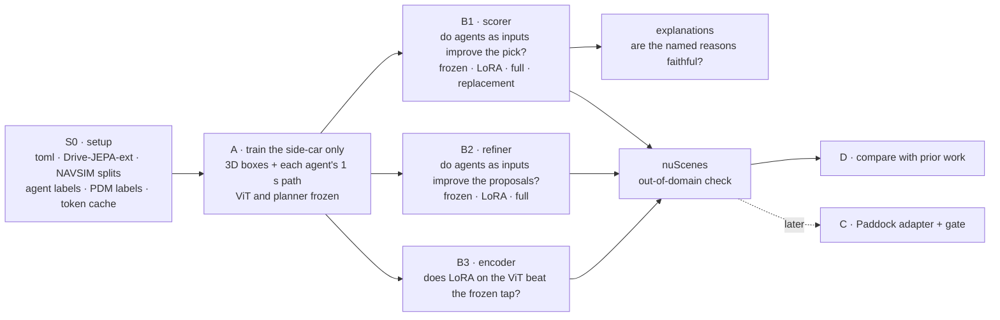
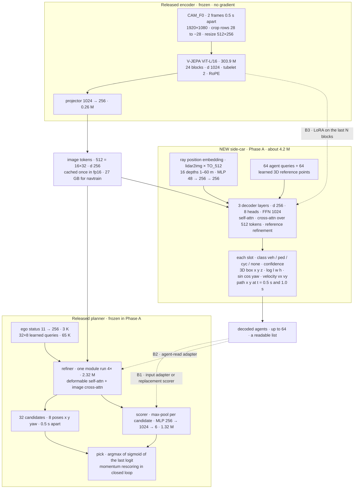
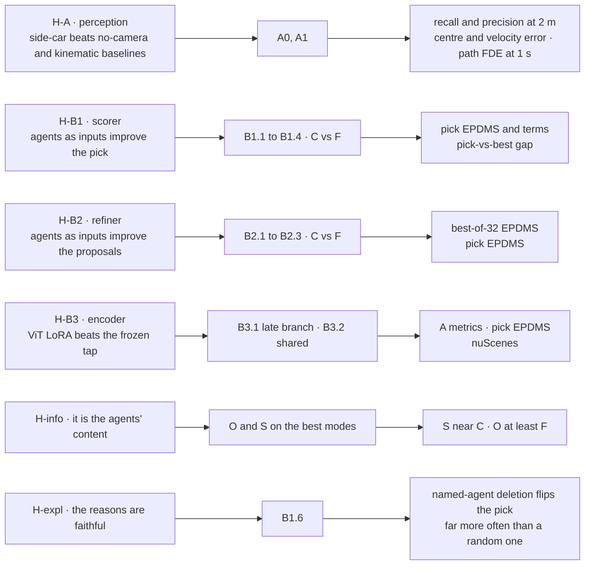
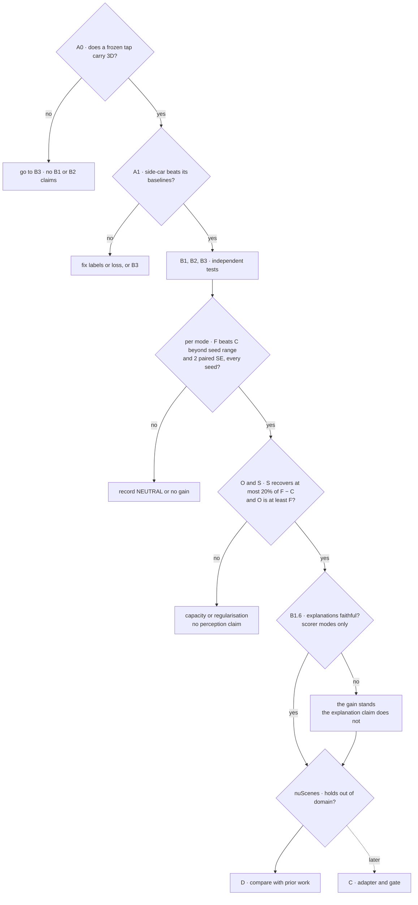

# H15 · A perception side-car on frozen Drive-JEPA (3D boxes + each agent's 1 s path), then tested as an input to the scorer, as an input to the refiner, and against LoRA on the ViT

**Status (2026-11-04): every planned run done except the gate (C), which the owner deferred.**
H15 is registered, and its predictions were committed before the first training step. The account
of what ran, what it showed, the decision and every departure from this plan is
[experiments/H15_perception_sidecar/README.md](../experiments/H15_perception_sidecar/README.md);
this document stays the plan.

**Where it came out (4 Nov, open loop):**
- **H-A supported.** The side-car (4.39 M) on the frozen ViT's output: recall 0.63, precision 0.74
  within 30 m (three seeds). It transfers to nuScenes (vehicle recall 0.48), and is data-limited
  (A2).
- **H-B1 and H-B2: no gain.** Agents as scorer or refiner inputs are NEUTRAL in every mode, and so
  are ground-truth agents. P7, P8 and P12 are refuted.
- **H-B3: no gain.** P13 is refuted. P15 is refuted too: on nuScenes the navtrain-fitted `full`
  scorer plans worse, with or without agents.
- **B1.6:** a scorer's named agents are faithful (deletion 3–5× a random agent's effect).
- **Unexpected:** retraining the refiner on navtrain, without agents, makes the release plan better
  on nuScenes. That is proposed as its own experiment.

**H14 was cancelled on 4 Nov (D19).** Where this plan leans on H14 (its code, its nuScenes scenes, its numbers as reference), the rerun does not: H15 has its own nuScenes reader and scene draw.

**Departures from this plan, each recorded in the README before the result it could bias:**
- **B1's loss:** its imitation term made every control worse than the release, so the listwise
  term was chosen again on the select logs with the control arm only (`bce`).
- **B2's teachers:** they are drawn as the release's training drew them; a row without good
  anchors gets no teacher term.
- **B3:** it runs from a cache of blocks 1–20 rather than the online ViT. B3.1 gains a control,
  and B3.2 is reduced to sharing the LoRA with the planner unchanged.
- **The readout:** "within 30 m" counted to 35 m until 4 Nov. It is fixed, and A0 was read again.
- **O, S and B1.6** run on every scorer mode, so no best mode is chosen.

- **Branch:** `drivejepa/auxilliary-head-02`.
- **History:** revision 2, after the owner's review comments and an independent review of the
  code paths it depends on.
- **Labels on every number:** *measured* (from a run), *counted* (on disk at this site), *read*
  (in code), *estimate*, or *argued*.
- **Diagrams** are Mermaid. S0.10 renders them to SVG and PNG.

## 1. What H15 tests

There is one training step, then several questions, each tested on its own:



- **Each B question has its own control.** The same adaptation runs without side-car input (arm
  C), on splits fixed before training.
- **Prior results are reference only** (§10). H15 takes none of them as given. Step D compares
  afterwards: agrees, disagrees, or complements.
- **The order is by cost, not by assumption:** B1 is the cheapest, B3 the most expensive. B2
  does not wait on B1's verdict.

## 2. Decided so far

| Topic | Decision |
|---|---|
| Base | Released Drive-JEPA (front-camera V-JEPA ViT-L). It is the gate's baseline |
| Side-car outputs | 3D boxes (x, y, z, l, w, h, yaw), class, velocity, and **each agent's path at t = 0.5 s and 1.0 s**, the plan's 2 Hz grid |
| Budget | ≤ 10% of the inference path: 307,860,553 × 0.1 ≈ **30.8 M** (*read* in Drive-JEPA's measurements). Every arm in this plan stays under about 8 M (§4.1) |
| Data | **NAVSIM first.** nuScenes is the out-of-domain check |
| Serving and gate | **Later** (§11). The training recipes come first |
| Ego 1 s path | Not considered (side note, §12) |

## 3. S0 · Setup: environment, data, labels, caches

### S0.1 The site's `gallops.toml`

The file is gitignored, so this is site config only. Run `gallops config` afterwards.

At this site, NAVSIM `trainval` is on disk: 1,310 logs and all 8 cameras, *counted*. The local
file still said it was not.

The keys, with placeholders:

```toml
[datasets.navsim]
path = "/path/to/navsim"                  # NAVSIM's root: navsim_logs/, sensor_blobs/, maps/
exp  = "/path/to/navsim-exp"              # unchanged: Drive-JEPA-cache/<release ckpt>

[datasets.navsim_metric_cache]            # new; config.py expands only {data.NAME}, so it needs a name
path = "/path/to/navsim/exp/train_metric_cache_v2_pruned"   # NAVSIM's own exp/ convention

[code]
drivejepa = "/path/to/Drive-JEPA-ext"     # recreated in S0.2
```

The tracked `gallops.toml.example` gains the same keys.

### S0.2 Recreate `Drive-JEPA-ext`, and what it means

**What it is.**
- Drive-JEPA's refiner samples the image with mmcv's compiled multi-scale deformable attention.
- The prebuilt mmcv wheel carries GPU code only up to sm_86, and no PTX to fall back on.
- On H200s (sm_90) the kernel cannot run. At this site it prints "no kernel image is available"
  and **returns garbage instead of raising**: 0.83 off the PyTorch path in H14's direct test
  (*measured*).
- **Paddock's patch 0001** chooses the kernel by compute capability and falls back to mmcv's
  pure-PyTorch implementation. That implementation is numerically equivalent, only slower. The
  switch is `DRIVE_JEPA_MSDA=auto|compiled|pytorch`.
- **0002** keeps NAVSIM scoring alive when one scenario fails.
- **0003** adds `Camera.camera_path` to the v1 devkit.
- **"-ext"** is upstream `e21f474` with the three patches as **commits** on branch
  `paddock-patches`. A Gallops sidecar can then name the exact code that trained, and the
  upstream checkout's working tree stays untouched.

**Docs to read:**
- Paddock's `patches/README.md`: the Drive-JEPA rows and how patches are applied (`git apply`,
  `paddock setup`);
- the header of Paddock's `patches/Drive-JEPA/0001-msda-compat-for-newer-gpus.patch`;
- Paddock's `adapters/models/drivejepa/model.yaml` (`DRIVE_JEPA_MSDA: "auto"`);
- H14's "Environment" section in `docs/drivejepa-aux-heads.md` at `1c60e59`.

**Recreate:**
1. `git -C <the upstream checkout> worktree add {code.drivejepa} e21f474`, then create the
   branch `paddock-patches`. `navsim_v2/data/8192.npy` is tracked, so the worktree has it.
2. `git apply` each patch in order, and commit each with its `Subject:` line.
3. Verify:
   - on the card, `use_compiled_msda` returns False;
   - the PyTorch path matches a CPU reference within 1e-5;
   - the release's forward on a few NAVSIM samples is finite and gives the same pick twice.

**`navsim` is not installed in the Drive-JEPA interpreter** (*checked*). It comes from
`PYTHONPATH`, so every recipe stage puts `{code.drivejepa}/navsim_v2` first and runs from there,
as Paddock's `model.yaml` does. The preflight records the `navsim` file actually imported.

### S0.3 Splits

All lists are committed.
- The report list is drawn by a seeded rule, then re-drawn and refused if edited (H14's
  `split.load` pattern).
- The select list is H04's, copied with its source commit and sha256.

| Split | Logs | Role |
|---|---|---|
| select | **H04's 51 held-out navtrain logs** (`recipes/drivejepa_wajepa/heldout_logs.txt` on branch `drivejepa-wajepa/run3a`; 4,457 samples) | epoch, mode and threshold choices; comparable with H04 |
| report | a fresh seeded draw of ~70 navtrain logs | every H15 number |
| train | the remaining ~1,070 of navtrain's 1,193 logs (103,287 samples, *counted* in `navtrain.yaml`) | training |
| navtest, nuScenes `val`, KITScenes, neuroNCAP | untouched | the gate, later |

**In-sample caveat.**
- The release trained on **all** of navtrain, so select and report are **in-sample for R**.
- F against C is fair: both start from R and train on the same logs.
- Every number against R is flagged in-sample. Clean against-R evidence comes only from nuScenes
  (OOD) and, later, the gate.
- The side-car itself has never seen these logs' labels.

### S0.4 Agent labels (NAVSIM `Annotations`)

**What NAVSIM provides** (*read*):
- each sample has 4 history and 10 future frames at 0.5 s (`navtrain.yaml:3-5`);
- per frame: `boxes` (x, y, z, l, w, h, heading), names, `velocity_3d`, `track_tokens`
  (`common/dataclasses.py:246,446`).

**The 1 s paths are new code.** H04's extractor drops track tokens (`agent_targets.py:56` on
its branch). The new code:
- joins frames t, t+1 and t+2 on `track_token`;
- moves each box from frame k to global and back to frame t, because boxes are in each frame's
  own ego frame;
- **rotates** `velocity_3d` into frame t, because it is world velocity in frame k's axes; ego
  speed is never subtracted;
- masks a path whose track ends early.

**Classes and filter:**
- vehicle, pedestrian, cyclist (H04's grouping);
- inside CAM_F0's view, via the corrected projection below, and within 50 m;
- metrics reported per range bin.

**Projection.** H04's `TO_512` (x·2/3; y·0.625 − 7) maps the vendor's padded-frame `lidar2img`
onto the 512×256 token image exactly: 0.2667/0.4 = 2/3, and 0.25·(v − 28) = 0.625·v_pad − 7
(*checked by arithmetic*). The preflight's projection check confirms it on data.

### S0.5 PDM labels (Phase B)

**Downloads** from Drive-JEPA's Hugging Face repo (tree at commit `9d435e12`):
- `train_metric_cache_v2_pruned.tar`, **33.5 GB**: the cache the release's scorer trained
  against;
- `anchors_scores_index_v2.tar`, 0.40 GB: the release's good-anchor list, used by B2's planning
  loss.

Both wait for the owner's OK: the disk is shared.

**How to call the vendored scorer** (*read* by the review):
- `get_sub_score` crashes without the anchors index, so call `before_score_proposals`,
  `score_proposals` and `after_score_proposals` directly.
- **Import them** from `Drive-JEPA-ext`. H04's 822-line copy is not reused.
- They need the **pruned** cache, which carries the replayed agents.

**Two scorers, kept apart.** The vendored scorer is not NAVSIM's official one: progress is
normalised against PDM-Closed only, TTC is checked every 0.5 s, and drivable area uses a fast
variant. So:
- the preflight requires **exact** equality with the scorer that made the labels;
- agreement with the official scorer is recorded on about 200 samples.

**What the release outputs.** Its 6 logits are the last 6 v2 columns: DDC, EP, TTC, LK, HC and
the final score. NC and DAC are not among them, and only the final logit was trained
(`sub_score_weight = 0`).

**Cost.** One sample's 32 candidates are timed in S0. *Estimate:* under 1 s per sample per
core, so about 30–40 min on 48 workers.

### S0.6 An explainer for the metric cache, after the download

`docs/navsim-metric-cache.md` will cover:
- **Provenance:** Hugging Face commit, tar sha256, and which navtrain tokens the pruned cache
  covers, *counted* ("pruned" may mean a subset).
- **Layout:** per-log and per-token lzma pickles.
- **Each record's fields:** ego state, route and centrelines, drivable area, the PDM-Closed
  reference, and the tracked objects with their future at 10 Hz.
- **How each v2 sub-score is computed:** NC, DAC, DDC, TLC, EP, TTC, LK, HC and the final
  formula, with code references, plus the vendored-vs-official differences.
- **Three worked examples,** each with a BEV figure:
  - one token's 32 release candidates scored term by term;
  - the human's path scored;
  - one collision verdict, with the agent and the time involved.
- **Measured cost.**

### S0.7 Token cache, or running the frozen ViT at train time?

At inference there is no choice to make: the ViT runs once, and the side-car reads the same
forward's tokens. The choice is only for training. Numbers are *estimates* scaled from H14's
*measured* rates: 15.9 min for 19,948 keyframes, input-bound on 24 threads, and 66 ms per batch
of 32 from cache.

| | Cache post-projector tokens once | Run the frozen ViT every step |
|---|---|---|
| Storage | 103,287 × 512 × 256 × 2 B = **27 GB fp16** (54 GB fp32); ×4 for a 1024-d tap | none: reads the NAVSIM JPEGs already on disk |
| One-time cost | ~1.5 h encoder pass | — |
| Per epoch | ~1–4 min (tokens from page cache) | ~10–20 min: two 1920×1080 decodes per sample plus a ViT-L forward on a shared GPU |
| A + B1 + B2 (~480 epoch-equivalents over arms and seeds) | **~15–25 GPU-h** + the pass (the §6 table's sum) | **~80–160 GPU-h** |
| Augmentation, other taps | none; the tap is fixed when cached (A0 picks it) | photometric or GridMask; any layer |
| ViT LoRA (B3) | impossible | required |
| Risk | cache/live skew, fp16 rounding: the preflight checks live = cache and that picks are unchanged | none |

**Recommendation:**
- Cache for A, B1 and B2: roughly 10× less compute, for 27 GB of disk.
- Run online only for B3.
- B1 does not even need tokens: the release's pass-4 features, pooled to 32×256 per sample, are
  saved in the same pass at **1.7 GB**.

### S0.8 The release's baselines on these splits, measured here

On the select and report halves (flagged in-sample), not inherited from H14's nuScenes numbers:
- the pick's EPDMS and its terms;
- best-of-32 EPDMS;
- the gap between the pick and the best of 32;
- L2 to the human at 1, 2 and 3 s.

These say, for NAVSIM, whether the proposals or the pick limit the plan.

### S0.9 Registration

- `gallops experiments new H15 perception_sidecar --owner Shreedhar`.
- **Register the planned runs** with `[runs.code] modules = ["gallops.drivejepa_perception"]`
  **in the same commit as the code.** `experiments.py:693-698` fails `make check` on an
  unclaimed module.
- `PREDICTIONS.md` follows the template: one row per hypothesis in §5–6, with baseline,
  prediction, support and refutation. The pre-registered subsets go there too. It is committed
  before A0, the first training.

### S0.10 Diagrams as images

- Every diagram here becomes a Graphviz `.dot` source under
  `experiments/H15_perception_sidecar/figures/`.
- Each is rendered to SVG (`dot -Tsvg`) and to 2× PNG (`rsvg-convert`).
- The experiment's README embeds them.

## 4. Phase A · Train the side-car only

### 4.1 Architecture and parameter budget



| Part | Parameters | At inference | Trained in |
|---|---:|---|---|
| Released model, inference path | 307,860,553 (*read*) | yes | — (frozen) |
| Side-car: 3 layers (~1.05 M each) + ray embedding + queries + heads | ~4.2 M | yes | A |
| B1 input adapter (cross-attention + term MLP + null token) | ~0.5 M | if B1 is adopted | B1.1–B1.3 |
| B1 replacement scorer (replaces the 1.32 M head) | ~1.5 M | if adopted | B1.4 |
| B1 scorer LoRA (rank 16) | ~0.04 M | if adopted | B1.2 |
| B2 agent-read adapter (cross-attention + FFN, one shared copy for the 4 passes) | ~0.8 M | if adopted | B2.1–B2.3 |
| B2 refiner LoRA (rank 16) | ~0.1 M | if adopted | B2.2 |
| B3 ViT LoRA (rank 16 on qkv, proj, fc1, fc2 of 4 blocks) | ~1.05 M | if adopted | B3 |
| **Largest combination** | **~7.5 M = 2.4%** | | under the 30.8 M cap |

### 4.2 Training recipe (from H04's trainer, ported)

- **Model:** H04's `AgentDecoder` and `AgentLoss`, ported to one camera.
  - It drops the 1024→256 input projection when the tap is 256-d.
  - It adds a path head (MLP 256→256→4) to every layer.
  - `token_rays` already handles N = 1 camera (*read*).
- **Loss:**
  - Hungarian matching on 2·(−p(true class)) + 0.25·L1(centre);
  - softmax focal loss (γ = 2) on all 64 slots;
  - L1 on the 8 box terms and on velocity;
  - **+ L1 on the path**, for matched slots with a valid future;
  - every layer supervised.
- **Optimiser and checks:**
  - AdamW 2e-4, weight decay 0.01, batch 64, fp16 autocast, cosine over 12 epochs, gradient
    clip 35 (H04's);
  - an overfit check first: 64 samples to centre error < 0.5 m and class accuracy > 95%;
  - one checkpoint per epoch; the epoch chosen on the select half.

### 4.3 Metrics and baselines (report half)

- **Detection** (H04's `agent_decoder_data.metrics`, restricted to the front view):
  - recall and precision at 2 m, by region, lane and range bin;
  - centre error and velocity error;
  - recall of moving vehicles.
- **Paths:** ADE and FDE at 1 s for matched agents, moving and static separately. Baselines:
  - stationary;
  - constant velocity from the true velocity at t;
  - constant velocity from the predicted velocity.
- **Lead vehicle:** gap error for the nearest in-lane vehicle ahead, against a no-camera prior.
- **Sight:** blanking the tokens must empty the detections.

| ID | Question |
|---|---|
| A0 | Which frozen tap carries 3D? Probe the post-projector 256-d tokens, ViT-out 1024-d and one mid block, on a 10k-sample subset |
| A1 | The side-car, 3 seeds, plus 64 against 128 queries on seed 0 |
| A2 *(opt.)* | A learning curve on 25, 50 and 100% of train: is it data-limited? |

## 5. Phase B · Sub-hypotheses, each against its own control

### 5.0 Rules shared by every B experiment

**Arms:**
- **C:** the same adaptation, with no agents.
- **F:** the side-car's agents.
- **O:** ground-truth agents.
- **S:** agents from another sample.
- Every mode runs C and F with 3 seeds. The best mode per question adds O and S.

**Inputs and loss:**
- **The side-car is frozen.** Its outputs keep the meaning they were trained to have.
- **Agents enter only as the decoded list,** through a box encoder (~0.07 M) and analytic
  candidate × agent terms with no weights:
  - gap and overlap at t = 0.5 and 1.0 s from the forecast, then constant velocity to 4 s;
  - TTC;
  - lead gap and closing speed.
- **Every new path starts at zero,** so step 0 equals the release.
  - Bit-exact **at batch 1** (*read*: x + 0.0 is exact, and GridMask is off in eval).
  - **A learned null token** covers empty scenes. Zero weights do not cancel the NaN of a fully
    masked softmax.
- **The same loss in every mode and arm.**

**Batching and hooks:**
- **The vendor mixes samples within a batch** (`spatial_cross_attention.py:151-153`, *read*):
  - every cache of release outputs, and every identity check, runs at batch 1;
  - batched training runs with `batch_fix.apply_all()` (1.49 m median drift without it at
    batch 64, *measured*).
- **Each forward gets a fresh feature dict,** because the vendor slices `lidar2img` in place.
- **Hooks only, no upstream edits:**
  - a forward pre-hook on `scorer.pred_score` for B1.1–B1.3;
  - a forward hook on `scorer` for B1.4;
  - a pre-hook on `_trajectory_head[0].Bev_refiner`, which fires on all 4 passes, for B2
    (*read*).

**Decision rule:**
- F beats C by more than C's seed range **and** more than twice the paired standard error,
  clustered by log, **on every seed**.
- NEUTRAL means "not resolved at this n".
- Subsets are pre-registered (lead vehicle ahead within 30 m; human slowing or stopped; an agent
  within 10 m of a candidate). Nothing is chosen after the result.

### 5.1 B1 · Scorer: do agents as inputs improve the pick, and how much must the scorer change?

- **Candidates:** the release's own 32 (fixed).
- **Labels:** computed once; inputs are cached pooled features.

| Mode | What trains | Question |
|---|---|---|
| B1.1 | input adapter only, release scorer frozen | Do the inputs alone improve the choice, with no fine-tuning? |
| B1.2 | adapter + LoRA (rank 8–16) on the scorer MLP | Does a constrained fine-tune add to it? |
| B1.3 | adapter + the full scorer MLP (1.32 M) | Is a full fine-tune needed? |
| B1.4 | **replacement scorer** built for the new design | Does a scorer designed around agents do better? |

**The replacement scorer (B1.4):**
- **Candidate token:** MLP([pooled pass-4 feature, the candidate's 8 poses, ego status]).
- **Two attention passes:**
  - cross-attention to the agent tokens, with the analytic terms as a pairwise bias;
  - self-attention across the 32 candidates.
- **Output:** heads for NC, DAC, DDC, TLC, EP, TTC, LK and HC. EPDMS is computed from them by
  NAVSIM's own formula, and the pick is its argmax.
- **Explainable by construction:** every number is a named sub-score, and the NC and TTC heads
  are attributable to agents.

**Loss and readouts:**
- **Loss,** in every mode:
  - BCE on the PDM labels: the final score, plus the sub-scores where the head has them;
  - listwise CE toward the human, `softmax(−ADE/τ)`;
  - optional λ·KL to the release's scores.
- **Readouts:** the pick's EPDMS and its terms, the gap between pick and best of 32, L2 at 1, 2
  and 3 s.

**B1.5 and B1.6:**
- **B1.5:** O and S on the best mode. Is it information or capacity?
- **B1.6:** are the explanations faithful? Measured on the best F, seed 0, report half:
  - **deletion fidelity:** removing the agent an explanation names flips or shrinks the pick
    against a random detected agent;
  - **grounding:** the named agent is within 2 m of a real box;
  - **calibration:** the AUC of the predicted NC and TTC against the labels;
  - **baseline:** the release's own trained collision-agent head (2.05 M), run at inference.

### 5.2 B2 · Refiner: do agents as inputs improve the proposals?

| Mode | What trains | Question |
|---|---|---|
| B2.1 | agent-read adapter only, refiner frozen | Do the inputs alone improve the proposals? |
| B2.2 | adapter + LoRA (rank 8–16) on the refiner | Does a constrained fine-tune add to it? |
| B2.3 | adapter + the full refiner path (2.39 M) | Is a full fine-tune needed? |
| B2.4 | O and S on the best mode | Information or capacity? |

**The loss** is the release's own trajectory loss: the human winner-takes-all term plus 0.5 × the
good anchors from `anchors_scores_index_v2`. Upstream's `zip` truncation (only min(4, batch)
passes get a loss) is fixed, and the preflight checks parity with the vendor's
`trajectory_loss_anchors`.

**Readouts** need no online grading. After training, the candidates are scored once, offline:
- (a) best-of-32 EPDMS and minADE: the refiner's own effect;
- (b) the pick with the frozen release scorer;
- (c) the pick with B1's best scorer mode retrained on the new candidates, if B1 found one.

Backward through `grid_sample` is nondeterministic, so B2 seeds do not reproduce bit for bit.
The seed range absorbs that.

### 5.3 B3 · Encoder: should the ViT be fine-tuned with LoRA instead?

| Variant | What trains | Question |
|---|---|---|
| B3.1 | LoRA (rank 16, last N = 4 blocks) **in a late branch used only by the side-car**, plus the side-car | Does adapting the encoder improve perception over the frozen tap (A1's metrics)? The planner's tokens stay bit-exact, and inference pays about N/24 ≈ 17% more ViT compute |
| B3.2 | shared LoRA (the planner sees adapted tokens) + side-car, with the planner losses | Does it improve the pick beyond B1/B2's best, and at what cost out of domain? H07's ground, so it is read on nuScenes too |

- **No token cache**, so B3 runs online (S0.7).
- It is the most expensive question, and it runs last.

### 5.4 Hypotheses at a glance





## 6. Experiments

| ID | Question | Trains (everything else frozen) | Arms × seeds | Data: train → select / report | Primary readout (baseline) | Decides | Cost (*estimate*) |
|---|---|---|---|---|---|---|---|
| **S0** | Is the setup right? | nothing | — | navtrain | live = cache; labels exact; PDM labels equal the vendored scorer; MSDA check; R's baselines (S0.8) | blocks everything | ~1.5 GPU-h pass; 34 GB downloads; ~1–1.5 h CPU for labels |
| **A0** | Which frozen tap carries 3D? | 1-layer probe | 3 taps × 1 | 10k subset → select | recall at 2 m within 30 m; centre error | the side-car's input | ~1 GPU-h (+21 GB temporary for the 1024-d taps) |
| **A1** | Can the side-car detect agents and predict 1 s paths? | side-car | 1 × 3 (+ 128 queries on seed 0) | train → select / report | §4.3 metrics against their baselines | H-A | ~2–3 GPU-h |
| A2 *(opt.)* | Is it data-limited? | side-car | 3 sizes × 1 | as A1 | A1 metrics | more data (nuScenes)? | ~1–2 GPU-h |
| **B1.1–B1.4** | Do agents improve the pick, and how much must the scorer change? | adapter / + LoRA / + scorer / replacement | 4 modes × {C, F} × 3 | as A1 | pick EPDMS + terms (vs C; R in-sample) | H-B1 | ~2 GPU-h + CPU labels |
| **B1.5** | Information or capacity? | best B1 mode | {O, S} × 3 | as A1 | S−C and O−F as shares of F−C | H-info | <1 GPU-h |
| **B1.6** | Are the reasons faithful? | nothing | best F, seed 0 | report | deletion fidelity, grounding, NC/TTC AUC (vs the release's collision head) | H-expl | minutes |
| **B2.1–B2.3** | Do agents improve the proposals, and how much must the refiner change? | adapter / + LoRA / + refiner path | 3 modes × {C, F} × 3 | as A1 | best-of-32 EPDMS; pick EPDMS (a)(b)(c) | H-B2 | ~8–12 GPU-h + CPU scoring |
| **B2.4** | Information or capacity? | best B2 mode | {O, S} × 3 | as A1 | as B1.5 | H-info | ~3–4 GPU-h |
| **B3.1** | Does a side-car-only ViT LoRA beat the frozen tap? | ViT LoRA (branch) + side-car | 1 × 3 | as A1 (online) | A1 metrics | H-B3 (perception) | ~6–9 GPU-h |
| **B3.2** | Does a shared ViT LoRA beat B1/B2's best? | ViT LoRA + side-car + planner | 1 × 3 | as A1 (online) | pick EPDMS; nuScenes | H-B3 (planning) | ~8–12 GPU-h |
| **OOD** | Does the best of each B hold on nuScenes? | nothing | best models | nuScenes 102 held-out train scenes (H14's list) | detection zero-shot; picked L2 and collision vs R (out of sample, fair) | trust in B | ~1–2 GPU-h + nuScenes token pass (~16 min) |
| **D** | Agree, disagree or complement prior work? | — | — | — | written comparison (§10) | the account | — |
| C *(later)* | Serve and gate | — | — | gate subsets | gate verdicts | shipping | §11 |

**Cost to the first decisions** (S0 → A0 → A1 → B1.1–B1.6): about 6–8 GPU-h, plus the
downloads and CPU for labels.

## 7. Code changes (training recipes first)

**On the branch:**
1. **The branch is at `main`.** It was fast-forwarded to `b2d2c59` on 3 Nov; it had no commits
   of its own.
2. **Tag `1c60e59` locally** (`h14-pr20-head`) before reading from it. It is on no branch, so
   garbage collection could remove it.
   - Do not restore H14's package yet: `experiments.py:662` skips claims from records with a
     `branch` field.
   - Port only the utilities needed, citing their origin: staged cache passes and manifests,
     clustered SE, the split pattern, the hook pattern.
   - Restore H14's whole package only for the OOD step, dropping H14's `branch` field in the
     same commit.
3. **Port H04's pieces** from `origin/drivejepa-wajepa/run3a`, with Navvrat:
   - `AgentDecoder` and `AgentLoss` (overlay `agent_decoder/.../agent_decoder.py`);
   - `token_rays` (overlay `run2/.../global_look.py`);
   - `extract_agents.py`, `agent_targets.py`, `agent_decoder_data.py` (metrics, CacheSet);
   - `train_agent_decoder.py`.

**New package `src/gallops/drivejepa_perception/`.** It must run under Python 3.9: no
`zip(strict=)`, `match`, `X | Y` at runtime or `itertools.pairwise`. Lint targets 3.11, so only
the 3.9 test run catches these.

| Module | Role |
|---|---|
| `env.py` | `PYTHONPATH`, cwd and `DRIVE_JEPA_MSDA=auto` for `{code.drivejepa}`; records the imported `navsim` file |
| `navsim_data.py` | sample index, the three split lists, agent labels with the track join and frame transforms |
| `tokens.py` | one batch-1, eval-mode pass. Writes fp16 tokens (mmap), the release's 32 candidates, logits and pooled pass-4 features. Skips the v2 builder's unused 4-camera tensor, with the preflight proving the inputs unchanged |
| `pdm_labels.py` | per-candidate v2 sub-scores, calling the vendored scorer step by step, imported from Drive-JEPA-ext |
| `sidecar.py`, `train_sidecar.py`, `probe.py` | Phase A (A0, A1, A2) |
| `fusion.py` | box encoder, analytic terms, input adapter, agent-read adapter, null token, zero-init, hooks |
| `scorers.py`, `train_scorer.py` | B1: LoRA wrapper, replacement scorer, the four modes |
| `train_refiner.py` | B2, with `batch_fix` and offline scoring of the new candidates |
| `vit_lora.py`, `train_vit_lora.py` | B3: late-branch and shared LoRA, online ViT |
| `explain.py` | B1.6 tests, camera and BEV renders |
| `evaluate.py` | every readout, with log-clustered SE and the pre-registered subsets |
| `preflight.py` | the checks below, run before every training step; cannot be skipped |

**Preflight checks,** each "what the trainer computes = what was recorded":
- **code** (`train/preflight.code_checks`);
- **data:** splits disjoint, no navtest tokens;
- **inputs:** live batch-1 = cache; release picks unchanged under fp16;
- **labels:** a re-run equals the cache; the frame transform agrees with NAVSIM's; the 1 s join
  keeps box size; seen boxes project inside 512×256;
- **PDM labels:** exactly the vendored scorer's output;
- **zero-init identity:** step 0 equals the release at batch 1;
- **batched = batch-1** within H14's tolerances when `batch_fix` is on;
- **sight.**

**Other files:**
- `recipes/drivejepa_perception.toml`: every stage, with `python = "drivejepa"`, and locations
  only as `{runs}`, `{weights}`, `{data.navsim}` and `{data.navsim_metric_cache}`.
- `docs/navsim-metric-cache.md` (S0.6).
- `experiments/H15_perception_sidecar/`: `experiment.toml`, `PREDICTIONS.md`, `figures/` (DOT,
  SVG, PNG).
- Tests:
  - the track join and velocity rotation on synthetic poses (golden values);
  - split determinism;
  - analytic terms;
  - null token with no agents (no NaN);
  - zero-init identity for both adapters and the LoRA wrapper on toy modules;
  - Hungarian and path loss sanity.

## 8. Verification

- `make check` exits 0, including portability and the registry. Read `$?` directly.
- The new tests pass under the Drive-JEPA interpreter, Python 3.9.23 (*checked*: scipy 1.13.1,
  torch 2.1.0).
- S0's checks all pass before A0. Every run's preflight report lands in its sidecar.
- A1's overfit check passes.
- Every readout is recomputed by `evaluate.py` from saved predictions. Numbers go into
  `experiment.toml` with their strength and flags (`open-loop`, `adapted`, and in-sample for R).
- The figures render: `dot` and `rsvg-convert` exit 0, and the SVGs and PNGs exist.

## 9. Alternatives not pursued now

- **Dense BEV lifting** (LSS or BEVFormer-lite): 10–20 M, and depth from a 16×32 grid is coarse.
  Revisit only for map terms.
- **An off-the-shelf 3D detector:** a second backbone, and unclear training data.
- **Training-only heads (H14-style):** they do not feed the planner, which this design requires.
- LoRA on the ViT is a tested question (B3), as is replacing the scorer (B1.4).

## 10. Reference only, not assumptions: what earlier work reported

Step D compares H15's results with these after the fact.

| Source | Reported |
|---|---|
| H14 (nuScenes) | best of 32 0.20 m from the human; pick 1.2–1.7 m worse; refiner-only fine-tune made the pick worse; training-only heads improved it (T2 L2 at 3 s 3.76 → 2.93 m) |
| GC01 | perception-blind re-ranker: KITScenes 2.52 → 0.97 m open loop; neuroNCAP 1.85 vs 3.01; never picks a stop |
| GC06 | scorer on cached features: collision AUC 0.66–0.83 vs the release's 0.50–0.59 |
| H04 | agent decoder on frozen WA-JEPA tokens: recall 0.497, precision 0.748 at 2 m; moving vehicles within 20 m 0.849 (`selected-on-report`); NAVSIM 85.27 → 87.30 with agent look and sub-score heads |
| D08 / GC07 | a sub-score scorer alone flipped sides in closed loop |
| H07 / D18 | one-domain encoder + planner fine-tune failed the gate (NAVSIM 0.857 → 0.753) |

## 11. Later: serving and the gate (deferred; notes kept from the review)

**Paddock changes:**
- **Where Δ goes.** It must be added **inside** the vendor forward, through the scorer hook. Its
  momentum stage, `(14σ + 2·EC)/16`, and the argmax both happen inside that forward
  (`drive_jepa_model.py:85,149`).
- **Keep the release's logits separately.** Otherwise `extras` and the candidate dumps change
  meaning.
- **Declare `DRIVEJEPA_SIDECAR`** in `model.yaml`, empty by default. The queue accepts only
  declared env keys.
- **Replay the probe** in fp32 with a tolerance, as `ranker.py:171` does.
- **Return the agents** as `extras["lead"]` plus a model-native block.

**Gate:** quick tier first, then the smoke (~2 h 40 min per checkpoint, H02), plus the
pick-switch rate (D07, D08).

## 12. Side note: the ego's 1 s path

Not considered. The 32 candidates already hold the ego's options, and a regressed ego path
invites the scorer to imitate rather than reason. Each candidate's own first second is checked
against every agent's forecast instead.

## 13. Risks

1. **Weak depth beyond about 30 m.** Depth from a frozen 16×32 grid may not reach that far. A0,
   per-range metrics, arm O and B3 cover it.
2. **Label quality.** NAVSIM's boxes are auto-labels; nuScenes' human labels are the OOD check.
3. **Labels and caches are in-sample for R** on navtrain. Flagged everywhere; nuScenes is the
   clean comparison.
4. **Downloads and disk:** 34 GB onto a shared disk. Asked before download.
5. **Batching and determinism.** Rules in §5.0; the seed range absorbs B2's nondeterminism.
6. **Shared GPUs.** Cached training, mmap, and `host.py`'s RAM guard.
