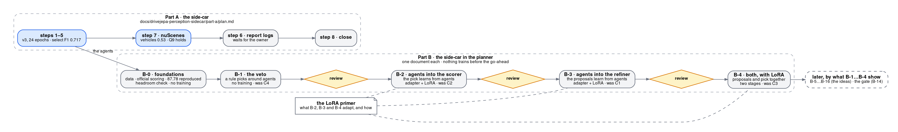
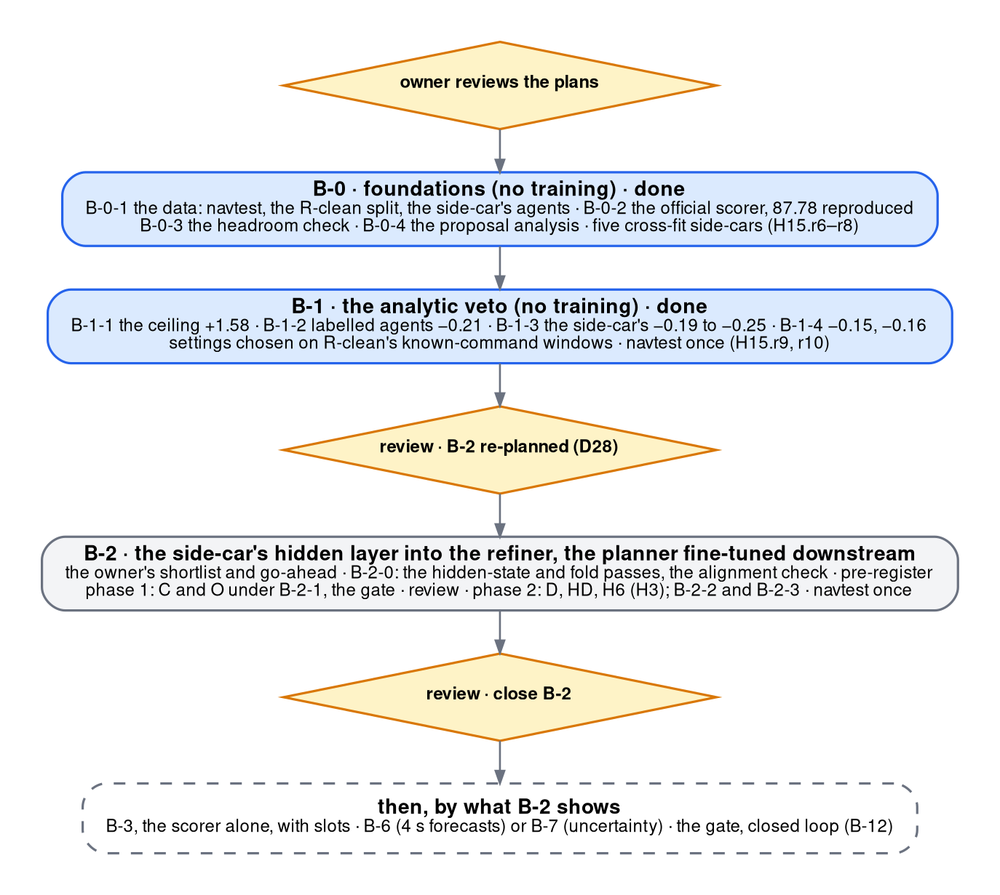

# H15 · The perception side-car: overview, tracker and discussion log

**Updated 13 Nov 2026.** This is the common record of H15. Every document of this work links here.
- Every change to one of them adds a dated line to the [log](#log) and updates the [tracker](#tracker).
- A decision also gets its D-number in [experiments/decisions.toml](../../experiments/decisions.toml).

## The crux

Drive-JEPA plans from camera tokens, and has no explicit account of the other agents. H15 asks two questions.
- **Part A.** Can a small side-car, reading the same frozen ViT, find the agents ahead in 3D and say where each
  will be in a second?
- **Part B.** Given that account, does Drive-JEPA's planner plan better on scenes it never trained on?

## Where it stands (13 Nov)

- **Part A, the side-car.**
  - Steps 1–5 are done: v3, 18.4 M parameters, 24 epochs, select F1 0.717 over three seeds.
  - Step 7 is done: on nuScenes it finds 53% of the vehicles within 30 m, so Q9 holds. Warping the images to
    NAVSIM's camera did not help.
  - Step 6, reading the report logs once, waits for the owner.
- **Part B, the side-car in the planner.**
  - They share one plan of foundations, B-0, and a LoRA primer.
  - **B-0 is done (12 Nov):** the anchor reproduces here (87.783 against 87.78), R̃ equals R, and the headroom is
    counted (`H15.r6`–`r8`).
  - **B-1 is done (`H15.r9`, `H15.r10`):** a clearance veto loses 0.15 to 0.25 points on navtest, with labelled
    agents or the side-car's, removed or penalised; the ceiling gains 1.58.
  - **B-2 is re-planned (13 Nov, D28):** the side-car's last hidden layer goes into the refiner, and the planner
    downstream is fine-tuned. Arms C, O, D, HD, H6 and H3 run under three recipes.
    [Its plan](part-b/B-2-hidden-refiner.md) has 14 figures for review. It is documents only, and waits for the
    owner's shortlist.
  - **The other ideas were renumbered (D28):**
    - B-2 absorbs the 11 Nov B-3, B-4 and B-5;
    - the scorer alone is now B-3, not scheduled;
    - B-4 to B-14 are the rest.

    The [naming table](#naming) translates. What has run is in the [log](#log).

## Naming

**Part B's experiments are named `B-<n>-<v>`.**
- `n` is the experiment:
  - 0 is the shared foundations;
  - 1 and 2 are chosen: the veto (done) and the hidden layer into the refiner (planned);
  - 3 to 14 are the other ideas, not scheduled (renumbered on 13 Nov, D28; the table below translates).
- `v` is a sub-version within it: 1, 2, and so on. For example, B-1-3 is the veto with the side-car's agents.
- **Runs** in `experiment.toml` keep the registry's IDs, `H15.r6` onward. Each run's label names its `B-<n>-<v>`.
- **The arms** of a trained experiment:

  | Arm | What it is |
  |---|---|
  | R | the released model |
  | R̃ | the release run through the same cached path, every adapter at zero |
  | C | the identical adaptation, without agents |
  | F | with the side-car's agents (B-1 and the 11 Nov plans) |
  | O | with the labelled agents |
  | D | B-2: the side-car's decoded list, as F's input was |
  | HD | B-2: D, with each kept agent's hidden slot a₆ appended |
  | H6, H3 | B-2: all 128 hidden slots of layer 6 or layer 3, with each slot's centre and confidence |

**Old labels, and what they are now:**

| Was | Now | Note |
|---|---|---|
| C4, the analytic veto | **B-1** | chosen first |
| C2, agents into the scorer | **B-2** | chosen second |
| C1, agents into the refiner | **B-3** | chosen third |
| C3, "B-LoRA": both, with LoRA | **B-4** | chosen fourth |
| C5 to C16 | B-5 to B-16 | the same number |
| the 10 Nov plan's steps B1 (data) and B2 (headroom) | B-0-1, B-0-2 and B-0-3 | the foundations |
| that plan's B3 (the veto) | B-1 | |
| that plan's B4–B8 | each experiment's own pre-registration, runs, navtest read and close | |
| the first pass's B1, B2, B3, B3.2 (3–4 Nov) | **unchanged** | recorded runs `H15.b1`, `H15.b2`, `H15.b3`, `H15.b32`, always written with "the first pass" or the run ID. Their lineage: B-3 continues the first pass's B1; B-2 its B2 |

**Renumbered on 13 Nov (D28).** Records written before then keep their own numbers: PREDICTIONS.md, D22–D27, run
notes and dated log lines.

| Until 13 Nov | Now | Note |
|---|---|---|
| B-2, agents into the scorer | **B-3** | the scorer alone; its plan kept, not scheduled |
| B-3, agents into the refiner | **B-2** | arm D of the new B-2 |
| B-4, both with LoRA | **B-2** | its two stages are B-2-2, its joint training B-2-1 |
| B-5, agent-aware initial proposals | **B-2** | a later variant: pass 1 sees the slots |
| B-6 to B-16 | **B-4 to B-14** | in order: B-6 → B-4 (token map) … B-8 → B-6 (4 s forecasts), B-9 → B-7 (uncertainty), B-13 → B-11 (named agent), B-14 → B-12 (closed loop), B-16 → B-14 (refiner retrain) |

## The tracker

**Part B:**

| ID | The question | What changes | What trains | Status | Plan | Needs |
|---|---|---|---|---|---|---|
| B-0 | Can a planning gain be measured honestly here? | nothing: data, scoring, checks | five cross-fit side-cars | **done** (`H15.r6`–`r8`; D25, D26) | [B-0, the foundations](part-b/B-0-foundations.md) | — |
| B-1 | Does a rule on the agents pick better than the release? | the pick, by a rule | nothing | **done: no** (`H15.r9`, `r10`); for the owner's review | [B-1, the veto](part-b/B-1-veto.md) | B-0 |
| B-2 | Does the side-car's hidden layer, given to the refiner with the planner fine-tuned downstream, plan better than its decoded list? | the refiner and the scorer | the read (adapter) + LoRA or weights, by recipe | **re-planned** (13 Nov, D28); documents only, for the owner's shortlist | [B-2, the hidden layer into the refiner](part-b/B-2-hidden-refiner.md) | B-0; B-1 |
| B-3 | Does a scorer that reads the agents pick better, the proposals fixed? | the scorer | an adapter + LoRA | not scheduled (was B-2) | [B-3, the scorer alone](part-b/B-3-scorer.md) | by what B-2 shows |
| B-4 to B-14 | the other ideas | — | — | not scheduled | [the ideas](part-b/ideas.md) | by what B-2 shows |

- **What B-2 and B-3 adapt, and how:** [the LoRA primer](part-b/lora-primer.md).
- **Order of work:**
  - B-0, then B-1, then the owner's review.
  - B-2: its shortlist and go-ahead, then B-2-0, phase 1 (a gate), phase 2, each closed by a review
    ([B-2's phases](part-b/B-2-hidden-refiner.md#pictures)).

**Part A:**

| Step | Status | Run | Where |
|---|---|---|---|
| 1–3 · data, model and loss, pipeline check | done, reviewed (D21) | `H15.r1` | plan A §3–6, notebooks 01–03 |
| 4 · criteria committed | done | — | PREDICTIONS.md |
| 5 · three sizes, then v3 at three seeds | done | `H15.r3`, `H15.r4` | plan A §9.2, notebook 06 |
| 6 · report logs, read once | **waits for the owner** | — | plan A §8.1 |
| 7 · nuScenes, as recorded and warped | done | `H15.r2` (data), `H15.r5` | plan A §9.3, notebook 07 |
| 8 · close Part A | open | — | — |

## The discussion log

Newest last. Each entry is what was discussed or asked, what was decided, and what was done.

- **3 Nov · H15 registered; the first pass.**
  - Planned and run in a day and a half: the side-car (A), then its agents into the scorer (the first pass's B1),
    into the refiner (B2), and LoRA on the ViT (B3), plus nuScenes.
  - B1 and B2 came out neutral on navtrain's logs, where the release had trained: its pick scores NC and TTC
    0.996 there.
- **4 Nov · inconclusive; redone one step at a time.**
  - H14 is cancelled (D19).
  - The owner judges H15's first pass inconclusive: more ran than could be reviewed (D20). Part A is redone in
    eight reviewed steps, and phases B and C wait.
  - Steps 1–3 reviewed: "use recommended settings" (D21).
- **4–5 Nov · step 5.** v3 for 24 epochs, chosen by the committed rules: select F1 0.717.
- **9 Nov · the executive update** of Part A
  ([part-a/executive-update.md](part-a/executive-update.md)).
- **10 Nov · the next steps (D22).**
  - **The owner asked for:**
    - nuScenes validation in parallel;
    - a brainstorm of where the side-car could connect to Drive-JEPA;
    - as the first idea, the side-car as an extra input to the downstream planner with a LoRA fine-tune, meeting
      or beating NAVSIM, with an analysis of how the proposals change;
    - a plan for the other ideas.
  - **Asked and answered:**
    - Step 6 waits, and only step 7 runs.
    - Phase B is recorded inside H15.
    - A fixed recipe reads navtest once, and an R-clean selection split is built for later choices.
    - The pending Part A edits are committed on `-02` first.
    - Then: "documents first, like Part A; I shortlist; no training until the go-ahead". Step 7 runs now, since it
      is evaluation only.
  - **Done:**
    - the branch;
    - step 7 (`H15.r5`): Q9 holds; the warp does not help;
    - [the ideas](part-b/ideas.md) (then C1–C16) and the first B plan.
- **11 Nov · reprioritised and restructured (D23).**
  - **The owner chose four ideas, in order:** the veto, the scorer, the refiner, both with LoRA. They are now
    B-1 to B-4.
  - **The owner asked for:**
    - one plan document each, opening with the crux and what to expect, then the concepts as questions and
      answers that build to the plan;
    - a LoRA primer for these experiments;
    - diagrams;
    - one naming for B and C: `B-<n>-<v>`;
    - this overview as the common record;
    - the branch renamed `drivejepa/auxilliary-head-part-b`, committed and pushed.
  - **Not implemented.** The owner reviews the plans, and execution starts in another session.
  - **Counted for the primer:** the refiner's 13 linear layers and the scorer's 3. Rank-16 LoRA on them adds
    177,200 and 69,728 parameters.
- **11 Nov · one picture of the four experiments.**
  - At the owner's request, [B-0](part-b/B-0-foundations.md) opens with a single diagram of B-1 to B-4
    inside Drive-JEPA.
  - It shows each experiment beside the part of the planner it changes, with what it trains, the one question it
    tests, and what is read.
  - The figure is `b0-four-experiments`.

- **11 Nov · every side-car document in one folder.** At the owner's request, H15's documents move under
  `docs/drivejepa-perception-sidecar/`:
  - this overview is the folder's `README.md`, beside `first-pass-plan.md`, which spans both parts;
  - `part-a/` holds Part A's plan and its executive update;
  - `part-b/` holds B-0 to B-4, the ideas and the LoRA primer.
  - Every link and path that named the old files was rewritten, including the paths quoted in D20–D23.
- **11 Nov · execution opens: B-0 in full, then B-1 (D24).**
  - **Asked and answered** (the owner):
    - Scope: all of B-0, cross-fitting included, then B-1. B-2 to B-4 wait for the review after B-1.
    - B-1's four decisions and B-0's (a), (b) and (d)–(g): the recommendations.
    - B-0 (c): reuse the navtest metric cache Paddock built on 10 Nov, once verified here, rather than build one.
    - Cross-fitting, if the train rows read more than 0.03 better than select, trains inside B-0, before B-1.
    - A smoke run of B-1 on the select logs: allowed, flagged, choosing nothing.
    - "Keep documenting all the progress with good commit history": one commit per step, each with a line here.
  - **Found while planning, and corrected in [B-0](part-b/B-0-foundations.md):**
    - The vendored scorer's TTC loop is the official one, line for line (*read*). It is lane keeping that it checks
      every 0.5 s. B-0, `pdm_labels` and [the metric-cache page](../navsim-metric-cache.md) said TTC.
    - A navtest metric cache exists at this site after all: Paddock's, 12,146 tokens over 136 logs (*counted*).
      Paddock built it from another tree and interpreter, so H15 re-caches 32 tokens here before trusting it.
    - The release's navtest score per token is not on this site, so the 87.78 anchor is measured here for the
      first time.
    - The side-car names only vehicles, pedestrians and cyclists. A collision with a static object is room for
      B-1-1 but not for B-1-2 or B-1-3, and B-0-3 counts it apart.
  - **Pre-registered:** B-0's gates and its cross-fit rule, in PREDICTIONS.md, before any B-0 pass. B-1's section
    is written before B-1 reads R-clean.
- **11 Nov · B-0 runs; the anchor reproduces here.** Details, gate by gate, in
  [B-0's "What has run"](part-b/B-0-foundations.md#what-has-run-11-nov).
  - **Done:** the two lists (B-0's counts, scripted for the first time), labels, token and ViT passes, the
    side-car's agents for both splits; Paddock's navtest cache verified; navtest's PDM labels.
  - **The anchor:** the release's own picks, replayed through the official scorer here, give EPDMS (human filter)
    87.783 and CSV 84.495, against H04's 87.78 and 84.49. R̃, the cached path the trained arms start from,
    differs from R by +0.0014 ± 0.0011 points.
  - **Headroom (B-0-3):** of 275 navtest scenes whose pick fails NC or TTC, 271 have a safe proposal among the
    32; 156 of those name an agent in CAM_F0's view within 50 m, and the side-car found 127–135 of them.
  - **Cross-fitting runs:** the side-car reads 0.085 better in F1 on rows it trained on (limit 0.03), so five
    cross-fit side-cars train now (D24), before B-1.
  - **B-1 is built and pre-registered:** `veto.py`, a smoke run on select (chooses nothing), and its PREDICTIONS.md
    section, committed before any R-clean read.
  - **Waiting:** R-clean's metric cache, PDM labels and preflight; the live release (B0-G9); the cross-fit
    side-cars; B-0-4.
- **12 Nov · R-clean is unlike navtest; B-1 chooses on its known-command windows (D25).**
  - **Found** (B-0-1's check of R-clean before use): 77% of its windows carry the "unknown" driving command, which
    navtrain and navtest never have, and 55% have the ego stopped (navtest 7%). On those windows the release's
    input is out of distribution: its pick fails NC four to six times as often.
  - **Asked and answered:** which windows B-1's grid chooses on. The owner: only those whose command navtest uses,
    2,624 windows over 20 logs, still city-reweighted. PREDICTIONS.md's B-1 section is amended, dated, before any
    B-1 rule read R-clean.
  - **Done since:** R-clean's cache (B0-G4), labels and live preflight (B0-G5, B0-G6); the five cross-fit
    side-cars (select F1 0.700–0.708, within 0.02 of seed 0's: B0-G11); B-0-4 on R against R̃.
  - **The live release (B0-G9):** picks equal on every token and EPDMS within 6e-8 points of the replay, but the
    gate's "every column equal" holds on 52% of tokens, not 99.9%. Every discrete column is identical everywhere;
    only EP differs, by at most 1.5e-6, because the plans differ by at most 5e-5 m. Brought to the owner before
    B-1 reads navtest.
- **12 Nov · B-1's grid on R-clean, and its settings frozen.**
  - On R-clean's 2,624 known-command windows (city-reweighted, effective n about 630), the ceiling B-1-1 gains
    +0.24 ± 0.20 points: little room there. Every setting of B-1-2 (6) and of B-1-3 (12) loses, by 0.05 to
    0.20 points; the vetoes leave NC and TTC failures where they were and cost progress.
  - By the pre-registered rule the least intrusive settings are frozen: B-1-2 at 0.5 m within 1 s, B-1-3 at
    0.5 m within 1 s and confidence 0.7 (`recipes/drivejepa_perception/part_b1_frozen.json`).
- **12 Nov · B0-G9 amended (D26).**
  - **Asked and answered:** the live-release gate failed as written on EP alone (every discrete column identical,
    EP within 1.5e-6, EPDMS within 6e-8). The owner amended it, knowing the result: discrete columns equal on
    99.9%, EP within 1e-5. The as-written record stays beside the amended one; PREDICTIONS.md carries the
    amendment, dated. B-1 then reads navtest once.
- **12 Nov · B-1 read on navtest, once: the veto does not pick better than the release.** Details in
  [B-1's "What has run"](part-b/B-1-veto.md#what-has-run-1112-nov).
  - The ceiling, which reads the grader's labels, gains +1.58 ± 0.19 points: the room is real.
  - With labelled agents the veto loses 0.21 ± 0.05; with the side-car's, 0.19 to 0.25 on each seed. V2 and V3 are
    refuted.
  - Why: the 1 s clearance catches 5% of the failing proposals and switches safe picks near vehicles. Half the
    loss is EC, from picks that switch on one frame and not the next. False alarms explain almost none of it.
  - B-1-4's pre-registered trigger fired (B-1-3 loses progress beyond 2 SE). Its design is not pre-registered in
    detail, and the analysis rules out the causes it targets, so it waits for the owner.
- **12 Nov · B-1-4 runs (D27).**
  - **Asked and answered:** whether B-1-4 runs, given that the analysis rules out what it targets. The owner: run it
    as sketched. Its 16-setting grid and its criterion (V6, predicted −0.25 to +0.05) are pre-registered in
    PREDICTIONS.md before any read.
- **12 Nov · B-1-4 read on navtest, once; B-1 closes.**
  - Frozen on R-clean (every setting at or below R there): λ 0.1, 0.5 m, no widening, 1 s.
  - On navtest it loses 0.15 to 0.16 points on each seed (V6 refuted): less than B-1-3's removal, with less EC and
    progress lost, but as many switched picks and no fewer collisions.
  - **B-1's answer:** with perfect front-camera agents or the side-car's, removed or penalised, a clearance rule at
    the pick does not beat the release on navtest. The room is real (the ceiling: +1.58), but the rule does not find
    it. Next is the owner's review of B-1, before B-2 to B-4.
- **13 Nov · B-0 and B-1 explained on real scenes.**
  - **The owner asked:** "the numbers alone don't make complete sense". Show the predictions over the input images,
    every pre- and post-processing step, how the metrics were computed and the conclusions derived, with good and
    bad examples; no new code in the pipeline, all of it in new documents.
  - **Done:** [B-0, explained](part-b/B-0-explained.md) and [B-1, explained](part-b/B-1-explained.md), with 14
    figures drawn from the passes' own outputs by one script
    (`experiments/H15_perception_sidecar/scripts/part_b_explained_figures.py`; `src/` unchanged). Each example is the
    extreme of a stated rule, written with its numbers to `figures/part-b-explained-examples.json`.
  - **What the pictures add to the numbers** (*argued* from them, not counted):
    - B-1's best switch is right partly by luck: the veto fired on the car beside the ego, not the car ahead;
    - round footprints make two cars in adjacent lanes "overlap" (−0.12 m as circles, +1.40 m as rectangles);
    - the worst switches fall back to proposals the release ranked 28th or 29th, which then fail another term;
    - the missed failures include cut-ins that a 1 s path and constant velocity cannot foresee.
- **13 Nov · B-2 re-planned: the side-car's hidden layer into the refiner (D28); the ideas renumbered.**
  - **The owner asked:**
    - B-1 did not bring the value expected. In B-2, give the proposal network the side-car's last hidden layer
      instead of the decoded agents.
    - Think through why it might or might not work.
    - Propose fine-tuning recipes, asking questions while planning.
  - **Asked and answered** (nine questions, three rounds):
    - the module that makes the proposals (the refiner) reads the hidden layer, and the planner downstream is
      fine-tuned;
    - try three tensor options: layer-6 slots, slots with the decoded geometry, layer-3 slots;
    - keep the decoded list as arm D;
    - fold-matched cross-fitting;
    - compare three recipes;
    - this is the new B-2: the other ideas renumbered compactly;
    - the absorbed 11 Nov plans (B-3, B-4) deleted; the scorer plan kept as B-3;
    - documents only.

    Approving the plan, the owner asked for a new branch, pushed, and detailed visualizations for review.
  - **Found while planning** (*read* or *counted*; [B-2's plan](part-b/B-2-hidden-refiner.md)):
    - A side-car slot's centre is not in its hidden vector. It lives in a reference point carried beside it, so every
      hidden arm carries the centre.
    - The release already trained each proposal's feature to predict its collision and TTC agents over 4 s
      (`agent_pred`). That is the strongest reason against.
    - In the two-stage recipes the planning loss never trains the read's route into the pick (pass 4). Stage 3 gets
      a pass-4 copy, and the joint recipe is primary.
    - `mtd_loss` discounts earlier passes geometrically (0.1, 0.01, 0.001), not "each at 0.1" as the 11 Nov plans
      said.
    - Decoding keeps 4.75 of 128 slots a row on the train rows; 36.4 clear confidence 0.1 (*counted*).
  - **An independent review, checked against the code,** added:
    - one primary contrast (HD − D) with gatekeeping;
    - C and O first, as a gate;
    - test-time swaps instead of a trained S arm;
    - the five fold side-cars' alignment check.
  - **Done:**
    - [B-2's plan](part-b/B-2-hidden-refiner.md): nine diagrams and five charts; the charts by
      `experiments/H15_perception_sidecar/scripts/part_b2_plan_figures.py`, their numbers in
      `figures/part-b2-plan-numbers.json`;
    - D28;
    - the branch `drivejepa/auxilliary-head-part-b2`;
    - the renumbering across the documents and figures.
- **13 Nov · B-2 goes ahead (D29); pre-registered before any run.**
  - **The owner:** "go ahead and complete the b-2 experiments … let me know when the results are ready to review".
  - **Taken as** the plan's recommendations, (a) to (j). Momentum's second read is deferred: no momentum replay exists,
    and B-1 had none.
  - **Pre-registered** in PREDICTIONS.md (Part B · B-2), before B-2-0's alignment check and the first training step:
    - the design;
    - the gates B2-G1 to B2-G4;
    - the alignment rule;
    - the phase-1 gate (O − C at or below 0 on every seed stops B-2);
    - the noise-floor rule;
    - predictions K0 to K5 and the reported ones.
  - **Code for B-2-0:**
    - `b2_inputs.py`: the fold rule, the hidden pass and its gates, the alignment check;
    - the side-car hands over its hidden layer beside its outputs;
    - `part_b2_folds.json`, written and re-derived;
    - recipe stages `part-b-2-0-*`.

## Open decisions for the owner

| From | Decision |
|---|---|
| Part A | step 6, the report logs, read once; retrain the no-camera control in fp32; weighting what matters (11.9); head changes (11.11); test the warp's three changes apart (plan A §9.3) |
| B-0 | decided on 11 Nov (D24) |
| B-1 | decided on 11 Nov (D24) |
| B-2 | the shortlist and go-ahead; (a) the primary contrast; (b) the phase-1 gate; (c) H3; (d) navtest's side-car; (e) more seeds; (f) B-2-1's auxiliary heads; (g) the grid; (h) the later variants; (i) nuScenes; (j) momentum |
| B-3 | none until it is scheduled |

Each experiment's own document gives these decisions in full, with a recommendation.

## The documents

| Document | What it is |
|---|---|
| [first-pass-plan.md](first-pass-plan.md) | the first pass's plan (3 Nov), kept as it was |
| [part-a/plan.md](part-a/plan.md) | Part A's plan, in reviewed steps, with what has run (§9) |
| [part-a/executive-update.md](part-a/executive-update.md) | Part A's executive update (9 Nov) |
| [part-b/ideas.md](part-b/ideas.md) | every idea for Part B, B-1 to B-14 |
| [part-b/B-0-foundations.md](part-b/B-0-foundations.md) | **B-0**: the foundations and the protocol every experiment shares |
| [part-b/B-1-veto.md](part-b/B-1-veto.md) | **B-1**, the analytic veto |
| [part-b/B-0-explained.md](part-b/B-0-explained.md) | B-0 on real scenes: what each model reads and outputs, how it is scored, how the conclusions follow |
| [part-b/B-1-explained.md](part-b/B-1-explained.md) | B-1 on real scenes: the rule step by step, good and bad examples, every number traced |
| [part-b/B-2-hidden-refiner.md](part-b/B-2-hidden-refiner.md) | **B-2**, the side-car's hidden layer into the refiner, the planner fine-tuned downstream (13 Nov), with its figures |
| [part-b/B-3-scorer.md](part-b/B-3-scorer.md) | **B-3**, the agents into the scorer alone (the 11 Nov B-2's plan), not scheduled |
| [part-b/lora-primer.md](part-b/lora-primer.md) | LoRA, for these experiments |
| [experiments/H15_perception_sidecar/](../../experiments/H15_perception_sidecar/) | the record: README, PREDICTIONS.md, experiment.toml, the notebooks, the figures |
| [experiments/decisions.toml](../../experiments/decisions.toml) | the decisions, D19–D28 for this work |

## How this set is kept

- **Every side-car document lives in this folder:** cross-part ones at its top, the rest in `part-a/` or `part-b/`.
  Figures stay with the experiment's record, in `experiments/H15_perception_sidecar/figures/`.
- **Each document opens with its status and date.** Experiment plans open with the crux and what to expect.
- **Any change to a document adds a dated line to the log here,** and updates the tracker.
- **A decision gets a D-number** in `experiments/decisions.toml`, and is mirrored in the log.
- **A run is recorded in `experiment.toml`,** and the README and CARD are rendered, never typed.
- **Numbers are copied from records, never re-derived,** and each carries its label: *counted*, *measured*, *read*
  or *argued*.
