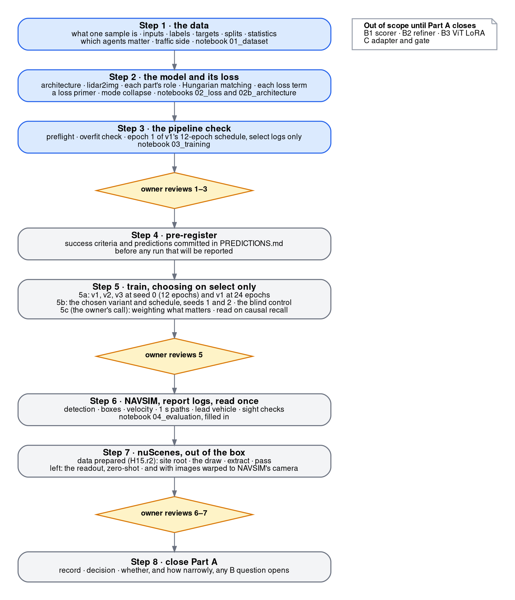
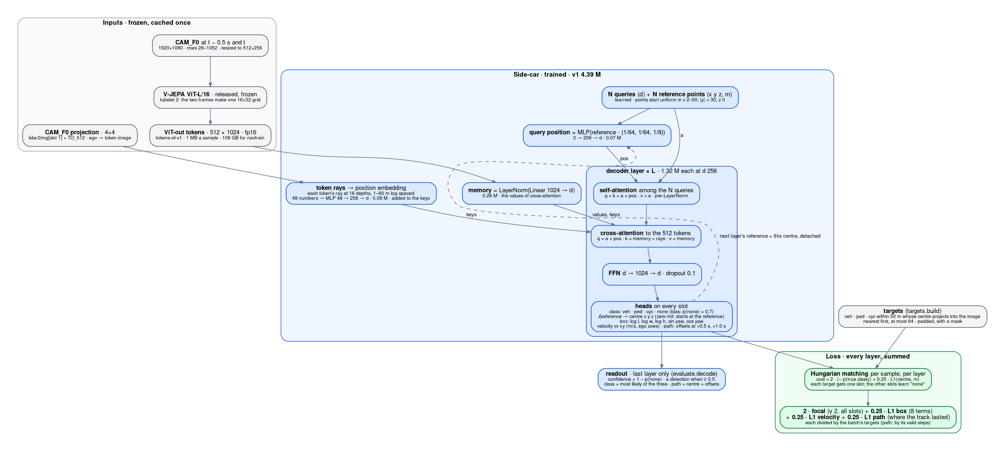
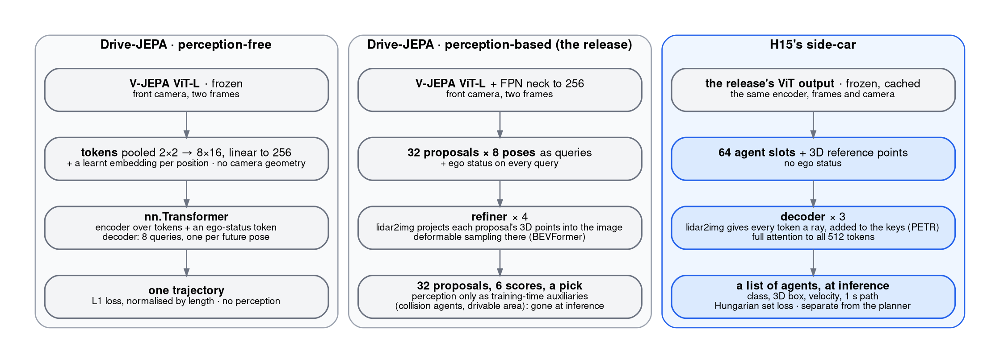
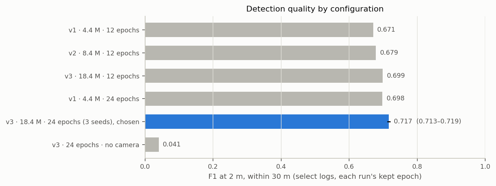
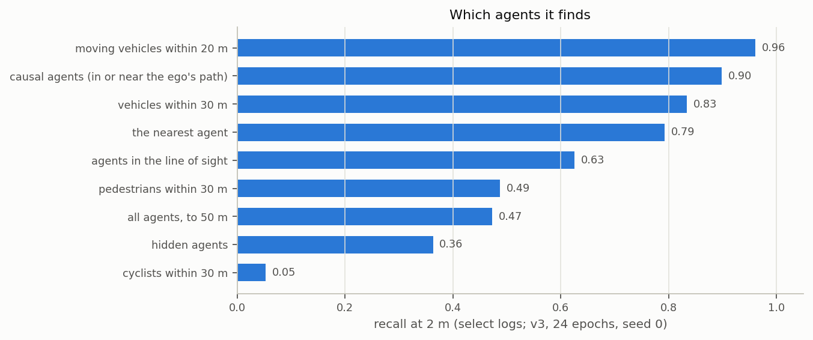
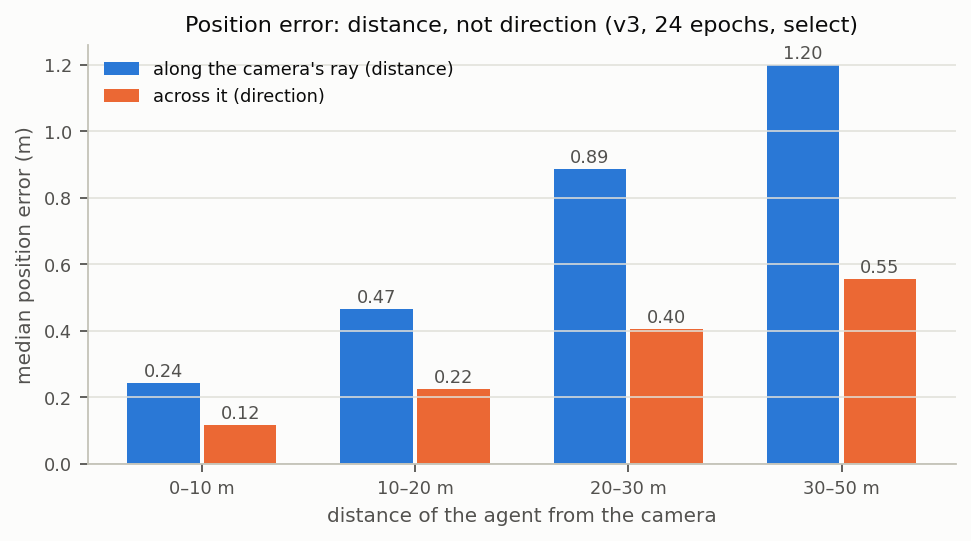
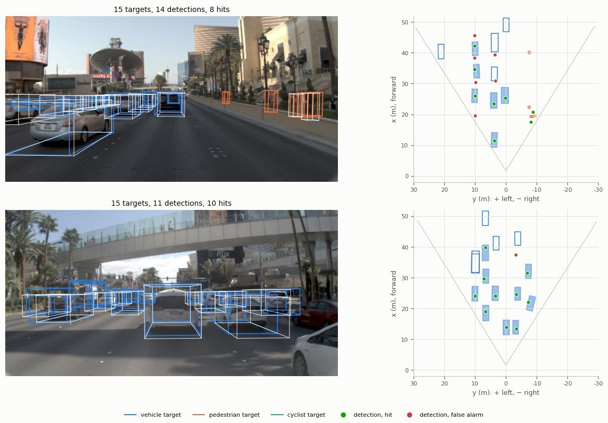

# H15 Part A, the perception side-car: executive update

**9 Nov 2026 · owner: Shreedhar · status: steps 1–5 of 8 done; the one-time test (step 6) waits for the
owner's review.** Details: [the plan](plan.md) (§9.2 for step 5) and
[notebook 06](../../../experiments/H15_perception_sidecar/notebooks/06_predictions.ipynb).

## Summary

- **What it is.** A small add-on network, the *side-car*: 18.4 M parameters, 6% of Drive-JEPA's 308 M. It
  reads Drive-JEPA's frozen camera features and lists the agents in front of the car: what each one is,
  where it is, how big, how fast, and where it will be in one second. It is trained alone; the planner is
  not changed.
- **How well, so far.** On 51 held-out driving logs (4,457 frames):
  - it finds 67% of the agents within 30 m, and 77% of its detections are real (F1 0.717, the mean of three
    training seeds);
  - it finds 90% of the agents in or near the car's path, and 95–96% of moving vehicles within 20 m;
  - with its camera input zeroed, the same network finds almost nothing (F1 0.04).
- **Its main weakness is distance, not direction.** Direction is right to under 1°, but from about 25 m
  the median distance error passes 1 m. Cyclists, 0.5% of the training data, are almost never found.
- **Caveat.** These logs were also used to choose the model, so the numbers flatter it slightly. The
  deciding read, on 70 separate test logs, is step 6; nuScenes, a different city and car, follows.

## 1. What the side-car predicts: the heads

The side-car looks at the front camera's last two frames. It has a fixed set of *slots* (128 for the
chosen model, 64 for the smallest), and every slot predicts the following, through one small network per
output (Figure 2).

| Head | What it predicts | Values |
|---|---|---|
| **Class** | which kind of agent the slot holds, or none | 4 options: vehicle, pedestrian, cyclist, no agent. A slot is shown as a detection when its confidence, 1 − P(no agent), is at least 0.5 |
| **Position** | the agent's 3D centre | metres from the car: up to 50 m ahead, inside the front camera's view |
| **Box** | length, width, height and heading | metres, and an angle |
| **Velocity** | its velocity over the ground (2D) | m/s. In the labels, 95% of agents move under 9 m/s; the fastest, 26 m/s |
| **1 s path** | where it will be in 0.5 s and in 1.0 s | metres from where it is now |

- **Training data:** NAVSIM's labels on 1,071 driving logs. That is 94,195 frames and 660,723 agents: 56%
  vehicles, 43% pedestrians and 0.5% cyclists. A frame has 7 agents, and half of them are beyond 32 m.
- **Not predicted:** static objects (cones, barriers, signs), and agents outside the front camera's view
  or beyond 50 m.
- **Graded by importance, but not predicted:** each agent is also labelled
  - **causal** when it is visible and in or near the car's path;
  - **visible** or **hidden**, by its line of sight;
  - **nearest first**, by distance;
  - and pedestrians standing together count as one **group**.

## 2. When is a head trained enough?

**Accepted practice asks two questions.**
1. **Has training converged?**
   - The held-out score has stopped improving by more than its noise, and the training loss is flat.
   - The learning-rate schedule has finished.
   - The held-out score has not turned down, which would be overfitting.
   - Different random seeds agree more closely than any further gain being sought.
2. **Is it good enough for its use?**
   - It clears thresholds fixed *before* the result, on data never used to choose, on every seed.
   - The measures are the standard ones for detection: the share of agents found (recall), the share of
     detections that are real (precision), average precision across confidence levels, and the errors in
     position, size, heading and velocity of the agents found (the nuScenes benchmark's measures).
   - Paths must beat a constant-velocity extrapolation.

**Fit for purpose comes first:** for a planner, finding the agents that affect the car, and placing the
near ones accurately, matters more than distant agents.

**Our thresholds** were committed in [PREDICTIONS.md](../../../experiments/H15_perception_sidecar/PREDICTIONS.md)
before training. They are decided at step 6, on the test logs; here is the preview on the selection logs:

| Criterion | Passes if, on every seed | Preview (chosen model, three seeds) |
|---|---|---|
| Detection within 30 m (Q1) | recall ≥ 0.55 and precision ≥ 0.65 | recall 0.67–0.68, precision 0.76–0.77 |
| Moving vehicles within 20 m (Q2) | recall ≥ 0.85 | 0.95–0.96 |
| 1 s path against constant velocity (Q4) | lower error, by more than 2 standard errors | 4.4–4.8% lower (the standard errors come at step 6) |
| Gap to the vehicle ahead (Q5) | at most half the error of guessing the average gap (8.2 m) | 1.7–1.9 m |
| Agents in or near the path (Q10) | recall ≥ 0.80 within 30 m | 0.90 (over all ranges) |
| Per class (Q3, reported, not decided) | vehicles ≥ 0.70; pedestrians 0.35–0.55 | vehicles 0.83, pedestrians 0.46–0.49, cyclists 0.04–0.05 |

**Where each head stands** (chosen model, selection logs):

| Head | Verdict | Evidence |
|---|---|---|
| Class: vehicles | good | average precision 0.87; 83% found within 30 m |
| Class: pedestrians | fair | average precision 0.54; 49% found within 30 m |
| Class: cyclists | not trained enough, for lack of data | 0.5% of the training agents; found 4–5% of the time |
| Position: direction | good | median error under 1° at every distance |
| Position: distance | **the main gap** | median error 0.24 m within 10 m, 1.2 m at 30–50 m; 30% of agents beyond 30 m are more than 2 m off |
| Velocity | adequate | 0.42 m/s error on the agents found; parked cars are not given the car's own motion |
| 1 s path | a modest gain, as predicted | 4–5% better than constant velocity |
| Confidence | over-confident below 0.7 | a detection at 0.55 confidence is right about 40% of the time |
| Box size and heading | not yet summarised for the chosen model | measured at step 6 |

**Training is close to converged:**
- the score still rises slowly, by 0.003–0.006 over the last 6 of 24 epochs;
- the seeds agree within 0.006.

More epochs would add little. Closing the gaps above needs changes, such as a head for distance along the
camera's ray, or more cyclist data, not more training.

## 3. The experiments, and what they found

**How we got here.**
- **First pass (3–4 Nov):** it trained the side-car and tested three ways of feeding it to the planner, all
  in a day and a half. That was too much to review, and the owner judged it inconclusive (decision D20).
- **The rerun:** Part A alone, in eight steps, each reviewed before the next (Figure 1).
- **Steps 1–3 (4 Nov):** the data, the model and its loss, and a one-epoch check of the pipeline. They were
  reviewed, and the owner chose the plan's recommended settings (D21).
- **Step 4:** the success criteria were committed before any training.
- **Step 5 (4–5 Nov):** eight training runs, scored only on the selection logs, in about 2.5 hours on one
  shared GPU.

**Step 5's results** (F1 within 30 m on the selection logs; Figure 4):

| Configuration | Parameters | F1 |
|---|---|---|
| v1, 12 epochs | 4.4 M | 0.671 |
| v2 (deeper), 12 epochs | 8.4 M | 0.679 |
| v3 (deeper and wider), 12 epochs | 18.4 M | 0.699 |
| v1, 24 epochs | 4.4 M | 0.698 |
| **v3, 24 epochs: the chosen model** (seeds 0, 1, 2) | 18.4 M | **0.717** (0.713–0.719) |
| v3, 24 epochs, no camera | 18.4 M | 0.041 |

**What we learned:**
1. **Bigger and longer both help, by similar amounts.** v3 beats v1 by 0.028; twice the training adds 0.027
   for v1 and 0.021 for v3. Each difference is well beyond the noise between logs: its 95% interval
   excludes zero.
2. **Width matters, depth does not.** v3's last three decoder layers add almost nothing. Its gain over v2,
   which has the same depth, comes from its width.
3. **The results are reproducible.** The three seeds agree within 0.006, and the rerun reproduced the first
   pass's smallest model (0.671 against 0.669).
4. **The camera is essential.** With its camera input zeroed, the network finds 6% of the agents, and 3% of
   its guesses are right. That run trained unstably, and its cause is not yet found.
5. **The errors are mostly about distance** (Figure 6).
   - 43% of the missed agents have a detection of the right class 2–4 m away, and 45% of the false alarms
     are such misplacements.
   - About three quarters of the missed agents are mostly hidden behind others.
6. **It behaves sensibly where it matters** (Figure 5):
   - classes are almost never confused (0.3% of detections);
   - parked cars do not inherit the car's own motion;
   - each detection draws its evidence mostly from its own agent in the image, which is useful for
     explaining the planner later.

**What's next:**
- **Step 6, when the owner agrees:** read the 70 test logs once, for the three seeds and the no-camera run.
  This decides the criteria in section 2.
- **Step 7, done on 10 Nov** ([the plan](plan.md), §9.3): on nuScenes, a city and car
  it never saw, the side-car finds 53% of the vehicles within 30 m, so the committed criterion holds (F1 0.50,
  against 0.72 on NAVSIM). Warping the images to NAVSIM's camera does not help.
- **Step 8:** close Part A, and decide whether any question about feeding the side-car to the planner opens.
- **Open decisions:**
  - retrain the no-camera run so it is stable;
  - weight the agents that matter more in training;
  - add a head for distance along the camera's ray, with an uncertainty.

## 4. Diagrams

**Figure 1: the eight steps, each closed by a review.** Steps 1–5 are done (blue).

**Figure 2: the side-car.** These are its inputs (frozen camera features and the camera's geometry), its
decoder, its five heads, the loss it is trained with, and what is read out.

**Figure 3: the side-car beside Drive-JEPA's two variants.** It reads the same frozen encoder, but its
output is a list of agents, kept separate from the planner.

**Figure 4: detection quality by configuration.** The black tick on the chosen model spans its three seeds.

**Figure 5: which agents it finds.** These are the chosen model's numbers; the agents that matter most are
found most often.

**Figure 6: position error, distance against direction.** Error along the camera's line of sight grows
with range; error across it stays small.

**Figure 7: two scenes drawn at random from the selection logs.** Each shows the camera image and a
bird's-eye view. Coloured boxes are the labelled agents and white boxes the side-car's detections. In the
bird's-eye view, green dots are detections that hit an agent and red ones are false alarms, mostly a few
metres from a real car.

