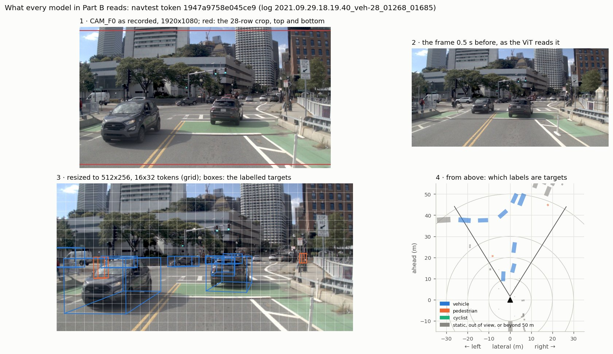
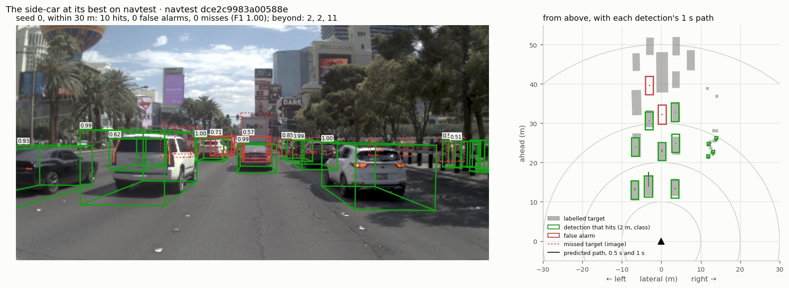
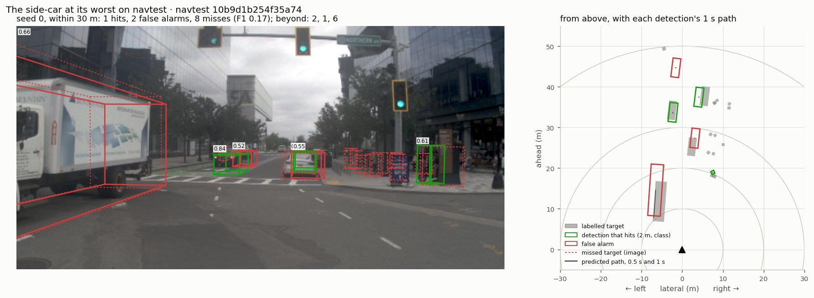
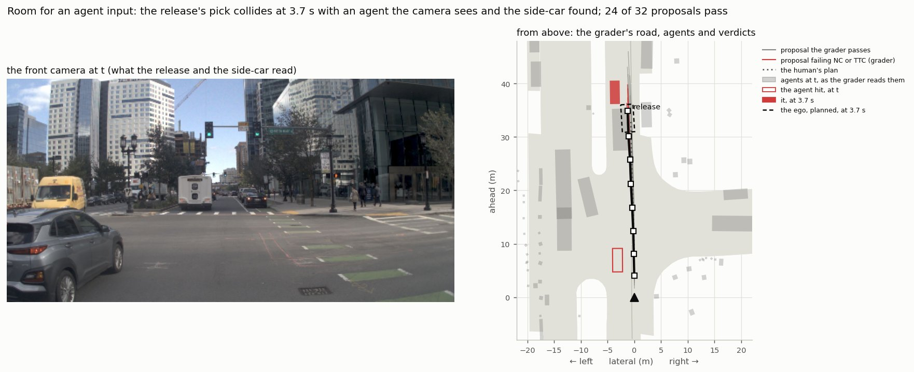
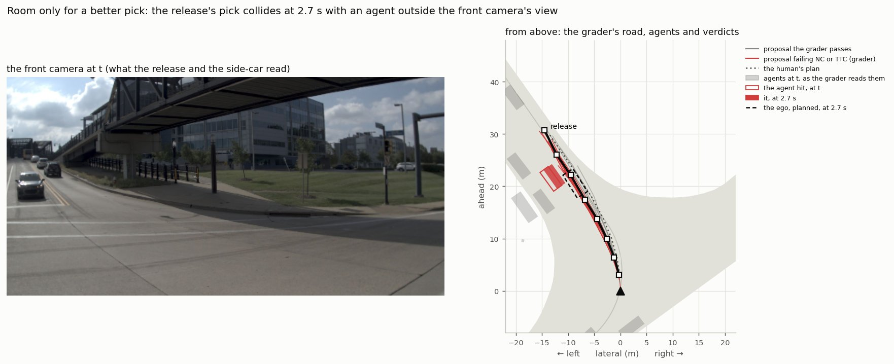
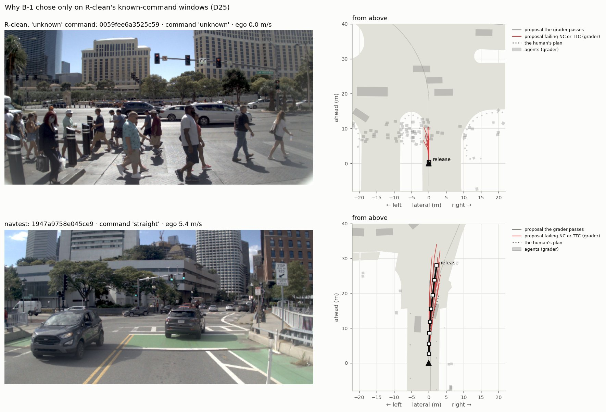
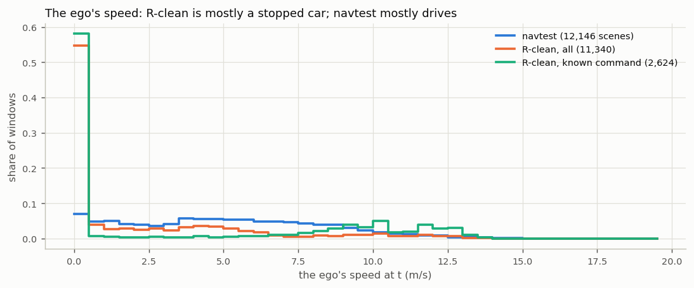

# H15 Part B · B-0, explained: what was computed, on what, and how to read its numbers

**Status (13 Nov 2026): a companion to [B-0, the foundations](B-0-foundations.md), whose "What has run" lists the
results.** This page shows them on real scenes: what each model reads, what it outputs, how an output is scored, and
how each conclusion follows from the scores. Nothing here is a new result.
- **The pictures** are drawn by `experiments/H15_perception_sidecar/scripts/part_b_explained_figures.py` from what
  B-0's passes wrote. It reuses the package's own geometry (`views`, `targets`, `geometry`) and readout
  (`evaluate.match`), so a picture cannot disagree with the numbers.
- **The examples are chosen by rules, not by eye.** Each is the extreme of a stated rule, with ties going to the first
  token in sorted order. The rules and the numbers behind each choice are in
  [part-b-explained-examples.json](../../../experiments/H15_perception_sidecar/figures/part-b-explained-examples.json).
- **Labels on numbers:** *counted* and *measured* come from the passes; *read* comes from code; *argued* is reasoning.
- B-1's own walk-through is [B-1, explained](B-1-explained.md).

## Contents

1. [One sample, from the camera to the planner's pick](#1)
2. [The side-car's output, and how it is scored](#2)
3. [How a plan is graded](#3)
4. [The anchor: why 87.783 matters](#4)
5. [The headroom counts](#5)
6. [R-clean, and why B-1 chose on part of it](#6)
7. [Every B-0 number: where it comes from](#7)
8. [What B-0 concluded, and how](#8)

## 1. One sample, from the camera to the planner's pick

*navtest token `1947a9758e045ce9`, Boston. It is also B-1's best-gain example.*

**A sample is a window of a recorded drive.** It has 4 frames of history ending at the current frame t, then 10 future
frames, at 2 Hz. NAVSIM's own `filter_scenes` cuts these windows. navtest has 12,146 of them over 136 logs (*counted*).

**What the release reads, step by step** (*read*; Part A's plan §3.2 and the token pass, `tokens.py`):

| Step | What happens | Shape |
|---|---|---|
| 1. The camera | CAM_F0, the front camera, at t and at t − 0.5 s (panels 1 and 2) | 1920 × 1080 each |
| 2. The crop | 28 rows dropped top and bottom (panel 1's red lines) | 1920 × 1024 |
| 3. The resize | bilinear, to the ViT's input; then ImageNet normalisation | 512 × 256 (panel 3) |
| 4. The ViT | V-JEPA's ViT-L/16, frozen. A tubelet of 2 fuses the two frames, so the output is one 16 × 32 grid of 16-pixel tokens (panel 3's grid) | 512 tokens × 1024 |
| 5. The projector | maps the tokens to the planner's width | 512 tokens × 256 |
| 6. The refiner | 32 proposal queries, refined in 4 passes by one module: self-attention, deformable attention into the image tokens through CAM_F0's camera matrix, a feed-forward, and a decoder to poses | 32 proposals × 8 poses (x, y, yaw) |
| 7. The scorer | pass 4's queries, max-pooled over each proposal's 8 poses, into a 3-layer MLP | 32 × 6 logits |
| 8. The pick | the 6th logit through a sigmoid is the proposal's score; the pick is the highest score, the first index on ties | 1 proposal |

- **A proposal** is 8 poses of the rear axle, 0.5 s apart, from 0.5 s to 4 s, in the ego frame (x forward, y left).
  That is NAVSIM's trajectory convention.
- **What the side-car reads** is step 4's output, the ViT's own 512 × 1024 tokens, plus the same camera matrix.
- **What B-0 cached per sample** (`tokens-navtest-v1`, `tokens-vit-navtest-v1`): the step 4 and step 5 tokens, the
  32 proposals, the logits, the scores, the pick, and the camera matrices.

**The checks that make the cache trustworthy** (*measured*; PREDICTIONS.md, B0-G5):
- **Batched equals batch 1.** The pass runs 16 samples at a time, with `batch_fix`. On 32 samples, batch 1 gives the
  same picks, and proposals within 4e-5 m.
- **The fast input path equals the vendor's.** On 12 samples, the pass's shortcut for the camera geometry gives every
  model input identical to the vendor's own builder.
- **The cached pick is the argmax of the cached scores**, on every one of 12,146 rows.
- **Live equals cache.** A fresh forward of 6 rows, with inputs built by NAVSIM's own code from the raw logs, equals
  the cache: tokens to fp16 rounding, picks 6 of 6, scores within 3e-6.

**The labels** (panel 4; *read*: `navsim_data.window_labels`, `targets.build`):
- **What a label is.** Every annotated agent at t within 60 m: class, a 3D box (x, y, z, length, width, height, yaw)
  in t's ego frame, its velocity, and its positions at t + 0.5 s and t + 1 s, joined by track.
- **What a target is.** A vehicle, pedestrian or cyclist whose box centre projects inside the 512 × 256 image, within
  50 m, nearest first, at most 64. Coloured by class in panel 4.
- **What is left out:** static objects, agents outside the camera's view, and anything beyond 50 m. These are grey in
  panel 4.
- **Why it matters.** Only targets can be found by the side-car, or read by B-1-2's rule.
- **The labels are held to NAVSIM's code** on 60 windows per split: 0 problems (B0-G2).

## 2. The side-car's output, and how it is scored

**What the side-car outputs** (*read*: `train_sidecar.agent_arrays`). v3 has 18.4 M parameters and 128 query slots,
and reads the 512 ViT tokens. Each slot gives:
- **class logits** over 4 choices: vehicle, pedestrian, cyclist, or none. Softmax gives probabilities;
  **confidence = 1 − p(none)**, and the class is the most likely of the three agent classes;
- **a box:** centre (x, y, z), size from exp of the predicted log-size, and yaw from atan2 of the predicted sine and
  cosine;
- **a velocity** (vx, vy), and **a path:** offsets from the centre at t + 0.5 s and t + 1 s.

**A slot is a detection if its confidence is 0.5 or more.** That is Part A's readout threshold; B-1-3 later uses 0.7.

**How a detection is judged** (*read*: `evaluate.match`, Part A's readout, which is H04's rule):
1. Take the detections in order of confidence, highest first.
2. Match each to the nearest still-free target **of its class** whose centre is **within 2 m**, in x and y. That is a
   **hit**.
3. A detection with no such target is a **false alarm**. A target no detection reached is a **miss**.
4. Precision = hits ÷ detections; recall = hits ÷ targets; F1 = 2 · hits ÷ (detections + targets). Part A read
   these within 30 m.

**At its best** (`dce2c9983a00588e`, Las Vegas). *The rule: of every 7th navtest row with at least 6 targets within
30 m, the best F1 for seed 0, then the most targets.*
- **Within 30 m: 10 hits, 0 false alarms, 0 misses (F1 1.00).** Every car in the queue ahead, near and in the next
  lanes, is placed within 2 m.
- **Beyond 30 m: 2 hits, 2 false alarms, 11 misses.** The far end of the queue is where it fails: two of its boxes
  sit more than 2 m from any label (red), and most of the far cars are not found. Part A measured this: depth error
  grows with range, and recall falls beyond 30 m.
- **Paths (right panel, black ticks):** short for the queued cars, which barely move in 1 s.

**At its worst** (`10b9d1b254f35a74`, Boston, a wet day). *The same rows: the worst F1, then the most targets.*
- **Within 30 m: 1 hit, 2 false alarms, 8 misses (F1 0.17).**
- **The truck on the left counts twice.** It is detected, but its box sits about 3 m from the label, as the bird's-eye
  view shows (red outline beside the grey box). So it is one false alarm *and* one miss. Part A found that 45% of
  false alarms are such misplacements.
- **The pedestrians and cars at the crossing, about 25 m ahead, are mostly missed** (dashed red on the image).
- **What this means for B-1.** A rule that reads these agents would act on a misplaced truck, and would not see the
  crossing. B-1's false-alarm example is this failure mode at work.

**The agents passes are held to the runs that made them** (*measured*, B0-G7). Before decoding a split, each pass
decodes the run's own select rows, by the same code, and requires the select F1 its training recorded. All 9 passes
(3 seeds × select, navtest and R-clean) give it **exactly**: 0.7195, 0.7182 and 0.7132. This proves the model, the
epoch and the decoding are the ones that were measured. It does not prove that navtest's accuracy equals select's.

**Train-row optimism, and why cross-fitting ran** (*measured*; B-0 Q8):
- On a seeded draw of 51 train logs (6,615 rows), each seed reads **F1 0.80–0.81 and causal recall 0.945**.
- On select, the same seeds read **F1 0.71–0.72 and causal recall 0.90**.
- **The gaps (0.085 and 0.046) exceed the pre-registered 0.03**, so a planner trained on train rows' agents would
  learn to trust agents that are better than any it will meet.
- **Five cross-fit side-cars** each trained without a fifth of the train logs. Their select F1 is 0.700–0.708, within
  0.02 of seed 0's (B0-G11). Each train row now has the agents of the side-car that never saw its log.
- **This matters for B-2 and later.** B-1 reads no train row.

## 3. How a plan is graded

**The metric cache: what the grader knows about a scene** (`docs/navsim-metric-cache.md`):
- the ego's state at t;
- every agent's footprint at 10 Hz for the next 4 s, from the log ("log replay": the agents do not react to the plan);
- the drivable area, the route and its centreline, and the traffic lights;
- the human's own plan;
- a reference planner's plan, PDM-Closed, which the ego-progress score is measured against.

The pictures below draw the drivable area (light grey), the centreline, and the agents (grey) from the cache itself.

**Two scorers read the cache:**

| | The vendored scorer (Drive-JEPA's copy) | The official scorer (navsim v2, `run_pdm_score.py`) |
|---|---|---|
| Used for | labels for all 32 proposals of every row, cheaply: B-1's choices, the analysis | the headline: one score per scene, for the plan an arm picked |
| Simulates | the ego tracking the 8 poses, 40 steps of 0.1 s | the same |
| Gates (multiplicative) | NC, DAC, DDC, TLC | the same |
| Weighted terms | EP 5, TTC 5, LK 2, HC 2 | EP 5, TTC 5, LK 2, HC 2, **EC 2** |
| EC (two-frame extended comfort) | absent | compares this frame's plan with the next frame's; blank where there is no next frame |
| The human filter | absent | a term the human's own plan fails is forgiven (set to 1) |
| Per-scene score | final = NC · DAC · TLC · DDC · (5 EP + 5 TTC + 2 LK + 2 HC) / 14 | EPDMS = NC · DAC · DDC · TLC · weighted mean of the soft terms present |

**What each term means:**
- **NC, no at-fault collision.** 0 if the ego hits an agent and is at fault; 0.5 for a static object.
- **DAC, drivable area compliance;** **DDC, driving direction compliance;** **TLC, traffic light compliance.**
- **EP, ego progress:** distance along the route, as a share of the larger of its own and PDM-Closed's.
- **TTC, time to collision:** 0 if projecting the ego up to 1 s ahead, at any step, puts it into an agent.
- **LK, lane keeping;** **HC, history comfort;** **EC, extended comfort.**

**Gates zero a scene.** A plan that hits something scores 0 whatever else it does. So a 1.5% collision rate costs
about 1.3 to 1.5 points of EPDMS.

**Navtest's numbers are means over scenes, × 100** (*read*: `navtest.score`, H04's arithmetic, ported with its tests):
- **EPDMS (human filter):** the mean over the 12,146 scenes of each scene's EPDMS, built from the human-filtered
  columns. A scene without a next frame leaves EC out of its weights (÷ 14 instead of ÷ 16). This is the number
  87.78 refers to.
- **The CSV score:** the mean of navsim's own `score` column, which is not human-filtered (84.49).

## 4. The anchor: why 87.783 matters

**What the anchor proves** (*measured*, B0-G8). The release's own picks, stored per token and handed to navsim's
official scorer by the replay agent, give **EPDMS (human filter) 87.783 and CSV 84.495**. H04 measured **87.78 and
84.49** at another site. The sub-scores match H04's to rounding: NC 0.985, TTC 0.979, DAC 0.986, EC 0.479
(H04: 0.478).
- So this site's code tree, metric cache, scorer and arithmetic reproduce the published number.
- So any later difference against 87.783 is the arm's, not the site's.

**The replay is exactly the store.** The replay agent writes down every plan it hands the scorer: all 12,146 equal
the stored plans. A store that misses a token is refused before scoring, because `run_pdm_score.py` crashes on any
failed token.

**The live release (B0-G9; *measured*).** The release itself, run by navsim (batch 1, fp32, its own feature builder),
was checked against the replay:
- it picks the same proposal on all 12,146 tokens;
- its plans are within 5e-5 m of the replayed ones;
- its EPDMS is 6e-8 points from the replay's;
- every discrete column (NC, DAC, DDC, TLC, TTC, LK, HC, EC) is identical everywhere.

Only EP, which is continuous in the plan, differs, by at most 1.5e-6. The gate as written asked for every column
exactly equal, which held on 52.2% of tokens. The owner amended it to "discrete columns equal, EP within 1e-5" (D26),
and both records are kept.

**R̃, the cached path the trained arms will start from (B0-G10; *measured*).** R̃ runs the refiner from the cached
fp16 tokens, batched, with every adapter at zero. It picks as R on 99.975% of scenes (3 differ). It differs from R by
+0.0014 ± 0.0011 points, and its proposals by 2e-5 m. A trained arm's gain over R̃ is therefore a gain over the
release.

## 5. The headroom counts

*The scene above* (`024d89a3e1e752dc`; *the rule: a release pick failing NC officially, the at-fault agent a target
seed 0 found, and B-1-3 keeping the pick; the nearest such agent*):
- At t, a car is a few metres ahead of the ego, in the lane to its left (red outline).
- The release's pick (black, squares) drives straight ahead.
- **The car cuts in.** By 3.7 s it is ahead in the ego's lane (red fill), and the ego's planned footprint (dashed)
  reaches it.
- **Room for a better pick:** 24 of the 32 proposals pass NC and TTC (grey); 8 fail (red).
- **Room for an agent input:** the car is in CAM_F0's view, and the side-car found it.
- **But a 1 s forecast would not have seen the cut-in.** It is B-1's missed-failure example.

*Above* (`00fcad6d092c5e8e`; *the rule: a release pick failing NC officially, a safe proposal among the 32, the
at-fault agent out of CAM_F0's view or beyond 50 m; the first token*):
- The ego turns left under a bridge.
- The release's pick clips a stationary vehicle on the left, at 2.7 s.
- **That vehicle is not in the front camera's view.** No agent input from this camera could help; only a better pick
  among the 32 could.

**How the counts were made** (`headroom.count`; *measured*, from the release's labels only):
1. **Which scenes fail.** A scene counts as failing if the official scorer gives the release's pick NC < 1 or TTC < 1:
   **275 of 12,146** (2.3%).
2. **Room for a better pick.** Of those, is there a proposal among the 32 that the vendored scorer passes on both NC
   and TTC? **271.**
3. **Room for an agent input.** Of those, what does the grader name as the object behind the failure? It names the
   at-fault collision's track, or else the TTC track; the track is then looked up in the labels:
   - a target, in CAM_F0's view within 50 m: **156**;
   - out of view or beyond 50 m: **94**;
   - not among the labels: **14**;
   - a static object: **7**.
4. **Room for this side-car.** Of the 156, did seed k's detections hit that target (the readout's own match)?
   **127, 133, 135.**

| Count | Bounds |
|---|---|
| 275 scenes fail NC or TTC | everything an agent rule could fix (about 2.3 points at most) |
| 271 have a safe alternative | a better *pick* (B-1; B-2's refit scorer; B-3) |
| 156 of those name an in-view agent | an *agent input* from this camera |
| 127–135 of those the side-car found | *this* side-car |

- **B-0 argued the in-view share would be "a half to two thirds".** It is 58% (*measured*).
- **Best-of-32 over the pick:** +7.4 points of the vendored final, over all terms. That is the room for selection of
  any kind, not only for agents.

## 6. R-clean, and why B-1 chose on part of it

**What R-clean is** (`fresh.json`):
- the trainval logs that no NAVSIM scene filter names: 118 logs, 58 of them with a route;
- every routed window of those logs: **11,340 windows** (*counted*: B-0's counts, scripted for the first time).
- The release never trained on them, so it is a split to choose settings on without touching navtest.

*Top* (`0059fee6a3525c59`; *the rule: an unknown-command R-clean window where the release's pick fails NC; the first
token*):
- The ego is stopped at a crosswalk in Las Vegas, with a crowd of pedestrians crossing.
- Its driving command, one of the release's inputs, is **"unknown"**.
- **All 32 proposals fail (red):** every one creeps forward into the crossing.

*Bottom:* a navtest scene. The ego is moving and its command is "straight"; its 32 proposals fan out ahead along its
lane. Most of them fail here, against the car ahead: this is B-1's best-gain scene.

**What B-0's check of R-clean found** (*measured*, `headroom.profile`):

| | R-clean | navtest |
|---|---|---|
| Driving command left / straight / right / unknown | 1% / 22% / 0% / **77%** | 21% / 66% / 13% / 0% |
| Ego stopped (< 0.5 m/s) | **55%** | 7% |
| Pedestrians per window | **39** | 9 |
| Release pick fails NC / TTC (vendored) | 3.2% / 4.6% | 1.6% / 2.1% |

- **navtrain never has the "unknown" command** (0 of 103,288 rows), so the release has never seen it.
- **On R-clean's unknown-command windows its input is out of distribution.** Its pick fails NC on 4.0% of them and on
  0.65% of the rest.
- **The owner's decision (D25):** B-1 chooses only on the 2,624 windows (20 logs) whose command navtest uses.
- **The kept windows still differ from navtest:** 58% of them have the ego stopped (the green line above), and almost
  all drive straight.

## 7. Every B-0 number: where it comes from

| Number | What it is | Computed by | Value |
|---|---|---|---|
| navtest scenes and logs | the vendor's filter, re-derived and pinned by sha256 | `navsim_data.navtest_record` | 12,146; 136 (*counted*) |
| R-clean windows | its rule, re-derived from the logs | `navsim_data.fresh_record` | 11,340 over 58 logs (*counted*) |
| batched vs batch 1 | the largest proposal gap and the share of equal picks on 32 rows | `tokens.check_batched` | 4e-5 m; 32 of 32 |
| live vs cache | a fresh forward of 6 rows against the cache | `preflight.run_data` | picks 6 of 6; scores within 3e-6 |
| PDM labels re-score | 50 rows scored again, compared exactly | `pdm_labels.check` | 0 problems per split |
| select F1 reproduced | each agents pass against its run's record | `train_sidecar.select_f1_check` | gap 0.0 on all 9 passes |
| optimism | train-row minus select F1 and causal recall, mean over 3 seeds | `train_sidecar.optimism` | 0.085; 0.046 |
| cross-fit select F1 | each fold's kept epoch | `train_sidecar.crossfit_agents` | 0.700–0.708 |
| the anchor | the mean of per-scene EPDMS (human filter) × 100, and of the CSV `score` | `navtest.score` on `run_pdm_score.py`'s CSV | 87.783; 84.495 |
| live vs replay | pick agreement; discrete columns; EP; EPDMS | `navtest.compare_live` | 100%; 100%; 1.5e-6; 6e-8 |
| R̃ − R | the per-scene paired mean of EPDMS differences × 100, SE clustered by log | `navtest.paired` | +0.0014 ± 0.0011 |
| headroom | the counts in §5 | `headroom.count` | 275, 271, 156, 127–135 |
| R-clean profile | the table in §6 | `headroom.profile` | as shown |

**The SE clustered by log.** Scenes within one log are not independent: they are the same drive, 0.5 s apart. So the
SE of a mean paired difference d̄ over N scenes in G logs is

  SE = √( G / (G − 1) · Σ_logs ( Σ_{scenes in the log} (dᵢ − d̄) )² ) / N,

with G = 136 on navtest (`b_report.clustered_se`). It is wider than the naive SE, and it is what every "± SE" in
Part B means.

## 8. What B-0 concluded, and how

| Conclusion | From | Strength |
|---|---|---|
| A planning gain can be read honestly here: the official scorer, this site's tree and cache reproduce the release's 87.78 | the anchor (§4) and the live release, both exact on every discrete column | **measured**, strong |
| The arms' cached path starts exactly where the release is | R̃ − R = +0.0014 ± 0.0011 | measured, strong |
| Every input B-1 reads is what the code that made it measured | gates B0-G1 to B0-G7 and B0-G11, each an equality check | measured |
| There is room for a better pick on navtest, and most of it involves an agent the camera sees | §5: 271 of 275 failures have a safe alternative; 156 name an in-view agent | measured (counts) |
| The side-car finds most of those agents | 127–135 of 156 | measured |
| How much of that room a rule or model can take is not shown by these counts | it depends on finding the failing proposals, which B-1 tests | argued |
| R-clean is a poor stand-in for navtest, and only its known-command part was used | §6 | measured; the choice is the owner's (D25) |
| Agents learned on train rows would flatter a planner trained on them | optimism 0.085 > 0.03 | measured; cross-fitting answers it |

**Not concluded here:** whether agents help the planner. That is B-1's question, and B-2's and B-3's (numbered since 13 Nov, D28).
