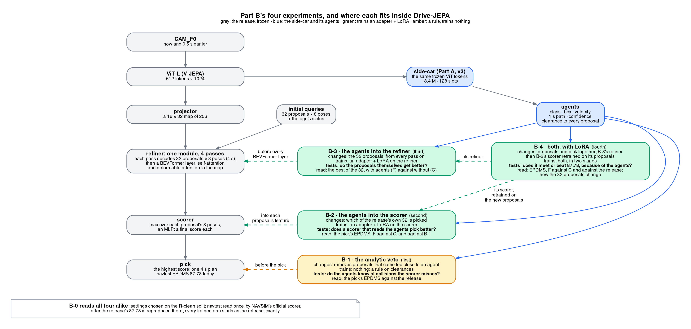

# H15 Part B · B-0: the foundations every experiment shares

**Status (11 Nov 2026): running.** The owner approved execution on 11 Nov (D24): all of B-0, then B-1, with the
recommended choices below, except (c). What has run is logged in [the overview](../README.md#log).
- **Where it sits:**
  - The common record is [the overview](../README.md): the tracker, the naming and the
    discussion log.
  - The ideas are in [the ideas](ideas.md).
- **The experiments that stand on it:**
  - [B-1, the veto](B-1-veto.md);
  - [B-2, the scorer](B-2-scorer.md);
  - [B-3, the refiner](B-3-refiner.md);
  - [B-4, both with LoRA](B-4-joint-lora.md).
- Until 11 Nov this page was the whole Part B plan. Its B-LoRA sections moved to B-4's document.

## The four experiments, in one picture

**How to read it.**
- **Down the left is Drive-JEPA as it runs today:** the ViT, the projector, the refiner's four passes, the scorer
  and the pick. In every experiment all of it stays frozen, except what LoRA adapts.
- **On the right is the side-car.** It reads the same frozen ViT tokens and lists the agents ahead, with each one's
  clearance to every proposal.
- **Between them, each experiment sits beside the part of the planner it changes:**
  - B-1 acts before the pick;
  - B-2 acts in the scorer;
  - B-3 acts in the refiner;
  - B-4 changes both, through B-3's refiner and B-2's scorer, retrained on the new proposals.
- **Each card says** what changes, what trains, the one question it tests, and what is read. They run in their
  numbers' order, B-1 first, each closed by the owner's review.
- **This page, B-0, makes their answers comparable:**
  - the same data;
  - the same official scorer, after it reproduces the release's 87.78;
  - every trained arm starting as the release, exactly.

## The crux

**Before any experiment can claim it plans better than the release, three things must be true here.**
1. There is a place to read planning that the release never trained on: navtest, and a clean selection split.
2. That place is scored the way the release's 87.78 was scored, and the release reproduces 87.78 on it.
3. Every input the experiments read (the agents, the tokens, the proposals' labels) exists for those rows.

B-0 builds those three. It also counts how much room there is, before anything is spent trying to fill it.

## What to expect

- **The data step is plumbing, with one real risk:** the anchor may not reproduce.
  - 87.78 was measured off this site, in another Drive-JEPA tree (at `548bb82`).
  - Upstream navsim has since fixed a bug in the human filter (`359c7f7`, 29 Sep 2025, *read*).
  - If our replay gives 87.5 or 88.1, nothing is compared until the difference is found.
- **The headroom check (B-0-3) may be sobering.** The release's navtest collisions are 1.5% of scenes (NC 0.985)
  and its TTC failures 2.1% (*read*). Only some of those involve an agent the front camera sees within 50 m.
  - *Argued* expectation: a half to two thirds.
  - If it is a small share, every Part B experiment is bounded to a small gain on NAVSIM. The closed-loop gate
    becomes the place where agents matter.
- **The clean split is small:** 11,340 windows, 87% Las Vegas (*counted*). It is good for choosing settings; it
  is not a second test set.

## The concepts, question by question

**Q1. Why can't the planner experiments be judged on H15's own logs?**
- The select and report logs are navtrain logs, and the release trained on all of navtrain. There its pick
  already scores NC and TTC 0.996, and EPDMS 0.914 (vendored scorer, *read*).
- The first pass's scorer and refiner experiments found nothing there, even with ground-truth agents.
- A gain cannot show where there is no room. On navtest, the release scores NC 0.985 and TTC 0.979.

**Q2. Why read navtest only once?**
- Its 87.78 is the number "meet or beat" refers to.
- Every choice made by looking at navtest (an epoch, a margin, a variant) borrows some of its noise.
  - H04's paired interval on navtest was ±0.4 points.
  - Keeping the best of four variants by navtest would add about +0.2 points of luck (*argued*): the size of the
    gain we hope for.
- So each experiment freezes its choices first, then reads navtest once.

**Q3. Then where are choices made?** On an R-clean split: trainval logs that no NAVSIM split uses, so the release
never trained on them.
- 118 such logs exist; 58 have a route, which every NAVSIM filter needs.
- That gives 11,340 routed windows (*counted*).
- Each window is 4 frames of history and 10 of future.
- The selection rule reweights it to navtest's city mix.

| City | Logs · with a route | Routed windows |
|---|---|---|
| Las Vegas | 71 · 53 | 9,895 |
| Pittsburgh | 20 · 3 | 975 |
| Boston | 26 · 2 | 470 |
| Singapore | 1 · 0 | 0 |

**Q4. What does "scored the way 87.78 was" mean?**
- NAVSIM's official v2 `run_pdm_score.py`, on all 12,146 navtest scenes, with no momentum-aware selection.
- It reports EPDMS with the human filter (87.78) and navsim's CSV score (84.49).
- The vendored scorer that labelled H15's proposals is close, but not the same (*read*):
  - progress is normalised against PDM-Closed only. The official per-token run also scores each plan beside
    PDM-Closed alone, so this matters only where both make under 5 m of progress;
  - lane keeping is checked every 0.5 s, and drivable area by a faster point test;
  - EC and the human filter are absent.
  - Until 11 Nov this page said TTC was checked every 0.5 s. It is not: the vendored TTC loop is the official one,
    line for line (0.1 s steps, projections at 0, 0.3, 0.6 and 0.9 s).
- So the vendored scorer labels every proposal cheaply, for choices and analysis. The official one gives each
  headline.

**Q5. How does the official scorer score a plan that a modified model made?**
- Through a *replay agent*. It returns, for each navtest token, the plan we stored, and `run_pdm_score.py`
  simulates and scores it as it would the release's.
- navsim's submission scorer is not used:
  - it calls `pdm_score` without the traffic-agents policy v2 needs;
  - it never computes EC (*read*).

**Q6. What is R̃, and why is it not exactly R?**
- The experiments run the refiner from cached fp16 tokens at batch 64, through `batch_fix`. The release ran live,
  in fp32, at batch 1.
- R̃ is the release through that same cached path, with every adapter at zero.
- It is the exact starting point of every trained arm, so F − C never depends on R̃ − R.
- R̃ − R is still measured on every navtest scene, so "against the release" is honest.
- The first pass's tolerance for that path was 5 cm and 95% of picks (`preflight.py`, *read*).

**Q7. What does the headroom check count?**
- For every navtest scene where the release's pick fails NC or TTC:
  - Is there a collision-free proposal among its 32? That is the room a better *pick* has.
  - Is the at-fault agent in the front camera's view, within 50 m? That is the room an *agent input* has. The
    vendored scorer names that agent and its time.
  - Did the side-car find that agent? That is the room *this side-car* has.
- Each answer bounds the experiments above it.

**Q8. Where do the agents for these rows come from?**
- From the v3 side-car, a pass over the ViT tokens: seeds 0, 1 and 2, each at its kept epoch (24, 21, 24).
- The planner's seed k reads the side-car's seed k.
- On the train rows, the side-car's agents are better than on scenes it never saw: it trained on them. So the
  gap is measured first.
  - If train − select exceeds 0.03 in F1 or causal recall, the train rows get cross-fitted agents: 5 side-cars,
    each trained without one fifth of the train logs.

**Q9. What keeps an experiment honest when it runs?** The protocol below. The preflight's form is "what the
trainer computes equals what was recorded". Choices are made on the R-clean split; navtest is read once. The
report logs are never read; the preflight refuses them.

## The plan

### B-0-1 · The data step

| Pass | train / select | R-clean | navtest | Cost (*estimate*) |
|---|---|---|---|---|
| labels: agents, the ego's future | `labels-v1`, exists | new | new | under a minute each |
| projected tokens, ViT output, the release's 32 proposals and pooled scorer input | `tokens-v1`, `tokens-vit-v1`, exist | new | new | about 8 GPU-min for navtest (`tokens-v1` took 3,786 s for 103,288 rows, *measured*); 3.2 + 12.7 GB |
| the side-car's agents, seeds 0–2 | new (`agents-a1-s0` is the first pass's v1) | new | new | minutes of GPU |
| metric cache | Drive-JEPA's pruned v2 train cache, exists | new | Paddock's v2 cache, reused once verified (D24) | R-clean about 1 h of CPU; navtest minutes, to verify |
| PDM labels of the release's 32 proposals | `pdm-v1`, exists | new | new | `pdm-v1` took 596 s for 103,288 rows (*measured*) |

- **The lists.** `navtest.json` and `fresh.json` sit beside `splits.json` in `recipes/drivejepa_perception/`. Each
  records:
  - its rule, and the sha256 of its source scene filter;
  - its tokens' sha256.
  - It is re-derived and refused if edited.
  - `splits.json` itself does not grow: its loader checks only its own keys (`navsim_data.load_splits`, *read*).
- **The passes gain a split source:** navtrain (the default), navtest or fresh. Today the labels and token passes,
  the preflight and `train_sidecar.load` are hard-wired to navtrain and trainval (*read*).
- **The R-clean split's check, before use.** Why NAVSIM left these logs out is not known. Their annotation
  coverage, the ego's speed and the commands are compared with navtest's.
- **Train-row optimism.** Each side-car seed is read on a seeded draw of 51 train logs and on select: F1, causal
  recall, and depth error by range.

### B-0-2 · The official scorer, and the anchor

1. **The navtest metric cache: Paddock's, verified (D24).**
   - Paddock built a complete v2 cache on 10 Nov: 12,146 tokens over 136 logs (*counted*), read here as
     `{data.navsim_navtest_metric_cache}`.
   - It came from another Drive-JEPA tree (`e21f474` with edits equal to patches 0001–0003, none of which touch
     caching) and another interpreter. So counting it is not enough:
     - every navtest token must have exactly one entry, and the builder's scene filter must equal this site's
       `navtest.yaml`;
     - 32 seeded tokens are cached again here, with this site's tree and interpreter, and fixed plans must score
       bit-equal against both, by the vendored scorer and by the official one.
   - A manifest under `{runs}/drivejepa_perception/` records its identity: its metadata CSV's sha256, re-checked
     before every scoring run, since Paddock owns the directory.
   - If it fails, H15 builds its own, as first planned (`run_metric_caching.py`, about 1 h of CPU).
   - `pdm_labels.check` re-scores navtest rows exactly before any proposal is labelled there.
2. **The replay agent.**
   - `replay_agent.py`, with its Hydra config under `recipes/drivejepa_perception/navsim_config/agent/`.
   - The launcher sets `DRIVE_JEPA_MSDA=auto`, since this GPU's compiled kernel returns garbage without it.
   - It puts the vendor tree and `src` on the path, and moves `output_dir` out of the shared models
     directory.
3. **The two scores.**
   - EPDMS with the human filter, and navsim's CSV score, by H04's arithmetic.
   - `navtest_score.py` on branch `drivejepa-wajepa/run3a`, ported to Python 3.9 (it uses `zip(strict=True)`), with
     its test.
4. **The anchor's gate.**
   - The release's own picks, replayed, must give 87.78 and 84.49, to ± 0.02.
   - Once, the live release is also run through the official scorer (1–4 GPU-hours): the two must agree token by
     token wherever the plans agree.
   - Otherwise stop, and compare navsim at `548bb82` against this site's `e21f474`.
5. **R̃.** A dump of the cached path with zero adapters, and R̃ − R on every navtest scene: at least 99% of picks
   equal, and |ΔEPDMS| ≤ 0.05.

### B-0-3 · The headroom check

For the release's pick on navtest (official CSV per token) and its 32 proposals (vendored labels):

| Count | Tells |
|---|---|
| scenes failing NC, TTC, DAC, EP… by term | where the points go |
| of the NC or TTC failures, how many have a proposal among the 32 that passes both | the room for a better pick (B-1, B-2) |
| of those, how many have the at-fault agent in CAM_F0's view within 50 m (`targets.seen`) | the room for an agent input |
| of those, how many failed on a static object | room for a pick (B-1-1) but not for an agent input: the side-car names only vehicles, pedestrians and cyclists |
| of those, how many the side-car found, per seed | the room for this side-car |
| best of 32 against the pick, overall | the room for selection of any kind |
| the same for the R-clean split | whether it resembles navtest |

This reads navtest's labels for the release only. It changes no choice, since no experiment's settings are
chosen on navtest.

### B-0-4 · The proposal analysis

`b_analysis.py`, used by every experiment. It works on the 32 proposals and the pick of any two arms, on navtest
and on the R-clean split.
- **Best of 32,** and the share of the 32 that pass NC and TTC.
- **Clearance** of the pick and of all 32 to the labelled agents (`geometry.terms`).
- **The 32's spread:** endpoint distances, lateral and longitudinal; minADE and miss rate
  (`train_generator.evaluate`).
- **Which proposals moved:** a Hungarian match of one arm's 32 to another's (`scipy`), with displacement by rank
  and by nearness to an agent.
- **The pick:** the pick-switch rate, and its progress and clearance before and after.
- **The pick's steadiness between consecutive frames:** a proxy for EC, beside the official EC.
- **The first pass's subsets:**
  - a lead vehicle in lane within 30 m;
  - the human slowing or stopped;
  - an agent within 10 m of a proposal in the first 2 s.
  - Also: whether the side-car found each scene's causal agents (`importance.py`).
- **BEV drawings:** a seeded draw of the scenes whose pick changed, and the largest gains and losses.

## What has run (11 Nov)

Every pass is a stage `part-b-0-*` of `recipes/drivejepa_perception.toml`, writing under
`{runs}/drivejepa_perception/`. Gates are PREDICTIONS.md's (Part B · B-0), committed before the first pass.

| Gate | What | Result |
|---|---|---|
| B0-G1 | the lists | **holds.** `navtest.json`: 136 logs, 12,146 tokens, pinned to the vendor's filter (sha256 `61284edf…`). `fresh.json`: 118 candidate logs, 58 routed, 11,340 windows (Las Vegas 9,895, Pittsburgh 975, Boston 470): B-0's counts exactly, scripted for the first time (*counted*) |
| B0-G2 | labels | **holds.** navtest 12,146 rows, R-clean 11,340; 0 problems on 60 windows each against NAVSIM's code |
| B0-G3 | Paddock's navtest cache | **holds.** One entry per navtest token; its builder's filter equals this site's `navtest.yaml`; 32 seeded tokens cached again here score bit-equal against it (vendored scorer, eight plans each; official scorer, the human's plan) |
| B0-G5 | token passes | **holds on navtest; R-clean's live check waits for its PDM labels.** Batched equals batch 1 on 32 rows (proposals within 4e-5 m, every pick equal); the pick is the argmax of the saved scores on every row; ViT-out equals its taps exactly; a live forward of 6 navtest rows equals the cache (tokens to fp16 rounding, picks 6 of 6, scores within 3e-6) |
| B0-G6 | PDM labels | **holds on navtest:** 12,146 rows, 50 re-scored exactly. R-clean's wait for its cache |
| B0-G7 | the side-car's agents | **holds:** each seed, decoded by the pass's own code, gives exactly the select F1 it recorded (0.7195, 0.7182, 0.7132); select, navtest and R-clean decoded; no report row |
| B0-G8 | the anchor | **the replay reproduces it:** EPDMS (human filter) **87.783**, CSV **84.495**, against H04's 87.78 and 84.49 (*measured*, 12,146 tokens, every replayed plan equal to the store). NC 0.985, TTC 0.979, DAC 0.986, EC 0.479, as H04 recorded. The gate's formal check waits for the live release |
| B0-G10 | R̃ − R | **holds:** picks equal on 99.975% of scenes; ΔEPDMS +0.0014 ± 0.0011 points (*measured*). R̃'s proposals are within 5.7 mm of the token pass's |

**Train-row optimism (B-0-1; *measured*).** On a seeded draw of 51 train logs (6,615 rows), each seed reads
F1 0.800–0.805 and causal recall 0.945–0.946; on select, 0.713–0.720 and 0.897–0.903. The mean gaps, 0.085 and
0.046, exceed 0.03, so by D24 five cross-fit side-cars train now, one per fold of the train logs, before B-1.

**Headroom on navtest (B-0-3; *measured*, from the release's labels only).**
- The release's pick fails NC on 186 scenes and TTC on 254: NC or TTC on 275 (2.3%).
- 271 of the 275 have a proposal among the 32 that passes both: the room for a better pick.
- Behind 156 of those 271 is a labelled agent in CAM_F0's view within 50 m (58%; B-0 argued for a half to two
  thirds); 94 are out of view or range, 14 not among the labels, 7 static objects.
- The side-car's seeds found 127, 133 and 135 of the 156.
- Best-of-32 beats the pick by 7.4 points of the vendored final (6.5 under the human filter), over all terms.

## The protocol every experiment follows

1. **One question per experiment, and arms that isolate it.**
   - The adaptation without agents (C) beside the one with them (F).
   - Labelled agents (O) as the ceiling of perception.
   - The release (R, R̃) as the bar.
2. **Choices on the R-clean split; navtest read once,** after every run of the experiment has finished.
3. **The criteria are pre-registered:** each plan's draft goes into PREDICTIONS.md, as a dated Part B section,
   once the owner approves it, before the experiment's first training step.
4. **Paired comparisons.**
   - Per scene, with SE and intervals clustered by log (136 navtest logs).
   - H15's rule for "beats": on every seed, beyond C's seed range and twice the SE.
5. **The preflight** refuses to train unless:
   - code is committed and the suite passes under Python 3.9;
   - the splits are re-derived, and **no report-log row** is in any row set;
   - caches equal live forwards;
   - untrained models equal R̃ bit for bit;
   - PDM labels re-score exactly.
6. **Records.**
   - Each run is `H15.r6` onward in `experiment.toml`, its label naming its `B-<n>-<v>`.
   - Decisions go to `decisions.toml`.
   - Every change is mirrored in the overview's log.

## Decisions for the owner

**Decided on 11 Nov (D24):** the recommendations, except (c). Paddock's navtest cache, which did not exist when this was
written, is reused once verified (B-0-2).

| | Decision | Recommended |
|---|---|---|
| (a) | the R-clean window rule: all routed windows, or a navtrain-like "non-trivial" filter (validated by how well it reproduces `navtest.yaml` on 10 navtest logs); the 2 routed test logs outside navtest (306 Boston windows) | all routed windows; leave the test logs out |
| (b) | the fidelity gate: the replay alone, or the live release too | both |
| (c) | where the navtest metric cache lives | under `{runs}`, H15's; Paddock can point at it later. **Decided: Paddock's, verified** |
| (d) | momentum | none, as the anchor; with it as a second read |
| (e) | the cross-fit threshold | 0.03 in F1 or causal recall |
| (f) | the side-car read on navtest, for the analysis' strata. Choice 11.2 kept navtest out of Part A's test; here nothing about the side-car is chosen | yes, flagged |
| (g) | H04's EPDMS arithmetic | ported into H15 with its test |

## Risks

1. **The anchor may not reproduce here** (above). Nothing on navtest is compared until it does.
2. **The report logs could leak through reused code.**
   - `train_refiner`, `train_scorer`, `pdm_labels.build`, `train_sidecar agents` and `b_report` read them today.
   - New entry points, and the preflight's guard, answer it.
3. **The R-clean split is small and Las-Vegas-heavy.** It chooses settings; it does not test them.
4. **Power.** A paired SE of 0.1–0.2 points may leave a real +0.2 unresolved at 3 seeds. B-0-3 says beforehand how
   large a gain could be.
5. **Disk and the shared GPU.**
   - 70–120 GB in all, with the experiments.
   - Runs are slow and noisy in time; plans quote wall time.

## Cost (*estimate*)

| Item | GPU | CPU |
|---|---|---|
| B-0-1: passes for navtest and R-clean, agents | about 0.5 h | metric caches about 2 h; labels minutes |
| B-0-2: the live release on navtest, once | 1–4 h | the official scorer |
| B-0-3, B-0-4 | — | minutes |

## Code

| | Modules |
|---|---|
| **Reused** | `pdm_labels.score`, `geometry.terms`, `train_sidecar.agent_arrays`, `b_report.clustered_se`, `importance.py`, `drivejepa_b2d.train_generator.evaluate`, the preflight's existing checks |
| **Extended** | `navsim_data`, `tokens`, `preflight` (a split source); `pdm_labels` (`--root`, a row set, the TTC agent); `train_sidecar agents` (`--rows`, `--vit-tokens`, report rows refused); `geometry` (per-agent clearances); `targets` (`truth_agents`) |
| **New** | `navtest.py` (metric-cache, score, compare), `replay_agent.py` and its configs in `recipes/drivejepa_perception/navsim_config/`, `cached_release.py` (R̃), `b_analysis.py`, `headroom.py` |

The new modules sit inside `gallops.drivejepa_perception`, so the package's claim covers them. The recipe stages
are `part-b-0-*`: the first pass already owns `b1-*` to `b3-*`.
