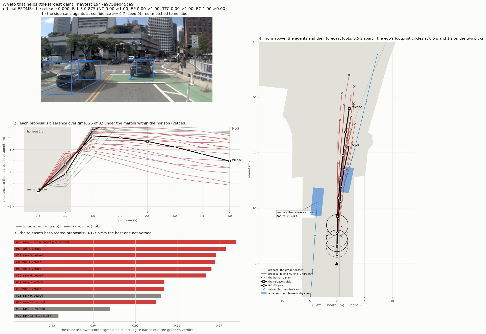
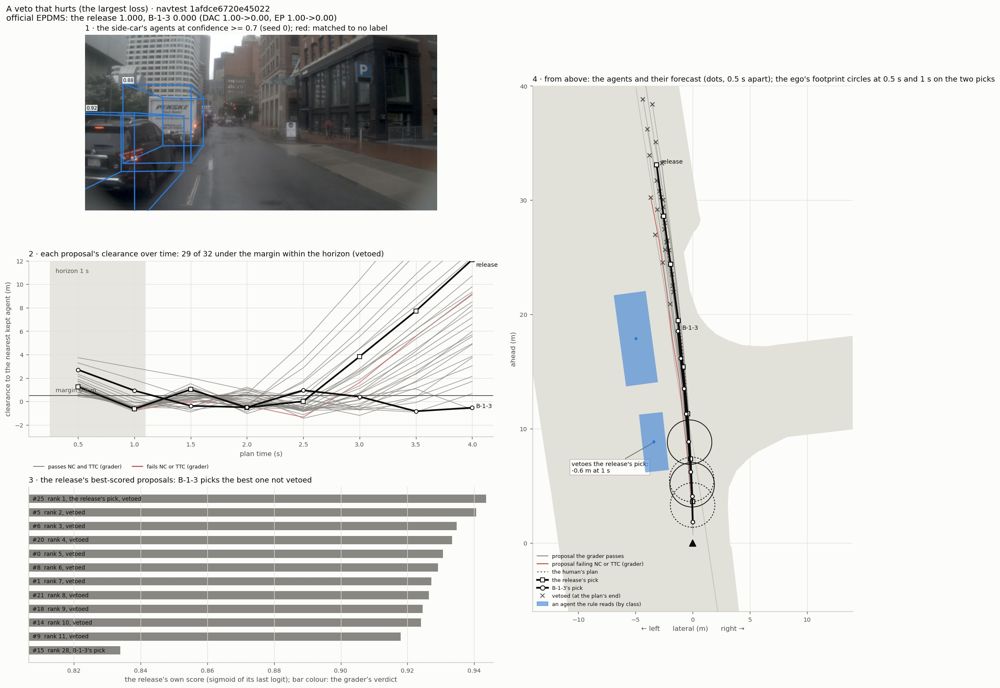
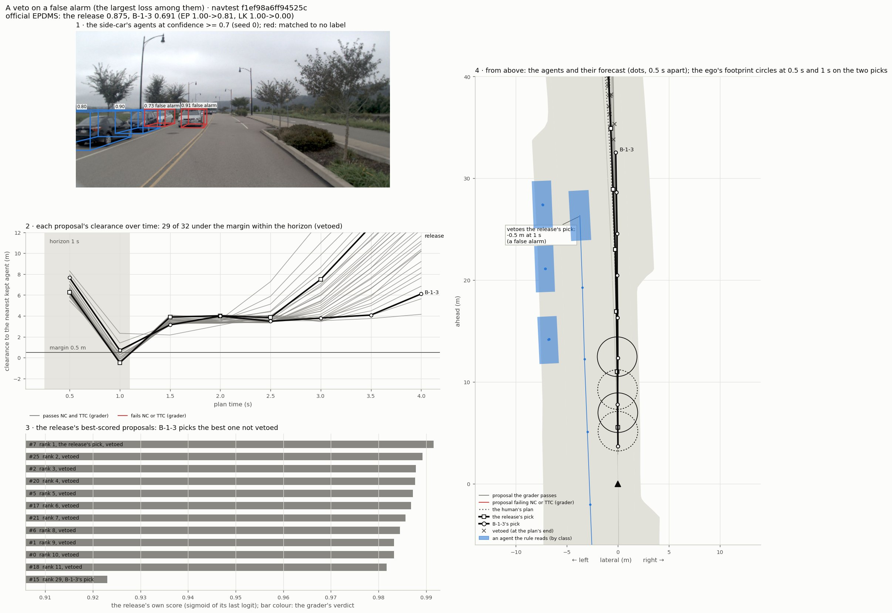
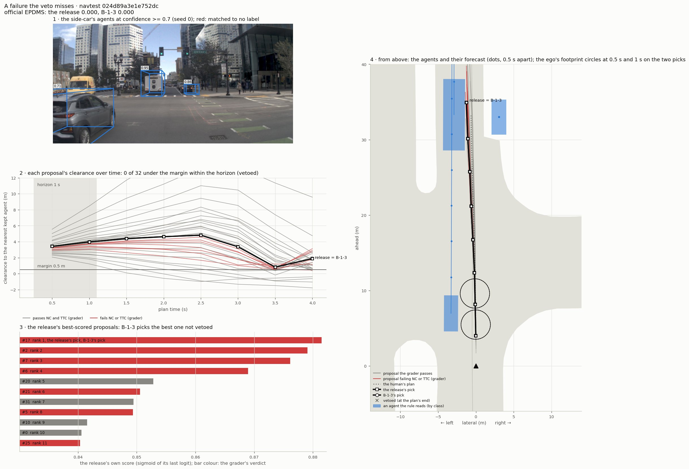
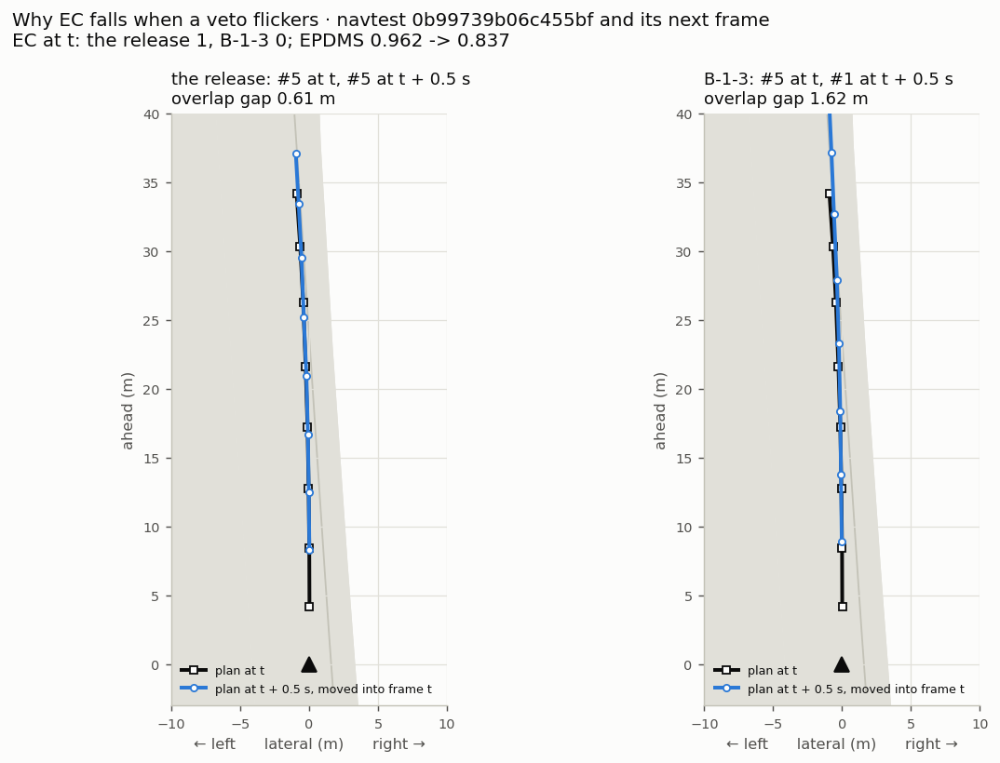
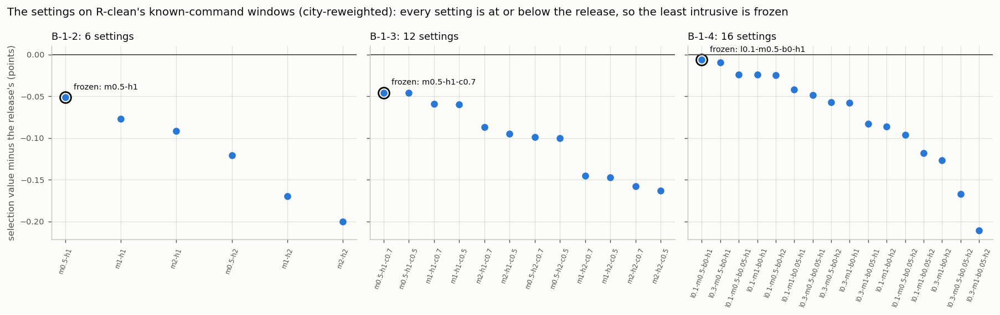
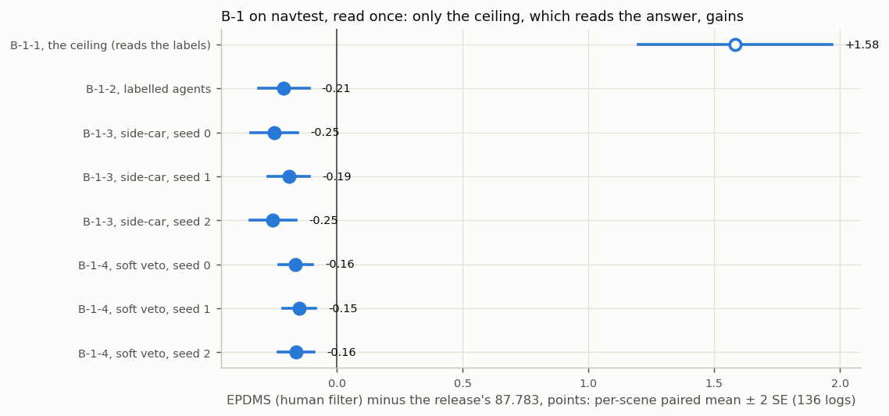

# H15 Part B · B-1, explained: the veto on real scenes, and how its numbers were made

**Status (13 Nov 2026): a companion to [B-1, the analytic veto](B-1-veto.md), whose "What has run" lists the results
(`H15.r9`, `H15.r10`).** This page shows the rule working on real navtest scenes, and traces every number from the
scenes to the verdicts. Nothing here is a new result.
- **The foundations it stands on** (inputs, scorers, the anchor) are explained in [B-0, explained](B-0-explained.md).
- **The pictures** come from `experiments/H15_perception_sidecar/scripts/part_b_explained_figures.py`. It reads what
  B-1's passes wrote and recomputes the clearances with `geometry.clearances` at the frozen settings: the code B-1 ran.
- **Every example is the extreme of a stated rule**, ties to the first token in sorted order. The rules and the
  numbers are in [part-b-explained-examples.json](../../../experiments/H15_perception_sidecar/figures/part-b-explained-examples.json).
- **The examples are B-1-3's on seed 0,** at its frozen setting: 0.5 m within 1 s, side-car agents at confidence 0.7
  or more.

## Contents

1. [The rule, step by step, on a real scene](#1)
2. [Why round footprints veto next to cars](#2)
3. [Good and bad examples](#3)
4. [How the settings were chosen](#4)
5. [How the navtest numbers were computed](#5)
6. [The verdicts, and how the conclusions follow](#6)
7. [Every B-1 number: where it comes from](#7)

## 1. The rule, step by step, on a real scene

*navtest `1947a9758e045ce9`, Boston. The rule: of the scenes where B-1-3 switched the pick, the largest official
EPDMS gain over the release.*

**Panel 1: the agents the rule reads.**
- The side-car's detections at confidence 0.7 or more, drawn on the 512 × 256 image the ViT reads, coloured by class.
- A detection that matches no labelled target of its class within 2 m would be red ("a false alarm"). Here both
  detections are real: a car in the next lane on the left, and the car ahead.
- B-1-2 runs the same rule on the labelled targets instead (B-0, explained, §1). B-1-1 reads no agents.

**Panel 4 (right): the forecast and the footprints** (*read*: `geometry.py`).
- **Each agent's forecast.** At 0.5 s and 1 s the agent is where its predicted path puts it. After 1 s it moves at its
  predicted velocity from its 1 s position, as PDM simulates other agents. The dots are its centre every 0.5 s.
- **Each footprint is a circle with the area of its box.**
  - The ego's: √(5.176 m × 2.297 m / π) = 1.95 m, centred 1.461 m ahead of the rear axle.
  - A typical 4.6 × 1.9 m car's: 1.67 m.
- **The two picks.** The circles drawn are the ego's footprint at 0.5 s and 1 s on the release's pick (solid) and on
  B-1-3's pick (dashed). Vetoed proposals end in ×. Each proposal is coloured by the grader's verdict: grey passes NC
  and TTC, red fails one.

**Panel 2: each proposal's clearance over time.**
- The clearance of proposal k at plan time t is the distance between the ego's footprint centre and the agent's
  centre, minus both radii. Below zero, the circles overlap.
- Each line is one proposal's clearance to the nearest kept agent at t = 0.5, 1.0, …, 4.0 s.
- **The veto:** a proposal is removed if its line is under the margin (0.5 m) anywhere in the shaded horizon (1 s).
  Here **26 of 32** are removed: at 0.5 s every proposal is within 1.6 m of the car in the next lane.

**Panel 3: the pick.**
- The bars are the release's own scores, the sigmoid of its last logit, best first.
- B-1-3 picks the highest-scored proposal that was not vetoed. If every proposal is vetoed, the release's pick
  stands (D24, B-1 (b)).
- Here the release's pick, #25, is its top-scored proposal, and it is vetoed. B-1-3 falls back to **#10, the
  release's 16th**.

**What the official scorer says:** the release 0.000, B-1-3 0.875.
- The release's pick collides with the car ahead (NC 0). The collision also zeroes its progress and its TTC.
- B-1-3's pick is slower, and it does not reach that car: NC, TTC and EP go from 0 to 1.
- But EC, the agreement with the next frame's plan, falls from 1 to 0, so the scene scores 0.875 rather than 1.

**Read it honestly** (*argued* from the picture and the numbers):
- **The veto fired on the car beside the ego,** 3.5 m to the left at 0.37 m clearance (`vetoed_by` in the JSON).
- **It did not fire on the car the release hits ahead.** The gain came from the slower proposal it happened to fall
  back to.
- **It is the best of 283 switches,** and it is right partly by luck.

## 2. Why round footprints veto next to cars

**Two cars side by side in adjacent lanes,** centres 3.5 m apart across the lane line (*argued*, arithmetic):

| Footprint | The gap between them |
|---|---|
| as rectangles (the ego 2.30 m wide, the car 1.90 m) | 3.5 − 1.15 − 0.95 = **+1.40 m**: well clear |
| as circles of equal area (1.95 m and 1.67 m) | 3.5 − 1.95 − 1.67 = **−0.12 m**: "overlapping" |

- **So a typical car in the next lane, level with the ego within the first second, puts every proposal that keeps to
  the ego's lane under the margin.** For a car this size it holds at any margin, even 0.
- **The circles were never meant as a collision check.** `geometry.py` says so: "rough on purpose, because these are
  features for a learned scorer and explanations for a person, not the grader" (*read*). B-1's rule uses them as one.
- It fits where B-1's progress losses sit: on vehicles within 20 m (`veto analyse`, *measured*: 96–98% of the EP
  lost by B-1-3, by seed).
- **Not counted:** what share of wrong vetoes are side-by-side cars. The examples below show the mechanism; a count
  would need a new pass.

## 3. Good and bad examples

### 3.1 The worst loss: a real car, and a fallback that leaves the road

*navtest `1afdce6720e45022`, Boston, wet. The rule: of the scenes where B-1-3 switched the pick, the largest official
EPDMS loss.*
- **The release's pick (#25, its top-scored) passes every term:** EPDMS 1.000.
- **A car parked in the left lane is a real agent** (confidence 0.92, matched to its label), 9.4 m ahead and 3.4 m to
  the left. Its circle comes within **−0.64 m** of the ego's at 1 s. As rectangles they would be over a metre apart.
- **29 of 32 proposals are vetoed.** The fallback is **#15, the release's 28th**: it passes NC and TTC, but the
  official scorer finds it leaves the drivable area. DAC goes from 1 to 0, and the scene scores **0.000** (its
  progress is recorded as 0 too).
- **The lesson.** When nearly everything is vetoed, the pick falls to a proposal the release itself scored poorly,
  and nothing checks that proposal in any other way. Of B-1-3's 283 switches (seed 0), **193 lost** score and 41
  gained.

### 3.2 A false alarm: a parked car placed in the oncoming lane

*navtest `f1ef98a6ff94525c`. The rule: of the switches whose vetoing agent matches no label, the largest loss.*
- The release's pick (#7, its top-scored) scores 0.875.
- **A detection 26.3 m ahead and 3.7 m to the left** (confidence 0.91, red on the image) matches no labelled target.
  - On the image it overlaps the cars parked on the left, which are labelled about 7 m to the left. So it is most
    likely one of them, placed about 3 m too far toward the ego, in the oncoming lane (*argued* from the picture).
  - Its predicted velocity sends it toward the ego, so its circle is within −0.49 m at 1 s.
- **29 of 32 are vetoed;** the fallback, the release's 29th, loses progress (EP 1.00 → 0.81) and lane keeping (LK
  1 → 0). EPDMS 0.875 → 0.691.
- **How common it is:** 11 of B-1-3's 283 switches on seed 0 come from a false alarm (6 on seeds 1 and 2). Part A's
  misplacement in depth and direction is real, but it is a small part of B-1's loss.

### 3.3 A failure the veto misses: a cut-in

*navtest `024d89a3e1e752dc`, the same scene as B-0's in-view headroom example. The rule: the release's pick fails NC
(official), the at-fault agent is a target seed 0 found, and B-1-3 kept the pick; the nearest such agent.*
- **The car ahead on the left is found** (confidence 0.71). Over the next 4 s it cuts in front of the ego, and the
  release's pick hits it at 3.7 s (B-0, explained, §5).
- **Nothing is vetoed:** within 1 s every proposal is more than 0.5 m clear of every agent.
- **The forecast cannot see the cut-in either.** It keeps the car straight at constant velocity after 1 s, in its own
  lane, so even at 3.5 s the release's pick is 0.8 m clear. A longer horizon alone would not have caught it; a
  forecast that turns would (B-6).
- **101 navtest scenes are like this** on seed 0: the release's pick collides with an agent the side-car found, and
  the veto keeps the pick.

### 3.4 EC: a veto that flickers between frames

*navtest `0b99739b06c455bf` and its next frame. The rule: of the scenes where B-1-3 kept the release's pick yet the
official EPDMS fell, the largest fall.*
- **How EC is computed** (*read*: `run_pdm_score.py`). Extended comfort compares the plan at frame t with the plan at
  the next frame, 0.5 s later, over the 3.5 s they share. If the motion they ask for differs beyond navsim's comfort
  thresholds, EC at t is 0. The score is written on frame t.
- **What happens here.**
  - The release picks #5 at t and #5 again at t + 0.5 s; moved into t's frame, the two plans differ by 0.61 m on
    average over their overlap. EC = 1.
  - B-1-3 also picks #5 at t, but its veto switches the next frame to #1, which differs by 1.62 m. EC = 0.
- **The cost:** EPDMS 0.962 → 0.837, a loss of 0.125, which is EC's weight of 2/16.
- **A scene can lose without being switched.** It loses when its next frame is switched. On seed 0, **77** scenes
  changed this way.

### 3.5 The ceiling, for scale

B-1-1 vetoes exactly the proposals the grader's own labels fail on NC (0 or 0.5) or TTC.
- It switches 273 picks, every one away from a failing pick, and gains **+1.58 ± 0.19** points.
- It reads the answer, so it is never a result. It is the size of the room a perfect pick could use.

## 4. How the settings were chosen

**Where the choice was made:** R-clean's 2,624 windows whose driving command navtest also uses (D25; B-0, explained,
§6). Navtest was never used for it.

**The grids** (D24, D27):
- B-1-2: margins 0.5, 1, 2 m × horizons 1, 2 s, which is 6 settings.
- B-1-3: the same × confidence 0.5, 0.7, which is 12.
- B-1-4: λ 0.1, 0.3 × margin 0.5, 1 m × widening 0, 0.05 per metre × horizon 1, 2 s, which is 16.

**The selection value of a pick** (*read*: `veto.filtered_final`, `veto.city_weights`):
1. Take the vendored labels of the picked proposal (B-0, explained, §3).
2. Every term the human's own plan fails is set to 1, as navsim's human filter does.
3. Recombine: NC · DAC · TLC · DDC · (5 EP + 5 TTC + 2 LK + 2 HC) / 14. There is no EC: the vendored scorer has none.
4. Average over the windows, each weighted so that the cities match navtest's mix with Singapore left out: Las Vegas
   40%, Boston 36%, Pittsburgh 24%.
   - Boston's 133 windows and Pittsburgh's 109 carry 60% of the weight.
   - So the effective sample is 630 windows of 2,624 (Kish's n_eff).
5. Subtract the release's own value. The y-axis above is that difference, in points.

**The rule:** the highest value wins; for B-1-3 and B-1-4, the mean over seeds 0–2. A tie goes to the fewer vetoes,
then to the grid's order.

**What happened** (*measured*, selected-on-report):
- **Every setting is at or below the release.** The more a setting vetoes (a larger margin, a longer horizon), the
  more it loses.
- **So the rule froze the least intrusive setting of each sub-version:** B-1-2 at 0.5 m within 1 s; B-1-3 the same at
  confidence 0.7; B-1-4 at λ 0.1, 0.5 m, no widening, 1 s.
- **What this means in plain words:** the choice on R-clean was "veto as little as possible". Navtest then measured
  how much even that costs.

## 5. How the navtest numbers were computed

**For each arm** (*read*: `veto.read_navtest`, `navtest.paired`):
1. **Pick** on every one of the 12,146 navtest scenes, at the frozen setting.
2. **Store** the picked proposal for every token.
3. **Score** the store with navsim's official scorer through the replay agent (B-0, explained, §4). Every replayed
   plan is checked to equal the store.
4. **Take each scene's difference** from the release: dᵢ = EPDMSᵢ(arm) − EPDMSᵢ(R).
5. **Report the mean of dᵢ × 100, ± its SE clustered over the 136 logs** (B-0, explained, §7). The chart shows
   ± 2 SE.

**Where B-1-3's −0.250 (seed 0) comes from** (*measured*, from the per-scene differences):

| Scenes | Count | Sum of dᵢ | Points |
|---|---|---|---|
| the pick switched | 283 (2.3%): 41 gained, 193 lost, 49 unchanged | −23.76 | −0.196 |
| not switched, yet changed: the next frame switched (EC) | 77 | −6.63 | −0.055 |
| all the others | 11,786 | 0 | 0 |
| **all 12,146** | | **−30.38** | **−0.250** |

B-1-2's −0.212 splits the same way:
- 305 switches (49 gained, 203 lost, 53 unchanged), −0.151;
- 85 changed through EC, −0.061.

**The same loss, by term** (*argued*: a first-order split from the measured mean sub-score changes):

| Term | Mean change (B-1-3, seed 0) | Its weight in a scene's EPDMS | Contribution |
|---|---|---|---|
| EC | −0.0120, on the 10,040 scenes with a next frame | 2/16 | about −0.12 |
| EP | −0.0025 | 5/16 | about −0.08 |
| NC | −0.0004 | a gate: a failing scene loses about 0.9 | about −0.04 |
| TTC | −0.0004 | 5/16 | about −0.01 |
| | | **sum** | **about −0.25** |

**How often the veto was right** (*measured*: `veto analyse`, against the vendored labels):

| | B-1-2 | B-1-3, seeds 0 / 1 / 2 |
|---|---|---|
| failing proposals (NC or TTC) the veto removed | 1,949 of 40,595 (5%) | 1,800 / 1,574 / 1,872 |
| passing proposals it removed | 9,164 | 8,528 / 7,503 / 8,727 |
| pick switches away from a failing pick | 10 of 305 | 8 / 6 / 9 |
| switches whose vetoing agent is a real agent / a false alarm | — | 272 / 11, 244 / 6, 286 / 6 |

**B-1-4, the soft veto,** lowers each score by λ × its worst confidence-weighted shortfall under a range-widened
margin, and removes nothing.
- It switches as many picks as B-1-3 (2.1–2.4%).
- It loses less: −0.15 to −0.16 points, with EC −0.009 to −0.011 and half B-1-3's progress loss.

## 6. The verdicts, and how the conclusions follow

**The verdicts are mechanical:** each comes from PREDICTIONS.md's rule, written before the read.

| # | What | Predicted | Measured | The rule | Verdict |
|---|---|---|---|---|---|
| V1 | B-1-1 − R, the ceiling | +0.5 to +1.5 | +1.58 ± 0.19 | supports if beyond 2 SE | supported |
| V2 | B-1-2 − R | +0.2 to +0.8 | −0.21 ± 0.05 | refutes if under 0 beyond 2 SE | **refuted** |
| V3 | B-1-3 − R, each seed | −0.3 to +0.4 | −0.25 ± 0.05, −0.19 ± 0.04, −0.25 ± 0.05 | refutes if under 0 beyond 2 SE on any seed | **refuted** |
| V4 | B-1-3's share of B-1-2's gain | 0.2 to 0.6 | 1.10, a ratio of two losses | reported | — |
| V5 | EP lost by B-1-3 | under 0.3 | 0.22 | refutes if over 0.6 | not refuted |
| B-1-4's trigger | B-1-3 loses progress | — | EP below R's beyond 2 SE, every seed | runs B-1-4 | fired (D27) |
| V6 | B-1-4 − R, each seed | −0.25 to +0.05 | −0.16, −0.15, −0.16 (each about 5 SE) | refutes if under 0 beyond 2 SE on any seed | **refuted** |
| V7 | B-1-4's EC loss against B-1-3's | smaller | −0.009 to −0.011 against −0.011 to −0.014 | reported | smaller |

**The conclusions, each with its evidence and its strength:**

| Conclusion | Evidence | Strength |
|---|---|---|
| A clearance veto at the pick does not beat the release on navtest, with perfect front-camera agents or the side-car's, removing or penalising | V2, V3, V6, each refuted at 4 to 5.5 SE, read once | **measured**, strong |
| Perception is not what limits this rule | B-1-3 loses about as much as B-1-2; false alarms cause 6–11 of about 270 switches per seed | measured |
| The rule looks in the wrong place and time | it removes about 5% of failing proposals; failures come later than 1 s (the cut-in, §3.3) or from agents out of view (35% of failures, B-0) | counts measured; the mechanism argued from examples |
| Round footprints make it veto beside cars | the arithmetic in §2; the worst example; the losses sit on vehicles within 20 m | argued; not counted |
| Switching picks costs comfort | EC is half the loss; the EC example | measured; the mechanism read from navsim's EC |
| The room is real | the ceiling: +1.58 when the rule knows which proposals fail | measured, but it reads the answer |
| A learned use of the agents (then B-2 to B-4; now B-2 and B-3) is unlikely to show a NAVSIM gain, and the closed-loop gate (then B-14; now B-12) becomes the place | PREDICTIONS.md's decision rule for V2 not supported | **argued**, by a rule set in advance |

**What would have to change for a rule to help** (*argued*; each is a new idea, not B-1):
- footprints as rectangles;
- a horizon and a forecast that reach the failures, which happen at 2–4 s and include cut-ins (B-6, longer
  forecasts);
- a pick that stays steady from frame to frame;
- or a learned scorer that weighs all of this against progress (B-3; and B-2's refit scorer).

## 7. Every B-1 number: where it comes from

| Number | Computed by | Read from |
|---|---|---|
| clearances, vetoes, picks | `geometry.clearances`, `veto.vetoed`, `veto.pick_with_veto` | `{runs}/drivejepa_perception/part-b/b1/clearance-*` |
| the selection value and its weights | `veto.filtered_final`, `veto.city_weights` | `part-b/b1/grid-fresh/grid.json`, `grid-b14-fresh/grid.json` |
| the frozen settings | `veto.freeze`, `veto.soft_freeze` | `recipes/drivejepa_perception/part_b1_frozen.json`, `part_b14_frozen.json` |
| per-scene official EPDMS | navsim's `run_pdm_score.py` via the replay agent; `navtest.per_token` | `part-b/b1/navtest/score-*`, `navtest-b14/score-*` |
| EPDMS − R and its SE | `navtest.paired` (`b_report.clustered_se`) | `part-b/b1/navtest/navtest.json`, `navtest-b14/navtest.json` |
| V1–V7 | `veto.verdicts`, `veto.read_navtest_soft` | the same files |
| rates, confusion, real vs false alarm, EP by agent | `veto.analyse` | `part-b/b1/analysis-{fresh,navtest}.json` |
| the per-scene breakdown in §5 | per-scene differences of the official runs | recomputed from the same CSVs for this page |
| the examples | `part_b_explained_figures.pick_examples` | `figures/part-b-explained-examples.json` |
