# H15 Part B · B-2: the side-car's hidden layer into the refiner, with the planner fine-tuned downstream

**Status (14 Nov 2026): run in full.**
- B-2 was re-planned on 13 Nov (D28) and approved with every recommendation (D29).
- Phase 1's gate stopped it (K0, `H15.r12`). The owner then had phase 2 run all the same (D30): `H15.r13` and `r14`.
- **The primary contrast is refuted.** The side-car's hidden layer adds nothing to its decoded list (HD − D below 0 on
  all five seeds). No agent input beats the same fine-tune without one.
- [What has run](#results) has the verdicts, the [deep analysis](#deep) and 14 figures.
- [The overview](../README.md) holds the tracker, the naming and the log.
- This plan stands on two documents:
  - [B-0, the foundations](B-0-foundations.md);
  - B-1's result, in [B-1, the veto](B-1-veto.md) and [B-1, explained](B-1-explained.md).
- It replaces three of the 11 Nov plans and one idea:
  - B-2, the agents into the scorer alone, which becomes [B-3](B-3-scorer.md), not scheduled;
  - B-3, the agents into the refiner;
  - B-4, both with LoRA;
  - B-5, agent-aware initial proposals.

  What still held in them is here; the rest is in git history. See [What changed on 13 Nov](#changed).
- How LoRA adapts the refiner and the scorer: [the LoRA primer](lora-primer.md).
- **Numbers follow the 13 Nov renumbering (D28).** B-3 is the scorer alone, and B-4 to B-14 are the other ideas.
  The overview's [naming table](../README.md#naming) translates records written before it.
- **The figures:**
  - Every number in a chart is drawn by `experiments/H15_perception_sidecar/scripts/part_b2_plan_figures.py` from
    the passes' own outputs, and written to
    [part-b2-plan-numbers.json](../../../experiments/H15_perception_sidecar/figures/part-b2-plan-numbers.json).
  - The diagrams are Graphviz sources beside their pictures.
- **Labels on numbers:** *counted* on disk · *measured* by a run · *read* in code or a record · *argued*. The
  counts marked "13 Nov" are new, made for this plan; every other number is copied from a record.

## The crux

**B-1 gave the planner the side-car's agents as a decoded list, through a rule, and lost.**
- On navtest it lost 0.21 points with labelled agents, and 0.15 to 0.25 with the side-car's.
- The ceiling, which reads the grader's labels, gained +1.58.

**The owner's question for B-2:** is the decoded list the bottleneck? That list is class, confidence, box,
velocity and 1 s path, cut at confidence 0.5.
- The module that makes the proposals, the refiner, is given the side-car's **last hidden layer** instead.
- The planner downstream is **fine-tuned**.
- Does it then plan better on navtest:
  - than the same fine-tune without the side-car (C);
  - than the same fine-tune with the decoded list (D);
  - than the release (R)?
- And how do the proposals and the pick change?

## What to expect

- **Small, if anything** (*argued*). The draft predictions:
  - HD − D, the primary contrast: −0.1 to +0.2 points;
  - HD − C: −0.1 to +0.3;
  - HD against R: −0.4 to +0.3, so "meets" is more likely than "beats".

  Here HD is the decoded list with each agent's hidden slot appended.
- **The strongest reasons against are measured or read, not argued:**
  - B-1's pre-registered rule fired. Explicit agents near the ego added nothing, even perfect ones.
  - The release already learned what NC and TTC need, more directly than the side-car did. Each proposal's feature
    was trained to predict that proposal's collision and TTC agents, every 0.1 s over 4 s, from all logged agents.
  - The room is in the pick, not in the proposals: 271 of 275 failing navtest scenes already have a safe proposal.
- **The strongest reasons for are counted:**
  - Decoding keeps 4.75 of the side-car's 128 slots a row. Another 31.6 hold evidence at confidence 0.1 to 0.5,
    which a learned reader could weigh and a list cannot.
  - The side-car reads the ViT's 1024-d tokens, before the planner's 256-d projector.
- **What it is worth either way:**
  - If HD − D holds, the decoded list was a bottleneck. The scorer alone (B-3) and the closed-loop gate (B-12) then
    follow with slots.
  - If it does not, explicit agents add little on NAVSIM, decoded or hidden, to a planner already supervised on
    per-proposal collision agents. The remaining room (the ceiling's +1.58) belongs to the pick's horizon: B-6
    (4 s forecasts) or closed loop (B-12).

## B-2 in pictures

**How to read it.**
- **Down the left is Drive-JEPA as it runs.**
  - Grey is frozen.
  - The refiner and the scorer are green: B-2 adapts them by LoRA or trains their weights, by recipe.
- **Down the right is the side-car**, frozen.
  - Its hidden layer: 128 slots of 384 numbers, each with a centre and a confidence.
  - Its decoded list, which the heads make from those slots.
- **Between them sit the arms**, each handing the adapter different tokens, and the adapter itself.
  - The adapter adds δ to the refiner's queries before every BEVFormer layer, on all four passes.
  - Its output layer starts at zero, so at step 0 every arm is the release's cached path, R̃, exactly.

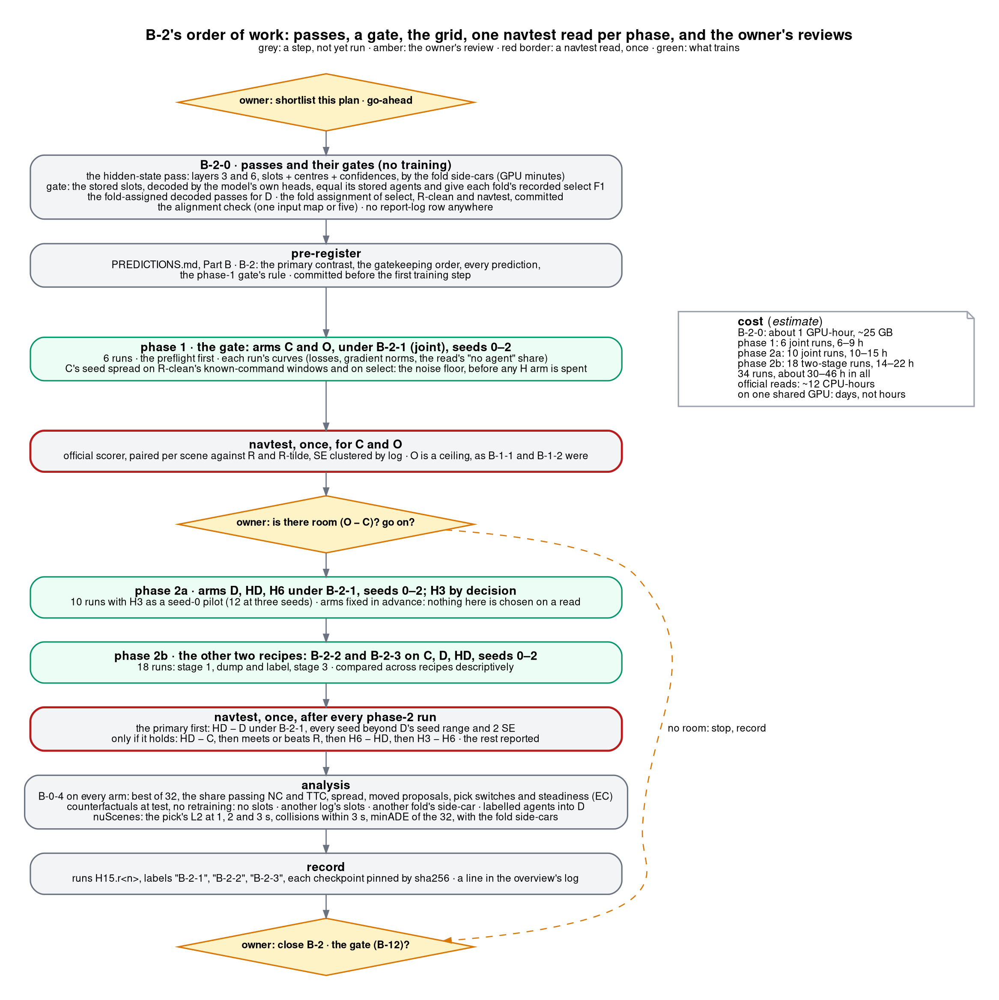

**How to read it.**
- **B-2-0** builds and checks the inputs. Nothing trains there.
- **Phase 1** trains only C and O.
  - Their seed spread gives the noise floor.
  - Their navtest read says whether perfect agents leave any room for a learned planner.
- **The owner decides whether to go on.**
- **Phase 2** trains the other arms and recipes, fixed in advance, and reads navtest once.

## The concepts, question by question

**Q1. What did B-1 leave, and why change the input rather than stop?**
- **What B-1 showed** (*measured*, `H15.r9`, `H15.r10`):
  - A rule on explicit agents at the pick lost on navtest:
    - labelled agents, −0.21 ± 0.05;
    - the side-car's agents, −0.25, −0.19 and −0.25 by seed;
    - softened into a penalty, −0.16, −0.15 and −0.16.
  - The ceiling gained +1.58 ± 0.19.
  - B-1-2's 1 s clearance caught 1,949 of 40,595 failing proposals. The failures come later than 1 s, or from
    agents out of view: 94 of the 271 scenes with room (35%; B-0-3).
- **The pre-registered rule** (PREDICTIONS.md, Part B · B-1) says that with V2 not supported, a learned use of the
  agents is unlikely to show a NAVSIM gain, and the closed-loop gate becomes the place.
  - Going on is the owner's decision (D28), made knowing that rule.
  - What B-1 did not test is a *learned* use of a *richer* input. B-2 tests exactly that, and nothing else.
- **The room on navtest is real, and mostly in the pick** (*counted*, 13 Nov, and B-0-3's record):

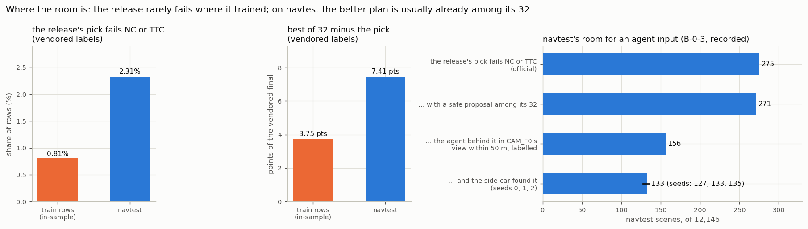

- **How to read it:**
  - On navtrain's train rows the release's pick fails NC or TTC 0.81% of the time; on navtest, 2.31% (vendored
    labels, the same scorer for both).
  - Best of 32 beats the pick by 3.75 points in-sample and 7.41 on navtest.
  - On the right is B-0-3's navtest funnel:
    - 275 failing scenes;
    - 271 of them with a safe proposal among the 32;
    - 156 with the agent behind the failure in CAM_F0's view within 50 m;
    - 127, 133 and 135 of those found by the side-car's seeds.

**Q2. What exactly is the side-car's last hidden layer?**
- **The model.** The side-car is v3 (*read*, `train_sidecar.VARIANTS` and its runs' `run.json`):
  - six decoder layers, width 384, 12 heads, 128 slots, 18.44 M parameters;
  - it reads the ViT's output, 512 tokens of 1024, before the projector the planner uses.
- **The hidden layer.** After each layer ℓ every slot holds a vector aℓ of 384 numbers. The class, box, velocity
  and path heads read it. B-2's "last hidden layer" is a₆: 128 × 384 per frame.
- **A slot's centre is not in aℓ** (*read*, `sidecar.py` 136–158; the picture below):
  - The centre is a reference point carried beside aℓ: refℓ = refℓ₋₁ + ref_mlp(aℓ), detached before the next layer.
  - The position code reaches only the attention's queries and keys. The values are aℓ itself and the image tokens.
  - The ViT's own position code is RoPE (*read*, `vjepa2/configs/eval/vitl/in1k.yaml:161`), applied inside
    attention, so the tokens carry none added.
- **So aℓ holds what an agent is, and how to move its reference point, but not where it is:**
  - its class, size, heading and motion, and its 1 s path;
  - its slot's identity.
- **Every hidden arm therefore carries the slot's centre**, refℓ, beside aℓ. Without it the refiner could not place
  an agent at all.
- **Why layer 3 too:**
  - Part A found refinement done by layer 3: v3 at 12 epochs reads the same F1 at layer 3 as at layer 6
    (*measured*, notebook 06).
  - But every layer has its own heads and the same loss (*read*, `SideCarLoss`), so layer 3 is no less specialised
    to detection. H3 ≈ H6 is the likely result (*argued*).

**Q3. What does decoding throw away?**
- **The cut.** The decoded list keeps a slot only at confidence ≥ 0.5, and then only its argmax class, a point box,
  a velocity and a 1 s path. No uncertainty is kept.
- **How much it drops** (*counted*, 13 Nov):
  - On the train rows (the cross-fit side-cars) the list keeps 4.75 slots a row.
  - 12.7 slots clear 0.3, and 36.4 clear 0.1.
  - On navtest (seed 0) the same counts are 3.33, 9.70 and 33.4.
- **How good that evidence is:**
  - Part A measured the side-car over-confident below 0.7: a slot at 0.55 is right about 40% of the time.
  - So most of what the list drops is noise, and some of it is the agent that mattered.

- **Two navtest scenes, each the extreme of a rule** (the rules and their numbers are in the JSON; side-car seed 0,
  as B-1 read it). The rules are written in the script and printed with their numbers.
  - **What decoding drops, where it mattered** (navtest `baf0c6e99bec57db`):
    - The release's pick fails on a parked car in view, which seed 0 has no slot on at 0.5. Arm D cannot see it.
    - A vehicle slot at 0.18 lies 0.26 m from its centre. Only the hidden arms receive it.
  - **What a hidden arm must learn to discount** (`abe4fa26de85552d`):
    - The pick is safe.
    - Ten slots at 0.11–0.25 lie on its plan with no labelled centre within 2 m. Most sit around the car ahead at
      other depths: Part A's commonest false alarm.

**Q4. Why might it work, and why might it not?**

**For:**
1. **Decoding discards evidence** (Q3). A learned reader can weigh 36 slots a row; a list holds under five.
2. **The side-car reads what the projector may drop.** It reads 1024-d tokens, the planner a 256-d projection of
   them (*read*).
3. **A learned reader is not bound to a 1 s clearance.** B-1's caught 1,949 of 40,595 failing proposals
   (*measured*).
4. **Planners elsewhere read agent queries, not boxes:** UniAD, VAD and SparseDrive take content plus position
   (*argued*). They train perception and planning together, on far more data.
5. **Retraining the refiner helped out of domain.** In the first pass every retrained refiner brought the release's
   pick on nuScenes 0.28–0.36 m closer to the human at 3 s, with or without agents (*measured*, in-sample; now
   B-14). Arm C re-measures it.

**Against:**
1. **B-1's pre-registered rule already fired** (Q1). Going on is D28.
2. **The release already learned this, more directly** (*read*, `drive_jepa_config.py`, `compute_navsim_score.py`
   95–124).
   - It trained with `agent_pred`: weight 1 on the presence and 0.1 on the corners.
   - Each proposal's pooled feature predicts that proposal's at-fault collision agent and its TTC agent, every
     0.1 s over 4 s, from PDM's simulation of all logged agents, out of view included.
   - The side-car's supervision is per agent, 1 s, front camera. The H15 documents had mentioned these heads only in
     passing.
3. **The room is in the pick, not the proposals.**
   - 271 of 275 failing scenes have a safe proposal (*measured*).
   - The refiner's own loss has no NC or TTC term (Q6).
   - The first pass's agent-fed refiner moved best of 32 by +0.004, −0.013 and +0.001 points, even with labelled
     agents (*measured*, in-sample).
4. **The planner is in-sample on navtrain.** Its pick fails NC or TTC on 0.81% of train rows. The adapter is taught
   where the release needs no help, and may learn to ignore its input. Cross-fitting cures the side-car's optimism,
   not the planner's (*argued*).
5. **Slots hold corrections, not positions** (Q2). The forecast that arm D gets analytically, H6 must learn.
6. **B-1's failures are about horizon and view** (*measured*): after 1 s, and 35% out of view. The slots see the
   same camera and were trained to 1 s.
7. **Seed noise.** The first pass's F − C ran from −0.21 to +0.24 across seeds (*measured*), so three seeds
   against three resolve about 0.3–0.4 points (*argued*), above the plausible effect.
   - There is also more to overfit: a row's hidden layer is 49,152 numbers, against about 2,300 in D's list.
   - And EC: B-1 lost half its points to picks that flicker between frames.

**Q5. Where does the hidden layer enter the planner, and what flows where?**
- **Through the 11 Nov B-3-1 adapter** (*read*, `train_refiner.RefinerAdapter`). It is a pre-hook on the shared
  `Bev_refiner` that adds δ to the 256 queries before each pass's BEVFormer layer.
- **Its own half** reads each query with its pose. It runs in every arm, C included.
- **Its side-car half** gives each query attention over the arm's tokens, with a learned "no agent" slot to attend
  to.
- **Its output layer starts at zero**, so the untrained model is R̃ bit for bit. The preflight checks it.
- **What each arm hands the adapter:**

| Arm | Tokens | Attention bias | Slots |
|---|---|---|---|
| C | none: the own half only | — | — |
| O | labelled agents in CAM_F0's view within 50 m, in D's format (confidence 1) | clearance, as D | the labelled ones |
| D | the decoded list: 18 numbers each (class, confidence, centre, size, yaw, velocity, path) → MLP | −clearance / 5 from each pose to each agent at its time, + 13 clearance features per proposal (`geometry.terms`) | confidence ≥ 0.5 (4.75 a row) |
| HD | D's tokens + LayerNorm(a₆) → 128, per kept agent | D's | D's |
| H6 | LayerNorm(a₆) → 128, + a code of ref₆ | log(confidence); no clearance | all 128 |
| H3 | as H6, from a₃ and ref₃ | as H6 | all 128 |

- **How to read it.** It traces one sample from CAM_F0 to the plan.
  - Left, the planner: ViT-out 512 × 1024 → map 16 × 32 × 256 → queries 256 × 256 → per pass, proposals
    32 × 8 × 3 and δ 256 × 256 → pooled 32 × 256 → logits 32 × 6 → the plan, 8 × 3.
  - Right, the side-car: 128 slots × 384 per layer, its heads, its decoded list.
  - The table between them is what each arm hands over.

**Q6. Which loss trains which route? This is why the recipes differ.**
- **The order inside a pass** (*read*, `traj_refiner.py`): each pass first decodes its proposals from the incoming
  queries, then runs its BEVFormer layer on the queries plus δ. So:
  - p₁ is decoded before any δ, so pass 1 is agent-blind;
  - δ₁, δ₂ and δ₃ shape p₂, p₃ and p₄;
  - δ₄ changes only q₄, which only the scorer reads.
- **The planning loss** (*read*, `drivejepa_b2d.train_generator.mtd_loss`):
  - winner-takes-all L1 over x, y and heading: only the proposal nearest the human is pulled to it;
  - plus 0.5 × the same toward up to 4 good anchors: proposals from the release's vocabulary of 8,192 that NAVSIM
    scored ≥ 0.95 on that scene;
  - each earlier pass is discounted × 0.1 per pass (p₃ 0.1, p₂ 0.01, p₁ 0.001). The 11 Nov plans said "each
    earlier pass at 0.1"; the code discounts geometrically.
  - It has no NC or TTC term, and it never reaches δ₄.
- **The score loss** is BCE of each proposal's final score against its PDM label.
  - The release trained it jointly, with its refiner.
  - It reaches q₄, and so δ₄. Through the shared weights it reaches every pass.
- **So, by recipe** (Q9): in B-2-1 the score loss trains the read's route into the pick. In the two-stage recipes,
  stage 3 must train a pass-4 copy of the read. Otherwise a two-stage recipe tests imitation, not choosing.

**Q7. What does each arm isolate?**

| Contrast | It isolates | Kind |
|---|---|---|
| **O − C** | room for any agent input to a learned planner: perfect agents, in D's form | the gate (phase 1) |
| **HD − D** | the hidden content alone: everything else is D's | **the primary** |
| HD − C | the side-car, as HD hands it over | claim, if the primary holds |
| HD against R | meets or beats the release | claim, if the primary holds |
| H6 − HD | a learned geometry in place of the analytic one, and all 128 slots in place of the list | claim, if the above hold |
| H3 − H6 | an earlier layer | claim only at three seeds |
| D − C | the decoded list, learned rather than ruled | reported |
| C − R | the fine-tune itself, out of sample | reported |

- **No trained S arm** (another log's slots).
  - A trained S mostly re-measures C. Swapping the input at test costs nothing and says more.
  - **At test, without retraining, HD and H6 are also read with:**
    - no slots;
    - another log's slots;
    - another fold's side-car;
    - labelled agents in place of D's list.
- **There is no hidden-layer O.** Labelled agents have no slots, so perception's ceiling exists only for the
  decoded form.

**Q8. Why must the side-cars be fold-matched, at test too?**
- **Decoded agents are side-car-agnostic; hidden states are not.**
  - Decoded agents are in metres and classes, the same whichever side-car made them. The 11 Nov plans trained on the
    cross-fit side-cars' agents and read the full seed-k side-cars at test.
  - Hidden states are each model's own coordinates. A reader trained on the cross-fit side-cars' slots cannot read
    another model's.
- **The rule:**
  - Each train row reads the cross-fit side-car that never saw its log, as `agents-train-crossfit-v3` does
    (94,195 rows, five folds of the 1,071 train logs; *counted*, `H15.r8`).
  - Select, R-clean and navtest logs are each assigned to one fold's side-car by a fixed seeded rule, written once.
  - Every arm, D included, reads that assignment.
- **B-2-0 checks alignment first.** On select rows, every side-car's slots are fitted to side-car 0's:
  - matched by centre (Hungarian), and by slot index, since all five started from the same seed-0 slots;
  - with a ridge or orthogonal Procrustes map, its R² read on R-clean.
  - If the five align, one shared input map is learned on all rows. If not, one per fold.
- **Departures from B-0's Q8, recorded in D28:**
  - The side-car's seed is no longer sampled. All five folds are seed 0, select F1 0.7005–0.7077, against the full
    seeds' 0.7132–0.7195.
  - Arm D is therefore not B-1-3's input.

**Q9. Which fine-tuning recipes, and why compare all three?** The owner asked for three. They differ in how the
score loss reaches the read, and in how much of the planner moves.

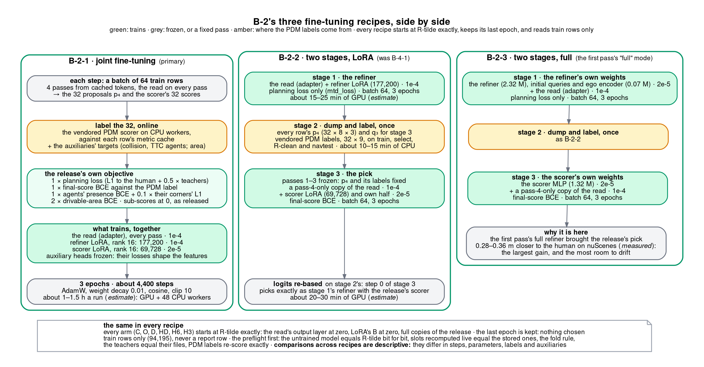

- **B-2-1 · joint fine-tuning (primary).** The release's own objective, resumed (*read*, `drive_jepa_config.py`):
  - **Losses and weights:**
    - planning loss × 1;
    - final-score BCE × 1, against PDM labels scored online by the vendored scorer on CPU workers;
    - the collision- and TTC-agent heads × 1 (presence) and × 0.1 (corners);
    - drivable area × 2;
    - sub-scores at 0, as released.
  - **What trains:**
    - the adapter;
    - rank-16 LoRA on the refiner (177,200) and on the scorer (69,728; *counted*, the LoRA primer).
  - The auxiliary heads stay frozen; their losses only shape the features (decision (f)).
  - 3 epochs, about 4,400 steps of 64.
  - About 1–1.5 h a run (*estimate*). The vendored labels took 596 s for 103,288 rows (*measured*).
- **B-2-2 · two stages with LoRA** (was B-4-1):
  1. The refiner: the adapter + refiner LoRA, the planning loss only.
  2. Dump every row's new proposals and label them once with the vendored scorer: train, select, R-clean, navtest.
  3. The pick: a pass-4-only copy of the read, with the scorer's LoRA and own half, on BCE.
     - Passes 1–3 are frozen, so p₄ and its labels stay as dumped.
     - The logits are re-based on stage 2's, so stage 3 starts as "the release's scorer on these proposals", exactly.
- **B-2-3 · two stages, full.**
  - As B-2-2, but the refiner (2.32 M, with the initial queries and ego encoder) and the scorer MLP (1.32 M) train
    their weights at 2e-5.
  - It is the first pass's "full" mode, which brought the largest nuScenes gain and has the most room to drift.
- **Comparisons across recipes are descriptive.** The recipes differ in steps, parameters, label source and
  auxiliaries, so a difference between them has many causes. The claims are made within a recipe.

**Q10. How is it read?**

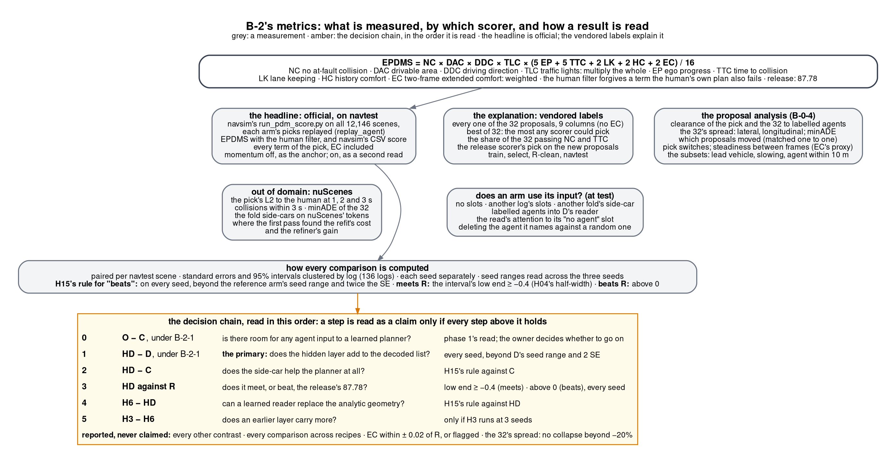

- **The headline** is navtest's EPDMS with the human filter, by NAVSIM's official scorer, through the replay agent.
  - It is B-0-2's pipeline, which reproduces the release's 87.783.
  - Paired per scene, with SE clustered over 136 logs, per seed.
  - Momentum off, as the anchor; on, as a second read.
- **The explanation** comes from the vendored labels of every proposal: best of 32, the share passing NC and TTC,
  and the release scorer's pick on the new proposals.
- **The proposal analysis (B-0-4)** reads clearance, spread, moved proposals, pick switches and steadiness, and the
  subsets.
- **nuScenes** reads the pick's L2 at 1, 2 and 3 s, collisions within 3 s and minADE, with the fold side-cars run
  on nuScenes' tokens.
- **The decision chain is read in order.** A step is a claim only if every step above it holds:
  1. the gate;
  2. the primary;
  3. HD − C;
  4. HD against R;
  5. H6 − HD;
  6. H3 − H6.

  Everything else is reported, never claimed.

**Q11. What can go wrong?**
- **The release needs no help where it trains** (Q4, against 4). The adapter may learn to ignore its input. The
  test-time swaps (Q7) show whether it uses it.
- **Seed noise hides a real effect** (Q4, against 7). Phase 1 measures C's spread before any H arm trains, and
  decision (e) adds seeds if it is too wide.
- **The fine-tune costs out of sample.**
  - H07's exp3 fine-tuned a generator and scorer and fell at the gate from 0.857 to 0.753 (D18).
  - The first pass's refitted scorer cost 0.23–0.44 m on nuScenes.
  - C − R, nuScenes and R̃ make it visible.
- **The 32 lose their spread** (11 Nov B-3's R5). This is measured.
- **EC.** New proposals and a refit scorer change picks between frames. It is measured, and flagged if it falls.
- **The cross-fit ties the planner to five side-cars.** Shipping it means shipping those, or one fold's.
- **Out of domain the slots shift more than boxes.** On nuScenes the side-car's F1 is 0.50 (`H15.r5`).
- **The shared GPU.** The grid is days of wall time, not hours (the cost, below).

## The plan

### Sub-versions: the recipes

| ID | Recipe | Arms × seeds | Recommended |
|---|---|---|---|
| **B-2-1** | joint fine-tuning, the release's own objective, online PDM labels | C, O (phase 1); D, HD, H6, H3 (phase 2a) × 0–2 | yes: primary |
| **B-2-2** | two stages, LoRA; stage 3 trains a pass-4 copy of the read with the scorer | C, D, HD × 0–2 (phase 2b) | yes |
| **B-2-3** | two stages, full fine-tune | C, D, HD × 0–2 (phase 2b) | yes |

The staged grid is 34 runs, against 54 for the full factorial (decision (g)):

| Phase | Runs | Estimated hours |
|---|---|---|
| 1 | 6 | 6–9 |
| 2a | 10, with H3 as a seed-0 pilot | 10–15 |
| 2b | 18 | 14–22 |

All estimates are wall time on one shared GPU (*estimate*).

### Steps

1. **After the owner's shortlist and go-ahead, B-2-0, no training:**
   - The hidden-state pass. Each fold's side-car on its own fold's train rows and on its assigned select, R-clean and
     navtest logs. It writes layers 3 and 6, the slots' centres and confidences, in fp16: about 98 KB a row a layer,
     ~25 GB in all (*estimate*).
     - **Its gate:** the stored slots, decoded by the same model's heads, equal its stored agents, and give each
       fold's recorded select F1 (B0-G7, B0-G11).
   - The fold-assigned decoded passes, for D on select, R-clean and navtest.
   - The fold assignment, committed: `recipes/drivejepa_perception/`, re-derived and refused if edited.
   - The alignment check (Q8).
   - No report-log row anywhere.
2. **Pre-register** in PREDICTIONS.md (Part B · B-2), as approved, before the first training step:
   - the chain;
   - every prediction;
   - the gate's rule.
3. **Preflight** (extended):
   - the untrained composed model equals R̃ bit for bit on 64 rows;
   - the slots recomputed live equal the stored ones;
   - the fold rule;
   - the teachers equal their files;
   - the PDM labels and the auxiliaries' targets re-score exactly;
   - no report-log row.
4. **Phase 1:** C and O under B-2-1, seeds 0–2.
   - C's seed spread on R-clean's known-command windows (D25) and on select.
   - Navtest once, for C and O. Then the owner's review.
5. **Phase 2:**
   - D, HD and H6 under B-2-1 (H3 per decision (c));
   - then B-2-2 and B-2-3 on C, D and HD;
   - the last epoch kept: nothing chosen.
6. **Dump and label** every run's proposals (vendored): train, select, R-clean, navtest.
7. **Health read on select**, which chooses nothing. The owner sees the curves: losses, gradient norms, the read's
   attention to its "no agent" slot.
8. **Navtest, once,** after every phase-2 run: R̃, C, D, HD, H6 (H3), every seed and recipe.
9. **Analysis:** B-0-4 on every arm; the test-time swaps (Q7); BEV drawings of the scenes whose pick changed.
10. **nuScenes** with the fold side-cars.
11. **Record** `H15.r<n>`:
    - labels "B-2-1", "B-2-2", "B-2-3";
    - every checkpoint pinned by its weights' sha256;
    - a line in the overview's log.

### Success criteria (a draft, for PREDICTIONS.md once approved)

On navtest, by the official scorer, paired per scene, SE clustered by log, every seed. Under B-2-1 unless named. The
chain is read in order (Q10).

| # | What | Predicted (*argued*) | Supports if | Refutes if |
|---|---|---|---|---|
| K0 | O − C, the gate | 0.0 to +0.4 points | above 0 beyond 2 SE, every seed | at or below 0, every seed: no room (decision (b)) |
| **K1** | **HD − D, the primary** | −0.1 to +0.2 | beyond D's seed range and 2 SE, every seed | below 0 beyond 2 SE, any seed |
| K2 | HD − C | −0.1 to +0.3 | beyond C's seed range and 2 SE, every seed | below 0 beyond 2 SE, any seed |
| K3 | HD against R | −0.4 to +0.3 | meets: the interval's low end ≥ −0.4, every seed; beats: above 0, every seed | high end below 0, any seed |
| K4 | H6 − HD | −0.3 to +0.1 | beyond HD's seed range and 2 SE, every seed | — |
| K5 | H3 − H6 | −0.1 to +0.1 | as K4, only at three seeds | — |

Reported, never claimed:

| What | Predicted (*argued*) | Flag if |
|---|---|---|
| D − C | −0.1 to +0.3 | — |
| C − R, the fine-tune alone | −0.5 to +0.3 | — |
| best of 32 (vendored), HD − C | 0 to +0.3 points | — |
| the share of the 32 passing NC and TTC, HD − C | 0 to +1.5 percentage points | — |
| EC, HD − R | within ± 0.02 | lower by more than 0.02 |
| the 32's lateral spread at 4 s, HD against R̃ | within ± 10% | below by more than 20%: collapse |
| HD under B-2-2 and B-2-3, against B-2-1 | −0.3 to +0.2 and −0.4 to +0.2 | — |
| nuScenes L2 at 3 s, HD − R | −0.3 to +0.3 m | — |
| another log's slots change HD's pick | on ≥ 5% of navtest scenes | under 1%: the input is not used |

### Later variants, each by a stated trigger

| Variant | Was | Trigger |
|---|---|---|
| the scorer reads the slots directly (the cheap route into the pick) | B-4's "both" | best of 32 rises but the pick does not |
| pass 1 sees the slots: the read on the initial queries too | B-3-3 and B-5 | HD's proposals move little in pass 2 |
| LoRA kept off the deformable sampling offsets and attention weights | B-3-4 | where the refiner looks drifts |
| adapter only, no LoRA | B-3's `frozen` mode | if HD wins: how little suffices |
| sub-score heads trained beside the final score | B-2's decision (b) | if HD wins: the reasons made explicit |
| a KL anchor to the release's scores | new | EC falls by more than 0.02 |
| a planner-side slot layer (self-attention among the 128, ego-conditioned) | new | H6 trails HD: learned geometry needs more room |
| a training-only clearance term on the 32 (labelled futures; never an input) | new | the refiner ignores its input (the swaps) |
| D over all 128 decoded slots (the threshold factor alone) | new | H6 differs from HD |
| LoRA into the side-car's last layer, its detection loss kept | new | delicate under cross-fit: a fold trained on its held-out rows' planning labels becomes in-sample there |

### Decisions for the owner

| | Decision | Recommended |
|---|---|---|
| (a) | the primary contrast | HD − D: it changes one factor, the owner's question |
| (b) | the phase-1 gate | the owner decides after the read; stop if O − C is at or below 0 on every seed |
| (c) | H3 | a seed-0 pilot: likely ≈ H6 (Q2) |
| (d) | navtest's side-car | one fold per log, as trained; or each scene's metrics averaged over five readings, at 5× the scoring CPU |
| (e) | more seeds | five for C, D and HD under B-2-1 if C's seed range on R-clean exceeds 0.3 points |
| (f) | B-2-1's auxiliary heads | frozen, their losses kept: the release's way of making its features collision-aware |
| (g) | the grid | staged (34 runs) over the full factorial (54) |
| (h) | the later variants | none in the first grid; each by its trigger |
| (i) | nuScenes | yes: where the first pass found both a cost and a gain |
| (j) | momentum | off, as the anchor; on, as a second read (B-0's (d)) |

### Risks

1. **No room for a learned planner** (K0). The gate says so before the H arms are spent.
2. **Power.** A real +0.2 may stay unresolved at three seeds. Phase 1 measures the floor, and decision (e) answers it.
3. **The cost of adapting**, out of sample (C − R, nuScenes). It is reported beside every gain. Nothing ships that
   loses to R.
4. **The report logs.** They are never read: the preflight's guard. The existing `train_refiner` and `train_scorer`
   read them and keep a chosen epoch, so they are not reused as they are.

### Cost (*estimate*)

- **B-2-0:** about one GPU-hour and ~25 GB.
- **The grid:** 34 runs, about 30–46 h of wall time on the shared GPU.
- **Official reads:** ~12 CPU-hours.
- Days, not hours. The figures are per run, from the first pass's 0.20 s a batch (*measured*) and the vendored
  labels' 596 s per pass (*measured*).

### Code, when approved

None of this exists yet. Written only after the go-ahead, each piece with its check:

| Piece | What it does | Its check |
|---|---|---|
| `sidecar.SideCar.forward` | returns each layer's aℓ beside its outputs | outputs unchanged, tested |
| `train_sidecar hidden` | the hidden-state pass, by fold, on any source | its gate (step 1); report rows refused |
| the fold assignment | B-2's rule, written once | re-derived and refused if edited |
| the alignment check | the five folds against fold 0, R² on R-clean | — |
| a slot reader beside `scorers.AgentRead` | for HD, H6 and H3: LayerNorm + projection, a centre code, a log-confidence bias, the null slot | its zero-init identity |
| B-2's trainer, on Part B's splits only | joint (online vendored labels and the auxiliaries' targets, on CPU workers) and two stages (the pass-4 copy) | p₄ unchanged by stage 3; the last epoch kept |
| the preflight | step 3 | — |

Recipe stages are `part-b-2-*`.

## What has run (13–14 Nov)

Records:
- `H15.r11`: B-2-0, the inputs;
- `H15.r12`: phase 1, C and O;
- `H15.r13`: phase 2 under B-2-1;
- `H15.r14`: the two-stage recipes.

Phase 2 ran at the owner's instruction after phase 1's gate had said stop (D30). The gates, predictions and rules are
PREDICTIONS.md's (Part B · B-2), committed before any run (032d0c0) and unchanged since.

The charts are drawn by `experiments/H15_perception_sidecar/scripts/part_b2_results_figures.py` from the runs' records,
and the attention by `scripts/b2_attention.py`. Every number in them is in
[part-b2-results-numbers.json](../../../experiments/H15_perception_sidecar/figures/part-b2-results-numbers.json), with
every run's weights by sha256.

**In one line.** The side-car's hidden layer adds nothing to its decoded list (K1 refuted: HD − D is below 0 on all
five seeds, mean −0.09). Neither the list, nor the hidden slots, nor even labelled agents beat the same fine-tune
without them (C). The fine-tune itself gains about 0.4 points on navtest, but it loses on R-clean for three seeds
in five, and picks farther from the human on nuScenes.

### The verdicts (*measured*; navtest, the official scorer, paired per scene, SE clustered over 136 logs)

| # | What | Predicted | Measured, per seed | Verdict |
|---|---|---|---|---|
| K0 | O − C, the gate | 0.0 to +0.4 | −0.08, −0.06, −0.07 | **refuted** by its own rule (at or below 0, every seed). B-2 stopped; phase 2 ran by D30 |
| K1 | HD − D, the primary | −0.1 to +0.2 | −0.11, −0.07, −0.06, −0.18, −0.04 | **refuted**: below 0 on every seed, beyond 2 SE on seed 3 |
| K2 | HD − C | −0.1 to +0.3 | −0.15, −0.17, −0.03, −0.07, −0.12 | reported only (K1 failed); refuted on its own (seed 1) |
| K3 | HD against R | meets: low end ≥ −0.4 | +0.24, +0.34, +0.33, +0.19, +0.49 | reported only: meets on every seed, beats on one |
| K4 | H6 − HD | −0.3 to +0.1 | −0.03, +0.15, +0.17 | reported only: not supported (HD's seed range 0.30) |
| K5 | H3 − H6 | −0.1 to +0.1 | +0.06 (a pilot) | reported |
| — | D − C | −0.1 to +0.3 | −0.03, −0.10, +0.03, +0.11, −0.08 | reported: zero on average |
| — | C − R | −0.5 to +0.3 | +0.38, +0.51, +0.36, +0.26, +0.61 | reported: above the range on four seeds |
| — | HD, B-2-2 − B-2-1 | −0.3 to +0.2 | +0.04, +0.06, −0.06 | descriptive: within |
| — | HD, B-2-3 − B-2-1 | −0.4 to +0.2 | +0.04, −0.19, −0.20 | descriptive: within |

- Averaged over seeds (descriptive, beside H15's per-seed rule), ± 2 SE over seeds:
  - HD − D −0.093 ± 0.048;
  - HD − C −0.107 ± 0.051;
  - D − C −0.014 ± 0.075;
  - O − C −0.069 ± 0.008.
- The pre-registered reported measures:

  | Measure | Predicted | Measured |
  |---|---|---|
  | HD − C, best of 32 (vendored) | 0 to +0.3 | 0.00 |
  | HD − C, the share of the 32 passing NC and TTC | 0 to +1.5 pp | +0.02 pp |
  | HD − R, EC | within ± 0.02 | +0.002 to +0.028, never lower |
  | HD's lateral spread at 4 s, against R̃ | within ± 10% | +6.8%, no collapse |
  | nuScenes L2 at 3 s, HD − R | −0.3 to +0.3 m | +0.13 to +0.34 m |
  | another log's slots change HD's pick | on 5% or more | on 10.4–12.3% |

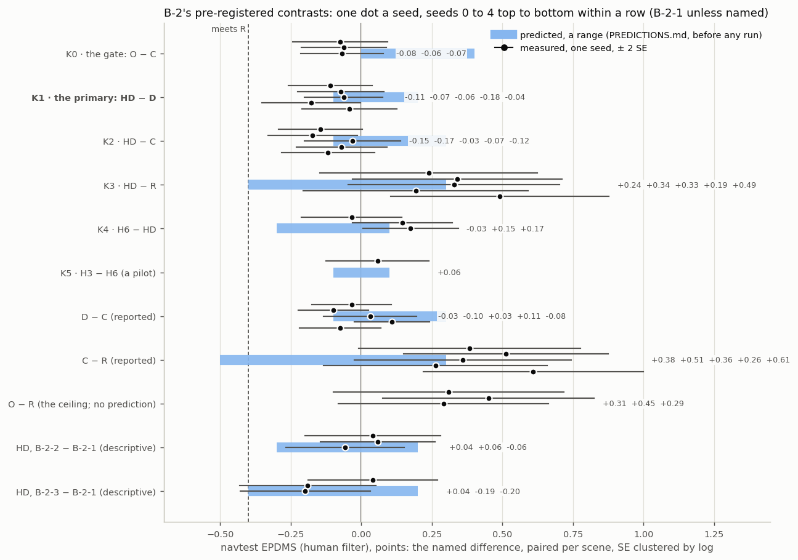

**How to read it.** Each row is a contrast. The blue bar is its predicted range, and the dots are the seeds, each ± 2
SE. Every input contrast (K0, K1, K2, D − C) sits at or left of zero. Every arm against R sits right of zero: that
gain is the fine-tune's.

### B-2-0, the inputs (`H15.r11`; *measured*)

- **B2-G1 holds.**
  - Each of the five fold side-cars, decoded by the pass's own code, gives exactly the select F1 it recorded.
  - On all 94,195 train rows the decoded list equals B-0's cross-fit agents in every value.
- **B2-G4: the five side-cars' hidden spaces do not align.**
  - Matched slot for slot, R² is −0.09 to −0.19.
  - A fitted linear map reaches only 0.47 to 0.55.
  - By the rule, each fold gets its own input map.
- **Added on 14 Nov:**
  - the nuScenes keyframes, decoded by the fold side-cars (each scene dealt a fold by the same rule; the gate holds);
  - a navtest pass read by the "wrong" fold, for the test-time swaps.

### The code, and what its checks caught (*measured*)

- **The trainer:** `train_b2.py`, the joint and the two-stage recipes, every arm. The preflight (B2-G3) runs before
  each run's first step. It held on all 58 trainings (40 runs, 18 of them with a stage 1):
  - every untrained model equals its base path bit for bit;
  - the online labeller equals `pdm-v1`;
  - every stage 3's targets equal the vendored scorer run live;
  - the stored slots equal the side-cars run live, within fp16.
- **Three bugs were caught before they cost a run:**
  - **Stage 3's targets.** Stage 3 would have read each train row's targets by row id, from a dump stored by
    position, so every target would have been another row's. The preflight now checks the targets on 16 spread rows
    against the vendored scorer run live.
  - **Restoring a stage-3 run.** It saves only what it trains, so restoring it would have rebuilt B-2-3's refiner from
    the release. Restoring now loads its stage 1 first. Every stage-3 dump refuses unless its proposals equal its
    stage 1's, and stage 3 now backpropagates only through pass 4's read and the scorer.
  - **The extra seeds.** The read would have left C's extra seeds out once the noise floor fired. Every seed range now
    spans every seed read.
- **Disclosed:** to test the scoring path, the 60-step joint HD smoke run was scored on navtest on 13 Nov (+0.39 ±
  0.14 against R). It chose nothing, and every rule had been committed before it.

### Phase 1: C and O, the gate (`H15.r12`)

- **What ran:** the release's own objective, resumed:
  - `mtd_loss`;
  - the final-score BCE against labels its own scorer computes online;
  - its collision-agent and area auxiliaries.

  Three epochs, 4,413 steps on the 94,195 train rows, the last epoch kept. The six runs trained together on one GPU,
  1.9 h each.
- **K0:** O − C is −0.075 ± 0.084, −0.062 ± 0.075 and −0.069 ± 0.073: at or below 0 on every seed. By its rule B-2
  stopped (D29 (b)).
- **The noise floor fired.** C's seed range on R-clean is 2.48 points against the limit of 0.3, so phase 2 added seeds
  3 and 4 for C, D and HD.

### Phase 2: the hidden layer, and every recipe (`H15.r13`, `H15.r14`; D30)

- **Sixteen runs under B-2-1:**
  - D and HD at seeds 0–4;
  - H6 at seeds 0–2;
  - H3 at seed 0, a pilot;
  - C at seeds 3 and 4.

  They trained twelve at a time on one GPU, 2.8–3.7 h each.
- **Eighteen two-stage runs:** C, D and HD under B-2-2 and B-2-3, seeds 0–2. Stage 1 took 1.5–2.2 h and stage 3
  0.5–1.8 h.
- **Each was dumped on navtest, R-clean, select and nuScenes,** and navtest was read once for all of phase 2.

| Arm · recipe | seeds | EPDMS − R, per seed | mean | NC | TTC | EP | EC | picks switched |
|---|---|---|---|---|---|---|---|---|
| C · B-2-1 | 5 | +0.38, +0.51, +0.36, +0.26, +0.61 | **+0.43** | −0.0025 | −0.0014 | +0.0090 | +0.0187 | 58% |
| O · B-2-1 | 3 | +0.31, +0.45, +0.29 | **+0.35** | −0.0025 | −0.0015 | +0.0093 | +0.0116 | 58% |
| D · B-2-1 | 5 | +0.35, +0.41, +0.39, +0.37, +0.53 | **+0.41** | −0.0025 | −0.0014 | +0.0091 | +0.0170 | 58% |
| HD · B-2-1 | 5 | +0.24, +0.34, +0.33, +0.19, +0.49 | **+0.32** | −0.0026 | −0.0015 | +0.0086 | +0.0126 | 58% |
| H6 · B-2-1 | 3 | +0.20, +0.49, +0.50 | **+0.40** | −0.0027 | −0.0019 | +0.0086 | +0.0197 | 59% |
| H3 · B-2-1 | 1 | +0.26 | **+0.26** | −0.0033 | −0.0031 | +0.0088 | +0.0068 | 60% |
| C · B-2-2 | 3 | +0.39, +0.56, +0.42 | **+0.46** | −0.0029 | −0.0018 | +0.0093 | +0.0203 | 60% |
| D · B-2-2 | 3 | +0.37, +0.49, +0.33 | **+0.40** | −0.0031 | −0.0025 | +0.0097 | +0.0167 | 59% |
| HD · B-2-2 | 3 | +0.28, +0.40, +0.27 | **+0.32** | −0.0037 | −0.0027 | +0.0085 | +0.0187 | 60% |
| C · B-2-3 | 3 | +0.23, +0.13, +0.11 | **+0.16** | −0.0041 | −0.0037 | +0.0103 | −0.0003 | 61% |
| D · B-2-3 | 3 | +0.23, +0.19, +0.30 | **+0.24** | −0.0041 | −0.0037 | +0.0106 | +0.0059 | 62% |
| HD · B-2-3 | 3 | +0.28, +0.15, +0.13 | **+0.19** | −0.0042 | −0.0039 | +0.0107 | +0.0014 | 62% |

Paired with R's 87.783 (each seed ± about 0.18–0.20). The sub-scores and the share of picks switched are means over
seeds.

### Deep analysis

**1. Where the fine-tune's gain comes from (*measured*).**
- **Every arm and recipe moves the same terms:** EP (+0.0085 to +0.0107) and EC (up to +0.020) gain, while NC
  (−0.0025 to −0.0042) and TTC (−0.0014 to −0.0039) lose.
- **The inputs change none of this.** Within a recipe, the arms' bars overlap.
- **B-2-3** gains the most EP and the least EC, and loses the most collisions.

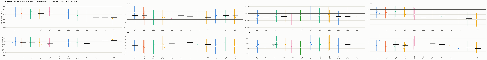

**2. Scene by scene: where gains and losses fall (*measured*; seeds averaged per scene, SE clustered by log).**
- **The fine-tune (C − R) helps where things move fast or are empty:**
  - above 10 m/s, +3.7 ± 1.0;
  - in scenes with no decoded agent, +1.7 ± 0.9.
- **It hurts in slow traffic and among many agents:**
  - at 0.5–5 m/s, −1.1 ± 0.5;
  - with 6 or more agents, −0.6 ± 0.5.

  Those are the scenes agent inputs were meant for.
- **There, no input recovers the loss:**
  - D − C with 6 or more agents is +0.11 ± 0.13;
  - HD − D there is −0.17 ± 0.15;
  - O − C is +0.05 ± 0.14.
- **On R's 275 failing scenes** the fine-tune gains +13.9 ± 4.0. No input adds to that (each SE about ±1.0–1.3).

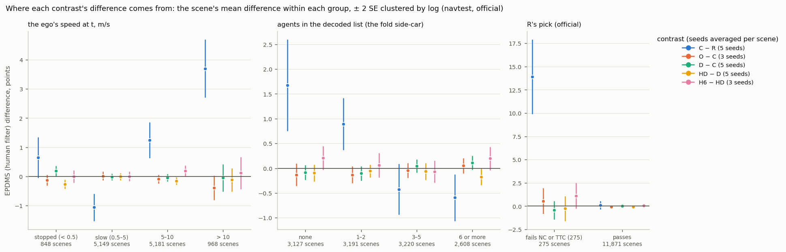

**3. Collisions: what is fixed, what is broken (*measured*; official NC and TTC, scene by scene).**
- **R's pick fails NC or TTC on 275 scenes.** B-0-3's rule finds the agent behind each:
  - 156 in view within 50 m;
  - 94 out of view or range;
  - 14 not in the labels;
  - 7 static;
  - 4 with no safe proposal.
- **Every run fixes 61–77 of them and breaks 83–124 others,** so every run fails more scenes than R (282–328).
- **No agent input fixes more of the 156 in-view failures than C does.**
  - C fixes 31–36 of them.
  - The input arms fix 25–34: O 31–34, D 28–32, HD 27–33, H6 27–32.

  Labelled agents in view, handed over by a learned reader, do not turn into avoided collisions.
- **B-2-3 breaks the most:** 108–124 scenes.

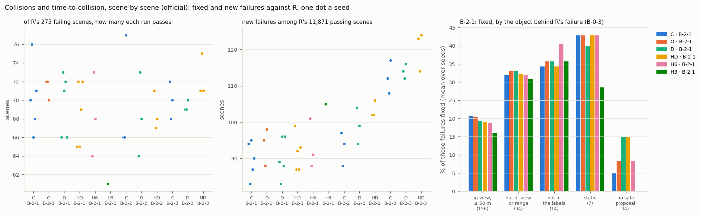

**4. Does the planner use its input? (*measured*; the test-time swaps, vendored).**
- **The agent arms lean on their input, without gaining from it.**
  - Without their agents, D loses 0.05–0.21 points and O 0.13–0.32.
  - Labelled agents swapped in at test move D's pick on only 1.5–2% of scenes, and change its final by −0.04 to +0.04.

  Perfect agents at test give D nothing either.
- **The hidden arms react more and gain nothing.**
  - Another log's slots move HD's pick on 10–12% of scenes and H6's on 14–15%, and change their final by −0.17 to
    +0.03 points.
  - Removing H6's slots entirely costs it nothing (−0.06 to +0.08).
- **Another fold's side-car is where the hidden layer shows its nature.**
  - It moves D's pick on 1% of scenes: decoded agents are side-car-agnostic.
  - It moves HD's on 6% and H6's on 14%: the hidden layer is each side-car's own coordinates, as B2-G4 found.

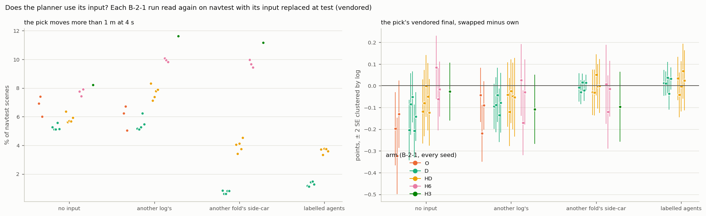

**5. What the reads attend to (*measured*; 2,048 navtest scenes, `b2_attention.py`).**
- **HD's read is the least engaged** (by the "no agent" token's share):

  | Arm | On the null token | Near its plan's poses (÷ uniform) |
  |---|---|---|
  | O | 63% | 1.3× |
  | D | 68% | 1.0× |
  | HD | 80% (pass 4), 88% on pass 1 | 0.73× |

  - Within 10 m HD gives each agent about its uniform share, where O gives 2.1× and D 1.6×.
  - Adding each agent's slot to its token seems to have made the reader trust the clearance geometry less, and the
    agents less (*argued*).
- **H6 and H3 read their slots heavily, and more with every pass.**
  - H6's null share falls from 57% on pass 1 to 29% on pass 4; H3's from 28% to 15%.
  - They attend 4–6× uniform within 10 m, and 1.6× near their plan's poses.
  - Attention per slot rises with confidence, from 0.3× below 0.1 to 8.5× above 0.7.
- **H6 uses the evidence decoding drops, and it does not help.**
  - Slots at 0.1–0.5, which no list keeps, take 34% of H6's attention per scene and 42% of H3's. That is twice what
    the slots the list keeps take (17% and 15%).
  - So the evidence the plan hoped for is read. It just does not plan better.

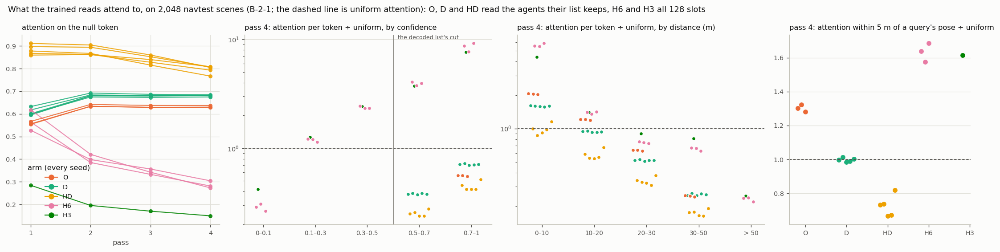

**6. No scene repeats (*measured*).**
- Per seed, HD's and D's scores differ on 49% of navtest scenes.
- On all five seeds by 0.05 or more, one scene favours HD and none favours D. C against D is the same: one scene.
- So the arms' scene-level differences are seed noise. They are carried by the release scorer's near-ties (its top
  two scores are within 0.01 on 88.5% of navtest), not by the input.

The figure shows the two scenes the rule picks. Its margins are small on most seeds, which is the finding: they
illustrate, they do not explain.

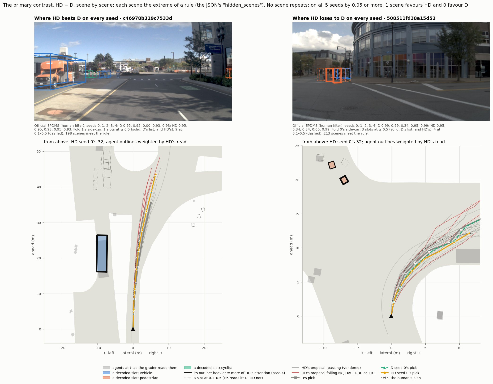

**7. The 32 proposals (B-0-4; vendored; *measured*).**

| | R | B-2-1, every arm | B-2-2 | B-2-3 |
|---|---|---|---|---|
| minADE to the human (3 s) | 0.163 m | 0.130 m | 0.130 m | 0.128 m |
| share of the 32 passing NC and TTC | 89.6% | 92.1–92.3% | 92.1% | 92.2% |
| best of 32 (vendored final) | 0.9590 | 0.9600–0.9601 | 0.9598–0.9602 | 0.9601 |
| lateral spread at 4 s (std) | 1.09 m | 1.17 m | 1.17 m | 1.18 m |
| the pick's move between frames | 1.22 m | 1.28–1.29 m | 1.30 m | 1.34–1.36 m |
| the 32's matched move from R | — | 0.54–0.55 m | 0.53–0.55 m | 0.57 m |

- **Within B-2-1 the arms are the same to the third decimal.** The inputs do not change what the refiner proposes.
- **The fine-tune makes the 32 closer to the human and safer.** Its scorer then picks differently on 58–62% of
  scenes.
- **B-2-3 moves the proposals most,** and its picks are the least steady between frames, which fits its low EC.

**8. Off navtest: R-clean and nuScenes (*measured*; health and reported).**
- **On R-clean, B-1's value, the loss follows the seed, not the arm.**
  - Under B-2-1, seeds 0, 1 and 3 lose 3.2–4.7 points in every arm, while seeds 2 and 4 lose under 1 (H6's seed 2
    gains 0.2).
  - The same seed means the same batches and the same initial LoRA and adapter weights. So whether the fine-tune
    learns R-clean's direction failures is set by the draw, not by the input.
  - B-2-2 loses 1.0–3.3 points. **B-2-3 loses nothing:** −0.3 to +0.3, the only recipe without a loss.
- **On nuScenes every run picks farther from the human,** while its best of 32 improves by 0.014–0.019 m. The pick's
  L2 at 3 s rises:
  - B-2-1, every arm alike: +0.12 to +0.34 m;
  - B-2-2: +0.25 to +0.37 m;
  - B-2-3: +0.38 to +0.51 m.

  Collisions within 3 s stay within 2 SE.

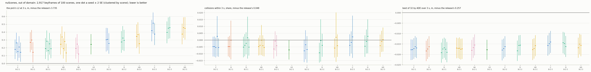

**9. The three recipes side by side (descriptive; *measured*).**

| Recipe | navtest | R-clean | nuScenes |
|---|---|---|---|
| B-2-1, joint | the largest gains (C +0.43) | the seed decides | +0.12 to +0.34 m |
| B-2-2, two stages with LoRA | about the same (C +0.46) | loses less (−1.0 to −3.3) | +0.25 to +0.37 m |
| B-2-3, two stages with the refiner's and scorer's own weights | about a third of the gain (C +0.16) | loses nothing | the farthest, +0.38 to +0.51 m |

- No recipe makes the side-car pay: HD − D is −0.06 to −0.09 under B-2-2, and −0.17 to +0.05 under B-2-3.

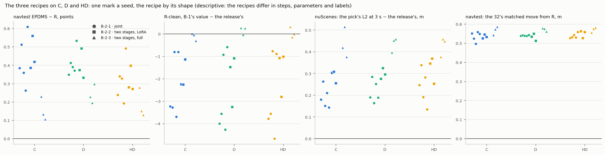

**10. Training (*measured*).**
- The planning loss falls from 0.65 to about 0.59–0.61 in every run, and the final-score BCE from 0.31 to 0.29–0.31.
- Seed for seed the arms' curves sit on top of each other.
- B-2-3's stage 1, the refiner's own weights, fits the planning loss best (0.585–0.592).
- How the reads' null shares move:
  - **HD's read turns away from its agents as it trains:** from 68% at the start to about 90% by step 1,500,
    ending at 77–81%.
  - **H6's** rises from 15% to about 33% and ends at 25–30%; H3's stays near 14%.
  - **D's and O's** stay flat, at 67–69% and 63%.

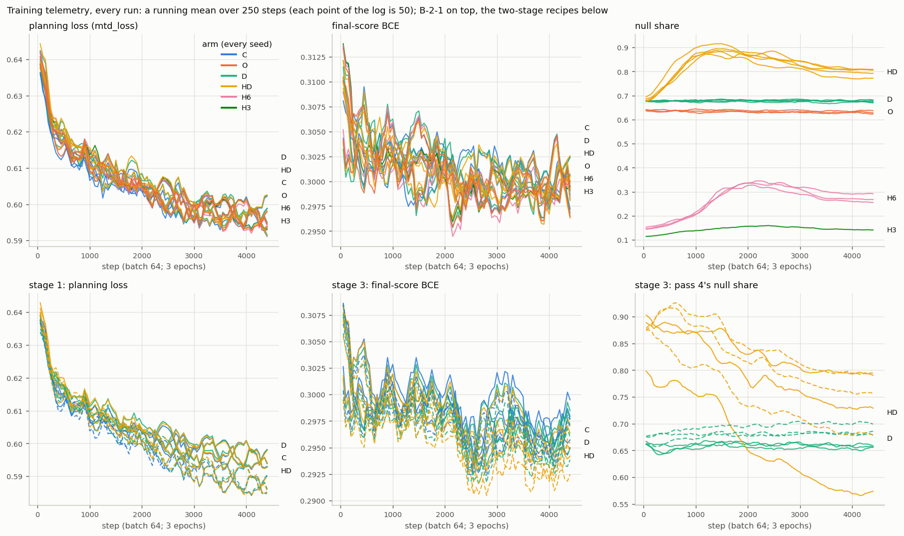

**11. What the fine-tune changes, scene by scene (phase 1; *measured*).** Three rule-chosen scenes, all low-speed
decisions:
- **Where it gains:** R creeps 3.5 m into the intersection on a red light (TLC 0). Every C seed holds at 0.3 m.
- **Where it loses:** R goes 9.4 m at an even pace. C starts slowly, then accelerates into the car merging from the
  left (NC 0, every seed).
- **On R-clean:** at a crosswalk where the human and R stay put, C creeps 2.7 m and fails DDC.

### What it says (PREDICTIONS.md's decision rules; *argued*)

- **K1 is refuted: the hidden layer adds nothing measurable to the decoded list.**
  - It costs about 0.09 points on average.
  - By the rule, its scorer alone (B-3) is not run with slots.
- **K0 was right to stop B-2.** Phase 2 measured what the gate predicted. No agent input beats the same fine-tune
  without one, through this reader and these recipes:
  - not labelled agents (O);
  - not the decoded list (D);
  - not the hidden slots (HD, H6, H3).

  Several things say the planner does not lack the input; it has no use for it here:
  - the reads attend to their inputs (H6 even reads the sub-threshold evidence);
  - the planner reacts when the inputs are swapped;
  - it fixes no more in-view collisions with them.

  This agrees with B-1, and with the release's own `agent_pred` heads. They were already trained on every logged
  agent's collisions, per proposal, over 4 s.
- **The pre-registered reading** is that the room on NAVSIM belongs to the pick's horizon, not to agent inputs. That
  points to B-6 (4 s forecasts) or B-12 (closed loop).
- **The fine-tune is the only thing that moved navtest, and it is not robust.**
  - Resuming the release's objective gains 0.4 points there, through progress and comfort, at a small cost in
    collisions.
  - On R-clean three seeds in five lose 3–5 points, and on nuScenes every run picks farther from the human.
  - B-2-3 trades most of the navtest gain for no R-clean loss.
  - None of it is a claim (C − R was "reported, never claimed"). It would need the closed-loop gate, and a seed and
    recipe chosen on R-clean, never on navtest.

### What it does not settle

- **Another reader:** pass 1 sees the slots, or the scorer reads them, or a training-only clearance term. These are the
  later variants, none triggered.
- **Agents beyond 1 s, or out of view:** B-6. No camera here sees behind, and 94 of R's failures are out of view.
- **Closed loop, where agents react:** B-12, the gate.
- **The fine-tune's R-clean failures:** why seeds 0, 1 and 3 learn to drive against the traffic direction there, and
  B-2-3 does not.

## Questions B-2 can answer

| Question | Read from | Answer (14 Nov) |
|---|---|---|
| Is there room for any agent input to a learned planner on NAVSIM? | K0 | **no, through this reader:** O − C −0.06 to −0.08 on every seed; D − C zero on average |
| Does the side-car's hidden layer add to its decoded list? | K1 | **no:** HD − D below 0 on all five seeds (mean −0.09), refuted |
| Does the side-car help the planner at all, in that form? | K2 | no: HD − C below 0 on every seed (reported) |
| Does it meet or beat the release? | K3 | meets on every seed, beats on one; the fine-tune, not the side-car, carries it (C − R +0.43) |
| Can a learned reader replace the analytic clearance? | K4 | H6 − HD −0.03, +0.15, +0.17: not supported |
| Does an earlier layer carry more? | K5 | H3 − H6 +0.06 (a pilot) |
| Does the planner use its input, or ignore it? | the test-time swaps, the attention | it uses it: swaps move 6–15% of picks, H6 reads the sub-threshold slots; it gains nothing from it |
| How do the proposals and the pick change? | B-0-4, every arm | the 32 move about 0.5 m, closer to the human and safer, the same for every arm; 58–62% of picks change |
| Which recipe moves the planner, and at what cost out of domain? | the recipes, descriptively; nuScenes, R-clean | B-2-1 and B-2-2 gain most on navtest and lose on R-clean; B-2-3 gains a third, loses nothing on R-clean, picks farthest on nuScenes |

## What B-2 does not answer

- **The scorer alone, with the proposals fixed:** B-3.
- **Agents beyond 1 s, or out of view:** B-6 (4 s forecasts); no camera here sees behind.
- **Closed loop, where agents react:** B-12, the gate.

## What changed on 13 Nov (D28)

**B-2 was re-planned at the owner's request after B-1's review.** The owner was asked nine questions, in three
rounds:
- the hidden layer goes into the refiner, and the planner downstream is fine-tuned;
- try the three tensor options;
- keep the decoded list as arm D;
- fold-matched cross-fitting;
- compare all three recipes;
- this is the new B-2, the other ideas renumbered;
- the absorbed 11 Nov plans deleted;
- documents only.

**Approving the plan,** the owner asked for a new branch, pushed, and for these visualizations.

**An independent review was run, and its claims checked against the code.** It added:
- the joint recipe as primary, and the pass-4 copy (Q6);
- one primary contrast with gatekeeping;
- O first, as a gate;
- test-time swaps instead of a trained S;
- the alignment check;
- the release's `agent_pred` heads as evidence.

| 11 Nov | 13 Nov |
|---|---|
| B-2, the agents into the scorer alone | B-3, its plan kept: [B-3](B-3-scorer.md), not scheduled |
| B-3-1, `RefinerAdapter` + LoRA | arm D's adapter, in every recipe |
| B-3-2, H04's agent look | not carried over |
| B-3-3 (agents into the initial queries) and idea B-5 | a later variant: pass 1 sees the slots |
| B-3-4, LoRA off the sampling offsets | a later variant |
| B-4-1, two stages | B-2-2, with a pass-4 copy of the read in stage 3 |
| B-4-2, joint, online PDM scoring | B-2-1, now primary |
| B-4-3 | not carried over |
| arms C, F, O; S in the first pass | C, O, D (was F's input), HD, H6, H3; S replaced by test-time swaps |
| F read the full seed-k side-cars at test | every arm reads the five fold side-cars, at test too |
| "earlier passes at 0.1" (B-3's Q3) | geometric: 0.1, 0.01, 0.001 (`mtd_loss`) |
| B-16, the refiner-retrain finding | B-14; B-2's C − R measures it again |
