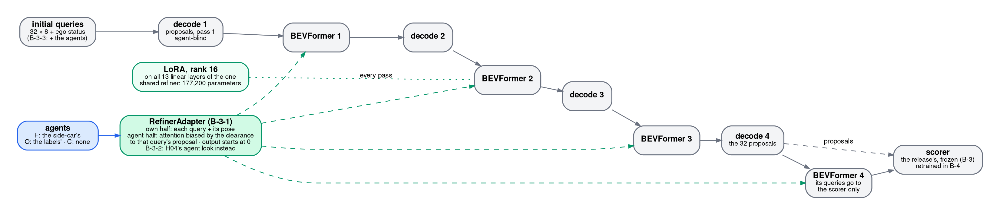

# H15 Part B · B-3: the agents into the refiner. Do the proposals themselves get better?

**Status (11 Nov 2026): planned, not run. Nothing trains before the owner's go-ahead.**
- [The overview](../README.md) holds the tracker, the naming and the log.
- This plan stands on [B-0, the foundations](B-0-foundations.md).
- How LoRA adapts the refiner: [the LoRA primer](lora-primer.md).
- It was C1 in [the ideas](ideas.md). It continues the first pass's B2 (`H15.b2`).

## The crux

**B-1 and B-2 can only choose among the release's 32 proposals. B-3 changes the proposals.**
- If the refiner sees the agents while it shapes them, across its four passes, do the 32 get better?
  - fewer of them through an agent;
  - the best of them better scored;
  - on scenes the release never trained on.
- B-3 reads the proposals' own quality: the best of the 32, by NAVSIM's score. The pick among them is B-4's
  question.

## What to expect

- **The best of 32 moves a little, if at all** (*argued*).
  - F − C: +0.0 to +0.3 points.
  - In the first pass, on logs the release had learned, it moved by +0.004, −0.013 and +0.001 points by seed.
- **The release's own scorer will likely pick worse among the new proposals.** It was trained on the old ones.
  The first pass measured 0.1–0.25 points lower. B-3 reads that pick only as a diagnostic: B-4 retrains the
  scorer.
- **Retraining the refiner may help out of domain, agents or not.**
  - In the first pass, every retrained refiner brought the release's pick on nuScenes 0.28–0.36 m closer to the
    human at 3 s, with 0.5–0.8 points fewer collisions.
  - Arm C did it too, so it was the retraining (B-16). B-3 measures it again, on navtest and nuScenes.
- **The loss does not reward keeping away from agents.** It pulls proposals toward the human's path and the
  release's good anchors. The agents can only help the refiner match those better where agents are near.
  - So the change should concentrate in scenes with an agent near the plan, and be absent elsewhere.

## The concepts, question by question

**Q1. How does the release make its 32 proposals?** From 256 learned queries, 32 proposals × 8 poses, plus the
encoded ego status. One shared module, the refiner, then runs four passes. Each pass:
1. a decoder (an MLP, 256 → 1024 → 1024 → 3, *counted*) turns the queries into 32 proposals of 8 poses (x, y,
   heading);
2. a BEVFormer layer updates the queries:
   - self-attention among the 256;
   - deformable attention to the 16 × 32 image map, at points projected from each pose;
   - a feed-forward network.

The fourth decoding is the 32 proposals. The fourth pass's queries are what the scorer reads.

**Q2. What does the refiner know about the agents?**
- Only what its own sample points land on. A proposal that would pass through a car sees the car only if its
  points fall on it in the image.
- An agent off every proposal's path reaches them only through self-attention, from the proposals that do pass
  near it.

**Q3. What does training reward?** The release's own planning loss (`mtd_loss`, *read*):
- winner-takes-all L2: only the proposal nearest the human's path is pulled to it;
- plus 0.5 × the same toward up to 4 "good anchors", proposals from the release's vocabulary of 8,192 that NAVSIM
  scored ≥ 0.95 on that scene;
- each earlier pass at 0.1.

No term scores NC or TTC directly. Good anchors are safe by construction, so the agents can help the refiner reach
them where agents are near.

**Q4. How do the agents enter?** Through the first pass's `RefinerAdapter` (*read*: `train_refiner.py`): a
pre-hook adds a correction to the 256 queries before each BEVFormer layer, on every pass.
- **Its own half** reads each query with its proposal's pose. It is in every arm.
- **Its agent half** gives each query attention over the agents, biased by the clearance from that query's
  proposal to each agent, plus the 13 clearance features. The clearances are computed from the pass's own
  proposals.
- Its output layer starts at zero, so the refiner starts as the release's.

**Q5. Why is pass 1 agent-blind, and does it matter?**
- Pass 1's proposals are decoded from the initial queries before any hook acts.
- The agents shape passes 2–4, and through pass 4's queries, the scorer's input.
- If the release's first guess is far off near agents, three passes may not be enough. B-3-3 gives the initial
  queries the agents too.

**Q6. Why read "the best of 32" rather than the pick?**
- The pick mixes two things: how good the proposals are, and how well the scorer chooses.
- The best of 32 is the score of the best proposal by NAVSIM's own labels (vendored). It is the proposals' quality
  alone: the most any scorer could pick.
- Beside it, the share of the 32 that pass NC and TTC says whether the set as a whole keeps away from agents.

**Q7. Why would the release's scorer pick worse among new proposals?**
- It learned to rank the release's own proposals, from features its refiner produced. New proposals come with
  shifted features, and its ranking no longer fits as well.
- The first pass measured this: 0.1–0.25 points lower.
- So B-3 reports that pick as a warning, not a result. B-4 trains a scorer on the new proposals.

**Q8. What does LoRA change in a refiner that runs four times?**
- Every pass uses the same weights, so one LoRA changes all four passes at once.
- Rank 16 on all 13 linear layers adds 177,200 parameters to the refiner's 2,321,219 (*counted*; the primer).
- Four of those layers decide *where* the deformable attention samples the image (sampling offsets and attention
  weights). Adapting them moves where the refiner looks. That is powerful, and can drift; decision (b).

**Q9. What does arm C test?**
- C retrains the refiner exactly as F does, with the adapter's own half and the same LoRA, but no agents.
- F − C is the agents' effect alone. C − R is what retraining the refiner does by itself: the first pass's
  unexplained nuScenes gain, B-16.

**Q10. What can go wrong?**
- **The 32 lose their spread** and collapse toward the human's path. That is measured.
- **Where the refiner looks drifts** (LoRA on the sampling offsets).
- **The agents are better on the train rows** than at test (B-0-1).
- **Two first-pass bugs, both fixed before training then, are held by the preflight:**
  - `batch_fix` applied twice;
  - rows without anchors pulled toward a stop.

## The plan

### Sub-versions

| ID | What | Arms × seeds | Recommended |
|---|---|---|---|
| **B-3-1** | `RefinerAdapter` + rank-16 LoRA on the refiner (the first pass's B2, `lora` mode) | C, F, O × 0–2 | yes |
| **B-3-2** | H04's "agent look": after each pass, per waypoint, the 16 nearest agents moved to that waypoint's time, coded relative to it, attended with a learned "nothing" slot; output starting at zero. Same LoRA | C, F, O × 0–2 | yes: a different design, which ran inside H04's Run 3A (navtest EPDMS 87.30, among other changes) |
| B-3-3 | B-3-1, with the agents added to the initial queries too, so pass 1 sees them | F × 0–2 | if B-3-1's F beats C |
| B-3-4 | B-3-1, with LoRA kept off the sampling offsets and attention weights | F × 0–2 | if B-3-1 shows drift in where it looks |

### Steps

1. **After B-0 and the go-ahead,** pre-register the criteria below, as approved.
2. **Preflight** (`preflight.run_refiner`, extended):
   - the untrained composed refiner equals R̃ bit for bit on 64 select rows;
   - the teachers equal their source files;
   - the agents decoded again live;
   - no report-log row.
3. **Train**, on train rows only, with a fixed recipe: `mtd_loss`, batch 64, 3 epochs, AdamW (learning rate 1e-4,
   weight decay 0.01), gradient clip 10, cosine schedule, the last epoch kept.
   - Part A's telemetry, plus the agent half's attention to its "no agent" slot.
4. **Dump** every row's new 32 proposals and pooled features (B-4 reuses these), and label them with the vendored
   scorer: navtrain, R-clean and navtest.
5. **Health read on select** (it chooses nothing). The owner sees the curves.
6. **Navtest, once:**
   - each arm's best of 32 and its collision-free share (vendored);
   - the release scorer's pick on the new proposals (official, as a diagnostic).
7. **Analysis (B-0-4):**
   - which proposals moved, and how far;
   - their clearance and spread;
   - the subsets;
   - counterfactuals on F: no agents, another log's agents, and labelled agents.
8. **nuScenes:** minADE of the 32, and the release scorer's pick's L2 and collisions.
9. **Record** `H15.r<n>`, labels "B-3-1"…, and a line in the overview's log.

### Success criteria (a draft)

| # | What | Predicted | Supports if | Refutes if |
|---|---|---|---|---|
| R1 | best of 32, F − C (B-3-1), navtest | +0.0 to +0.3 points | beyond C's seed range and 2 SE, every seed | negative beyond 2 SE, any seed |
| R2 | the share of the 32 passing NC and TTC, F − C | +0.5 to +2 percentage points | beyond 2 SE, every seed | — |
| R3 | the release scorer's pick on F's proposals, against R | −0.3 to +0.1 | reported: a diagnostic | — |
| R4 | best of 32, C − R̃: retraining alone | 0 to +0.2 | reported | — |
| R5 | the 32's lateral spread at 4 s, F against R̃ | within ± 10% | — | below by more than 20%: collapse |
| R6 | nuScenes minADE of the 32, C and F against R | 0.01–0.02 m lower | reported: the first pass's finding, re-measured | — |
| R7 | F's change concentrated where agents are near (the subset "an agent within 10 m") | ≥ 2× its all-scene effect | — | — |

### Decisions for the owner

| | Decision | Recommended |
|---|---|---|
| (a) | sub-versions | B-3-1 and B-3-2; B-3-3 and B-3-4 by B-3-1's result |
| (b) | LoRA on the sampling offsets and attention weights | yes, as the first pass did; B-3-4 is the variant without |
| (c) | the teacher draw: H15's, as in the first pass, or exactly the release's | H15's, so it continues the first pass; the release's in B-16 |
| (d) | 3 epochs fixed, or chosen on R-clean | fixed |

### Risks

1. **Nothing to see in the pick.** By design: the pick is B-4's. R3 is read as a warning only.
2. **Collapse of the proposals' spread** (R5). If it happens, B-4's scorer has less to choose from.
3. **A design effect taken for an agent effect.** B-3-2 differs in more than its fusion, so it gets its own C.

### Cost (*estimate*)

After B-0: about 15 minutes of GPU a run (the first pass's 0.20 s a batch, *measured*), so 18 runs for B-3-1 and
B-3-2. Plus a dump and labels per run, about 10 minutes of CPU each.

## Questions B-3 can answer

| Question | Read from |
|---|---|
| Do agents make the proposals keep away from agents? | R2; each proposal's smallest clearance, before and after |
| Or do they only make them more like the human's path? | minADE against the human, and against the good anchors |
| Which proposals move: those near agents, or all? | the matched displacement, by nearness to an agent |
| Does the refiner use the agents at all? | its attention to the "no agent" slot; F with no agents, and with another log's |
| Does the design of the fusion matter? | B-3-1 against B-3-2 |
| Does pass 1 matter? | B-3-3 against B-3-1 |
| Why does retraining the refiner help out of domain? | C − R on navtest and nuScenes, and B-16's arms |
| How much does the release's scorer lose on new proposals? | R3; the reason for B-4 |

## What B-3 does not answer

- **The pick among the new proposals:** B-4.
- **Closed loop:** B-14.
