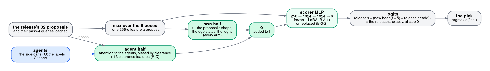

# H15 Part B · B-3: the agents into the scorer alone. Can a scorer that reads them pick better?

**Status (13 Nov 2026): not scheduled.** Planned on 11 Nov as B-2. It was renumbered B-3 when B-2 was re-planned
(D28). Nothing trains before the owner's go-ahead.
- Since 13 Nov, [B-2](B-2-hidden-refiner.md) gives the refiner the side-car's hidden layer and refits the scorer
  downstream. This plan is the scorer alone, with the proposals fixed.
- If scheduled, it would read whichever of B-2's inputs (decoded or hidden) B-2 shows to be used.
- [The overview](../README.md) holds the tracker, the naming and the log.
- This plan stands on [B-0, the foundations](B-0-foundations.md).
- B-1's result is its bar: [B-1, the veto](B-1-veto.md).
- How LoRA adapts the scorer: [the LoRA primer](lora-primer.md).
- It was C2 in [the ideas](ideas.md). It continues the first pass's B1 (`H15.b1`).

## The crux

**Keep the release's 32 proposals exactly as they are, and change only how one is chosen.**
- Given the side-car's agents, and each proposal's clearance to them at every step of the plan, a scorer learns
  which proposal NAVSIM will score best.
- Does it pick better on navtest:
  - than the release's own scorer;
  - than the same adaptation without agents;
  - than B-1's plain rule?

## What to expect

- **Small, if anything** (*argued*). The room for any better pick among the 32 is what B-1-1 measures (V1:
  +0.5 to +1.5 points). A learned scorer reaches only part of it.
  - F − C: +0.0 to +0.3 points.
  - F − R: −0.3 to +0.4.
- **The adaptation itself may cost** (C − R ≤ 0).
  - In the first pass, refitting the scorer on navtrain made the release's picks 0.23–0.44 m worse at 3 s on
    nuScenes, with or without agents.
  - The replacement scorer transferred best.
- **The first pass found nothing,** with every mode neutral and even with ground-truth agents. But it was read on
  logs the release had learned, where its pick's NC and TTC are 0.996. This plan reads where there is room. A
  second null there would be a real answer, not an artefact.
- **What it is worth either way:**
  - A scorer that beats B-1's rule uses the agents in ways a rule cannot, for example trading a little clearance
    for progress.
  - One that does not, says the rule is enough.
  - Either way, it says whether the scorer's named agent (B-11) is faithful out of sample.

## The concepts, question by question

**Q1. What exactly does the release's scorer see?**
- After the refiner's fourth pass, each proposal has 8 query vectors, one per pose.
- The scorer takes their maximum, one 256-number feature f per proposal.
- An MLP (256 → 1024 → 1024 → 6, *counted*) gives 6 logits: DDC, EP, TTC, LK, HC and the final score.
- **Only the final one was trained** (`sub_score_weight = 0`, *read*). The pick is the highest σ(final).

**Q2. Why might it misjudge a proposal near an agent?**
- f carries what the refiner's deformable attention sampled along that proposal, mixed with the other proposals'
  through self-attention.
- An agent that crosses later, or comes from the side, may barely register.
- On navtrain the scorer learned the scenes themselves; out of sample, what it learned of agents is what may not
  carry over.

**Q3. How do the agents enter?** Through B1's `Adapter` (*read*: `scorers.py`), which adds a correction δ to f.
- **Its own half** reads f with the proposal's shape (24 numbers), the ego status (11) and the release's logits
  (6). It is in every arm.
- **Its agent half** gives each proposal attention over the agents:
  - 4 heads, width 128, plus a learned "no agent" slot;
  - each attention weight is biased by −clearance / 5 × a learned per-head scale, so near agents are read first;
  - added to that, the 13 clearance features of `geometry.terms`: the smallest clearance at each of the 8 times,
    the overall minimum and when, the minimum within 1 s and within 2 s, and how many agents come within 1 m.
- δ = own half + Linear(141 → 256)(agent half), and its last layers start at zero.

**Q4. Why is the model exactly the release before training?**
- The logits are re-based: release logits + (adapted head(f + δ) − release head(f)) (`scorers.py:239–240`,
  *read*).
- With δ = 0 and LoRA's B = 0 the bracket is zero, so the pick is the release's, bit for bit. The preflight
  checks it on 512 rows.

**Q5. What trains in each sub-version?**

| Sub-version | Trains | Parameters |
|---|---|---|
| B-3-1 | the adapter + rank-16 LoRA on the scorer MLP's 3 layers | 277,600 in arm C, 415,460 in F and O: the adapter (207,872 or 345,732) + LoRA 69,728 (*counted*) |
| B-3-2 | a replacement scorer: 8 named sub-score heads and attention across the 32 proposals, the final score by NAVSIM's own formula | 0.27 M (*read*: the first pass's count) |
| B-3-3 | the adapter alone; the scorer frozen | 207,872 (C) or 345,732 (F, O) (*counted*) |

**Q6. What does it learn from?**
- The PDM labels of the release's 32 proposals on navtrain's train rows (`pdm-v1`, vendored scorer, *read*), as
  BCE on each proposal's final score.
- The first pass tried an imitation term (be near the human's plan) and dropped it: every control lost 2.5–2.7
  points (0.893–0.896 against 0.920), because the human's own plan scores 0.906 there.
- **An option (decision (b)):** also train the sub-score heads (NC, TTC, EP). The scorer's reasons then become
  explicit.

**Q7. What does arm C tell?**
- C is the same adapter's own half and the same LoRA, trained the same way, with no agents.
- F − C is the agents' effect alone. C − R is what refitting the scorer on navtrain does out of sample.
- O (labelled agents) bounds what better perception could add.

**Q8. What is different from the first pass?**

| | First pass B1 | B-3 |
|---|---|---|
| Where it is read | report logs, in-sample for the release | navtest, once; out of sample |
| The agents | v1 side-car, seed 0 | v3, the planner's seed k reads side-car seed k |
| Which epoch | chosen on select | the last: nothing chosen |
| Scorer of record | vendored | official, with EC and the human filter |
| The bar | C only | C, and B-1's rule |

**Q9. What can go wrong?**
- **The scorer fits navtrain** and loses out of sample: C − R and nuScenes show it.
- **The agents are better on the train rows** than at test. B-0-1 measures it, and cross-fits if it matters.
- **Picks that switch between frames** lose EC, which no training label carries.
- **LoRA mode was the most seed-variable** in the first pass (F − C from −0.21 to +0.24). Three seeds, and H15's
  rule, guard against reading one seed.

**Q10. How is it read?**
- Each arm's navtest pick is replayed through the official scorer, once, after all of B-3's runs.
- The vendored labels give every proposal's score for the analysis.
- nuScenes gives L2 and collisions out of domain.

## The plan

### Sub-versions

| ID | What | Arms × seeds | Recommended |
|---|---|---|---|
| **B-3-1** | adapter + LoRA on the scorer MLP | C, F, O × 0–2 | yes: the owner's interest, and the reference |
| **B-3-2** | a replacement scorer with named sub-scores | C, F, O × 0–2 | yes: it transferred best |
| B-3-3 | adapter only | C, F × 0–2 | if B-3-1 wins, to see how little suffices |

### Steps

1. **After B-0 and B-1's review**, pre-register the criteria below, as approved, in PREDICTIONS.md.
2. **Preflight** (`preflight.run_scorer`, extended):
   - the identity on 512 rows;
   - exact PDM re-scores;
   - agents decoded again live, equal to the stored ones;
   - no report-log row anywhere.
3. **Train**, on train rows only, with a fixed recipe: BCE, batch 256, 10 epochs, learning rate 1e-4 (adapter)
   and 2e-5 (head), the last epoch kept.
   - Part A's telemetry: per-step losses, gradient norms, and the agent half's attention to its "no agent"
     slot.
4. **Health read on select,** which chooses nothing, and the owner sees the curves.
5. **Navtest, once:** every arm and seed's pick, replayed and officially scored.
6. **Analysis:**
   - B-0-4, on the pick;
   - the named agent (B-11): delete it, or a random detected agent, and count how often the pick moves; is it
     real, within 2 m of a labelled agent?
   - the sub-scores' AUC against PDM's NC and TTC, if trained.
7. **nuScenes:** the picks, scored by L2 at 1, 2 and 3 s and collisions within 3 s.
8. **Record** `H15.r<n>`, labels "B-3-1", "B-3-2"…, and a line in the overview's log.

### Success criteria (a draft)

| # | What | Predicted | Supports if | Refutes if |
|---|---|---|---|---|
| S1 | F − C, B-3-1, navtest EPDMS | +0.0 to +0.3 | beyond C's seed range and 2 SE, every seed (H15's rule) | negative beyond 2 SE, any seed |
| S2 | F − R: meets or beats | −0.3 to +0.4 | meets: the 95% interval's low end ≥ −0.4, every seed; beats: above 0, every seed | high end < 0, any seed |
| S3 | C − R | −0.4 to +0.2 | reported | — |
| S4 | F − B-1-3: a learned use against a rule | −0.3 to +0.3 | reported | — |
| S5 | O − F | +0.0 to +0.4 | reported | — |
| S6 | the named agent: deleting it moves the pick, against a random agent | ≥ 3× | ≥ 3× and ≥ 85% real | < 1.5× |
| S7 | EC, F − R | within ± 0.02 | — | lower by more than 0.02 |
| S8 | nuScenes L2 at 3 s, F − R | 0 to +0.3 m (worse) | — | — (the first pass's cost, re-measured) |

### Decisions for the owner

| | Decision | Recommended |
|---|---|---|
| (a) | sub-versions | B-3-1 and B-3-2; B-3-3 only if B-3-1 wins |
| (b) | train the sub-score heads (NC, TTC, EP) beside the final score | yes, in B-3-2, where they are the design; not in B-3-1, so it stays the first pass's |
| (c) | the last epoch, or one chosen on R-clean | the last; a choice would borrow R-clean's noise for a small gain |
| (d) | read nuScenes | yes: it is where the first pass found the cost |

### Risks

1. **No room left after B-1.** If B-1-1 is small, S1's effect cannot be resolved. B-0-3 says so before training.
2. **The cost out of sample** (S3, S8). It is reported beside every gain; nothing ships from a model that loses
   to R.
3. **Explanations of a pick that is no better** (S6). They are read as a property, not a benefit.

### Cost (*estimate*)

After B-0: 9 runs per sub-version, 5–15 min of GPU each; one official scoring run per run.

## Questions B-3 can answer

| Question | Read from |
|---|---|
| Does a learned scorer use agents better than a rule? | S4: F against B-1-3 |
| Where does it help: lead vehicles, slowing, an agent within 10 m? | the subsets |
| Does it trade clearance for progress differently from the rule? | NC, TTC and EP of the pick, F against B-1-3 |
| Is the pick the limit, or the proposals? | the gap between best of 32 and the pick, before and after |
| Does refitting the scorer on navtrain cost out of sample? | C − R on navtest and nuScenes |
| Which form transfers: LoRA on the release's head, or a new head? | B-3-1 against B-3-2 |
| Can the scorer explain its pick by an agent, faithfully, on scenes it never saw? | S6 |
| How much would better perception add? | O − F |

## What B-3 does not answer

- **Whether better proposals exist to be picked:** B-2, the refiner, with the scorer refit downstream.
- **Closed loop:** B-12.
