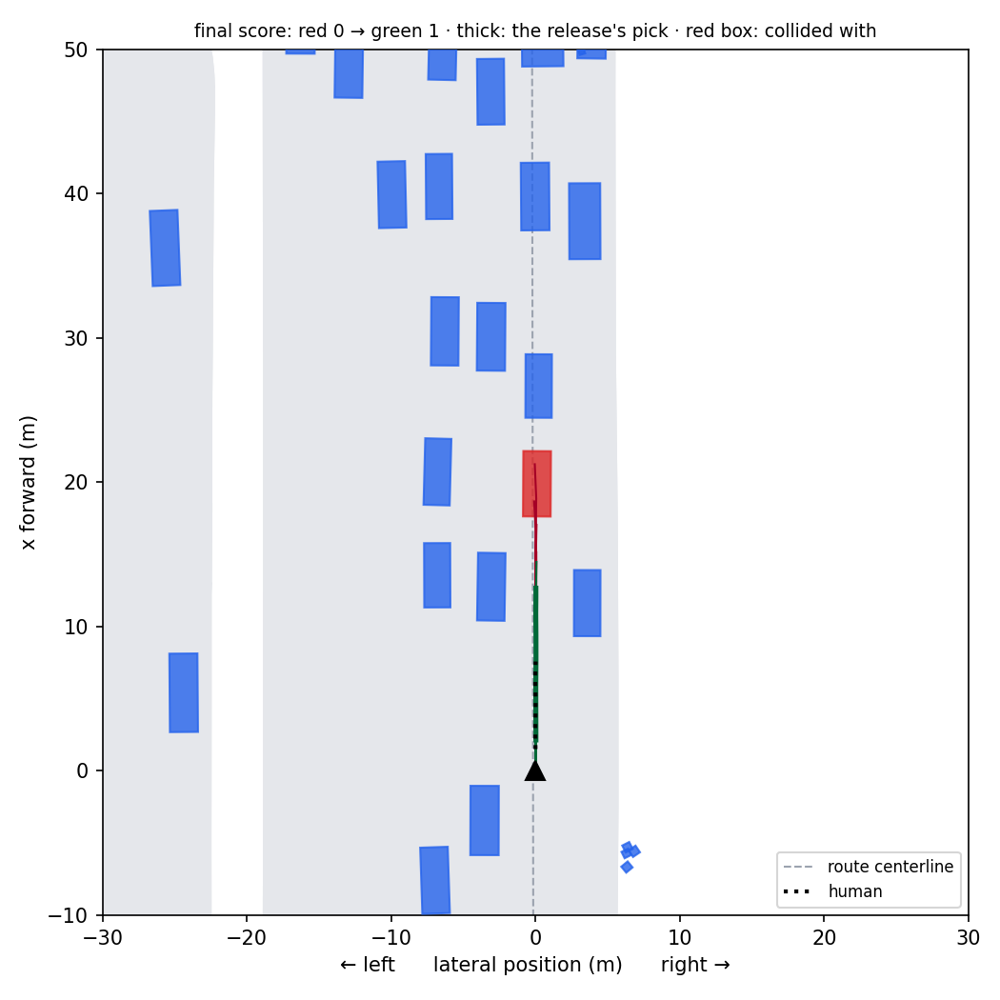

# NAVSIM's metric cache, as H15 uses it

**Status (2026-11-03; corrected 2026-11-11): downloaded, verified, counted and exercised.** H15 phase B reads it for its
labels: every release candidate's NAVSIM v2 sub-scores (`gallops.drivejepa_perception.pdm_labels`).
The plan is [the side-car's first-pass plan](drivejepa-perception-sidecar/first-pass-plan.md), S0.5–S0.6.

How to read the marks:
- *counted* and *measured*: done on this site, by
  `experiments/H15_perception_sidecar/scripts/metric_cache_explainer.py`, whose output is
  [explainer.json](assets/navsim-metric-cache/explainer.json);
- *read*: read in the code named;
- *reported*: stated by the independent code review of 3 Nov and not re-verified here.

## What it is, and where it came from

A metric cache holds everything NAVSIM's PDM scorer needs to grade a plan for one sample, without
the logs or the map files:
- where the ego is, and where the human went;
- what the other agents did over the next 4 s;
- the drivable area, the route and its centreline;
- a reference plan (PDM-Closed) that progress is measured against.

The scorer uses it to grade any plan against what actually happened. That is how the release's
scorer was trained, and how H15's phase B labels the release's 32 candidates.

| | |
|---|---|
| Source | Hugging Face dataset `LinhanWang/Drive-JEPA`, commit `9d435e12` |
| File | `train_metric_cache_v2_pruned.tar`, 33,455,616,000 B, sha256 `d55646d2c742…cdbb9b2`; with it `anchors_scores_index_v2.tar`, 398,745,600 B, sha256 `2ee29849d464…c4be5f9` |
| Checked | both match their LFS sha256 (3 Nov); no member path is absolute or climbs with `..` |
| Where | the site's `[datasets.navsim_metric_cache]` (`gallops.toml`), read as `{data.navsim_metric_cache}` |
| Layout | `<log>/unknown/<token>/metric_cache.pkl`: one lzma-compressed pickle of a `MetricCache` (navsim `planning/metric_caching/metric_cache.py`) per sample |
| Coverage | **103,288 of 103,288** navtrain samples have a record (*counted*) |

## What "pruned" means: fields, not samples

Every navtrain sample is there. What the pruning removed is three of the dataclass's fields. Each
is a list of agent detections or tracks the scorer itself does not read: it reads the agents through
`observation`. (*counted* on one record; `describe()` in the script)

| Field | Present | What it is |
|---|---|---|
| `ego_state` | yes | the ego at t: rear-axle pose in global coordinates, speed, acceleration |
| `trajectory` | yes | PDM-Closed's plan: the reference every proposal's progress is compared with (51 poses) |
| `human_trajectory`, `past_human_trajectory` | yes | what the driver did next, and the last 1.5 s |
| `observation` | yes | the other agents, as occupancy maps at 10 Hz over 4 s (41 steps), each mapping a track token to its footprint polygon; agents follow their logged paths (log replay) |
| `drivable_area_map` | yes | drivable-area polygons around the route (216 in the example) |
| `centerline`, `route_lane_ids` | yes | the route's centreline (3,345 points in the example) and its lanes (139) |
| `map_parameters` | yes | which nuPlan map (here `us-nv-las-vegas-strip`) |
| `past_detections_tracks`, `current_tracked_objects`, `future_tracked_objects` | **no (pruned)** | the raw detections the observation was built from |

## How a plan becomes nine numbers

The scorer is Drive-JEPA's own copy, `score_module/compute_navsim_score.py` and
`train_pdm_scorer.py` in `{code.drivejepa}` (*read*). `pdm_labels.score` calls it in three steps.

1. **`before_score_proposals`.**
   - It puts PDM-Closed's plan first.
   - It turns each 8-pose, 0.5 s plan into 40 poses at 0.1 s.
   - It simulates the ego tracking each plan for 4 s.
2. **`scorer.score_proposals`.** It grades every simulated plan against the record: the agents'
   10 Hz footprints, the drivable area, the route and the traffic lights.
3. **`after_score_proposals`.** It returns one row per plan, with PDM-Closed's own row already
   dropped (its last line returns `scores[1:]`).
   - The scorer's internal arrays keep the reference at index 0, so plan *k*'s collision sits at
     index *k*+1 there.
   - H15 found this the hard way, and `pdm_labels.score` asserts one row per plan.

**The nine columns:**

| Column | Kind | What fails it |
|---|---|---|
| NC, no at-fault collision | multiplicative | hitting an agent while at fault |
| DAC, drivable area compliance | multiplicative | leaving the drivable area |
| TLC, traffic light compliance | multiplicative | running a red light |
| DDC, driving direction compliance | multiplicative | driving against traffic |
| EP, ego progress | weighted, 5 | progress along the route, as a share of the larger of its own and PDM-Closed's (1 if both are under 5 m); it is multiplied by the four multiplicative terms first, so a crash also zeroes it |
| TTC, time to collision | weighted, 5 | projecting the ego 1 s ahead (at a 0.3 s stride, lines 581–583) puts it into an agent |
| LK, lane keeping | weighted, 2 | drifting more than 0.5 m from the lane for over 2 s |
| HC, history comfort | weighted, 2 | jerky motion against the past trajectory |
| final | — | (NC · DAC · TLC · DDC) × (5·EP + 5·TTC + 2·LK + 2·HC) / 14 |

`_aggregate_pdm_scores` computes the final score; two-frame extended comfort is left out of it.
The formula holds on the examples below: EP 0.791 gives (5 · 0.791 + 9)/14 = 0.925, which is the
stored final score.

**It is not NAVSIM's official scorer.**
- Progress is normalised per plan against PDM-Closed only (*read*: `_aggregate_pdm_scores`), not
  against the best of all the plans scored together. The official per-token run also scores each plan
  beside PDM-Closed alone (`navsim/evaluate/pdm_score.py`), so the two differ only where both make
  under 5 m of progress (*read*).
- Lane keeping is checked every 0.5 s (`interval_length = 0.5`, every fifth 0.1 s step), and drivable
  area uses a faster point test, `points_in_polygons_fast` (*read*).
- TTC is the official loop, line for line: 0.1 s steps, the ego projected 0, 0.3, 0.6 and 0.9 s ahead
  (*read*, 11 Nov). Until then this page said, as *reported*, that TTC was evaluated every 0.5 s. It is
  not.
- EC and the human filter are absent.
- H15's labels must equal what this scorer computes, and `pdm_labels check` requires exact
  equality on re-scoring. Agreement with the official scorer is a separate measurement.

## Three worked examples

Both samples are from the first navtrain logs. The release trained on all of navtrain, so its
good scores here are **in-sample**.

*Token `32b4934cb70c50a7`, ego frame, x forward. Grey is the drivable area; dashed is the route
centreline; boxes are agents at t, red for the one the failing candidates hit; dotted is the
human's next 4 s.*

**1. One sample's 32 candidates, term by term** (token `153c6b07f09d53d1`):

| Candidate | NC | DAC | TLC | DDC | EP | TTC | LK | HC | final |
|---|---|---|---|---|---|---|---|---|---|
| the release's pick (6) | 1 | 1 | 1 | 1 | 1 | 1 | 1 | 1 | **1.000** |
| the worst (11) | **0** | 1 | 1 | 1 | 0 | 1 | 1 | 1 | **0.000** |

- 19 of the 32 score 1.000, and the mean is 0.945.
- The worst one has an at-fault collision at the 39th 10 Hz step (3.9 s). Its NC of 0 zeroes its
  progress and its final score.

**2. The human's plan** (the same two samples):

| Sample | NC | DAC | TLC | DDC | EP | TTC | LK | HC | final |
|---|---|---|---|---|---|---|---|---|---|
| `153c6b07f09d53d1` | 1 | 1 | 1 | 1 | 1 | 1 | 1 | 1 | 1.000 |
| `32b4934cb70c50a7` | 1 | 1 | 1 | 1 | **0.728** | 1 | 1 | 1 | **0.903** |

In the second sample the human follows slow traffic and makes less progress than PDM-Closed. So
the driver's own plan scores below the release's pick, which scores 1.000: EP rewards progress the
human chose not to make.

**3. A collision verdict, with the agent and the time** (token `32b4934cb70c50a7`, the figure above):
- 9 of the 32 candidates score below 0.5.
- Each collides, at fault, with the vehicle about 20 m ahead in the ego lane, at 10 Hz steps 30 to
  40 (3.0–4.0 s). Their TTC is 0 as well.
- The release's pick (19) and 8 others score 1.000.
- `pdm_labels` keeps the collided agent per candidate as `navsim_data.track_id` of its token, so a
  verdict links back to the labelled agent.

## Cost

- **Measured:** 24 samples in 6 s on 4 workers, about 1 s per sample per core for the 32
  candidates plus the human.
- **Estimate:** all 103,288 navtrain samples take about 35–40 min on 48 workers.
