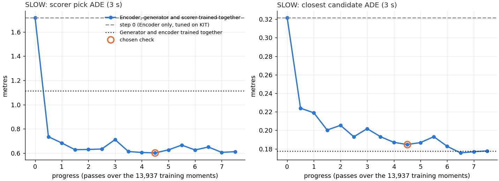
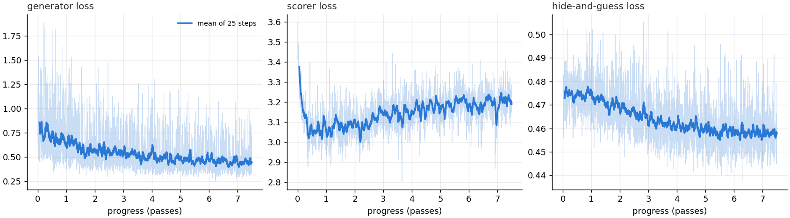

# Encoder, generator and scorer trained together on KITScenes

Run 2026-10-21 on shakaal, 3 h 10 min wall time (training plus checks). Code: `src/allthree.py` (training and checks), `src/final5.py`
(held-out run), `src/report.py` (tables and plots). Full per-check tables: `out/tables.md`. Checkpoints and dumps:
`{runs}/drivejepa_kitscenes/generator_joint_kit/s5/`.

## Summary

1. All three parts were trained at once from the released generator and scorer and the KIT-tuned encoder LoRA. Training stopped by rule after 7.5 passes (no gain in 6 checks). The checkpoint at 4.5 passes was fixed before the held-out moments were read.
2. **The scorer is the win.** On the 223 held-out moments, scorer pick ADE (3 s) is **0.596 m**. "Generator and encoder trained together" gets 1.101 m and "Generator only, trained on KIT" gets 1.146 m.
3. Paired by scene, the pick ADE is 0.505 m better than "Generator and encoder trained together" (95 % interval −0.631 to −0.383) and 0.550 m better than "Generator only" (−0.664 to −0.439). On SLOW TURNS it is 0.945 m better (−1.476 to −0.479, n = 37).
4. The pick gap (pick ADE minus closest candidate ADE) fell from 0.91 to 0.39 m. The scorer now picks much nearer to the best candidate on the menu.
5. **The menu itself did not improve.** Closest candidate ADE (3 s) is 0.203 m vs 0.190 m for "Generator and encoder trained together" (+0.013 m, interval −0.004 to +0.027, so a tie).
6. Variety (spread of the 32 candidates) is 1.78 vs 1.60 for "Generator and encoder trained together".
7. Both hard checks (turning, menu guard) held at every one of the 15 checks.
8. Scorer pick FDE (1 s / 2 s / 3 s) is 0.20 / 0.62 / 1.35 m, vs 0.31 / 1.17 / 2.53 m for "Generator and encoder trained together".
9. **Caveat:** the scorer now ranks candidates by closeness to the human path, not by upstream's safety grade (see Caveat).

## Model names

| Name | What it is |
|---|---|
| Released model | upstream Drive-JEPA weights, no KIT training |
| Encoder only, tuned on KIT | released model + encoder LoRA tuned on KIT; this run's starting encoder |
| Generator only, trained on KIT | encoder as above (frozen) + generator trained on KIT |
| Generator and encoder trained together | generator + encoder LoRA trained together on KIT (scorer untouched) |
| **Encoder, generator and scorer trained together** | **this run** |

Groups: SLOW < 15 m/s, FAST ≥ 15 m/s, SLOW TURNS = SLOW with heading change by 3 s greater than 0.3 rad. ADE (3 s) is
the mean over waypoints 0.5–3 s. "Closest candidate" is the candidate of the 32 nearest the human path. "Scorer pick" is
the candidate the model actually drives.

## How the scorer was trained

**What upstream picks with.** It computes `argmax(sigmoid(last pred_score logit))` over the 32 candidates
(`drive_jepa_model.py:85-91`). The comfort re-score that can follow runs only when `past_ego_simulated_states` is
given, which never happens on KIT. The other five logits (driving direction, ego progress, time to collision, lane
keeping, comfort) take no part in the pick, and upstream trained with their weight at 0. Code references are in
`out/g0_findings.md`. This run therefore keeps upstream's pick rule and trains only the last logit.

**The new target.** For each candidate k, d_k = mean xy distance to the human path over the first 6 waypoints (0.5–3 s).
The target over the 32 candidates is softmax(−d_k / 0.5 m), and the loss is the cross-entropy between that target and
softmax(last logit). Only the `pred_score` head is trained (Adam 1e-4). The other scorer heads stay frozen. The five
other logits share the head's hidden layers, so they drift a little (mean absolute change 0.12 at the chosen check).
They do not affect the pick.

**What the scorer reads.** It reads the generator's final query state (`bev_feature`, max-pooled over each candidate's 8
queries; `scorer.py:41-42`). It never sees image features directly. Images reach it only through the generator's
refinement layers.

**Frozen replay.** We wanted the scorer loss to train the scorer and the encoder, but not the generator. So each step
computes the generator's final state twice:
- once normally, for the generator loss;
- once more for the scorer, with every generator weight, the ego input, the starting anchors and the candidates passed
  between the 4 refinement rounds all detached. Only the image features stay attached.

The replay gives bit-identical numbers to the normal pass. Before training we checked this on a fixed batch in training
mode, both without and with GridMask firing: max abs difference 0.0, logits bit-identical. The same checks showed:
- the scorer loss gives exactly zero gradient to all 41 generator tensors;
- it gives non-zero gradient to all 10 `pred_score` tensors and all 192 LoRA tensors;
- the logit gradient lands only on the last of the 6 logits.

So the scorer loss can still shift the menu indirectly, by moving the encoder LoRA, but never through the generator's
weights. In practice it supplied 12–35 % of the LoRA gradient norm at the checks; the generator loss supplied 64–86 % and
hide-and-guess 1–3 %.

**Why the scorer loss crept up after half a pass** (right-hand plot below): the menu tightened, with SLOW variety falling
from 2.82 to 1.68. More candidates sit near the human path, so the target got flatter and the lowest loss reachable
rose. Measured on the 1,763 picking moments:

| | target entropy (lowest loss possible) | scorer loss | part the scorer can still learn |
|---|---|---|---|
| step 0 | 2.53 | 3.50 | 0.98 |
| chosen check (4.5 passes) | 2.88 | 3.25 | 0.37 |
| last check (7.5 passes) | 2.94 | 3.32 | 0.38 |

### Worked example

Picking moment `174d46e1`, t = 40, a SLOW TURN. The table shows the 5 step-0 candidates with the highest target. At the
chosen check the generator has moved, so the same slot holds a different trajectory, and its d_k and target are given
again.

| slot | step 0: d_k (m) | step 0: target | step 0: prediction | chosen: d_k (m) | chosen: target | chosen: prediction |
|---|---|---|---|---|---|---|
| 28 | 0.29 | 0.100 | 0.052 | 0.81 | 0.037 | 0.052 |
| 9 | 0.32 | 0.094 | 0.041 | 0.62 | 0.054 | 0.054 |
| 16 | 0.39 | 0.082 | 0.048 | 0.56 | 0.061 | 0.051 |
| 22 | 0.40 | 0.080 | 0.046 | 0.32 | 0.098 | 0.053 |
| 18 | 0.42 | 0.077 | 0.045 | 0.94 | 0.029 | 0.049 |

- At step 0 the released scorer picked slot 28 (d = 0.29 m).
- At the chosen check it picks slot 6 (d = 0.95 m), while the closest candidate is slot 12 (d = 0.18 m).
- The trained prediction here is nearly flat (0.049–0.054). This is one of the moments where the scorer still misses.

## Every check (1,763 picking moments)

"Progress" is passes over the 13,937 training moments. The hard checks compare against step 0:
- **Turning:** SLOW TURNS pick ADE must not get worse.
- **Menu:** SLOW closest ADE must not get worse.

**Flag** (report only): worse than "Generator and encoder trained together" on the same moments, whose SLOW values are
closest ADE 0.177 and pick ADE 1.115. Its SLOW TURNS ADEs were never recorded, so only SLOW is compared.

| progress | SLOW pick ADE (3 s) | SLOW closest ADE (3 s) | SLOW pick gap | SLOW TURNS pick ADE (3 s) | SLOW TURNS closest ADE (3 s) | SLOW within 2 m | SLOW variety | encoder drift | hard checks | flag closest / pick |
|---|---|---|---|---|---|---|---|---|---|---|
| step 0 | 1.718 | 0.322 | 1.396 | 1.933 | 0.417 | 18.6 | 2.82 | 0 | — | FLAG / FLAG |
| 0.5 | 0.735 | 0.224 | 0.511 | 0.851 | 0.317 | 20.3 | 2.67 | 0.037 | ok | FLAG / ok |
| 1.0 | 0.684 | 0.219 | 0.465 | 0.780 | 0.327 | 20.1 | 2.61 | 0.053 | ok | FLAG / ok |
| 1.5 | 0.628 | 0.200 | 0.428 | 0.748 | 0.293 | 22.9 | 2.12 | 0.061 | ok | FLAG / ok |
| 2.0 | 0.630 | 0.205 | 0.425 | 0.701 | 0.307 | 22.7 | 2.23 | 0.069 | ok | FLAG / ok |
| 2.5 | 0.634 | 0.193 | 0.441 | 0.725 | 0.277 | 22.4 | 2.18 | 0.071 | ok | FLAG / ok |
| 3.0 | 0.711 | 0.202 | 0.510 | 0.709 | 0.275 | 24.1 | 1.95 | 0.081 | ok | FLAG / ok |
| 3.5 | 0.613 | 0.193 | 0.420 | 0.708 | 0.277 | 24.7 | 1.81 | 0.084 | ok | FLAG / ok |
| 4.0 | 0.605 | 0.187 | 0.418 | 0.687 | 0.267 | 24.4 | 1.88 | 0.093 | ok | FLAG / ok |
| **4.5 (chosen)** | **0.602** | 0.185 | 0.417 | 0.705 | 0.271 | 25.3 | 1.68 | 0.099 | ok | FLAG / ok |
| 5.0 | 0.627 | 0.187 | 0.440 | 0.697 | 0.277 | 25.0 | 1.71 | 0.096 | ok | FLAG / ok |
| 5.5 | 0.666 | 0.193 | 0.473 | 0.686 | 0.261 | 25.9 | 1.58 | 0.100 | ok | FLAG / ok |
| 6.0 | 0.626 | 0.183 | 0.443 | 0.727 | 0.257 | 26.0 | 1.59 | 0.114 | ok | FLAG / ok |
| 6.5 | 0.650 | 0.176 | 0.475 | 0.808 | 0.259 | 25.6 | 1.65 | 0.109 | ok | ok / ok |
| 7.0 | 0.606 | 0.177 | 0.429 | 0.720 | 0.267 | 26.1 | 1.58 | 0.121 | ok | ok / ok |
| 7.5 | 0.612 | 0.178 | 0.434 | 0.704 | 0.253 | 26.2 | 1.55 | 0.128 | ok | FLAG / ok |

What the other per-check columns show (all in `out/tables.md`):
- ALL and FAST groups;
- FDE (1 s / 2 s / 3 s);
- SLOW TURNS tails vs step 0;
- the hide-and-guess loss on the 2,000 pairs (0.485 → 0.475);
- training losses and gradient shares;
- the 103 baseline moments.

Tied top scores: 0 at every check. The FAST group on the picking moments swings widely, from 1.0 to 2.7 m pick ADE
after the first pass, because it is small.

## The 223 held-out moments (read once)

The final run was gated in two steps before any held-out moment was read:
- "Generator only, trained on KIT" was rebuilt, and on the 103 baseline moments it matched the earlier final evaluation
  bit for bit (103 / 103 menus and picks, through both the dump path and the KIT wrapper path).
- The chosen checkpoint reproduced its own saved dump bit for bit (103 / 103).

The four reference rows equal the published `09_heldout_comparison/out/final_tables.json` exactly; `report.py` asserts this.

Groups: ALL 223, SLOW 221, FAST 2 (too few to read), SLOW TURNS 37.

| Model | closest ADE (3 s) | closest FDE (3 s) | within 2 m | variety | pick ADE (3 s) | pick FDE 1 s / 2 s / 3 s | SLOW closest / pick ADE | SLOW TURNS closest / pick ADE | FAST closest / pick ADE ‡ |
|---|---|---|---|---|---|---|---|---|---|
| Released model | 0.374 | 0.664 | 17.5 | 2.83 | 2.372 | 1.314 / 2.679 / 4.206 | 0.357 / 2.323 | 0.558 / 3.026 | 2.337 / 7.760 |
| Encoder only, tuned on KIT | 0.378 | 0.662 | 17.7 | 2.82 | 1.879 | 1.002 / 2.085 / 3.442 | 0.359 / 1.826 | 0.557 / 2.571 | 2.523 / 7.810 |
| Generator only, trained on KIT | 0.194 | 0.379 | 25.9 | 1.63 | 1.146 | 0.319 / 1.223 / 2.644 | 0.194 / 1.124 | 0.350 / 1.545 | 0.156 / 3.561 |
| Generator and encoder trained together | 0.190 | 0.377 | 26.0 | 1.60 | 1.101 | 0.313 / 1.169 / 2.533 | 0.189 / 1.077 | 0.346 / 1.764 | 0.267 / 3.797 |
| **Encoder, generator and scorer trained together** | 0.203 | 0.388 | 24.7 | 1.78 | **0.596** | **0.201 / 0.617 / 1.354** | 0.202 / **0.589** | 0.332 / **0.819** | 0.244 / 1.438 |

‡ 2 moments: too few to read.

SLOW TURNS tails against "Encoder only, tuned on KIT" (closest FDE (3 s)), for this run:
- 3 moments worse by more than 0.5 m;
- the largest increase is +0.97 m, at `8dcfc2ba` t = 40, the same moment that is the largest increase for "Generator only";
- worst-10 % mean 2.23 m, vs 2.80 and 2.85 for the two generator models.

### Paired differences (this run minus reference; negative = this run better)

Paired bootstrap, 10,000 resamples of whole scenes, seed 0.

| Reference | Metric | Group | n | mean (m) | median (m) | better / worse by > 10 cm | 95 % interval (m) |
|---|---|---|---|---|---|---|---|
| Generator only, trained on KIT | closest ADE (3 s) | ALL | 223 | +0.009 | +0.018 | 9 / 16 | [−0.006, +0.021] |
| | | SLOW | 221 | +0.008 | +0.018 | 9 / 15 | [−0.007, +0.021] |
| | | SLOW TURNS | 37 | −0.019 | +0.026 | 5 / 4 | [−0.086, +0.036] |
| | | FAST (too few to read) | 2 | +0.089 | +0.089 | 0 / 1 | [−0.021, +0.198] |
| | pick ADE (3 s) | ALL | 223 | **−0.550** | −0.377 | 144 / 41 | [−0.664, −0.439] |
| | | SLOW | 221 | **−0.536** | −0.370 | 142 / 41 | [−0.652, −0.429] |
| | | SLOW TURNS | 37 | **−0.725** | −0.596 | 26 / 8 | [−1.170, −0.331] |
| | | FAST (too few to read) | 2 | −2.123 | −2.123 | 2 / 0 | [−2.637, −1.608] |
| Generator and encoder trained together | closest ADE (3 s) | ALL | 223 | +0.013 | +0.012 | 10 / 24 | [−0.004, +0.027] |
| | | SLOW | 221 | +0.013 | +0.012 | 9 / 24 | [−0.004, +0.028] |
| | | SLOW TURNS | 37 | −0.015 | +0.018 | 7 / 8 | [−0.092, +0.053] |
| | | FAST (too few to read) | 2 | −0.023 | −0.023 | 1 / 0 | [−0.116, +0.070] |
| | pick ADE (3 s) | ALL | 223 | **−0.505** | −0.381 | 139 / 48 | [−0.631, −0.383] |
| | | SLOW | 221 | **−0.488** | −0.374 | 137 / 48 | [−0.615, −0.369] |
| | | SLOW TURNS | 37 | **−0.945** | −0.688 | 27 / 7 | [−1.476, −0.479] |
| | | FAST (too few to read) | 2 | −2.359 | −2.359 | 2 / 0 | [−2.378, −2.340] |

The pick wins are wide and their intervals exclude zero. Even so, about 1 in 5 moments (41–48 of 223) still gets a pick
worse by more than 10 cm. Every closest-ADE interval contains zero, so the menu is a tie.

### Pick gap (pick ADE (3 s) minus closest ADE (3 s))

| Model | ALL | SLOW | SLOW TURNS |
|---|---|---|---|
| Released model | 1.997 | 1.966 | 2.469 |
| Encoder only, tuned on KIT | 1.501 | 1.467 | 2.013 |
| Generator only, trained on KIT | 0.952 | 0.930 | 1.194 |
| Generator and encoder trained together | 0.912 | 0.888 | 1.418 |
| **Encoder, generator and scorer trained together** | **0.394** | **0.386** | **0.488** |

## Caveat

The released scorer learned upstream's safety-and-progress grade from simulated rollouts. This run replaced that target
with closeness to the human path on KIT. The pick numbers above measure exactly what it was trained for, and nothing here
shows that the new scorer avoids collisions, stays on the road or obeys lights better or worse than before. If a
candidate is close to the human path but unsafe, it now scores high. The five other logits were never used for the pick, so
nothing in the pick reflects a safety grade any more. Closed-loop testing is needed before any
driving claim.

## What was verified vs argued

- **Verified by running checks:**
  - every pre-training check;
  - the frozen replay is bit-identical;
  - gradient routing: generator zero from the scorer loss; `pred_score` 10/10 and LoRA 192/192 non-zero;
  - step 0 reproduces "Encoder only, tuned on KIT" on the 1,763 and the 103;
  - both held-out gates;
  - the reference rows equal the published table;
  - the target-entropy table.
- **Argued, not tested:**
  - that the scorer loss moved the menu only a little through the encoder (closest ADE ended level with the
    generator-only models, but there is no run without the scorer loss in this setup to compare against);
  - the safety caveat above.

## Deviations from the brief, with reasons

1. **Frozen replay for the scorer loss.** The scorer reads the generator's final state, so keeping the generator's
   weights out of the scorer loss needs the second, detached forward described above. This was not in the original
   wording; it was chosen in discussion before training.
2. **One pick rule, not two columns.** Upstream already picks on the last logit alone, so this run's rule and upstream's
   are the same, and a separate upstream-rule column would only repeat it.
3. **The SLOW TURNS comparison flag has no reference.** "Generator and encoder trained together" never recorded SLOW
   TURNS closest or pick ADE on the picking moments, and the brief said not to recompute it. Only SLOW is flagged.
4. **Hard-check counters run separately for each check.** The rule "a hard check fails 2 checks in a row" was read per
   check. It never triggered, so the reading did not matter.
5. **Step-0 match uses the merged encoder.** On the 103 moments, step 0 equals the earlier "Encoder only" record taken
   with the LoRA merged into the weights, bit for bit. The unmerged-LoRA record differs; we did not check where, but
   the likely cause is a different order of floating-point sums. Training uses the unmerged LoRA, and evaluation merges it, as all earlier models
   did.
