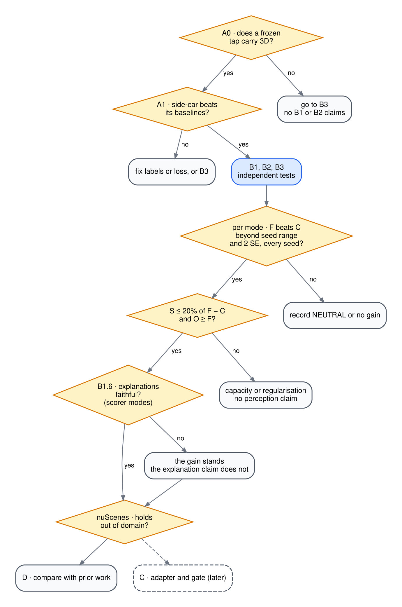

# H15 — A perception side-car on frozen Drive-JEPA: 3D boxes and each agent's 1 s path, tested as an input to the scorer, to the refiner, and against LoRA on the ViT

**Owner:** Shreedhar · **Started:** 2026-11-03 · **Status:** running (setup, S0)

The facts — runs, data, checkpoints, results, gate verdicts — live in
[experiment.toml](experiment.toml) and are rendered into the repository README. This page is the
account: why, what was done, what it showed, and what was decided.

- **The plan**, with every step, rule and cost estimate: [docs/drivejepa-perception-sidecar.md](../../docs/drivejepa-perception-sidecar.md).
- **The predictions**, committed before anything trained: [PREDICTIONS.md](PREDICTIONS.md).

## Why

Drive-JEPA's planner reads image tokens, but it has no explicit account of the other agents. So
nothing in it can be asked *which* car it reacted to.

H15 tests a small network on the frozen ViT's tokens that names the agents, with 3D boxes and
each one's next second. It then asks, as separate questions, whether handing those agents to the
scorer or to the refiner improves the plan, and how much of either has to change to use them. It
also asks whether LoRA on the ViT does better than the frozen tap.

## What was done

| Date | Step | What happened |
|---|---|---|
| 3 Nov | plan | Approved and committed: `docs/drivejepa-perception-sidecar.md` |
| 3 Nov | S0.1 | The site's `gallops.toml` points `navsim` at the real NAVSIM root (trainval: 1,310 logs, all 8 cameras, *counted*) and names the metric cache |
| 3 Nov | S0.2 | `Drive-JEPA-ext` recreated (details below) |
| 3 Nov | S0.5 | Download started: Drive-JEPA's `train_metric_cache_v2_pruned.tar` (33.5 GB) and `anchors_scores_index_v2.tar` (0.4 GB). Source: the Hugging Face dataset repo `LinhanWang/Drive-JEPA` at `9d435e12`, checked against its LFS sha256s |
| 3 Nov | S0.9 | H15 registered; predictions written |
| 3 Nov | S0.10 | The plan's diagrams rendered from Graphviz sources in [figures/](figures/) |
| 3 Nov | S0.2 | The release's forward on navtrain samples through Drive-JEPA-ext: finite, and bit-identical over two passes |
| 3 Nov | S0.3 | Splits committed: [splits.json](../../recipes/drivejepa_perception/splits.json). Select is H04's 51 held-out logs; report is a seeded draw of 70; train is the other 1,071 of navtrain's 1,192 logs |
| 3 Nov | S0.4 | The labels pass ran from `6efd8e6` on all 103,288 navtrain samples in 2 min (numbers below) |
| 3 Nov | S0.5 | Downloads verified against their LFS sha256s, then extracted into NAVSIM's `exp/` |
| 3 Nov | S0.5 | `pdm_labels` written and smoke-run (details below) |
| 3 Nov | S0.6 | The explainer: [docs/navsim-metric-cache.md](../../docs/navsim-metric-cache.md), with worked examples and figures |
| 3 Nov | S0 | The token pass rebuilt twice to make it affordable, each change held to the vendor's exact output (details below) |
| 3 Nov | A, B | Code written and tested ahead of the data, all under `gallops.drivejepa_perception` (list below) |
| 3 Nov | — | The test suite passes under Drive-JEPA's 3.9 again, so 3.9 trainers' preflights can pass (`e959b06`) |
| 4 Nov | S0 | Token pass done (63 min); PDM labels for all 103,288 rows, re-scored exactly; the release read on select and report (S0.8) |
| 4 Nov | A0, A1 | The three taps probed; the ViT's own output chosen, and its cache pass started; the blind baseline trained |
| 4 Nov | B1 | The first C runs (loss `imitation`, `84fd73e`) lost to the release in every mode. The loss is now chosen on the select logs, C arm only, before any arm reads an agent (below) |
| 4 Nov | B1 | Loss chosen (`bce`); the four controls trained, 3 seeds each, at the release's level (below) |
| 4 Nov | B2 | Teachers gathered into one array (21 s; 33 ms a row from NFS before). Two bugs caught before any B2 run trained: rows without anchors were pulled toward a stop, and `batch_fix` was applied twice. The three controls are training |
| 4 Nov | B3 | Code written (`6b51492`); the block-20 cache pass passed its parity check (largest difference 0.029 against the ViT-out cache) |
| 4 Nov | A | A readout bug found and fixed: "within 30 m" counted to 35 m. A0 read again (below). A1's three seeds and 128-query run training on the ViT output |
| 4 Nov | OOD | H14's package restored from its PR head for its nuScenes code; H15's nuScenes pass and readout written and tested (`0d1ac0f`); the extract of H14's 102 held-out scenes running |

**Code written ahead of the data:**
- **Side-car and phase A:** the side-car, its targets and metrics, and the phase-A trainer.
- **B1 and B2:** the scorer modes and the B1 trainer; the refiner trainer (B2).
- **Shared by phase B:** the verdict rule (`b_report`) and the explanation test (B1.6).
- **Checks:** every trainer's preflight.

**`pdm_labels` (S0.5) in detail:**
- **Measured:** a metric cache exists for 103,288 of 103,288 navtrain samples. "Pruned" removed
  three detection fields the scorer does not read.
- **A bug the smoke run caught:** the vendor's `after_score_proposals` already drops the PDM-Closed
  reference, so a second `[1:]` would have shifted every label by one candidate. The code now
  asserts one row per plan.

**The token pass (S0), and its two changes:**
- **First run:** 6.4 rows/s, an ETA of 4.4 h.
- **Inputs:** profiled, the vendor's feature builder spent most of a sample normalising four
  full-size camera images into a tensor the model never reads.
  - `fast_bev_feature` computes the geometry the model does read, held exactly equal to the
    vendor's on 12 rows.
  - The cache it builds is bit-identical to the vendor-path cache.
- **Still GPU-bound** at 6.2 rows/s: a batch-1 forward took 158 ms on the shared GPU, half of it
  the refiner's small kernels.
  - The pass now runs batched with `batch_fix`, held to batch 1 on 32 rows before it starts.
  - Measured on the smoke run: every pick equal, candidates within 3.8e-5 m, tokens within one fp16
    step.
- **Result:** 23.7 rows/s, about 70 min for the 103,288 rows.
- **Done (4 Nov), from `a2c5255`:** 103,288 rows and 14,457 A0 tap rows in 63 min (56 GB), against
  the release whose sha256 is `740335c8`.
  - The startup check, batch 16 against batch 1 on 32 rows: every pick equal; candidates within
    4.6e-5 m, logits within 1.8e-5, tokens within 0.004.
  - The fast inputs equalled the vendor's on 12 rows.

**The labels pass (S0.4), *measured*:**
- **Agents within 60 m:** 7,104,100, of which 1,812,167 vehicles, 1,533,271 pedestrians, 16,245
  cyclists and 3,742,417 static.
- **Path joins:** 96.6% at t + 0.5 s and 93.4% at t + 1.0 s.
- **`check`, on 60 random windows:**
  - the ego future is 1.9e-6 off NAVSIM's `get_future_trajectory`;
  - path points are 3.7e-6 m off nuPlan's and NAVSIM's transforms;
  - re-runs equal the stored labels;
  - 27 of 8,208 joins (0.33%) change box size by more than 0.5 m.

**S0.2 in detail.**
- `Drive-JEPA-ext` is `e21f474` plus Paddock's patches 0001–0003, as commits `c92b06c`, `7f29654`
  and `afab5fc`.
- *Measured* on an H200 NVL (sm_90):
  - the compiled deformable-attention kernel is refused under `auto`;
  - the PyTorch path agrees between CUDA and CPU to 1.8e-7;
  - forced, the compiled kernel prints "no kernel image is available", does not raise, and
    returns output 0.989 off a reference whose largest value is 0.989.

## What it showed

So far, phase A has started. Structured results go into `experiment.toml` when B1 gives H15 its
headline; until then, the numbers live here.

### S0.5 · the PDM labels (4 Nov, from `b46230a`)

- **All 103,288 navtrain samples scored**, in 10 min on 48 workers; no metric cache missing.
- **Re-scoring:** `check-pdm` re-scored 50 random rows and found them exactly equal.
- **Mean final scores:** 0.798 for the release's 32 candidates, 0.967 for the best of them, and
  0.906 for the human's plan.
- **Collisions:** 7.51% of candidates have an at-fault collision, exactly the share whose NC is
  below 1.

### S0.8 · the release's own picks (in-sample for it)

| Split | Pick EPDMS | Best of 32 | Gap | L2 at 1 / 2 / 3 s (m) |
|---|---|---|---|---|
| select (4,457) | 0.920 | 0.961 | 0.041 | 0.68 / 1.48 / 2.53 |
| report (4,636) | 0.914 | 0.956 | 0.042 | 0.70 / 1.50 / 2.56 |

**The release's pick, term by term (report logs):**

| NC | DAC | TLC | DDC | EP | TTC | LK | HC |
|---|---|---|---|---|---|---|---|
| 0.996 | 0.994 | 0.979 | 0.989 | 0.919 | 0.996 | 0.860 | 0.975 |

- **P6** predicted a gap of at least 5 points. It is **4.2**, less than predicted.
- **What this means for B (*argued*, written before any B result):**
  - The terms agents can inform, NC and TTC, are already 0.996 on the release's pick in-sample.
    The pick loses most in lane keeping, progress and traffic lights.
  - So on NAVSIM in-sample, an agent-aware scorer has a few tenths of a point to win from
    collisions. P7's +0.3 to +1.0 is optimistic on this evidence.

### A0 · which frozen tap carries 3D

One-layer probes, 6 epochs on 10,000 train rows, read on the select logs, front view, at the kept
epoch (6). Read again with the fixed readout (`*-reread`, `f2b6570`); the as-run numbers counted
targets to 35 m (see "a readout bug" below) and are kept in brackets.

| Tap | Recall at 2 m, ≤ 30 m | Precision | F1 | Recall 0–20 / 20–30 / 30–50 m | As run (≤ 35 m): recall / precision / F1 |
|---|---|---|---|---|---|
| post-projector, 256-d | 0.249 | 0.318 | 0.280 | 0.351 / 0.184 / 0.127 | (0.225 / 0.299 / 0.257) |
| **ViT output, 1024-d** | **0.343** | **0.383** | **0.362** | 0.459 / 0.268 / 0.160 | (0.313 / 0.367 / 0.338) |
| block 12, 1024-d | 0.269 | 0.311 | 0.289 | 0.369 / 0.205 / 0.110 | (0.242 / 0.303 / 0.269) |

- **P1 is supported.** The best tap reaches 0.343 within 30 m, above the support threshold of 0.30
  and just under the predicted range of 0.35–0.60.
- **The ViT output beats the projector's** by 0.094 recall, against a predicted ≥ 0.03.
- **All three were still rising** at epoch 6.
- **Decided:** A1 reads the ViT's own output, cached for every row by a second pass that is held
  to the full forward's tap.
- **That pass (`tokens-vit-v1`, from `30b9fdb`), *measured*:** 103,288 rows in 38 min at batch 16,
  102 GB fp16. On 32 rows it equals the full forward's tap exactly (largest difference 0.0).

### A readout bug: "within 30 m" was within 35 m (found 4 Nov, during A1)

- **What:** `evaluate.readout`'s range bins were 0–20, 20–35 and 35–50 m. "Within 30 m" summed the
  first two, so it counted targets out to 35 m. The plan, P1 and P2 mean 30 m, as H04 did: its
  seen rule kept targets to 30 m.
- **What it touched:**
  - A0's numbers above, and their range bins. The choice of tap stands: all three taps were read
    the same way, and the gap between them is 0.07–0.09 in recall.
  - A1's kept epochs, chosen by F1 "within 30 m" while A1 trained. They are kept as chosen, not
    chosen again.
- **Fixed** (bins 0–20, 20–30, 30–50, tested at 28 and 32 m). `train_sidecar reread` reads a run's
  saved weights again with the fixed readout, beside the as-run files. A0 and A1 are reported on
  both definitions, each labelled.

### A1 · the side-car (`f05e2ff`; report logs, front view, within 30 m)

Trained on the ViT's own output, 12 epochs over the 94,195 train rows, 4.39 M parameters (1.4% of
the inference path). Each run's kept epoch was chosen on the select logs by the as-run readout;
the numbers below are those epochs read again with the fixed one (`a1-*-reread`).

| Run | Kept | Recall | Precision | F1 | Recall 0–20 / 20–30 / 30–50 m | Moving vehicles ≤ 20 m | Lead-gap error (prior 8.53 m) |
|---|---|---|---|---|---|---|---|
| seed 0 | 11 | 0.632 | 0.742 | 0.683 | 0.807 / 0.512 / 0.228 | 0.936 | 2.35 m |
| seed 1 | 11 | 0.630 | 0.736 | 0.679 | 0.795 / 0.517 / 0.231 | 0.935 | 2.36 m |
| seed 2 | 12 | 0.630 | 0.742 | 0.682 | 0.801 / 0.513 / 0.235 | 0.935 | 2.14 m |
| seed 0, 128 queries | 12 | 0.647 | 0.802 | 0.716 | 0.816 / 0.530 / 0.222 | 0.948 | 2.27 m |
| no camera (blind) | 1 | 0 | — | 0 | 0 / 0 / 0 | 0 | — |

**Each agent's next second** (matched moving agents, FDE at 1 s, paired per agent, SE clustered by
log):

| Run | Side-car's path | Constant velocity, its own velocity | Difference (SE) | Constant velocity, the label's | Stationary |
|---|---|---|---|---|---|
| seed 0 | 1.219 m | 1.268 m | −0.049 (0.013) | 0.396 m | 4.84 m |
| seed 1 | 1.224 m | 1.272 m | −0.048 (0.014) | 0.400 m | 4.76 m |
| seed 2 | 1.205 m | 1.263 m | −0.059 (0.012) | 0.399 m | 4.87 m |

**Against the predictions (*measured*):**
- **P2 supported.** Recall 0.630–0.632 and precision 0.736–0.742 on all three seeds, against a
  bar of 0.40 and 0.50. Recall is above the predicted 0.40–0.60.
- **P3 supported.** 0.935–0.936 against a bar of 0.65; ≥ 0.75 was predicted.
- **P4 supported, more weakly than predicted.** The side-car's paths beat constant velocity from its
  own velocity by 0.048–0.059 m, beyond 2 SE on every seed. That is 4–5%, not the predicted ≥ 10%.
  Most of the path error is where it puts the agent now, not where it sends it: its centre error
  is 0.90 m, and constant velocity from the label's own centre and velocity reaches 0.40 m.
- **P5 supported.** 2.14–2.36 m against the prior's 8.53 m: under half of it, and under the
  predicted 3 m.
- **H-A is supported.**
- **By class (all ranges):** vehicles 0.47, pedestrians 0.24–0.25, cyclists 0.13–0.18. The side-car
  is mainly a vehicle detector.
- **128 queries, one seed:** +0.06 precision and +0.03 F1 over 64. Phase B reads seed 0 with 64
  queries, as fixed before any A1 result.

**The sight check fails on seed 0.**
- **The check (pre-registered):** with the tokens zeroed, the detections should all but vanish.
- **Seeds 1 and 2 and the 128-query run pass:** 0 per sample, against 5.2–5.3 with the image.
- **Seed 0 makes 27 detections per sample from zeroed tokens.** That is the seed phase B reads.
- *Argued:* all-zero tokens never occur in real input, and on real input seed 0's recall and
  precision match the seeds that pass. So this is more likely the model's answer to an input
  outside anything it saw than detections made without the image.
- **The in-distribution check (`a1-*-sight`, `158f49c`), *measured*.** Each report row was read
  with its own geometry and targets but the real tokens of a row from another log (the S arm's
  draw):

  | Run | Recall, own tokens | Recall, another log's | Precision, own / another's | Lead-gap error, own / another's |
  |---|---|---|---|---|
  | seed 0 | 0.632 | 0.046 | 0.742 / 0.034 | 2.35 / 19.9 m |
  | seed 1 | 0.630 | 0.047 | 0.736 / 0.036 | 2.36 / 20.0 m |
  | seed 2 | 0.630 | 0.045 | 0.742 / 0.034 | 2.14 / 20.0 m |
  | 128 queries | 0.647 | 0.046 | 0.802 / 0.037 | 2.27 / 20.0 m |

- **Every run, seed 0 included, loses its recall without its own image.** It still detects about
  five agents a sample, those of the other image, and they miss this row's.
- So seed 0's detections on real input are made from the image. Its zeroed-token failure is its
  answer to an input it never saw, and is recorded as such.

### A1 · the no-camera baseline (blind arm, report logs)

- Trained identically on zeroed tokens, it detects nothing: recall 0 over 24,216 targets.
- The lead-gap reference is the train-mean prior, with an error of 8.53 m (P5's bar). The reread
  confirms both.

### B1 · the first loss pulled the scorer toward the human (a deviation, before any agent arm)

The plan's B1 loss was BCE on the PDM labels plus a listwise CE toward the human,
`softmax(−ADE/τ)`, weight 0.5, τ = 1 m. The first control runs (arm C, no agents; `84fd73e`)
trained with it in three modes, three seeds each (frozen at `84fd73e`; lora and full at `3e666e1`,
whose code is the same). *Measured*, select logs, each seed's kept epoch:

| Mode | Pick EPDMS, seeds 0 / 1 / 2 | L2 at 1 s (m) | EP of the pick |
|---|---|---|---|
| release, untrained | 0.9201 | 0.681 | 0.937 |
| frozen | 0.8947 / 0.8947 / 0.8955 | 0.150 / 0.149 / 0.157 | 0.879 / 0.882 / 0.879 |
| lora | 0.8943 / 0.8932 / 0.8944 | 0.167 / 0.157 / 0.167 | 0.877 / 0.875 / 0.879 |
| full | 0.8930 / 0.8941 / 0.8941 | 0.155 / 0.162 / 0.153 | 0.875 / 0.877 / 0.878 |

The fourth mode, `replace`, did not run: its preflight refused uncommitted code.

- **Every control lost 2.5–2.7 points to the release.** The kept epoch was 1 or 2 in every run.
- **Its L2 to the human fell from 0.68 m to 0.15 m at 1 s.** The scorer had learnt to pick the
  candidate nearest the human. Its progress fell with it, because the human's own plan scores
  0.906 against the release pick's 0.920 (S0.5, S0.8).
- *Argued:* an F-against-C comparison under that loss would ask whether agents help an imitation
  picker, which is not B1's question.

**What changed, and what did not:**
- **Changed:** the loss's listwise term is now chosen, by `train_scorer --choose-loss`, among three:
  - `imitation`: the first runs';
  - `bce`: none;
  - `best`: toward the PDM-best candidates, the choice the readout scores.
- **The rule, fixed before the choice ran:** seed 0 of every mode trains with each loss; the
  highest mean over the four modes of the select pick EPDMS at the kept epoch wins.
- **What the choice reads:** select logs, arm C only. Report logs and agents are not read.
- **Unchanged:** the arms, the modes, the seeds, the decision rule and every prediction. The chosen
  loss is used in every mode and arm.
- The imitation runs are kept, apart, as `{runs}/drivejepa_perception/b1-imitation/`.

**The choice (`b1-choose-loss`, `977bb56`), *measured*:** select logs, arm C, seed 0, each run's
kept epoch. The release's own pick scores 0.9201.

| Loss | frozen | lora | full | replace | Mean | NC / TTC of the pick, frozen | L2 at 1 s, frozen |
|---|---|---|---|---|---|---|---|
| imitation | 0.8947 | 0.8943 | 0.8930 | 0.8974 | 0.8948 | 0.998 / 0.996 | 0.15 m |
| **bce** | **0.9202** | **0.9200** | **0.9202** | **0.9192** | **0.9199** | 0.996 / 0.994 | 0.86 m |
| best | 0.8635 | 0.8669 | 0.8633 | 0.8637 | 0.8644 | 0.972 / 0.967 | 1.35 m |

- **Chosen: `bce`.** Every mode's control then sits within 0.001 of the release.
- **Ranking toward the PDM-best candidate made the control worse than imitation did.** Its pick
  moved away from the human (1.35 m at 1 s) and into collisions: NC 0.972 and TTC 0.967, against
  0.995 and 0.994 for the release.
  - *Argued:* the best candidate is often the fastest safe one. Without agents the control cannot
    tell safe from unsafe, so it learns "faster" and pays in collisions.
  - That is the gap the F arm is meant to fill. It is also why `best` is not a fair control:
    under it, F could beat C by repairing damage the loss did, not by adding a reason.
- **The replacement scorer** (B1.4: a new network, trained from scratch on the control's own
  inputs) reaches 0.9192, within 0.001 of the release, in two epochs.

### B1 · the controls, with `bce` (`ccde355`, report logs)

*Measured.* The pick's EPDMS, at each seed's kept epoch and at the last (10). The release's pick
scores 0.9140 on the same 4,636 rows (in-sample for it).

| Mode | Trained | Seed 0 | Seed 1 | Seed 2 | Seed range, kept |
|---|---|---|---|---|---|
| frozen (B1.1) | 0.21 M | 0.9139 / 0.9142 | 0.9141 / 0.9140 | 0.9133 / 0.9138 | 0.0008 |
| lora (B1.2) | 0.28 M | 0.9131 / 0.9147 | 0.9149 / 0.9146 | 0.9126 / 0.9131 | 0.0023 |
| full (B1.3) | 1.53 M | 0.9150 / 0.9150 | 0.9148 / 0.9149 | 0.9154 / 0.9149 | 0.0006 |
| replace (B1.4) | 0.27 M | 0.9103 / 0.9110 | 0.9111 / 0.9120 | 0.9113 / 0.9121 | 0.0010 |

- **The residual controls hold the release's level, within 0.002.** Fine-tuning the scorer on
  in-sample PDM labels, without agents, neither gains nor loses.
- **The replacement control sits 0.003 below.**
- **The seed ranges are small, 0.0006–0.0023.** They are one half of the decision rule's bar for F;
  the other half is 2× the paired SE, which needs F.

**Decided before any F result:** O and S run on **every** mode, not only on "the best" one, and
B1.6's explanation test runs on every F mode at seed 0. Each costs minutes. The plan's wording
needed a best mode to be chosen, and choosing it on the report logs would have flagged every O, S
and B1.6 number `selected-on-report`.

P10 and P11 are still scored on "the best mode". It is named on the **select** logs: the largest
mean over the three seeds of F − C in select pick EPDMS, each seed at its kept epoch. Every mode's
numbers are reported beside it.

### B2 · cost, and which mode gets O and S (written before any F result)

- **Measured step time:** 0.20 s per batch of 64 (refiner forward and backward from cached tokens,
  `b2-frozen-C`, seed 0, shared GPU). A seed's 3 epochs then take about 15 min, plus about 2 min
  to PDM-score its new candidates. The 18 C and F runs come to about 5 GPU-h.
- **O and S run on one mode, chosen on the select logs:** the mode with the largest mean F − C in
  select best-of-32 EPDMS. That is P12's readout, read on the split meant for choices. B2's O and
  S cost hours, not minutes, so they do not run on every mode as B1's do.

### B3 · how it runs, and where it departs from the plan (written before any B3 run)

**A cache, not the online ViT.**
- Blocks 1–20 are frozen in every B3 variant, so their output for a row is a constant.
  `tokens.py --block20` caches it once (fp16, 30 GB) for a seeded 20,000 train rows plus the
  select and report logs.
- Training then runs only blocks 21–24 and the norm. No image is decoded, and the first 20 blocks
  never run.
- The plan's S0.7 assumed B3 needed the online ViT. It needs it only for augmentation, which no
  H15 arm uses.
- The pass is held to the ViT-out cache through the frozen tail before it writes a row; the
  B3.1 preflight holds A1, read through that tail, to its recorded select F1.

**B3.1 gains a control.**
- P13 compares the LoRA branch with A1's side-car. Both B3.1 arms start from A1 seed 0's kept
  epoch and train the same steps on the same 20,000 rows. They differ only in LoRA.
- Against A1 alone, a gain could be A1's own extra training; against the control, it cannot.
  Both comparisons are reported.

**B3.2 is reduced.**
- The plan's B3.2 retrains the planner on the adapted tokens. That is B2's cost again.
- What runs: B3.1 seed 0's LoRA put in the trunk the planner reads, with the planner unchanged
  (`train_vit_lora shared`). The frozen branch must first reproduce the release's proposals and
  picks.
- It answers the half of the question that needs no training: does tuning the ViT's tail for
  perception move the release's plan, and by how much?

## Decision

None yet.
