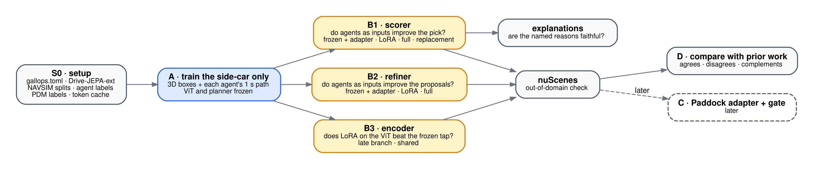
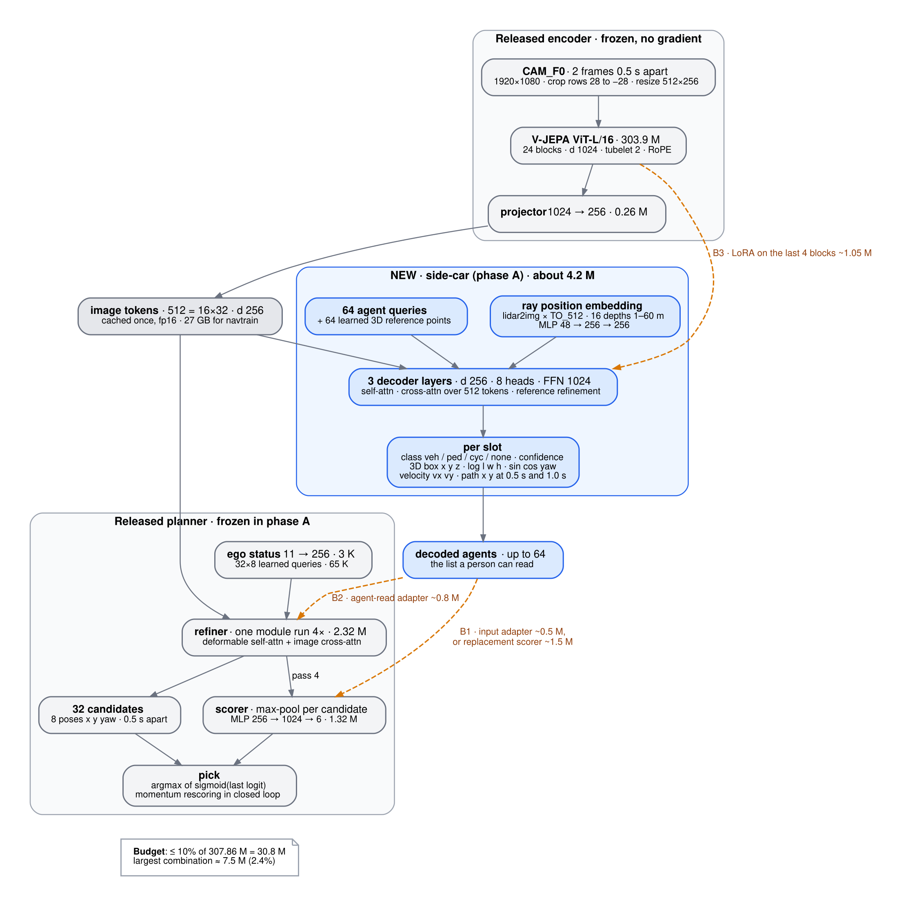

# H15 — A perception side-car on frozen Drive-JEPA: 3D boxes and each agent's 1 s path, tested as an input to the scorer, to the refiner, and against LoRA on the ViT

**Owner:** Shreedhar · **Started:** 2026-11-03 · **Status:** running (setup, S0)

The facts — runs, data, checkpoints, results, gate verdicts — live in
[experiment.toml](experiment.toml) and are rendered into the repository README. This page is the
account: why, what was done, what it showed, and what was decided.

- **The plan**, with every step, rule and cost estimate: [docs/drivejepa-perception-sidecar.md](../../docs/drivejepa-perception-sidecar.md).
- **The predictions**, committed before anything trained: [PREDICTIONS.md](PREDICTIONS.md).

## Why

Drive-JEPA's planner reads image tokens, but it has no explicit account of the other agents. So
nothing in it can be asked *which* car it reacted to.

H15 tests a small network on the frozen ViT's tokens that names the agents, with 3D boxes and
each one's next second. It then asks, as separate questions, whether handing those agents to the
scorer or to the refiner improves the plan, and how much of either has to change to use them. It
also asks whether LoRA on the ViT does better than the frozen tap.

## What was done

| Date | Step | What happened |
|---|---|---|
| 3 Nov | plan | Approved and committed: `docs/drivejepa-perception-sidecar.md` |
| 3 Nov | S0.1 | The site's `gallops.toml` points `navsim` at the real NAVSIM root (trainval: 1,310 logs, all 8 cameras, *counted*) and names the metric cache |
| 3 Nov | S0.2 | `Drive-JEPA-ext` recreated (details below) |
| 3 Nov | S0.5 | Download started: Drive-JEPA's `train_metric_cache_v2_pruned.tar` (33.5 GB) and `anchors_scores_index_v2.tar` (0.4 GB). Source: the Hugging Face dataset repo `LinhanWang/Drive-JEPA` at `9d435e12`, checked against its LFS sha256s |
| 3 Nov | S0.9 | H15 registered; predictions written |
| 3 Nov | S0.10 | The plan's diagrams rendered from Graphviz sources in [figures/](figures/) |

**S0.2 in detail.**
- `Drive-JEPA-ext` is `e21f474` plus Paddock's patches 0001–0003, as commits `c92b06c`, `7f29654`
  and `afab5fc`.
- *Measured* on an H200 NVL (sm_90):
  - the compiled deformable-attention kernel is refused under `auto`;
  - the PyTorch path agrees between CUDA and CPU to 1.8e-7;
  - forced, the compiled kernel prints "no kernel image is available", does not raise, and
    returns output 0.989 off a reference whose largest value is 0.989.

## What it showed

Nothing yet: no run has trained.

## Decision

None yet.
