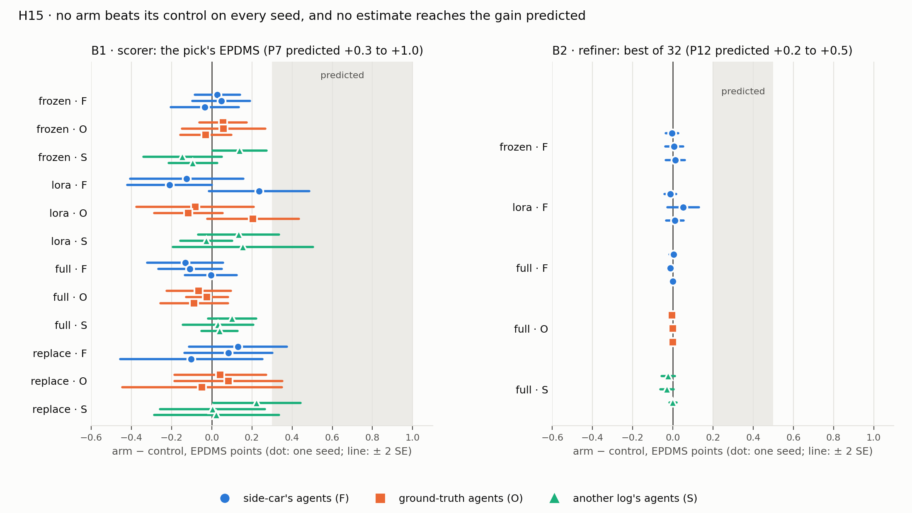
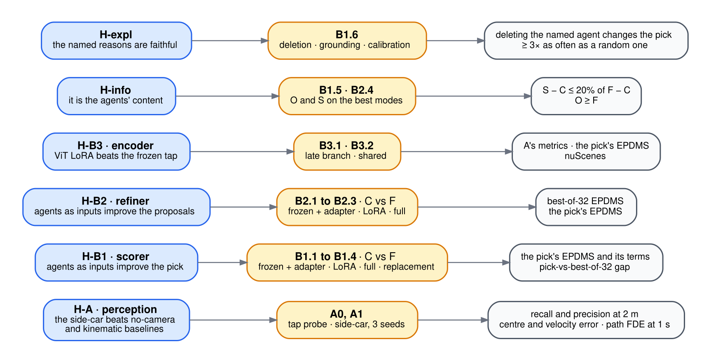

# H15 — A perception side-car on frozen Drive-JEPA: 3D boxes and each agent's 1 s path, tested as an input to the scorer, to the refiner, and against LoRA on the ViT

**Owner:** Shreedhar · **Started:** 2026-11-03 · **Status:** running: the rerun, Part A. Steps 1–3
reviewed (D21), step 4 committed, step 5a done and 5b running, on the select logs only; step 7's nuScenes
data prepared (D20)

The facts — runs, data, checkpoints, results, gate verdicts — live in
[experiment.toml](experiment.toml) and are rendered into the repository README. This page is the
account: why, what was done, what it showed, and what was decided.

- **The rerun's plan**, Part A alone, in reviewed steps: [docs/drivejepa-perception-sidecar-A.md](../../docs/drivejepa-perception-sidecar-A.md).
- **The first pass's plan**, with every step, rule and cost estimate: [docs/drivejepa-perception-sidecar.md](../../docs/drivejepa-perception-sidecar.md).
- **The predictions**, committed before anything trained: [PREDICTIONS.md](PREDICTIONS.md).

## The rerun: Part A, one reviewed step at a time (from 4 Nov)

**Why.** The owner judged the first pass inconclusive (D20). It ran the side-car and every phase-B
question in a day and a half, more than could be reviewed or debugged. H15 is redone from a revised
plan: Part A alone (train the side-car, measure it), in eight steps, each reviewed before the next.
Phases B and C wait. Everything from "Why" down is the first pass's account, kept as it was.

**Steps 1–5 (4 Nov):**

| Step | Review it in | What it established (*counted* or *measured*) |
|---|---|---|
| 1 · the data | [notebooks/01_dataset.ipynb](notebooks/01_dataset.ipynb) | **The labels line up with the images.** Boxes drawn through the side-car's own projection sit on the agents, so z is the box's centre. **The report logs are easier than select:** 5.2 targets a sample against 7.3, and 35% pedestrians against 44%. **Beyond 20 m every agent sits in two token rows.** Velocity labels are ground velocity, which the side-car must infer without the ego's speed |
| 2 · the model and its loss | [notebooks/02_loss.ipynb](notebooks/02_loss.ipynb) | **The loss rebuilt by hand equals `SideCarLoss`.** Matching trades 8 m of distance against full class certainty. 32 of the 64 reference points start outside the camera's view. A primer on loss options, with references, and the measured gradient balance: the class term pulls the shared layers 14× harder than the box term at step 0, 1.65× after epoch 1. On query collapse, epoch 1 shows under-detection and about one duplicate pair a sample |
| 2 · the model, part by part | [notebooks/02b_architecture.ipynb](notebooks/02b_architecture.ipynb) | **`lidar2img` never touches the tokens; it gives each one a ray, added to the keys.** NAVSIM's camera varies by 0.5°, and nuScenes' differs by about a token. One epoch in, turning the camera 2° moves detections by 0.01°: the side-car does not use the rays geometrically. Also the decoder's parts and their lineage, the heads, the readout, and Drive-JEPA's two variants |
| 3 · the pipeline check (`H15.r1`) | [notebooks/03_training.ipynb](notebooks/03_training.ipynb) | **The pipeline runs end to end.** The overfit check passed. The preflight passed, now with the live ViT output held to its cache. One epoch takes 46 s. Select F1 is 0.477 after epoch 1 of 12 (`smoke`). No report number was read |
| the evaluation plan (steps 6–7) | [notebooks/04_evaluation.ipynb](notebooks/04_evaluation.ipynb) | **The readout reproduces the run's numbers from its checkpoint.** The proposed metrics (AP, box errors, motion apart from position, calibration, by city) are prototyped. nuScenes needs its site root first |
| step 7, prepared (`H15.r2`) | [notebooks/05_nuscenes.ipynb](notebooks/05_nuscenes.ipynb) | **The nuScenes data is ready, and no model has read it.** The site root was recreated as the view of the shared copy that both configs name. 100 train scenes were drawn and committed, in two interpreters (plan §8.2). All 2,917 kept keyframes are passed, the projection agrees with the calibration to 1.4e-5 px, and the boxes sit on the agents. There are 3.8 targets a keyframe, and night and rain fall in single cities |
| 4 · the success criteria | [PREDICTIONS.md](PREDICTIONS.md), the rerun's section | **Committed before step 5's first training step (`9d32b80`):** plan §7 as written, with the owner's choices of 4 Nov (D21) |
| 5a · three sizes (`H15.r3`) | plan §9.2 | **By the committed rules: v3 (18.44 M) for 24 epochs.** Select F1 at the kept epoch: v1 0.671, v2 0.679, v3 0.699, and v1 on 24 epochs 0.698. Every gate held; G5: v1 reproduces the first pass, 0.671 against 0.669 |

- **To rerun a notebook,** open it with the **`drive-jepa-v2`** kernel ("Drive-JEPA v2").
  - It starts the interpreter `gallops.toml` names as `[python] drivejepa` (Python 3.9, torch 2.1),
    the one the outputs came from. The notebooks' metadata names it, so Jupyter and VS Code offer it
    first.
  - Do not use `python3` ("Python 3 (ipykernel)"): it starts the system Python, which has no torch.
  - Do not use `drive-jepa-py39`: it is another venv, with another navsim tree first on its path.
  - Headless: [scripts/run_notebooks.py](scripts/run_notebooks.py), run with that interpreter.
  - Notebooks 03 and 04 use a GPU if one is visible; `drive-jepa-v2` shows only GPU 1.
- **The success criteria** (plan §7) were committed before the pipeline check ran, and copied into
  PREDICTIONS.md at step 4, as written, with the owner's choices (D21).
- **The decisions asked of the owner** are in plan §11.
- **The second review (4 Nov)** added these, all proposals, none in v1 (plan §3.8, §4.1–4.6, §5.1–5.3, §11.7–11.12):
  - which agents matter: hidden and causal agents, pedestrian groups, nearest first;
  - traffic side;
  - what `lidar2img` does;
  - the decoder's parts, heads and readout;
  - Drive-JEPA's variants;
  - a loss primer, and mode collapse.
  - **Notebooks:** 01 §8–9, 02 §7–9, 02b, 03 §8 (the epoch-1 model's predictions on images) and 04 §4e–f.
  - **Measured:** after epoch 1, select recall is 0.70 for causal targets against 0.23 for all targets out to
    50 m. At step 0, on one batch, hidden targets are 60% of the targets and carry 66% of the box term.
- **Figures:** [the model](figures/part-a-sidecar.png) and [one training run](figures/part-a-training.png).

## Why

Drive-JEPA's planner reads image tokens, but it has no explicit account of the other agents. So
nothing in it can be asked *which* car it reacted to.

H15 tests a small network on the frozen ViT's tokens that names the agents, with 3D boxes and
each one's next second. It then asks, as separate questions, whether handing those agents to the
scorer or to the refiner improves the plan, and how much of either has to change to use them. It
also asks whether LoRA on the ViT does better than the frozen tap.

## What was done

| Date | Step | What happened |
|---|---|---|
| 3 Nov | plan | Approved and committed: `docs/drivejepa-perception-sidecar.md` |
| 3 Nov | S0.1 | The site's `gallops.toml` points `navsim` at the real NAVSIM root (trainval: 1,310 logs, all 8 cameras, *counted*) and names the metric cache |
| 3 Nov | S0.2 | `Drive-JEPA-ext` recreated (details below) |
| 3 Nov | S0.5 | Download started: Drive-JEPA's `train_metric_cache_v2_pruned.tar` (33.5 GB) and `anchors_scores_index_v2.tar` (0.4 GB). Source: the Hugging Face dataset repo `LinhanWang/Drive-JEPA` at `9d435e12`, checked against its LFS sha256s |
| 3 Nov | S0.9 | H15 registered; predictions written |
| 3 Nov | S0.10 | The plan's diagrams rendered from Graphviz sources in [figures/](figures/) |
| 3 Nov | S0.2 | The release's forward on navtrain samples through Drive-JEPA-ext: finite, and bit-identical over two passes |
| 3 Nov | S0.3 | Splits committed: [splits.json](../../recipes/drivejepa_perception/splits.json). Select is H04's 51 held-out logs; report is a seeded draw of 70; train is the other 1,071 of navtrain's 1,192 logs |
| 3 Nov | S0.4 | The labels pass ran from `6efd8e6` on all 103,288 navtrain samples in 2 min (numbers below) |
| 3 Nov | S0.5 | Downloads verified against their LFS sha256s, then extracted into NAVSIM's `exp/` |
| 3 Nov | S0.5 | `pdm_labels` written and smoke-run (details below) |
| 3 Nov | S0.6 | The explainer: [docs/navsim-metric-cache.md](../../docs/navsim-metric-cache.md), with worked examples and figures |
| 3 Nov | S0 | The token pass rebuilt twice to make it affordable, each change held to the vendor's exact output (details below) |
| 3 Nov | A, B | Code written and tested ahead of the data, all under `gallops.drivejepa_perception` (list below) |
| 3 Nov | — | The test suite passes under Drive-JEPA's 3.9 again, so 3.9 trainers' preflights can pass (`e959b06`) |
| 4 Nov | S0 | Token pass done (63 min); PDM labels for all 103,288 rows, re-scored exactly; the release read on select and report (S0.8) |
| 4 Nov | A0, A1 | The three taps probed; the ViT's own output chosen, and its cache pass started; the blind baseline trained |
| 4 Nov | B1 | The first C runs (loss `imitation`, `84fd73e`) lost to the release in every mode. The loss is now chosen on the select logs, C arm only, before any arm reads an agent (below) |
| 4 Nov | B1 | Loss chosen (`bce`); the four controls trained, 3 seeds each, at the release's level (below) |
| 4 Nov | B2 | Teachers gathered into one array (21 s; 33 ms a row from NFS before). Two bugs caught before any B2 run trained: rows without anchors were pulled toward a stop, and `batch_fix` was applied twice. The three controls trained |
| 4 Nov | B3 | Code written (`6b51492`); the block-20 cache pass passed its parity check (largest difference 0.029 against the ViT-out cache) |
| 4 Nov | A | A readout bug found and fixed: "within 30 m" counted to 35 m. A0 read again (below). A1's three seeds and 128-query run training on the ViT output |
| 4 Nov | OOD | H14's package restored from its PR head for its nuScenes code; H15's nuScenes pass and readout written and tested (`0d1ac0f`); the extract of H14's 102 held-out scenes running |
| 4 Nov | A1, A2 | Four A1 runs, read again with the fixed readout; the sight check in distribution; A2's learning curve (below) |
| 4 Nov | B1 | Every arm (F, O, S) in every mode; the report, NEUTRAL throughout; B1.6 on every F mode; the controls' calibration |
| 4 Nov | B3 | B3.1, both arms and three seeds; B3.2, refused once by its identity check, measured, then run |
| 4 Nov | OOD | The nuScenes pass (2,996 keyframes) and readouts for the side-car, B1 and B2 |
| 4 Nov | B2 | Every mode's F; `full`'s O and S; the report, NEUTRAL throughout |
| 4 Nov | — | **Run outputs deleted, ahead of a rerun after review (the owner's call):** every checkpoint, per-epoch metrics file, report and run log. Every number in this account and in `experiment.toml` was copied from them first. **Kept:** the caches the runs read (`tokens-v1`, `tokens-vit-v1`, `labels-v1`, `pdm-v1`, `anchors-v1`, `block20-v1`, `nusc-extract`, `nusc-v1`) with their manifests and build logs, and `agents-a1-s0`, whose source checkpoint is gone |
| 4 Nov | — | The metric cache and its sibling `anchors_scores_index_v2` moved from NAVSIM's `exp/` to its root (`{data.navsim_metric_cache}` updated); the two downloaded archives deleted, their sha256 list and logs kept beside the data |
| 4 Nov | — | **H15 made independent of H14:** its own nuScenes reader and scene draw (`nuscenes_data`, tested); H14's code, recipe and scene list deleted; the nuScenes caches built through them (`nusc-extract`, `nusc-v1`) deleted, to be rebuilt from H15's own draw |

**Code written ahead of the data:**
- **Side-car and phase A:** the side-car, its targets and metrics, and the phase-A trainer.
- **B1 and B2:** the scorer modes and the B1 trainer; the refiner trainer (B2).
- **Shared by phase B:** the verdict rule (`b_report`) and the explanation test (B1.6).
- **Checks:** every trainer's preflight.

**`pdm_labels` (S0.5) in detail:**
- **Measured:** a metric cache exists for 103,288 of 103,288 navtrain samples. "Pruned" removed
  three detection fields the scorer does not read.
- **A bug the smoke run caught:** the vendor's `after_score_proposals` already drops the PDM-Closed
  reference, so a second `[1:]` would have shifted every label by one candidate. The code now
  asserts one row per plan.

**The token pass (S0), and its two changes:**
- **First run:** 6.4 rows/s, an ETA of 4.4 h.
- **Inputs:** profiled, the vendor's feature builder spent most of a sample normalising four
  full-size camera images into a tensor the model never reads.
  - `fast_bev_feature` computes the geometry the model does read, held exactly equal to the
    vendor's on 12 rows.
  - The cache it builds is bit-identical to the vendor-path cache.
- **Still GPU-bound** at 6.2 rows/s: a batch-1 forward took 158 ms on the shared GPU, half of it
  the refiner's small kernels.
  - The pass now runs batched with `batch_fix`, held to batch 1 on 32 rows before it starts.
  - Measured on the smoke run: every pick equal, candidates within 3.8e-5 m, tokens within one fp16
    step.
- **Result:** 23.7 rows/s, about 70 min for the 103,288 rows.
- **Done (4 Nov), from `a2c5255`:** 103,288 rows and 14,457 A0 tap rows in 63 min (56 GB), against
  the release whose sha256 is `740335c8`.
  - The startup check, batch 16 against batch 1 on 32 rows: every pick equal; candidates within
    4.6e-5 m, logits within 1.8e-5, tokens within 0.004.
  - The fast inputs equalled the vendor's on 12 rows.

**The labels pass (S0.4), *measured*:**
- **Agents within 60 m:** 7,104,100, of which 1,812,167 vehicles, 1,533,271 pedestrians, 16,245
  cyclists and 3,742,417 static.
- **Path joins:** 96.6% at t + 0.5 s and 93.4% at t + 1.0 s.
- **`check`, on 60 random windows:**
  - the ego future is 1.9e-6 off NAVSIM's `get_future_trajectory`;
  - path points are 3.7e-6 m off nuPlan's and NAVSIM's transforms;
  - re-runs equal the stored labels;
  - 27 of 8,208 joins (0.33%) change box size by more than 0.5 m.

**S0.2 in detail.**
- `Drive-JEPA-ext` is `e21f474` plus Paddock's patches 0001–0003, as commits `c92b06c`, `7f29654`
  and `afab5fc`.
- *Measured* on an H200 NVL (sm_90):
  - the compiled deformable-attention kernel is refused under `auto`;
  - the PyTorch path agrees between CUDA and CPU to 1.8e-7;
  - forced, the compiled kernel prints "no kernel image is available", does not raise, and
    returns output 0.989 off a reference whose largest value is 0.989.

## What it showed

**In short (4 Nov):**
- **The side-car works (H-A supported).** 4.39 M parameters on the frozen ViT's output find agents
  ahead: recall 0.63 and precision 0.74 within 30 m, moving vehicles near the ego 0.94, the lead
  gap within 2.1–2.4 m. Its 1 s paths beat constant velocity, if only by 4–5%.
  - It transfers to nuScenes without training: vehicle recall 0.48.
- **Its agents do not improve the scorer's pick on NAVSIM (B1 NEUTRAL in every mode).** Neither do
  ground-truth agents: on these logs the release's pick already avoids collisions (NC and TTC
  0.996), so there is nothing for agents to fix.
- **The scorer's reasons are faithful (B1.6).** The agent it names moves its pick three to five
  times as often as a random one, and is real 86% of the time.
- **LoRA on the ViT's last blocks adds nothing (B3).** Not to perception, and shared, not to the
  plan either.
- **Out of domain, fitting the scorer to navtrain costs.** On nuScenes the `full` scorer plans
  0.23–0.31 m worse at 3 s than the release, with or without agents. The replacement scorer
  transfers best.
- **Its agents do not improve the refiner's proposals either (B2 NEUTRAL in every mode).** Neither
  do ground-truth agents.
- **A finding nobody predicted:** retraining the refiner on navtrain, with or without agents, makes
  the release plan better on nuScenes. Its pick lands 0.3 m closer to the human at 3 s, with
  fewer collisions. Why is untested.

<picture>
  <source media="(prefers-color-scheme: dark)" srcset="figures/verdicts-dark.png">
  
</picture>

The numbers behind each line follow; the structured record is `experiment.toml`.

### S0.5 · the PDM labels (4 Nov, from `b46230a`)

- **All 103,288 navtrain samples scored**, in 10 min on 48 workers; no metric cache missing.
- **Re-scoring:** `check-pdm` re-scored 50 random rows and found them exactly equal.
- **Mean final scores:** 0.798 for the release's 32 candidates, 0.967 for the best of them, and
  0.906 for the human's plan.
- **Collisions:** 7.51% of candidates have an at-fault collision, exactly the share whose NC is
  below 1.

### S0.8 · the release's own picks (in-sample for it)

| Split | Pick EPDMS | Best of 32 | Gap | L2 at 1 / 2 / 3 s (m) |
|---|---|---|---|---|
| select (4,457) | 0.920 | 0.961 | 0.041 | 0.68 / 1.48 / 2.53 |
| report (4,636) | 0.914 | 0.956 | 0.042 | 0.70 / 1.50 / 2.56 |

**The release's pick, term by term (report logs):**

| NC | DAC | TLC | DDC | EP | TTC | LK | HC |
|---|---|---|---|---|---|---|---|
| 0.996 | 0.994 | 0.979 | 0.989 | 0.919 | 0.996 | 0.860 | 0.975 |

- **P6** predicted a gap of at least 5 points. It is **4.2**, less than predicted.
- **What this means for B (*argued*, written before any B result):**
  - The terms agents can inform, NC and TTC, are already 0.996 on the release's pick in-sample.
    The pick loses most in lane keeping, progress and traffic lights.
  - So on NAVSIM in-sample, an agent-aware scorer has a few tenths of a point to win from
    collisions. P7's +0.3 to +1.0 is optimistic on this evidence.

### A0 · which frozen tap carries 3D

One-layer probes, 6 epochs on 10,000 train rows, read on the select logs, front view, at the kept
epoch (6). Read again with the fixed readout (`*-reread`, `f2b6570`); the as-run numbers counted
targets to 35 m (see "a readout bug" below) and are kept in brackets.

| Tap | Recall at 2 m, ≤ 30 m | Precision | F1 | Recall 0–20 / 20–30 / 30–50 m | As run (≤ 35 m): recall / precision / F1 |
|---|---|---|---|---|---|
| post-projector, 256-d | 0.249 | 0.318 | 0.280 | 0.351 / 0.184 / 0.127 | (0.225 / 0.299 / 0.257) |
| **ViT output, 1024-d** | **0.343** | **0.383** | **0.362** | 0.459 / 0.268 / 0.160 | (0.313 / 0.367 / 0.338) |
| block 12, 1024-d | 0.269 | 0.311 | 0.289 | 0.369 / 0.205 / 0.110 | (0.242 / 0.303 / 0.269) |

- **P1 is supported.** The best tap reaches 0.343 within 30 m, above the support threshold of 0.30
  and just under the predicted range of 0.35–0.60.
- **The ViT output beats the projector's** by 0.094 recall, against a predicted ≥ 0.03.
- **All three were still rising** at epoch 6.
- **Decided:** A1 reads the ViT's own output, cached for every row by a second pass that is held
  to the full forward's tap.
- **That pass (`tokens-vit-v1`, from `30b9fdb`), *measured*:** 103,288 rows in 38 min at batch 16,
  102 GB fp16. On 32 rows it equals the full forward's tap exactly (largest difference 0.0).

### A readout bug: "within 30 m" was within 35 m (found 4 Nov, during A1)

- **What:** `evaluate.readout`'s range bins were 0–20, 20–35 and 35–50 m. "Within 30 m" summed the
  first two, so it counted targets out to 35 m. The plan, P1 and P2 mean 30 m, as H04 did: its
  seen rule kept targets to 30 m.
- **What it touched:**
  - A0's numbers above, and their range bins. The choice of tap stands: all three taps were read
    the same way, and the gap between them is 0.07–0.09 in recall.
  - A1's kept epochs, chosen by F1 "within 30 m" while A1 trained. They are kept as chosen, not
    chosen again.
- **Fixed** (bins 0–20, 20–30, 30–50, tested at 28 and 32 m). `train_sidecar reread` reads a run's
  saved weights again with the fixed readout, beside the as-run files. A0 and A1 are reported on
  both definitions, each labelled.

### A1 · the side-car (`f05e2ff`; report logs, front view, within 30 m)

Trained on the ViT's own output, 12 epochs over the 94,195 train rows, 4.39 M parameters (1.4% of
the inference path). Each run's kept epoch was chosen on the select logs by the as-run readout;
the numbers below are those epochs read again with the fixed one (`a1-*-reread`).

| Run | Kept | Recall | Precision | F1 | Recall 0–20 / 20–30 / 30–50 m | Moving vehicles ≤ 20 m | Lead-gap error (prior 8.53 m) |
|---|---|---|---|---|---|---|---|
| seed 0 | 11 | 0.632 | 0.742 | 0.683 | 0.807 / 0.512 / 0.228 | 0.936 | 2.35 m |
| seed 1 | 11 | 0.630 | 0.736 | 0.679 | 0.795 / 0.517 / 0.231 | 0.935 | 2.36 m |
| seed 2 | 12 | 0.630 | 0.742 | 0.682 | 0.801 / 0.513 / 0.235 | 0.935 | 2.14 m |
| seed 0, 128 queries | 12 | 0.647 | 0.802 | 0.716 | 0.816 / 0.530 / 0.222 | 0.948 | 2.27 m |
| no camera (blind) | 1 | 0 | — | 0 | 0 / 0 / 0 | 0 | — |

**Each agent's next second** (matched moving agents, FDE at 1 s, paired per agent, SE clustered by
log):

| Run | Side-car's path | Constant velocity, its own velocity | Difference (SE) | Constant velocity, the label's | Stationary |
|---|---|---|---|---|---|
| seed 0 | 1.219 m | 1.268 m | −0.049 (0.013) | 0.396 m | 4.84 m |
| seed 1 | 1.224 m | 1.272 m | −0.048 (0.014) | 0.400 m | 4.76 m |
| seed 2 | 1.205 m | 1.263 m | −0.059 (0.012) | 0.399 m | 4.87 m |

**Against the predictions (*measured*):**
- **P2 supported.** Recall 0.630–0.632 and precision 0.736–0.742 on all three seeds, against a
  bar of 0.40 and 0.50. Recall is above the predicted 0.40–0.60.
- **P3 supported.** 0.935–0.936 against a bar of 0.65; ≥ 0.75 was predicted.
- **P4 supported, more weakly than predicted.** The side-car's paths beat constant velocity from its
  own velocity by 0.048–0.059 m, beyond 2 SE on every seed. That is 4–5%, not the predicted ≥ 10%.
  Most of the path error is where it puts the agent now, not where it sends it: its centre error
  is 0.90 m, and constant velocity from the label's own centre and velocity reaches 0.40 m.
- **P5 supported.** 2.14–2.36 m against the prior's 8.53 m: under half of it, and under the
  predicted 3 m.
- **H-A is supported.**
- **By class (all ranges):** vehicles 0.47, pedestrians 0.24–0.25, cyclists 0.13–0.18. The side-car
  is mainly a vehicle detector.
- **128 queries, one seed:** +0.06 precision and +0.03 F1 over 64. Phase B reads seed 0 with 64
  queries, as fixed before any A1 result.

**The sight check fails on seed 0.**
- **The check (pre-registered):** with the tokens zeroed, the detections should all but vanish.
- **Seeds 1 and 2 and the 128-query run pass:** 0 per sample, against 5.2–5.3 with the image.
- **Seed 0 makes 27 detections per sample from zeroed tokens.** That is the seed phase B reads.
- *Argued:* all-zero tokens never occur in real input, and on real input seed 0's recall and
  precision match the seeds that pass. So this is more likely the model's answer to an input
  outside anything it saw than detections made without the image.
- **The in-distribution check (`a1-*-sight`, `158f49c`), *measured*.** Each report row was read
  with its own geometry and targets but the real tokens of a row from another log (the S arm's
  draw):

  | Run | Recall, own tokens | Recall, another log's | Precision, own / another's | Lead-gap error, own / another's |
  |---|---|---|---|---|
  | seed 0 | 0.632 | 0.046 | 0.742 / 0.034 | 2.35 / 19.9 m |
  | seed 1 | 0.630 | 0.047 | 0.736 / 0.036 | 2.36 / 20.0 m |
  | seed 2 | 0.630 | 0.045 | 0.742 / 0.034 | 2.14 / 20.0 m |
  | 128 queries | 0.647 | 0.046 | 0.802 / 0.037 | 2.27 / 20.0 m |

- **Every run, seed 0 included, loses its recall without its own image.** It still detects about
  five agents a sample, those of the other image, and they miss this row's.
- So seed 0's detections on real input are made from the image. Its zeroed-token failure is its
  answer to an input it never saw, and is recorded as such.

### A2 (optional) · the side-car is data-limited (`f3934bf`, seed 0, report logs, within 30 m)

Trained identically on a seeded 25% and 50% of the train logs (whole logs, `--train-fraction`), read
with the fixed readout at the epoch each kept.

| Train logs (rows) | Recall | Precision | F1 | Moving vehicles ≤ 20 m | Lead-gap error |
|---|---|---|---|---|---|
| 25% (25,120) | 0.530 | 0.609 | 0.567 | 0.880 | 3.51 m |
| 50% (49,276) | 0.590 | 0.695 | 0.638 | 0.909 | 2.80 m |
| 100% (94,195; A1 seed 0) | 0.632 | 0.742 | 0.683 | 0.936 | 2.35 m |

- **Every doubling still adds 0.045–0.07 F1.** The steps shrink but have not stopped, so more
  labelled scenes would still improve the side-car. One seed per fraction.
- The zeroed-token sight check is no more stable here: 52 detections a sample at 25%, 3 at 50%.

### A1 · the no-camera baseline (blind arm, report logs)

- Trained identically on zeroed tokens, it detects nothing: recall 0 over 24,216 targets.
- The lead-gap reference is the train-mean prior, with an error of 8.53 m (P5's bar). The reread
  confirms both.

### B1 · the first loss pulled the scorer toward the human (a deviation, before any agent arm)

The plan's B1 loss was BCE on the PDM labels plus a listwise CE toward the human,
`softmax(−ADE/τ)`, weight 0.5, τ = 1 m. The first control runs (arm C, no agents; `84fd73e`)
trained with it in three modes, three seeds each (frozen at `84fd73e`; lora and full at `3e666e1`,
whose code is the same). *Measured*, select logs, each seed's kept epoch:

| Mode | Pick EPDMS, seeds 0 / 1 / 2 | L2 at 1 s (m) | EP of the pick |
|---|---|---|---|
| release, untrained | 0.9201 | 0.681 | 0.937 |
| frozen | 0.8947 / 0.8947 / 0.8955 | 0.150 / 0.149 / 0.157 | 0.879 / 0.882 / 0.879 |
| lora | 0.8943 / 0.8932 / 0.8944 | 0.167 / 0.157 / 0.167 | 0.877 / 0.875 / 0.879 |
| full | 0.8930 / 0.8941 / 0.8941 | 0.155 / 0.162 / 0.153 | 0.875 / 0.877 / 0.878 |

The fourth mode, `replace`, did not run: its preflight refused uncommitted code.

- **Every control lost 2.5–2.7 points to the release.** The kept epoch was 1 or 2 in every run.
- **Its L2 to the human fell from 0.68 m to 0.15 m at 1 s.** The scorer had learnt to pick the
  candidate nearest the human. Its progress fell with it, because the human's own plan scores
  0.906 against the release pick's 0.920 (S0.5, S0.8).
- *Argued:* an F-against-C comparison under that loss would ask whether agents help an imitation
  picker, which is not B1's question.

**What changed, and what did not:**
- **Changed:** the loss's listwise term is now chosen, by `train_scorer --choose-loss`, among three:
  - `imitation`: the first runs';
  - `bce`: none;
  - `best`: toward the PDM-best candidates, the choice the readout scores.
- **The rule, fixed before the choice ran:** seed 0 of every mode trains with each loss; the
  highest mean over the four modes of the select pick EPDMS at the kept epoch wins.
- **What the choice reads:** select logs, arm C only. Report logs and agents are not read.
- **Unchanged:** the arms, the modes, the seeds, the decision rule and every prediction. The chosen
  loss is used in every mode and arm.
- The imitation runs are kept, apart, as `{runs}/drivejepa_perception/b1-imitation/`.

**The choice (`b1-choose-loss`, `977bb56`), *measured*:** select logs, arm C, seed 0, each run's
kept epoch. The release's own pick scores 0.9201.

| Loss | frozen | lora | full | replace | Mean | NC / TTC of the pick, frozen | L2 at 1 s, frozen |
|---|---|---|---|---|---|---|---|
| imitation | 0.8947 | 0.8943 | 0.8930 | 0.8974 | 0.8948 | 0.998 / 0.996 | 0.15 m |
| **bce** | **0.9202** | **0.9200** | **0.9202** | **0.9192** | **0.9199** | 0.996 / 0.994 | 0.86 m |
| best | 0.8635 | 0.8669 | 0.8633 | 0.8637 | 0.8644 | 0.972 / 0.967 | 1.35 m |

- **Chosen: `bce`.** Every mode's control then sits within 0.001 of the release.
- **Ranking toward the PDM-best candidate made the control worse than imitation did.** Its pick
  moved away from the human (1.35 m at 1 s) and into collisions: NC 0.972 and TTC 0.967, against
  0.995 and 0.994 for the release.
  - *Argued:* the best candidate is often the fastest safe one. Without agents the control cannot
    tell safe from unsafe, so it learns "faster" and pays in collisions.
  - That is the gap the F arm is meant to fill. It is also why `best` is not a fair control:
    under it, F could beat C by repairing damage the loss did, not by adding a reason.
- **The replacement scorer** (B1.4: a new network, trained from scratch on the control's own
  inputs) reaches 0.9192, within 0.001 of the release, in two epochs.

### B1 · the controls, with `bce` (`ccde355`, report logs)

*Measured.* The pick's EPDMS, at each seed's kept epoch and at the last (10). The release's pick
scores 0.9140 on the same 4,636 rows (in-sample for it).

| Mode | Trained | Seed 0 | Seed 1 | Seed 2 | Seed range, kept |
|---|---|---|---|---|---|
| frozen (B1.1) | 0.21 M | 0.9139 / 0.9142 | 0.9141 / 0.9140 | 0.9133 / 0.9138 | 0.0008 |
| lora (B1.2) | 0.28 M | 0.9131 / 0.9147 | 0.9149 / 0.9146 | 0.9126 / 0.9131 | 0.0023 |
| full (B1.3) | 1.53 M | 0.9150 / 0.9150 | 0.9148 / 0.9149 | 0.9154 / 0.9149 | 0.0006 |
| replace (B1.4) | 0.27 M | 0.9103 / 0.9110 | 0.9111 / 0.9120 | 0.9113 / 0.9121 | 0.0010 |

- **The residual controls hold the release's level, within 0.002.** Fine-tuning the scorer on
  in-sample PDM labels, without agents, neither gains nor loses.
- **The replacement control sits 0.003 below.**
- **The seed ranges are small, 0.0006–0.0023.** They are one half of the decision rule's bar for F;
  the other half is 2× the paired SE, which needs F.

**Decided before any F result:** O and S run on **every** mode, not only on "the best" one, and
B1.6's explanation test runs on every F mode at seed 0. Each costs minutes. The plan's wording
needed a best mode to be chosen, and choosing it on the report logs would have flagged every O, S
and B1.6 number `selected-on-report`.

P10 and P11 are still scored on "the best mode". It is named on the **select** logs: the largest
mean over the three seeds of F − C in select pick EPDMS, each seed at its kept epoch. Every mode's
numbers are reported beside it.

### B1 · do the side-car's agents improve the pick? NEUTRAL in every mode

*Measured*, report logs, 4,636 rows (in-sample for the release, which scores 0.9140). The agents
are A1 seed 0's kept epoch (epoch 11; `agents-a1-s0`, 4.86 a row at confidence 0.5). F trained from
`e6af85b`, O and S from `1627ebd`; the B1 code is the same in both. `b1-report`, by the rule fixed
before any F run.

F − C per seed at the kept epoch, in EPDMS points, with 2 SE clustered by log in brackets:

| Mode | F − C, seeds 0 / 1 / 2 | C's seed range | O − C (true agents) | S − C (another log's) | Verdict |
|---|---|---|---|---|---|
| frozen (B1.1) | +0.03 (0.11) / +0.05 (0.14) / −0.04 (0.17) | 0.08 | +0.06 / +0.06 / −0.03 | +0.14 / −0.15 / −0.09 | NEUTRAL |
| lora (B1.2) | −0.13 (0.28) / −0.21 (0.21) / +0.24 (0.25) | 0.23 | −0.08 / −0.12 / +0.21 | +0.13 / −0.03 / +0.16 | NEUTRAL |
| full (B1.3) | −0.13 (0.19) / −0.11 (0.16) / −0.00 (0.13) | 0.06 | −0.07 / −0.02 / −0.09 | +0.10 / +0.03 / +0.04 | NEUTRAL |
| replace (B1.4) | +0.13 (0.24) / +0.08 (0.22) / −0.10 (0.35) | 0.10 | +0.04 / +0.08 / −0.05 | +0.22 / +0.00 / +0.02 | NEUTRAL |

- **Every arm against its control, in every mode, at the kept and at the last epoch, is NEUTRAL.**
  No difference exceeds a quarter of a point, and every mode's sign changes between seeds.
- **Ground-truth agents (O) do no better than the side-car's (F).**
  - The limit is not the side-car's perception. With perfect agents, this scorer still has
    nothing to gain from them here.
  - S0.8 said as much before B ran: NC and TTC are 0.996 on the release's own pick, in-sample.
- **No gain in the terms agents could inform.** Mean F − C over seeds, in points, by term:
  - NC −0.10 to 0.00;
  - TTC −0.10 to +0.02;
  - the largest moves are in EP and LK, either sign.
- **The pre-registered subsets show nothing.** Lead vehicle within 30 m, slowing or stopped, and an
  agent within 10 m: none is larger than the whole beyond 2 SE.
- **The best mode on the select logs** (P10, P11) is `full`, with a mean F − C of +0.004 points.

**Against the predictions:**
- **P7 refuted.** No mode beats its control. +0.3 to +1.0 points were predicted, "most of it in NC
  and TTC". S0.8's measurement, read before any B run, had already called that optimistic.
- **P8 refuted.** No subset is larger.
- **P9 and P10 not applicable.** Their ratios divide by an F − C that is zero within noise. That O
  equals F is itself the H-info answer: no information is being used.

### B1.6 · are the scorer's reasons faithful? Yes, for what the model uses

*Measured* on each F mode's seed 0, report logs, the 2,335 rows that show at least two agents. The
named agent is the one the scorer's candidate-to-agent attention weighted most for its pick.

| Mode | Pick changes, named agent deleted | …a random one | Ratio | Named agent real (≤ 2 m, same class) | AUC (output) |
|---|---|---|---|---|---|
| frozen | 5.9% | 1.9% | 3.1 | 86.6% | 0.919 (TTC) |
| lora | 2.6% | 0.6% | 4.7 | 86.3% | 0.934 (TTC) |
| **full** (best on select) | 6.9% | 1.4% | 4.9 | 86.7% | 0.965 (TTC) |
| replace | 11.9% | 2.4% | 4.9 | 85.8% | 0.974 (NC) |

- **P11's three bars are met in every mode:** ratio ≥ 3, grounding ≥ 85%, AUC ≥ 0.75. The plan
  reads P11 only after a positive B1, and B1 is NEUTRAL. So it supports a narrower claim than the
  plan's:
  - An agent-aware scorer, no worse than the release, can name the agent behind its pick.
  - The name is faithful to what the model uses: deleting that agent moves the pick three to five
    times as often as deleting another, and the agent is real 86% of the time.
  - It does not show that using agents makes the pick better. B1 says it does not, here.
- **The AUC does not credit the agents** (`b1-calibration-*`, `5f9e02f`, every seed at its kept
  epoch). The controls, which never see an agent, rank risk as well:

  | Mode (output) | C, seeds 0 / 1 / 2 | F, seeds 0 / 1 / 2 |
  |---|---|---|
  | frozen (TTC) | 0.923 / 0.928 / 0.919 | 0.919 / 0.920 / 0.915 |
  | lora (TTC) | 0.944 / 0.954 / 0.933 | 0.934 / 0.955 / 0.944 |
  | full (TTC) | 0.961 / 0.965 / 0.961 | 0.965 / 0.965 / 0.961 |
  | replace (NC) | 0.970 / 0.970 / 0.973 | 0.974 / 0.971 / 0.966 |

  The calibration comes from training the sub-score outputs at all, which the release never did
  (`sub_score_weight = 0`). B1.6's claim about agents rests on the deletion test and the
  grounding, which only an arm with agents can pass.

### B3.1 · LoRA on the ViT's last four blocks: no gain (P13 refuted)

*Measured*, report logs, within 30 m, each seed at its kept epoch.
- **Both arms** start from A1 seed 0 and train 4 epochs on the cache's 20,000 train rows (`1627ebd`).
- **The preflight** first held the frozen branch to A1: select F1 0.66908 against its reread's
  0.66940.

| Arm | Trained | Recall, seeds 0 / 1 / 2 | Precision | Moving vehicles ≤ 20 m |
|---|---|---|---|---|
| A1 seed 0 (the frozen tap) | 4.39 M | 0.632 | 0.742 | 0.936 |
| control: A1 continued, no LoRA | 4.39 M | 0.629 / 0.625 / 0.622 | 0.747–0.754 | 0.937–0.943 |
| LoRA, rank 16, blocks 21–24 | 5.44 M | 0.633 / 0.630 / 0.629 | 0.742–0.752 | 0.939–0.942 |

- **P13 refuted.** LoRA minus the frozen tap is +0.001, −0.003 and −0.003 in recall, against ≥ +0.05
  predicted. P13 calls ≤ 0 refuted.
- **Against its control, LoRA is +0.005 on every seed.** That is inside the control's seed range of
  0.007, so not a result by the rule.
- **Adapting the encoder's last four blocks buys the side-car nothing on NAVSIM.** The frozen
  ViT output already carries what this side-car can use.

### B3.2 (reduced) · B3.1's LoRA shared with the planner: the plan does not move

*Measured* (`b3-shared`, `307a44d`). B3.1 seed 0's LoRA (kept epoch 3) was put in the trunk the
planner reads; the projector, refiner and scorer are the release's, unchanged.

**The identity check comes first.** The frozen branch must reproduce the release.
- Its first run was refused: the largest gap over all 148,352 report candidates was 0.75 m.
- `scripts/b3_identity.py` measured why. That gap and one of 0.061 m were the only two candidates
  over 0.05 m, and neither was the release's pick or its best.
- Every report pick was equal. The pick's candidate stayed within 1.1 mm on every row, and the
  per-row largest gap had a median of 0.3 mm and a 99.9th percentile of 4.4 mm.
- The check now holds the release's pick on every row, 99.9% of rows and the picks
  (`307a44d`). The frozen branch then scores exactly the release: 0.92010 on select, 0.91405 on
  report.

| Report logs | Pick EPDMS | Best of 32 | NC / TTC of the pick | L2 at 3 s |
|---|---|---|---|---|
| frozen branch (= the release) | 0.9140 | 0.9564 | 0.996 / 0.996 | 2.563 m |
| B3.1's LoRA shared | 0.9139 | 0.9567 | 0.997 / 0.996 | 2.563 m |

- **LoRA minus frozen: −0.02 points of pick EPDMS, SE 0.09.** Tuning the ViT's last four blocks for
  the side-car neither helps nor harms the release's plan.
- P14 predicted it would not beat the best B1 or B2 model. It does not; nothing here beats the
  release.
- The plan's B3.2, which retrains the planner on the adapted tokens, and B3.2 on nuScenes were not
  run.

### OOD · nuScenes (P15): the side-car transfers; the scorers do not gain, and `full` loses

*Measured*, out of sample for every model here (the release trained on NAVSIM, H15 on navtrain).
- **Rows:** 2,996 keyframes of 102 nuScenes train scenes (`ood-pass`, `5635f7f`). This first pass
  took the scene list and the nuScenes reader from H14; both were deleted with H14's code on 4 Nov,
  and the rerun draws its own scenes with H15's own reader (`nuscenes_data`).
- **Geometry:** on every scene, the vendor's lidar2img through `to_512(1600, 900)` equals the
  calibration's own projection to 0.00001 px. NAVSIM's `TO_512` would be 20+ px off here.
- **Readout:** `ood-read-v2`, `40511ca`.

**The side-car zero-shot** (A1 seed 0, epoch 11; within 30 m unless stated):

| | nuScenes | navtrain report logs |
|---|---|---|
| Recall, vehicles | **0.480** | — |
| Recall / precision, all classes | 0.380 / 0.608 | 0.632 / 0.742 |
| Recall 0–20 / 20–30 / 30–50 m | 0.563 / 0.249 / 0.089 | 0.807 / 0.512 / 0.228 |
| Pedestrians, two-wheelers | 0.165, 0.024 | — |
| Moving vehicles ≤ 20 m | 0.732 | 0.936 |
| Lead-gap error (prior) | 6.28 m (10.74) | 2.35 m (8.53) |

**B1's scorers against the release** (picked L2 at 3 s 3.788 m; collision within 3 s 4.04%). Each
seed's difference from the release, paired per keyframe; * marks a difference beyond 2 SE, clustered
by scene.

| Run | L2 at 3 s − release (m), seeds 0 / 1 / 2 | Collision − release (points) |
|---|---|---|
| frozen C | +0.07 / +0.16* / −0.01 | −0.1 / +0.1 / +0.0 |
| frozen F | +0.13* / +0.20* / +0.05 | −0.7 / −0.6 / −0.3 |
| lora C | +0.16* / +0.14* / −0.00 | −0.2 / +0.5 / −0.4 |
| lora F | −0.22* / +0.27* / +0.05 | −0.4 / −0.6 / +0.2 |
| full C | +0.28* / +0.44* / +0.35* | −0.2 / −0.1 / +0.5 |
| **full F** (best on select) | **+0.23* / +0.24* / +0.31*** | −0.5 / −0.5 / +0.6 |
| full O, S | +0.22* / +0.28* / +0.31*; +0.33* / +0.16* / +0.30* | within ±0.6 |
| replace C | −0.14 / +0.04 / −0.12 | +0.5 / −0.1 / −0.6 |
| replace F | −0.24* / +0.01 / −0.17* | −1.2* / −0.6 / −0.3 |
| replace O, S | −0.34* / −0.04 / −0.16*; −0.41* / −0.01 / −0.12 | within ±0.9 |

- **P15 refuted, by its own rule.**
  - The side-car's part holds: vehicle recall 0.480 against ≥ 0.30.
  - The best B1 model, `full` F, plans worse than the release at 3 s on every seed, beyond 2 SE:
    +0.23 to +0.31 m. P15 calls exactly that refutation.
  - Its collision rate is not lower.
- **The cost is the fine-tune, not the agents.** `full` C, with no agents, is as much worse
  (+0.28 to +0.44 m), and O and S match F. Fitting the whole scorer to navtrain's PDM labels costs
  out of domain; adding agents neither causes it nor repairs it.
- **The replacement scorer transfers best** in every arm (−0.41 to +0.04 m), C and S included, so
  that is the new scorer's doing, not the agents'.
  - Its one collision difference beyond 2 SE is −1.2 points, on F seed 0. S seed 0 is close behind
    (−0.9), so it is not evidence that the agents help.
- *Context:* B1's scorers change the release's pick on 48–64% of the navtrain report logs too, at
  equal EPDMS. Many candidates score alike. A changed pick is the norm, not a sign of drift.

### B2 · do the side-car's agents improve the refiner's proposals? NEUTRAL in every mode

*Measured*, report logs, 4,636 rows. Each run trained the refiner with the release's planning loss
for 3 epochs and was read at the last. Its new candidates were PDM-scored offline, and the release's
frozen scorer picked among them. C trained from `a372b31`, F from `e6af85b`; the refiner code is the same.
Verdicts are `b2-report`'s, each arm's own candidates against C's, by the pre-registered rule. The
release scores 0.9564 best of 32 and 0.9140 for its pick on these rows, in-sample.

| Mode | Best of 32, C (seeds 0 / 1 / 2) | Best of 32, F | F − C, points (2 SE) | C's range | Best of 32 | The pick |
|---|---|---|---|---|---|---|
| frozen (B2.1) | 0.9577 / 0.9575 / 0.9577 | 0.9576 / 0.9576 / 0.9579 | -0.004 (0.032) / +0.007 (0.045) / +0.013 (0.048) | 0.021 | NEUTRAL | NEUTRAL |
| lora (B2.2) | 0.9583 / 0.9580 / 0.9584 | 0.9582 / 0.9585 / 0.9585 | -0.013 (0.029) / +0.051 (0.078) / +0.011 (0.044) | 0.040 | NEUTRAL | NEUTRAL |
| full (B2.3) | 0.9589 / 0.9590 / 0.9589 | 0.9589 / 0.9588 / 0.9589 | +0.004 (0.019) / -0.013 (0.015) / +0.001 (0.010) | 0.009 | NEUTRAL | NEUTRAL |

- **P12 refuted.** +0.2 to +0.5 points were predicted, and no seed of any mode reaches +0.06. The
  agents change neither the candidates the refiner makes nor the pick among them.
- **Without agents, retraining the refiner moves best of 32 up by 0.1–0.25 points over the release,
  most in `full`.** The frozen scorer's pick moves down by 0.1–0.25 points. It was trained on the
  release's candidates, not on these.
- **The best mode on select** (the rule written before any F result) is `full`: mean F − C in select
  best of 32 −0.006 points.

**O and S on `full`, the best mode on select** (`b2-report` after them):

| Arm against C | Best of 32, points (2 SE), seeds 0 / 1 / 2 | Verdict | The pick | Verdict |
|---|---|---|---|---|
| F, the side-car's agents | +0.004 (0.019) / -0.013 (0.015) / +0.001 (0.010) | NEUTRAL | -0.019 (0.148) / -0.051 (0.146) / +0.146 (0.147) | NEUTRAL |
| O, ground-truth agents | -0.003 (0.015) / +0.000 (0.017) / +0.000 (0.015) | NEUTRAL | -0.051 (0.138) / +0.115 (0.118) / +0.111 (0.105) | NEUTRAL |
| S, another log's agents | -0.022 (0.033) / -0.028 (0.033) / +0.001 (0.017) | NEUTRAL | -0.106 (0.191) / +0.107 (0.142) / +0.137 (0.172) | NEUTRAL |

- **Ground-truth agents give the refiner nothing either:** −0.003, 0.000 and 0.000 points in best of
  32. As in B1, the limit is not the side-car's perception.
- **P10 is not applicable here either.** Its ratios divide by an F − C of zero.

### B2 on nuScenes · retraining the refiner plans better out of domain, with or without agents

*Measured* (`ood-read-b2`, `2349622`). Every B2 run, every seed at its last epoch, on the 2,996
nuScenes keyframes.
- **Setup:** the refiner runs from the pass's tokens, and the frozen release scorer picks.
- **The release:** min ADE over 3 s 0.268 m, picked L2 at 3 s 3.788 m, collisions within 3 s 4.04%.
- **Reading the table:** each run's difference from the release, seeds 0 / 1 / 2; * marks beyond
  2 SE, clustered by scene.

| Run | Best of 32 by ADE − release (m) | Picked L2 at 3 s − release (m) | Collisions − release (points) |
|---|---|---|---|
| frozen C | -0.019* / -0.020* / -0.020* | -0.08 / -0.04 / -0.09 | -0.4* / -0.4 / -0.4* |
| frozen F | -0.020* / -0.021* / -0.019* | -0.10 / +0.00 / -0.14* | -0.6* / -0.6* / -0.5* |
| lora C | -0.019* / -0.018* / -0.018* | -0.17* / -0.17* / -0.27* | -0.5* / -0.6* / -0.4 |
| lora F | -0.019* / -0.019* / -0.018* | -0.18* / -0.16* / -0.28* | -0.7* / -0.7* / -0.7* |
| full C | -0.016* / -0.017* / -0.015* | -0.28* / -0.32* / -0.34* | -0.7* / -0.7* / -0.7* |
| full F | -0.018* / -0.017* / -0.019* | -0.34* / -0.35* / -0.36* | -0.6* / -0.5 / -0.6 |
| full O | -0.018* / -0.018* / -0.015* | -0.35* / -0.33* / -0.36* | -0.8* / -0.6* / -0.8* |
| full S | -0.017* / -0.017* / -0.016* | -0.32* / -0.35* / -0.33* | -0.8* / -0.7* / -0.6* |

- **Every retrained refiner makes better candidates out of domain**: −0.015 to −0.021 m of min
  ADE on every seed, against a release at 0.268 m.
- **The `full` refiner's pick lands 0.28–0.36 m closer to the human at 3 s, and collides 0.5–0.8
  points less**, on every seed, mostly beyond 2 SE.
- **C does it too, and F, O and S match C.** So the gain comes from retraining the refiner on
  navtrain, not from the agents. H15 did not hypothesise it, and it is reported as found, not as
  a test.
- *Argued, not measured:* why should retraining on the release's own training logs, with the
  release's own loss, generalise better than the release?
  - One candidate: the release trained before `batch_fix` existed, with its refiner mixing
    samples within a batch, and these runs trained with the fix.
  - Another: H15's draw of the good-anchor teachers differs from the release's for rows with few
    anchors.
  - Neither is tested here. In-domain the same retraining raised best of 32 slightly and lowered
    the frozen scorer's pick slightly; the gate has not seen it.

### D · against earlier work (*argued*, from recorded numbers)

The plan kept earlier results as reference only (plan §10). Read against them afterwards:

**H14 was cancelled on 4 Nov (D19: inconclusive),** so its rows are gone from this comparison. H15 no
longer uses its code or scenes either (below).

| Earlier result | What H15 found | Reading |
|---|---|---|
| **H04:** an agent decoder on frozen WA-JEPA tokens; recall 0.497, precision 0.748 at 2 m; moving vehicles within 20 m 0.849 (`selected-on-report`) | A side-car on Drive-JEPA's frozen ViT output, front camera: recall 0.630, precision 0.739, moving vehicles 0.935 (3 seeds, report logs, epoch chosen on select) | **Agrees.** A frozen JEPA encoder carries enough 3D for a 4 M decoder. Different encoders, cameras and splits, so the numbers are not a ranking |
| **H04:** NAVSIM 85.27 → 87.30 with agent look and sub-score heads | B1: agents as scorer inputs are NEUTRAL in every mode, and so are ground-truth agents | **Complements.** H04's base had collision headroom. Drive-JEPA's pick already scores NC and TTC 0.996 in-sample (S0.8), so there is nothing for agents to fix on these logs |
| **GC06:** a scorer on cached features reached collision AUC 0.66–0.83, against the release's 0.50–0.59 | B1.6: the trained TTC and NC outputs reach AUC 0.92–0.97 on report candidates, with or without agents (C 0.92–0.97) | **Agrees.** The release's sub-score logits were never trained (`sub_score_weight = 0`). Training them on PDM labels is what calibrates them; agents add nothing to it |
| **H07 / D18:** one-domain encoder and planner fine-tuning failed the gate (NAVSIM 0.857 → 0.753) | B3.1: LoRA on the ViT's last blocks adds no recall (+0.005 over its control). B3.2: shared with the planner it does not move the plan | **Agrees.** Adapting the encoder buys little here, and in this reduced form costs nothing either |
| **H04:** agents in the planner helped on NAVSIM | B2: agents as refiner inputs are NEUTRAL in every mode, ground-truth agents too | **Complements**, as for B1: no collision headroom on these logs |
| **D08 / GC07:** a sub-score scorer alone flipped sides in closed loop | The replacement scorer changes the release's pick on 55–64% of report rows at equal EPDMS | **A warning for the gate (C).** Equal open-loop scores do not show equal closed-loop behaviour |

### B2 · cost, and which mode gets O and S (written before any F result)

- **Measured step time:** 0.20 s per batch of 64 (refiner forward and backward from cached tokens,
  `b2-frozen-C`, seed 0, shared GPU). A seed's 3 epochs then take about 15 min, plus about 2 min
  to PDM-score its new candidates. The 18 C and F runs come to about 5 GPU-h.
- **O and S run on one mode, chosen on the select logs:** the mode with the largest mean F − C in
  select best-of-32 EPDMS. That is P12's readout, read on the split meant for choices. B2's O and
  S cost hours, not minutes, so they do not run on every mode as B1's do.

### B3 · how it runs, and where it departs from the plan (written before any B3 run)

**A cache, not the online ViT.**
- Blocks 1–20 are frozen in every B3 variant, so their output for a row is a constant.
  `tokens.py --block20` caches it once (fp16, 30 GB) for a seeded 20,000 train rows plus the
  select and report logs.
- Training then runs only blocks 21–24 and the norm. No image is decoded, and the first 20 blocks
  never run.
- The plan's S0.7 assumed B3 needed the online ViT. It needs it only for augmentation, which no
  H15 arm uses.
- The pass is held to the ViT-out cache through the frozen tail before it writes a row; the
  B3.1 preflight holds A1, read through that tail, to its recorded select F1.

**B3.1 gains a control.**
- P13 compares the LoRA branch with A1's side-car. Both B3.1 arms start from A1 seed 0's kept
  epoch and train the same steps on the same 20,000 rows. They differ only in LoRA.
- Against A1 alone, a gain could be A1's own extra training; against the control, it cannot.
  Both comparisons are reported.

**B3.2 is reduced.**
- The plan's B3.2 retrains the planner on the adapted tokens. That is B2's cost again.
- What runs: B3.1 seed 0's LoRA put in the trunk the planner reads, with the planner unchanged
  (`train_vit_lora shared`). The frozen branch must first reproduce the release's proposals and
  picks.
- It answers the half of the question that needs no training: does tuning the ViT's tail for
  perception move the release's plan, and by how much?

## Decision

By the decision rules PREDICTIONS.md fixed before any run, read on 4 Nov:

- **H-A holds, so B's claims are allowed** (PREDICTIONS.md: "if H-A is refuted, no B claim is
  made").
- **B1 and B2: no mode beats its control.**
  - Every arm against its control is NEUTRAL: the side-car's agents (F), ground-truth agents (O)
    and another log's agents (S), in every mode where each ran (B2's O and S ran on `full`), at
    every epoch read.
  - P7 and P12, the gains predicted, are refuted.
  - The rule for this case: "record it. The side-car's agents do not help this planner on
    NAVSIM." Recorded.
- **B3: P13 is refuted.** LoRA on the ViT's last four blocks adds no recall over the frozen tap.
  Shared with the planner, it does not move the plan.
- **nuScenes: P15 is refuted by its own rule.** The best B1 model plans 0.23–0.31 m worse than the
  release at 3 s. The cost comes from fitting the scorer to navtrain; arm C pays it too.
- **The explanation route.**
  - The rule falls back to the release's collision head when B1 and B2 are refuted. That is what
    H15 recommends for now.
  - B1.6 found more than the rule anticipated: a scorer that reads agents, no worse than the
    release in-domain, names the agent behind its pick faithfully (deletion 3–5× a random agent's
    effect; 86% grounded).
  - Whether to adopt such a scorer for explanations is the owner's call, and it has a cost to
    weigh. The `full` mode loses out of domain; the replacement scorer does not.

**What this leaves open (*argued*):**
- **Why nothing helped.** On navtrain, in-sample, the release's pick already scores NC and TTC
  0.996: there is no collision headroom for agents to close.
  - Where the release does collide is where agents could matter: neuroNCAP's closed-loop
    scenarios, and navtest.
  - Any further B work belongs there, behind the gate, not on navtrain.
- **The side-car is worth keeping as a perception module.** It finds agents from the frozen tap
  with no change to the planner (1.4% of the parameters), transfers to nuScenes, and is
  data-limited: more labelled scenes would still improve it.
- **The refiner finding is worth a test of its own.** Retraining the refiner on navtrain, with no
  agents, makes the release plan better on nuScenes (0.3 m at 3 s, fewer collisions).
  - It was not hypothesised. Two causes are candidates, neither tested: training with `batch_fix`,
    or H15's draw of the teachers.
  - A new experiment would pre-register it, and take it through the gate's closed loop before any
    claim.
- **The gate (C)** was deferred by the owner and has not run. Nothing here changes the shipped
  model; no `gallops-v0.N` is earned.
